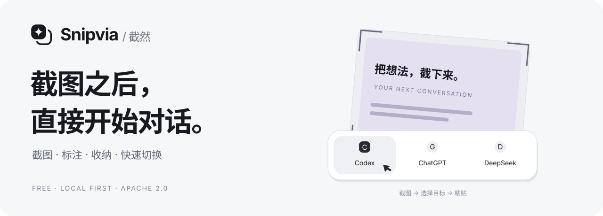
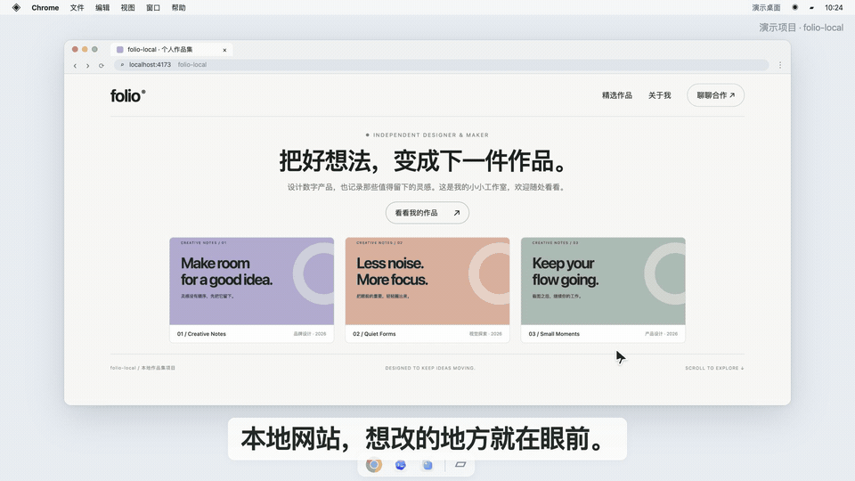
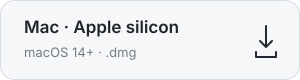
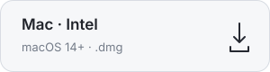
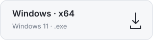
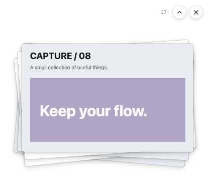
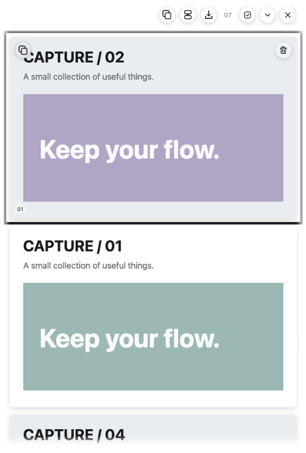
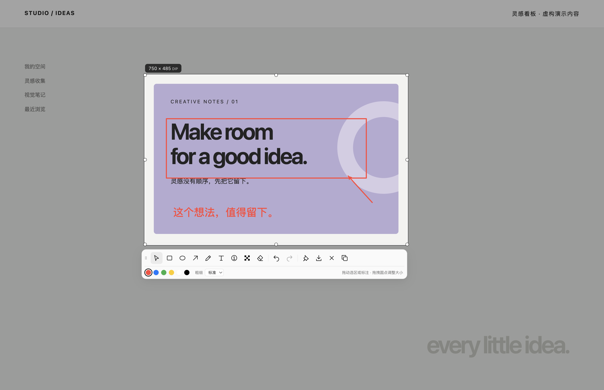
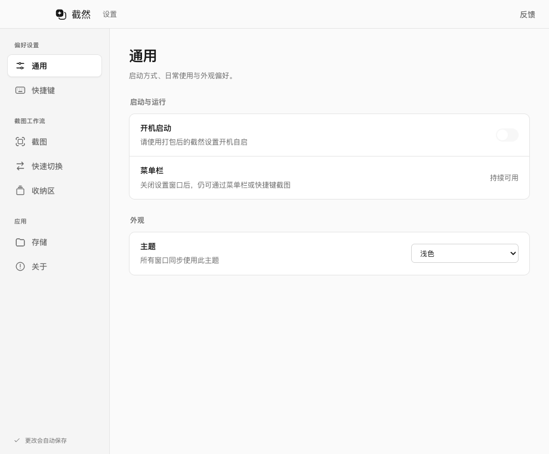

<p align="center">
  
</p>

<p align="center">
  <strong>一张截图，把问题带到正确的对话里。</strong><br />
  免费开源 · 无需登录 · 本地优先 · macOS / Windows
</p>

<p align="center">
  <a href="https://umbraticus.cn/">官网与视频演示</a> ·
  <a href="#下载-snipvia">下载</a> ·
  <a href="#三步开始">快速上手</a> ·
  <a href="#从源码运行">从源码运行</a> ·
  <a href="https://github.com/yuyeyuyy/Snipvia/issues">反馈问题</a>
</p>

## 截完，就去你要的对话

看到一个想改的页面、一段想问的内容，框选下来。截图复制完成后，从屏幕上方的快速切换条选择目标，来到 Codex、聊天应用或网页，再粘贴，说清楚你的想法。

<p align="center">
  
</p>

*网站与 Codex 对话为虚构流程演示，切换条使用真实客户端素材。Snipvia 负责截图、复制与切换；粘贴、发送和代码修改由用户及目标应用完成。[观看完整演示](https://umbraticus.cn/)*

快速切换默认关闭，在「设置 → 快速切换」中添加常用应用或网页后启用。目标与顺序由你决定，最多 8 个；收纳区的单张复制、全部复制和合并复制也能唤起同一条选择条。

macOS 可激活本机应用，并可选匹配 Chrome 已打开的标签。Windows 当前可打开保存的网页地址，本机应用激活与 Chrome 标签定位尚未支持。第三方应用需要自行安装、登录或配置，Snipvia 无需账号或 API Key。

## 下载 Snipvia

当前稳定版：[v1.0.1](https://github.com/yuyeyuyy/Snipvia/releases/tag/v1.0.1)。以下按钮直达 GitHub Release；[官网](https://umbraticus.cn/)提供功能介绍与视频演示：

<p align="center">
  <a href="https://github.com/yuyeyuyy/Snipvia/releases/download/v1.0.1/Snipvia-1.0.1-arm64.dmg"></a>
  <a href="https://github.com/yuyeyuyy/Snipvia/releases/download/v1.0.1/Snipvia-1.0.1-x64.dmg"></a>
  <a href="https://github.com/yuyeyuyy/Snipvia/releases/download/v1.0.1/Snipvia-Setup-1.0.1-x64.exe"></a>
</p>

- **Mac**：macOS 14 及以上，提供 Apple silicon 与 Intel 安装包，已完成 Developer ID 签名和 Apple 公证。
- **Windows**：Windows 11 x64 安装与运行回归通过；安装包尚未签名，检查更新后需手动安装。
- 完整说明与 SHA-256 校验文件见 [Release](https://github.com/yuyeyuyy/Snipvia/releases/tag/v1.0.1) 和[发行验收记录](docs/review/V1_0_1_RELEASE.md)。

## 边截边收，稍后一起处理

连续截图暂存在屏幕右侧。需要时展开成一列浏览，点击单张放大；不用时自动贴边，鼠标移到手柄上即可拉出。

<table>
  <tr>
    <td align="center" width="50%"><strong>收起，不挡住手头的事</strong></td>
    <td align="center" width="50%"><strong>展开，把几张图一起处理</strong></td>
  </tr>
  <tr>
    <td align="center"></td>
    <td align="center"></td>
  </tr>
</table>

- **单张复制**：鼠标移到图片上，复制或删除当前截图。
- **全部复制**：把所有独立原图作为文件复制，方便粘贴到支持多文件的目标。
- **合并复制**：选几张或直接使用全部，纵向拼成一张图。
- **导出与拖出**：导出独立 PNG，或把展开列表里的原图拖到支持文件拖放的文件夹、输入区。
- **按你的习惯来**：宽度、展开高度和自动贴边在设置中调整；按住 Alt 拖动可排序。

收纳区最多暂存 **32 张 / 256 MiB**，退出应用后不保留。重要截图请先导出。多文件粘贴与拖放的接收效果取决于目标应用。

## 圈一下，标一句，再发出去

框选后直接标注。矩形、箭头、文字、序号、马赛克和撤销都在浮动工具栏里；编辑完成可复制、保存或贴在屏幕上作参考。

<p align="center">
  
</p>

贴图支持拖动和缩放，双击即可关闭。截图与标注在本机完成。

## 三步开始

1. **安装并授权**：Mac 将应用放入「应用程序」，首次截图按引导授予屏幕录制权限。
2. **选好快捷键**：在设置中调整截图、编辑和收纳快捷键；已有自定义配置继续保留。
3. **配上常用目标**：开启「快速切换」，添加应用或网页。截图后选择目标，手动粘贴即可。

<details>
<summary><strong>查看默认快捷键</strong></summary>

| macOS | Windows | 动作 |
| --- | --- | --- |
| `Command+1` | `Ctrl+1` | 框选并直接复制 |
| `Command+2` | `Ctrl+2` | 框选并进入编辑器 |
| `Command+3` | `Ctrl+3` | 框选并加入收纳区 |
| `Command+4` | `Ctrl+4` | 隐藏／显示收纳区，保留展开状态 |
| `Command+5` | `Ctrl+5` | 确认后清空收纳区 |

v1.0.1 起的新配置采用上述组合，已有配置和自定义快捷键保留。展开／收起仍通过点击图堆或收纳区顶栏按钮操作；以设置中的实际键位为准。

</details>

Chrome 已有标签定位需要 macOS 自动化权限；可选的消息输入框聚焦还需要辅助功能权限。无法唯一确定输入框时，请手动点击后粘贴。Snipvia 不会自动粘贴或发送消息。

## 设置，按你的习惯摆好

快捷键、主题、截图、收纳和快速切换分开管理。支持浅色、深色与跟随系统，改动自动保存。

<picture>
  <source media="(prefers-color-scheme: dark)" srcset="docs/ui/v2/settings-menu-dark.png" />
  
</picture>

## 数据与权限

- **截图在本机处理**：当前客户端不把屏幕帧或截图上传到 Snipvia 服务，也不调用模型 API。
- **切换由你决定**：没有自动粘贴或发送；粘贴后，目标应用的数据处理遵循其自身规则。
- **本地会有副本**：保存、导出、文件拖放和全部复制可能产生磁盘副本，剪贴板也可能被其他应用读取。收纳区不是加密图库或持久备份。
- **网络用途明确**：GitHub Release 更新检查；开启快速切换后的公开网站图标获取；以及用户主动打开的链接。

详细的缓存、临时文件、Chrome 标签读取和权限边界见[隐私说明](docs/PRIVACY.md)。

## 常见问题

<details>
<summary><strong>需要登录或配置模型 Key 吗？</strong></summary>

不需要。当前 Snipvia 提供截图、编辑、收纳和快速切换，不内置 AI 对话、Agent 或模型调用。Codex、ChatGPT 等目标应用的账号、模型和费用由相应服务管理。

</details>

<details>
<summary><strong>关闭收纳区后，截图还在吗？</strong></summary>

本次运行内，隐藏或收起后仍在；退出或崩溃后不恢复。请先导出重要截图。全部复制产生的文件副本有独立的延迟清理规则，详见[隐私说明](docs/PRIVACY.md#截图和本地输出)。

</details>

<details>
<summary><strong>支持哪些应用和浏览器？</strong></summary>

macOS 可在设置中选择本地应用，例如 Codex、微信或飞书；实际激活受应用状态与系统权限影响。网页可由系统默认浏览器打开；Chrome 已有标签定位目前只在 macOS 提供。其他浏览器的已有标签定位尚未实现。

</details>

<details>
<summary><strong>以前的笔记和历史会被删除吗？</strong></summary>

旧数据保留在原目录，设置中提供旧记录的只读查看、显式导出与截图导入。旧版 AI、日程和模型配置不属于当前功能，兼容读取不会启用这些服务。

</details>

<details>
<summary><strong>性能与平台支持有哪些已知限制？</strong></summary>

macOS 原生 ScreenCaptureKit 路径仍有超时专项未解决，当前保留 Electron 自动回退。Intel 真机、多屏 / 混合 DPI，以及所有第三方多文件粘贴和拖放目标尚未全面验收。当前不支持跨屏框选、长截图或云同步。完整证据见[发行验收记录](docs/review/V1_0_0_RELEASE.md)，不以个别演示代表所有设备性能。

</details>

## 从源码运行

使用 **Node.js 24.15.x** 和 **pnpm 11.1.3**：

```sh
git clone https://github.com/yuyeyuyy/Snipvia.git
cd Snipvia
pnpm install --frozen-lockfile
pnpm electron:install
```

macOS：

```sh
pnpm dev
```

开发启动器使用固定的 `~/Applications/截然 Dev.app` 与独立开发数据目录，首次运行按引导完成权限设置。Windows 使用 `pnpm dev:raw`。原生 Helper、Xcode 和本地打包的要求见[开发说明](docs/DEVELOPMENT.md)。

<details>
<summary><strong>开发检查与代码阅读</strong></summary>

```sh
pnpm lint
pnpm typecheck
pnpm test
pnpm build
pnpm test:smoke
```

- [当前项目结构](docs/PROJECT_STRUCTURE.md) · [架构](docs/TECHNICAL_DESIGN.md)
- [产品范围](docs/PRD.md) · [路线与验收保留项](docs/ROADMAP.md)
- [代码 review 与清理记录](docs/review/CLEANUP_REVIEW.md)
- [截图性能与透明图堆记录](docs/v2/TRANSPARENT_SHELF_REPORT.md)
- [界面规范](docs/UI_DESIGN_LANGUAGE.md) · [验证复用规则](docs/VALIDATION_POLICY.md)

</details>

## 参与和反馈

有想法、遇到 Bug，欢迎提交 [Issue](https://github.com/yuyeyuyy/Snipvia/issues)，或加入 **QQ 群：643251313**。反馈时请附系统、版本和复现步骤，并先去除截图中的隐私内容。

代码与文档贡献请阅读 [CONTRIBUTING.md](CONTRIBUTING.md)；安全问题按 [SECURITY.md](SECURITY.md) 私下报告。

## 许可证与素材

源码采用 [Apache License 2.0](LICENSE)。第三方组件与商标保留各自声明；项目不代表 Codex、OpenAI、DeepSeek 或其他目标应用的官方产品。

[NOTICE](NOTICE) · [第三方声明](THIRD_PARTY_NOTICES.md) · [素材来源](docs/opensource/ASSET_PROVENANCE.md) · [本页展示素材说明](docs/readme/ASSETS.md)
