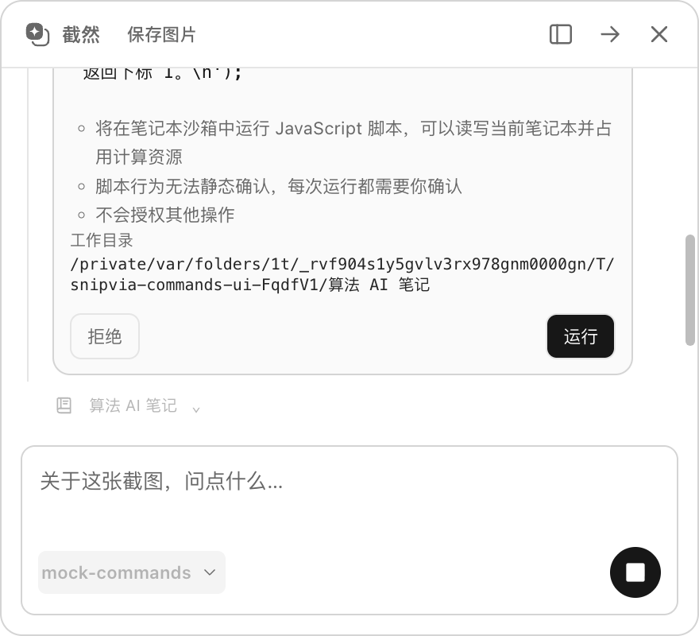
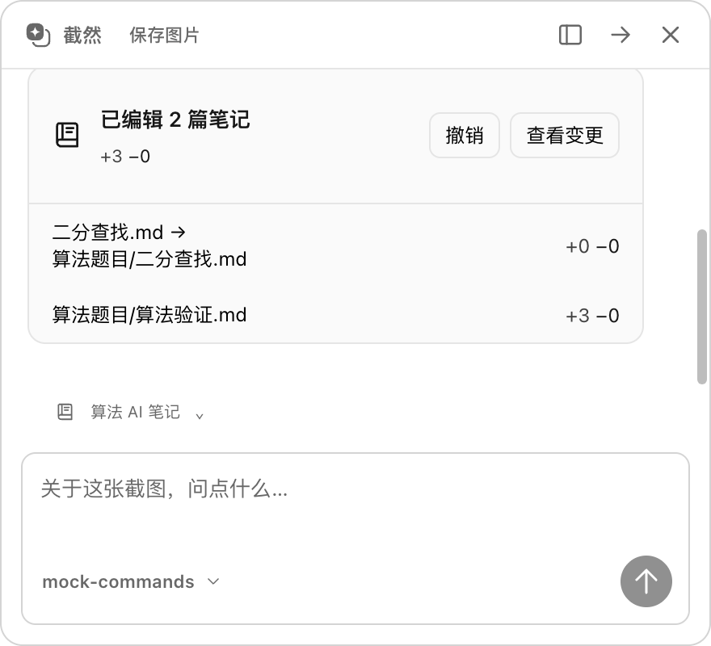
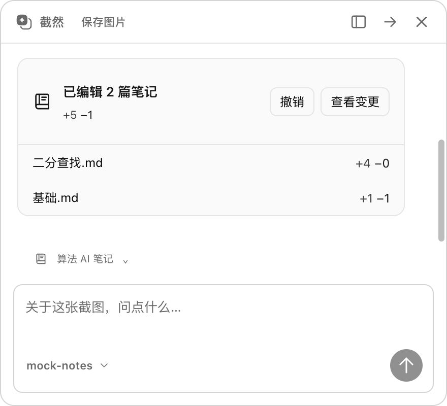
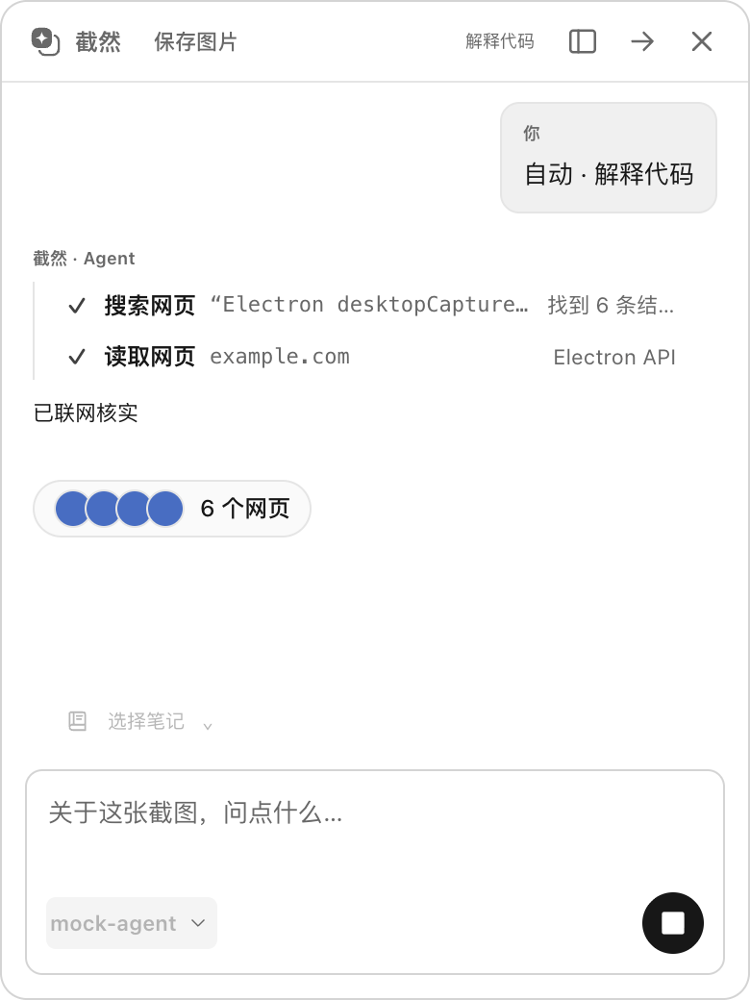

# Agent Execution UI

状态：主聊天与截图悬浮聊天默认启用 Agent 模式，接通真实 Runtime、窄 IPC 和 Chat Completions Tool Calling 适配器。更新：2026-10-06，加入选定笔记本的自动 Markdown 写入、OS 沙箱命令/脚本及实际变更列表。界面沿用原有工作区、白色/浅蓝、半透明浮窗和细圆角设计，没有增加页面骨架。

## 使用方式

1. 在现有「模型与设置」配置支持图片输入和 Tool Calling 的模型；当前适配的是 Chat Completions 兼容接口。
2. AI 截图后先等待用户，输入框自动获得焦点。**空输入按 Enter**：预测分支，再交给 Agent 处理；**输入提示词后按 Enter**：跳过预测，直接按提示词对话。等待和编辑输入时不启动 OCR / 分类 / 模型请求。悬浮对话默认使用 Agent，隐藏模式开关；返回主窗口后仍可手动关闭 Agent 使用普通聊天。续拍仍跳过预测，直接延续上下文；导入图片保持等待用户发送。
3. 需要记录或检索时点击 **选择笔记**（悬浮对话位于输入框外左上方），选择已由系统目录选择器登记的笔记本；没有笔记本时进入创建流程。当前对话绑定与写入能力不在重启后自动恢复。模型选择在输入框内左下角，只显示模型编号。
4. 发送任务。界面参考 OpenCode：底部状态行显示当前动作——「正在思考」「正在联网搜索 关键词」「正在读取 域名」「正在搜索文件 关键词」「正在读取文件 相对路径」「正在编辑 文件名.md」「正在执行命令」「等待你确认：运行脚本」；已完成、失败或等待确认的工具调用逐行进入上方时间线，每行为「状态图标 · 动作 · 目标 · 结果摘要/耗时」。多步任务由模型通过 `todo_write` 维护计划清单并显示在时间线顶部。任务结束后时间线折叠为「已执行 N 个步骤」，可展开查看。Agent 自行判断是否记录，所有写入工具结束后才进入最终回复。回复下方展示实际编辑文件，点击打开笔记或查看差异；未选笔记本或明确要求不记录时不提供写入工具。笔记修改卡片提供按轮「撤销」（见[自动笔记写入](AGENT_NOTE_WRITING_PLAN.md)）。通用文件修改与外部 MCP 执行仍禁用。

选定笔记本后支持真实的 `run_command` / `run_script`。命令和脚本分别显示「正在执行命令」「正在运行 … 脚本」，可以创建目录、移动笔记和测试算法。明确要求只读时，OS 沙箱也禁止修改笔记本；错误或停止后仍显示已发生的实际变更。详见 [命令与脚本](AGENT_COMMANDS.md)。
5. 输入框附近的 **停止**（悬浮对话为蓝色圆形、白色方块图标）取消当前 Runtime、LLM 请求、工具和等待中的确认。已成功提交的修改不会自动撤销；实际笔记修改列表保留真实结果，可手动点「撤销」回滚这一轮。
6. 悬浮对话点击截图下方「返回软件」，执行和待确认请求会移交主窗口，继续在同一上下文中操作。

分支预测在消息区显示为单行「正在预测分支」，随后由同样样式的 Agent 分析、联网状态接续。预测完成后在悬浮对话右上角显示只读分支标签；不再展示置信度栏或分支选择器，也不再暴露 `auto-action:select` IPC。分支启用和编辑仍在设置页管理。续拍沿用上下文，不展示旧的预测标签。

Agent 会把当前选区截图、对话及已执行工具的受限结果发送到所选模型服务。不会上传整张桌面；没有授权目录时，内置文件工具返回授权错误。Web 搜索默认使用 Exa 官方托管的免 Key 搜索；已配置 Brave Key 时优先使用 Brave。网页读取和分块读取无需搜索 Key。搜索服务不可达或限流会明确报错，见 [Web Tools](AGENT_WEB_TOOLS.md)。

回答下方的「N 个网页」胶囊汇总本轮真实检索结果。点击后弹窗显示图标、域名、实际可用的发布日期、标题、摘要及序号；点击条目用系统浏览器打开网页。回答内匹配已获取来源的链接显示为编号，点击定位到列表。历史消息保留来源；旧消息没有来源元数据时保持普通链接。示例图使用合成回答和图标，不代表真实搜索结果：












## 数据流与边界

```text
App / QuickChat → preload.agent.start(captureId, question)
  → Main 验证窗口、主 Frame、当前截图、任务所有权
  → AgentExecutionService → AgentRuntime / AgentLoop
  → ChatCompletionsAgentProvider → LLM
  → ToolRegistry / ToolExecutor / PermissionManager
  → NotebookWriter → 编辑器保存检查 → 原子写入选定笔记本
  → ExecutionPresenter → agent:changed → 所有工具共用单行状态
  → Provider 正文增量 → 推理过滤 → ExecutionPresenter → 40ms 合并推送 → Markdown 回答

permission_request → 拥有控制权的窗口在时间线对应行下方显示行内确认卡片
  → agent:decide(runId, requestId, decision)
  → Main 验证未过期、未取消、所有权和允许的决策
  → PermissionManager → 工具继续

Stop → agent:stop → Runtime AbortController → LLM / Tool / Permission
```

- Renderer 没有 Node、fs、Shell、工具执行器或 workspace capability。文件夹路径只能来自 Main 打开的系统选择器，不接受 Renderer 提交任意授权路径。
- `state`、`workspace`、`start`、`stop`、`decide`、`diff`、`note-open`、`note-diff` 及 `source-icon` 窄 IPC 仅允许主窗口或当前 QuickChat 的主 Frame。Overlay、Pin 和独立审批窗口不能借此启动 Agent。笔记请求只能传 captureId 和已知修改 ID，由 Main 查找实际路径；图标请求必须关联当前截图已知来源，Main 只请求对应 origin 的 favicon，返回有界 PNG data URL。
- 初次空输入分析使用独立 `auto-action:start(captureId)`，只接受当前 QuickChat 或 Pin 的主 Frame，并校验当前置顶截图及 `awaiting_input` 状态。Pin 获得焦点时按 Enter 也能触发同一路径。直接提交提示词、重复 Enter 或迟到调用不会重复启动分类。等待输入且输入框为空时 Ctrl/Cmd+C 可通过受限 `pin:copy` 复制当前截图并关闭。
- run 所有权绑定发起窗口的 `webContents.id`；其他窗口可以显示同一对话的状态，但不能替它审批或停止。移交必须由 Main 的「返回软件」操作完成。
- 快照使用递增 `revision` 和 captureId，忽略迟到事件；重新挂载通过 `state()` 恢复内存中的执行状态与笔记结果。
- 关闭/崩溃/导航销毁任务所属 Renderer 时取消；切换截图、打开其他历史时取消当前任务。删除历史同时撤销会话权限，不让迟到结果重新写回已删除的对话。
- Main 同时只执行一个 UI Agent 任务；普通聊天、自动 Action 和 Agent 不争用同一对话写入。
- Main 的 Registry 使用不可由 Renderer 更改的权限白名单：`workspace:read`、`network:read`、独立的 `notebook:write` 和 `workspace:execute`。笔记与命令工具仅在 Main 创建了当前笔记本能力时出现在模型请求中，执行器同样验证能力，不能通过模型传入 ID 或路径获得权限。通用写工具与 `external:execute` 不开放；已有审批不能绕过。配置好的 MCP Server 启动/连接基础保留，仍需独立审批。

## 状态投影

| UI 状态 | 含义 |
| --- | --- |
| `thinking` | 正在分析任务；只显示固定状态标签 |
| `tool_pending` | 已收到完整工具调用，等待校验、权限或执行 |
| `permission_required` | 正在等待用户确认 |
| `tool_running` | Executor 校验通过后开始执行，只在状态行显示，完成后进入时间线 |
| `tool_success` | 根据真实 ToolResult 接续状态，不保留完成卡片 |
| `tool_error` | 工具失败、拒绝或任务达到限制；不冒充成功 |
| `cancelled` | 用户停止或窗口生命周期取消 |
| `completed` | Runtime 正常返回最终答复 |

`ExecutionPresenter` 只投影 Provider 已过滤的正文增量，不转发半成品参数或 `providerState`。适配器忽略结构化 reasoning 字段，通过 `VisibleTextStream` 增量移除 `<think>` / `<analysis>` 区块（支持跨 SSE 分块、大小写和嵌套标签），未闭合的推理区块不会泄漏。Provider 的 `text_delta` 契约为用户可见正文，后续厂商适配器也必须遵守。

正文在请求完成前即可显示，Main 按 40ms 合并快照，阶段切换和完成状态立即推送。模型尚未结束时无法预知后面是否会调用工具；一旦出现 tool call，本轮暂显正文清空，改为操作状态，同帧或已知工具调用后的附带文字不显示。最终响应仍经 Runtime 完整校验后才作为成功答复保存，工具不会因半成品参数而执行。未提供 SSE 的兼容服务仍整体返回，不伪造逐字动画。

停止、超时或断流会终止增量推送，当前窗口保留已显示的部分正文和停止/错误提示；这些未完成片段不写入成功回答历史。运行中的回答可以随「返回软件」移交主窗口。

进行中的工具只在状态行显示；完成后以一行进入时间线。网页读取只显示域名，网页搜索显示查询，目录、读取和编辑显示目标相对路径，命令显示 `$ 命令`，脚本显示语言。未知工具使用中文动作名，不显示工具英文名。失败行下方用无边框文字给出原因。工具调用轮次中模型附带的文字仍不展示（避免泄露推理内容），时间线只来自 Main 投影的结构化事件。需要批准的请求以非模态卡片嵌在对应行下方：显示完整命令或脚本、原因与工作目录，拒绝在左、运行/允许在右，回车不能批准；不自动接受、不隐去权限控制。

自动笔记写入按真实提交结果更新文件清单，最终答复完成后展示。相同文件在本轮合并并计算净增删行；取消后已经提交的文件仍显示。详情见 [自动笔记写入](AGENT_NOTE_WRITING_PLAN.md)。

## 保留的 Diff、命令结构和内存限制

以下通用 Diff/修改审批是暂时禁用的能力基础。自动笔记 Diff 使用独立 `agent:note-diff`，不触发这些审批或 Undo；单文件最多 512 KiB，总预览最多 4 MiB / 100 条，超过时提示过期。

- Diff 按需通过 `agent:diff` 获取，不随每个状态快照重复发送修改前后全文。弹窗纯文本展示，新增/删除行使用轻量绿/红色；Esc 关闭且不批准修改。
- 单个 diff 最多 512 KiB，每 run 最多 2 MiB，总保留预览最多 4 MiB。超过时显示截断提示或过期提示；完整审批与冲突校验仍由 Main 执行。
- 最多保留 5 个内存会话，每会话 20 个执行记录；工具历史按完整用户回合裁剪至 500 条/2 MiB，再由现有 ContextManager 控制模型预算。
- 用户问题、最终答复或终止说明，以及每条消息最多 60 个来源元数据、8 条笔记修改元数据进入原有本地聊天历史。执行卡片、文件 diff、完整网页、工具上下文和 workspace 授权不持久化；重启后显示消息、来源与文件清单，可打开仍登记有效的笔记，不会重放工具。
- 行内确认卡片展示命令、工作目录与「拒绝/运行」。2026-10-06 已接入独立的 [沙箱命令与脚本](AGENT_COMMANDS.md)，2026-10-07 起脚本与非只读、非整理命令需先确认，状态行展示进度，等待真实退出后回复，并展示 Main 核对的 Markdown 移动、删除和编辑。

## 代码入口

- `src/shared/agent/execution.ts`：可序列化快照与 IPC Schema。
- `src/main/agent/ui/AgentExecutionService.ts`：会话、workspace、所有权、审批、取消及历史保存。
- `src/main/agent/ui/ExecutionPresenter.ts`：白名单状态投影，不转发内部推理。
- `src/main/agent/notes/`：专用笔记工具、范围与提交；`NoteChanges.tsx` 展示实际修改文件。
- `src/main/ai/llm/ChatCompletionsAgentProvider.ts`：独立 Provider，兼容 SSE/JSON，完整响应验证后执行工具，断流不执行半个调用。
- `src/main/ai/llm/VisibleTextStream.ts`：跨块过滤推理标签，逐步提供可见正文。
- `src/main/index.ts`、`src/preload/index.ts`：Main 组合和窄 IPC。
- `src/renderer/src/agent/AgentExecution.tsx`、`useAgentExecution.ts`、`execution.css`：复用组件、订阅、Diff 与输入区控制。
- `src/renderer/src/agent/activity.ts`：状态行文案、真实查询/域名。
- `src/renderer/src/agent/AgentExecution.tsx`：`AgentTimeline`（步骤行、计划清单、完成后折叠）与 `InlinePermission`（行内确认）。
- `src/renderer/src/App.tsx`、`chat/QuickChat.tsx`：两个现有入口。

## 验证及限制

2026-10-06 所有工具统一状态：移除聊天中的工具操作卡片，文件搜索、读取、目录和笔记写入均通过同一状态行接续。模拟模型配合真实临时目录，分别阻塞搜索、读取与写入，验证运行中及回复后没有工具卡片、先写后答和实际文件清单。权限决策与 Main 策略仍保留，必要审批使用弹窗。Lint、TypeScript、构建与 705 项单元测试通过；完整 Electron 回归 17 项通过、10 项条件测试跳过。

2026-10-06 命令接入验证：20 项新增原生沙箱用例通过；完整单元测试 726 项通过，完整 Electron 回归 18 项通过、10 项条件测试跳过。合成截图、临时算法笔记和模拟模型验证真实目录移动、Electron 内置 Node、单行命令/脚本状态、先执行再答、普通子进程停止、差异/打开与历史保存。另有 1 项临时安装包命令检查通过；首次无会话的系统密钥库初始化已调整，并复测账号登录/恢复与命令交互。Lint、TypeScript 与构建通过。未执行 Windows 命令或 Linux 真机测试。

单元测试覆盖状态投影、内部推理过滤、真实文件预览/拒绝/批准、窗口所有权、停止传递、移交、历史删除、SSE 工具调用组装、断流、响应上限和 Provider 格式映射。Electron 测试使用临时存储、临时文件、合成截图及本机模拟 SSE 服务，验证两个聊天入口及原有权限边界；不读取真实桌面或私人文件。

2026-09-27 默认只读联网接入验证记录（macOS / Apple 芯片）：

| 检查 | 结果 |
| --- | --- |
| `pnpm lint` | 通过 |
| `pnpm typecheck` | 通过 |
| `pnpm test` | 33 个测试文件、511 项通过；本次新增只读策略、搜索适配和 Fake-IP 验证 |
| `pnpm build` | 通过 |
| `agent-execution.spec.ts` | 通过；预测先于 Agent、默认模式、只读工具列表、搜索/读取网页、取消与返回软件 |
| `agent-file-approval.spec.ts` | 通过；获得真实 workspace 授权后仍禁止写入、编辑及 Undo，读取继续可用 |
| `desktop.spec.ts` | 通过；原有设置、普通聊天、截图及取消流程 |

执行了以上三项定向 Electron 冒烟测试，没有执行完整性能压测或真实桌面多轮截图。

### 单行联网状态与流式回答验证（2026-09-27）

- `pnpm lint`、`pnpm typecheck`、`pnpm build` 通过；`pnpm test` 共 34 个文件、519 项通过。
- 定向 Electron 测试 `agent-execution.spec.ts` 通过（4.8 秒）。使用合成截图、临时存储和受控 SSE，逐阶段暂停搜索、网页读取及最终正文，确认状态替换、无联网卡片、完成前可见正文、推理过滤及 Markdown 来源链接。
- 回答流式输出时从 QuickChat 返回主窗口，部分回答和任务所有权保持；点击停止后 HTTP 连接关闭，界面取消流式标记。单元测试另验证迟到增量不会重新出现。
- 沙箱内首次启动 Electron 超时，获准在 macOS GUI 运行后通过；未进行真实桌面多轮截图或真实模型账号测试。界面截图见上文及 [主窗口流式状态](ui/agent-streaming-main.png)。

### 分支预测状态整合验证（2026-09-27）

- `pnpm lint`、`pnpm typecheck`、`pnpm build` 通过；单独运行 `pnpm test`，34 个文件、519 项通过。首次与构建并行时，两个既有 MCP 测试在 150ms 握手准备阶段超时；未更改超时或断言，结束构建后完整重跑通过。
- `agent-execution.spec.ts` 与 `desktop.spec.ts` 两项 Electron 回归通过（共 23.3 秒），覆盖单行预测、右上角标签、分支选择器及 API 移除、后续搜索和流式回答、日程自动分流、续拍跳过预测。
- 已检查窄悬浮窗口截图：预测不再同时出现顶部状态栏与空状态；右上角标签不影响模型选择。截图、模型和网络内容均为合成测试数据。

首个适配器复用当前配置的兼容端点，继承 Runtime 的取消、超时、20 步和上下文预算；图片额外预留 4096 token，属于保守估算，并非模型专用 tokenizer。不同厂商对 vision + tool calling 的支持需要用实际模型验证。Anthropic/Gemini 原生协议、真实外部 MCP 账号及 Windows GUI 尚未在本阶段验证。

### 截图后等待提交验证（2026-09-27）

- `pnpm lint`、`pnpm build`（包含 typecheck）通过；`pnpm test --maxWorkers=1` 共 34 个文件、519 项通过。
- `agent-execution.spec.ts` 通过（4.3 秒）：截图后无 OCR / 分类 / Agent 请求；输入法确认和 Shift+Enter 不提交；空 Enter 启动预测，重复启动只执行一次；提示词直接进入 Agent，迟到的预测启动被忽略。继续验证了联网状态、流式输出、停止与返回主窗口。
- `desktop.spec.ts` 通过（10.7 秒）：输入框聚焦时复制截图并关闭、置顶截图 Enter、日程分流、普通聊天及续拍。复用置顶窗口时清除上一张截图的按钮焦点，避免 Enter 误触“返回软件”。
- 测试使用临时存储、合成截图和本机模拟服务；本次未进行真实桌面截图压测或真实模型账号测试。等待输入界面见 [截图](ui/agent-awaiting-input.png)。
- 高负载下既有 MCP 测试曾在连接准备阶段超时；测试现将子进程启动期限与请求期限分开，握手超时及请求超时仍分别按 150ms 验证，没有调整产品的超时配置。

### 悬浮对话精简布局验证（2026-09-27）

- 顶部仅显示预测后的只读分支；工作区位于输入框外左上方，模型编号位于框内左下角；发送/停止共用蓝色圆形按钮，聚焦边线使用中性黑色。
- `pnpm lint`、`pnpm build`（含 typecheck）、`pnpm test --maxWorkers=1` 通过，34 个测试文件、519 项单元测试。
- 两项定向 Electron 回归 `agent-execution.spec.ts`、`desktop.spec.ts` 通过（共 14.3 秒）。验证空输入和提示词两条路径、输入区布局、无 Agent 开关、模型编号、圆形停止控件、流式输出、停止移交以及普通聊天 IPC；未执行真实桌面截图压测。
- 已查看默认 390×520 和最小 340×360 窗口的合成截图：工作区、模型与发送按钮均可见，没有蓝色输入描边。示例见 [等待输入](ui/agent-awaiting-input.png)、[最小窗口](ui/agent-awaiting-input-compact.png) 和 [流式回答与停止按钮](ui/agent-streaming-quick.png)。
