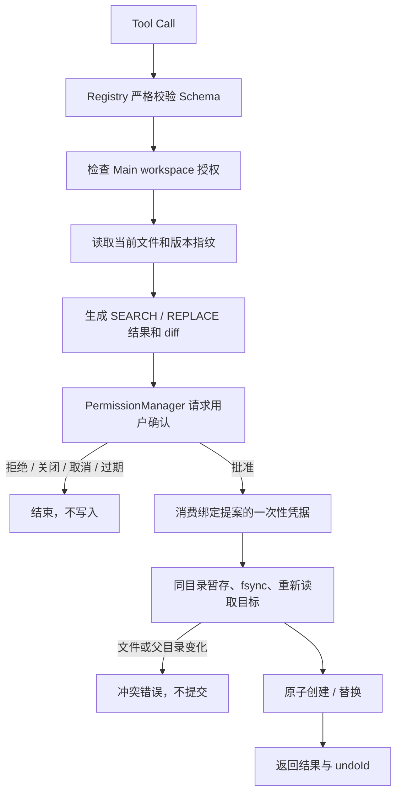

# Agent 文件修改：预览、审批、提交与 Undo

> 当前产品策略（2026-10-06）：Agent 可读取文件、联网，并通过独立的 notebook:write 能力自动整理选定笔记本中的 Markdown，见[自动笔记写入](AGENT_NOTE_WRITING_PLAN.md)。通用文件写入、编辑、Undo 与 external:execute 的 MCP 调用仍禁用，在 Main Registry/Executor 双重限制，不能用已有审批绕过。下文说明通用工具与底层能力。

状态：`write_file`、`edit_file`、独立 diff 审批窗口与 Undo 基础结构已实现。[Agent Loop](AGENT_RUNTIME.md) 已复用此审批链路；[Agent Execution UI](AGENT_EXECUTION_UI.md) 已提供兼容接口 Tool Calling、workspace 选择和聊天内联审批。日期：2026-09-27。

## 调用流程



所有工具由 `ToolRegistry` 注册。只读工具保留原来的 `execute()`；写入工具使用 `FileMutationToolDefinition.prepare()`，只输出数据形式的修改意图，不接触 UI、LLM 或可写文件句柄。`ToolExecutor` 驱动预览、审批、提交和取消。

没有审批服务时返回 `APPROVAL_REQUIRED`，不会直接写入。默认每项修改都单独确认；用户可明确选择本次会话或始终允许完全相同的操作。文件内容改变后重新确认，高风险删除不允许永久授权。详见 [统一权限系统](AGENT_PERMISSIONS.md)。

## 工具输入

完整创建/替换使用 `write_file`：

```json
{
  "id": "run_1_write_1",
  "name": "write_file",
  "input": {
    "path": "notes/summary.md",
    "content": "# 摘要\n\n今天的会议记录。\n"
  }
}
```

父目录必须已存在。不会隐式创建目录；目标存在时完整替换也必须展示旧内容与 diff。

局部修改使用顺序应用的 SEARCH / REPLACE：

```json
{
  "id": "run_1_edit_1",
  "name": "edit_file",
  "input": {
    "path": "src/example.ts",
    "edits": [
      { "search": "const timeout = 1000;", "replace": "const timeout = 3000;" },
      { "search": "console.log(debug);\n", "replace": "" }
    ]
  }
}
```

- SEARCH 必须非空，且在当时的内存文本中恰好匹配一次，包括空白。重叠匹配也算多处匹配。
- 匹配不到返回 `NO_MATCH`；匹配多处返回 `AMBIGUOUS_MATCH`，应要求模型重新读取并提供更多上下文。
- 最多 32 个编辑块；任一块失败则整项提案失败，不发生部分写入。
- 输出是标准 unified diff 形式的预览。为了避免大文件上的二次方 LCS 开销，当前使用线性扫描公共前后缀，一个 hunk 跨越变化区，不承诺最小 diff。真正提交的是 Main 已计算并经批准的结果，不再执行 Renderer 传回的 patch。

## 权限和 UI

`FileChangeService` 把修改前后文本、内容 SHA-256、目标相对路径、workspace ID、tool call ID 和操作类型封装成不可修改提案。`PermissionManager` 生成独立确认 ID，批准结果绑定完整提案摘要；凭据只能使用一次，不能拿一份确认批准另一个文件或另一份内容。

Main 的 `agentFileTools` 组合实例已经配置真实审批窗口。窗口使用 sandbox、contextIsolation 和关闭 Node integration 的 WebPreferences，沿用设置页面的权限分组语言，并嵌入工作区式 diff 预览。用户可在差异和前后全文间切换。文件以纯文本展示，不运行 HTML/Markdown。

Preload 仅提供：

- `agentPermissions.current()`：读取当前审批窗口的提案。
- `agentPermissions.decide(requestId, decision)`：回复一次、会话、持久允许或拒绝；Main 再次检查允许的选项。
- `agentPermissions.onRequest()`：订阅窗口专属请求事件；`clearRemembered()` 清除已记住授权。

IPC handler 绑定到审批窗口自己的 `webContents.ipc`，并检查主 Frame；主窗口、其他审批窗口和子 Frame 均不能代为批准。没有通用的 Renderer 文件写入、工具执行或任意路径授权 IPC。

默认文件准备/提交超时为 10 秒；人工确认单独最多等待 5 分钟，不占用文件处理预算。关闭窗口、页面加载失败、Renderer 崩溃、取消或授权撤销均拒绝继续。进入最终不可取消的原子系统调用后，执行器等待真实结果，避免“已写入却报告取消”的错误。

## 文件保护与并发语义

- 继续使用原有 workspace 相对路径、canonical path、根目录身份与符号链接检查。写入还拒绝多硬链接目标，避免破坏链接语义。
- 修改前读取当前 UTF-8 文件；保存 SHA-256、设备、inode、mtime、大小、mode 和父目录身份。预览不写暂存文件。
- 批准后，使用同目录随机名称、`wx` 排他创建暂存文件，写入完整字节、保留原普通权限位，并执行 `fsync`。新文件采用 `0600`。
- 暂存完成后再次读取目标，比较内容和文件身份；同一路径的本应用并发提交只允许一个进入。文件在预览期间被编辑、同内容替换、删除或新建都会导致冲突。
- 新文件通过 `link(temp, target)` 原子无覆盖创建，即使目标在最后一刻出现也返回冲突。已有文件使用同目录 `rename` 原子替换，读取者不会看到部分文本。
- 磁盘满、目录只读、权限不足或提交失败均返回明确错误，失败时清理本次暂存文件。提交成功后的清理失败不被谎报为未写入；只清理仍具有本次暂存 inode 的文件。

边界需要区分：这是应用层乐观并发检查。Node 的普通文件 API 不提供跨平台的“内容比较与 rename”单个原子操作；已有文件在最后一次校验与 rename 之间仍有极小竞态窗口，无法保证抵抗不配合的外部进程恰在该窗口写入。不要将本实现描述为 OS 级 CAS 或沙箱。若产品要求零竞态保证，需要专门的平台协作协议或受控文件服务。当前测试验证的是审批期间、暂存期间以及本应用并发提案的冲突拒绝。

原子替换保留文本字节和普通 mode，不承诺保留 ACL、扩展属性、所有权或原 inode。暂存文件已 fsync，但不承诺突然断电后的目录项持久性。

## 编码、换行与上限

- 文件修改与预览最多 256 KiB，包含 BOM；只接受有效 UTF-8 文本，拒绝二进制或无效代理字符。
- 保留已有 UTF-8 BOM 和 CRLF/LF 风格。SEARCH/REPLACE 可以传 LF，执行时转换为目标文件风格。
- 混合换行或单独 CR 返回 `MIXED_NEWLINES` / `INVALID_INPUT`，不静默重排文件。
- 不强制追加末尾换行；保留编辑结果指定的结尾。diff 标明没有末尾换行的行。

## Undo 基础结构

每次成功提交返回 `undoId`。Main 可调用：

```ts
await agentFileTools.executor.undo(undoId, {
  workspace: authorizedWorkspace,
  signal: abortController.signal
});
```

Undo 再次生成 diff、请求确认并复核当前版本。修改过的文件恢复为原始 UTF-8/BOM/换行字节；撤销新建会预览并确认删除该文件。若文件之后已被编辑，返回 `FILE_CONFLICT`，不覆盖用户后续工作。不同 workspace 凭据不能共享 Undo 记录。

当前最多保留最近 20 项内存快照，应用退出或清理时失效；尚无跨重启持久化、崩溃恢复或聊天中的 Undo 按钮。Undo 成功也生成新的记录，原记录失效。

## 文件入口与验证

- 类型/注册：`types/tool.ts`、`ToolRegistry.ts`、`registerFileTools.ts`。
- 写工具：`tools/file/writeFile.ts`、`tools/file/editFile.ts`。
- 提案/审批/执行：`FileChangeService.ts`、`PermissionManager.ts`、`ToolExecutor.ts`、`WorkspaceService.ts`。
- Patch/diff：`fileChanges/textPatch.ts`。
- 组合与窗口：`createFileToolSystem.ts`、`approval/createPermissionPrompt.ts`、Main 的 `agentFileTools`。
- Renderer/IPC：`src/shared/agent-file-change.ts`、`AgentPermissionPanel.tsx`、`file-approval.css`、preload。
- 单元测试：`tests/unit/agent-file-changes.test.ts`；覆盖匹配、审批绑定、失败清理、编码、并发、取消与 Undo。
- Electron 测试：`tests/integration/agent-file-approval.spec.ts`；合成文件验证 diff、批准/拒绝与跨窗口审批拒绝，截图见 [审批窗口](ui/agent-file-approval.png)。

验证命令：`pnpm lint`、`pnpm typecheck`、`pnpm test`、`pnpm build`，以及 `pnpm exec playwright test tests/integration/agent-file-approval.spec.ts`。Windows 上的 rename/link 与权限行为尚待真机验证。
