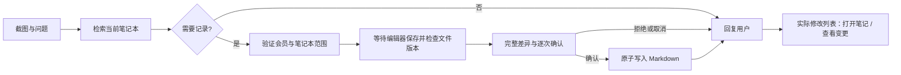

# Agent 整理与确认写入笔记

更新：2026-10-14。关联：[AI 笔记](AI_NOTES.md)、[执行界面](AGENT_EXECUTION_UI.md)、[算法学习用例](ALGORITHM_NOTE_SCENARIOS.md)、[AI 工作区 Phase 3](AI_CHAT_WORKSPACE_PHASE3.md)。

## 当前流程

选择或通过预测分支绑定笔记本后，Agent 自行判断本次内容是否值得记录。适合复习的概念、算法步骤、错误原因和代码解释可以创建、追加或局部修改 Markdown；寒暄、临时状态和没有可靠知识点的回答不强制写入。



2026-10-14 的 Phase 3 将专用笔记工具统一为「生成修改 → 完整预览 → 每次确认 → 保存」。既有截图浮窗的 `write_note` / `edit_note` 不再自动保存，每次只能允许一次，已有会话或持久授权不能跳过确认。主窗口 AI 对话使用独立的结构化提案工具，模型没有直接写入或执行命令权限。既有截图 Agent 的 [沙箱命令与脚本](AGENT_COMMANDS.md) 保留原有独立权限规则；通用文件工具与外部 MCP 执行仍禁用，命令不能退出笔记本沙箱。

## 使用方法

1. 创建或打开本地笔记本，再通过对话中的「选择笔记」或预测分支绑定指定笔记本。
2. 截图后提问，或空输入 Enter 执行已配置分支。Agent 模式负责工具调用，普通聊天不提供写入工具。
3. 模型使用目录和少量相关笔记判断新建或补充；只读取所需内容。
4. 目录操作只显示「正在查看目录…」状态，不留下独立卡片。
5. 写入时显示「正在编辑 文件名.md」，先查看完整差异，再允许本次修改。拒绝、取消或过期时不写入；本轮操作结束后模型才进入最终回复。
6. 回复结束后显示实际编辑的笔记数量、净增删行和文件列表。点击文件进入 AI 笔记；点击「查看变更」查看本次差异。
7. 不希望记录时明确输入「不要写入笔记」或「仅聊天」；这些明确表达会使本轮不提供笔记写入工具。

没有选择笔记本时，模型不获得写入工具，可正常回答并提示选择笔记。选择笔记本只提供可记录范围，模型并不会因为选择操作就强制生成文件。

## 工具与边界

| 工具 | 行为 |
| --- | --- |
| `write_note`，mode=create | 在已有目录中创建新 Markdown；目标存在时拒绝覆盖 |
| `write_note`，mode=append | 向已有 Markdown 追加内容，保持原有换行 |
| `edit_note` | 通过唯一匹配 SEARCH/REPLACE 更新已有段落，保留其他内容 |

- 工具参数只有相对路径与内容，不接受模型指定笔记本 ID、绝对目录或能力对象。
- 只允许当前笔记本中的 `.md`；隐藏目录、根 `assets/`、路径穿越、符号链接、硬链接及受保护目录被拒绝。
- `write_note` / `edit_note` 使用已有父目录，不直接创建、移动或删除目录；需要这些操作时使用独立的沙箱命令。图片附件自动写入尚未提供。
- 专用笔记工具单篇修改最多 256 KiB，一轮最多编辑 8 篇、提交 16 次。命令整理采用独立的目录/进程上限，变更清单最多 100 篇，详见命令文档。
- 写入前等待主窗口编辑器保存；未保存冲突或超时会阻止提交。
- 提交前重新核对内容、文件身份与父目录；外部变更产生冲突，不能覆盖新版本。
- 新文件采用无覆盖的原子提交，已有文件采用同目录原子替换，保留 UTF-8/BOM、换行与文件权限。
- 相同任务内重复调用不会重复追加；文件后来改变时拒绝以旧结果冒充当前内容。
- 会员、对话、笔记本及运行范围由 Main 验证；取消或范围撤销后不发起新提交。
- 提交前取消不写文件；提交已完成后取消会保留实际结果并显示修改列表，不声称已回滚。

这些保护不能为多个外部编辑器提供跨应用事务。若磁盘或权限发生变化，模型应停止并解释失败。

## 回复与修改展示

写入工具结果返回少量实际元数据，完整 Diff 保存在 Main 的有界内存中。最终答复根据真实结果生成；界面文件清单不从模型回复中提取，防止把「打算修改」显示成「已经修改」。

同一文件在本轮多次变更合并为一行，统计第一次版本与最终版本的净差异。操作被取消或模型回复失败，但文件已经提交时，界面仍显示已发生的变更。

修改元数据跟随对话存入本地历史；应用重启后仍可打开登记有效的笔记。Diff 预览有界且只在当前运行期间保留，过期时提示打开笔记查看当前文件。移除笔记本链接后不能通过旧记录访问该目录。

**撤销**（2026-10-07）：每轮结束（包括停止或失败）时，Main 把本轮改动的每篇笔记修改前后的完整内容存为检查点（`agent/notes/NoteCheckpoints.ts`，位于 `userData/agent-checkpoints/`）。「已编辑笔记」卡片提供「撤销」，二次确认后整轮回滚：编辑恢复原文、新建删除、移动移回原处、删除的笔记恢复。撤销前先保存编辑器草稿，再逐个核对每篇笔记当前内容与本轮结束时完全一致；任一篇之后被手动或被更晚一轮修改，整轮都不撤销，需先撤销更晚的修改。命令捕获的超过 256 KiB 或非 UTF-8 的笔记内容未知，该轮不能自动撤销。撤销不删除命令新建的空目录。检查点同时持久保存差异，重启后「查看变更」仍可用；删除对话时一并删除。图片附件自动写入尚未实现。主题目录可通过命令创建，命令引起的移动和删除由 Main 核对并展示；之后再由其他程序移动、删除或取消链接时，打开可能失败并提示重新检查。

## 代码入口

| 层级 | 文件 |
| --- | --- |
| 专用能力、提交与净差异 | `src/main/agent/notes/NotebookWriter.ts` |
| 工具 Schema 与描述 | `src/main/agent/notes/registerNotebookTools.ts` |
| 权限类别、执行器与原子文件操作 | `ToolRegistry.ts`、`ToolExecutor.ts`、`WorkspaceService.ts` |
| 运行绑定、条件判断与工具反馈 | `AgentExecutionService.ts`、`AgentLoop.ts` |
| 实际修改投影 | `ExecutionPresenter.ts`、`src/shared/agent/note-writing.ts` |
| 单行状态与编辑结果 | `src/renderer/src/agent/activity.ts`、`NoteChanges.tsx` |
| 打开到笔记编辑器 | Main / Preload 的固定 IPC、`App.tsx`、`NotesPanel.tsx` |
| 历史元数据 | `src/main/storage/history.ts`、`src/shared/contracts.ts` |

## 验收

单元用例涵盖实际创建、追加、精确编辑、净差异、重放、BOM/CRLF、路径限制、伪造 / 结束 / 撤销能力、软硬链接、并发冲突、取消与真实提交结果，以及没有笔记范围时不提供写入工具。投影与历史测试验证只展示已提交的元数据，不携带文件正文、不能用未知修改 ID 打开文件，并可在重新加载历史后恢复清单。

Electron 验收使用临时算法笔记、合成截图和模拟模型：控制目录与写入进度，检查隐藏卡片、先写后答、编辑器中本地修改得到保存与保留、文件清单、差异、点击定位、历史恢复、明确不记录以及提交后取消。


```sh
pnpm lint
pnpm typecheck
pnpm exec vitest run tests/unit/agent-note-writing.test.ts
pnpm build
pnpm exec playwright test tests/integration/agent-note-writing.spec.ts
```

2026-10-06 验证：`pnpm lint`、TypeScript 检查与 `pnpm build` 通过；46 个单元测试文件、697 项通过；完整桌面回归 15 项通过，10 项需要真机或打包环境的条件测试跳过。新增笔记流程使用模拟模型，实际内容保存在临时目录，不使用私人截图或正式笔记本。

真实模型是否恰当地提炼与归档需要人工用实际学习材料验收，见[算法用例](ALGORITHM_NOTE_SCENARIOS.md)。自动化不能代替内容准确性检查。
