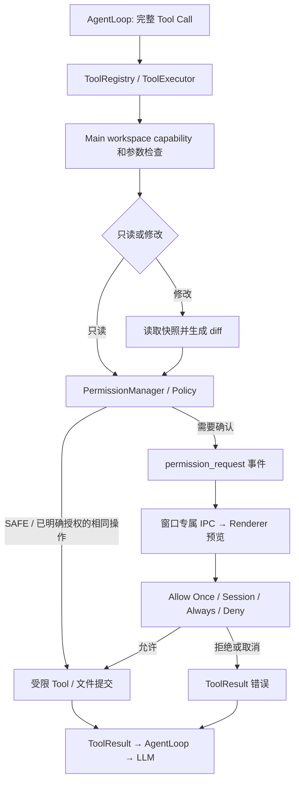

# Agent 权限系统

> 当前产品策略（2026-10-07）：Agent 可读取文件、联网，通过 notebook:write 自动整理选定笔记本的 Markdown，这三类不需要确认。通过 workspace:execute 在当前笔记本 OS 沙箱执行[命令与脚本](AGENT_COMMANDS.md)：只读与笔记本内整理命令直接执行，运行脚本、修改环境变量或系统设置等其他命令必须由用户确认。通用文件工具、Undo 与 external:execute 的 MCP 调用仍禁用，不能用已有审批绕过。下文说明通用工具与底层能力。

状态：统一风险策略、四种决策、权限事件、审批 IPC / UI、会话授权、持久授权和命令结构分析已实现。日期：2026-09-26。

已接入现有五个文件工具及 AgentLoop。现有截图聊天默认启用 [Agent 模式](AGENT_EXECUTION_UI.md)，使用独立 Chat Completions Tool Calling 适配器，通用写入审批作为底层能力保留。2026-10-06 接入 [沙箱命令与脚本](AGENT_COMMANDS.md)，采用独立 `workspace:execute` 与 Main 笔记本能力，在 OS 隔离的范围内执行。2026-10-07 起命令也进入 PermissionManager：字面只读或笔记本内整理命令为 SAFE 直接执行，脚本及其他命令为 DANGEROUS，需在对话时间线中确认（见[审批规则](AGENT_COMMANDS.md#审批规则)）；这不是把下面的字面命令分析结果当作任意 shell 的执行许可。独立 `delete_file`、`mkdir`、`move_file` 工具仍未提供，笔记整理可通过沙箱命令完成。[Web Tools](AGENT_WEB_TOOLS.md) 使用 SAFE 和独立 network:read 能力。[MCP](AGENT_MCP.md) 仍通过 external:execute 进入 DANGEROUS 审批，当前产品禁止外部工具执行。

## 模块与边界



- `PermissionManager` 不导入 Electron、React 或 LLM。可信 Main 注入 `PermissionPrompt` 和存储接口。
- `PermissionPolicy` 把工具能力与操作风险分开。原来的 `workspace:read/write` 是文件能力边界；`SAFE/REVIEW/DANGEROUS` 是审批策略。
- `ToolExecutor` 统一进入权限检查。写入继续使用不带副作用的提案接口，由 `FileChangeService` 生成预览，再消费绑定完整提案的一次性凭据。
- `AgentLoop` 转发 `permission_request` / `permission_resolved`，保留 runId、step、sequence 和 toolCallId。事件订阅者只能观察，不能通过修改事件获得执行权限。
- 文件工具只接触 workspace facade，不调用 UI 或 LLM。Renderer 不获得 fs、shell、workspace 授权或工具执行 IPC。

## 通用审批路径的风险级别

下面的分级保留用于通用文件工具与未隔离执行的策略分析。选定笔记本的 `workspace:execute` 不从此表取得 shell 权限；它使用上文的专用 Main 能力与强制 OS 沙箱。

| 级别 | 操作 | 默认行为 |
| --- | --- | --- |
| SAFE | read_file、list_directory、search_files、web_search、fetch_url | 已有明确 workspace 授权的文件访问不另弹窗；路径检查仍执行 |
| REVIEW | write_file、edit_file、mkdir、move_file、恢复已有文件的 Undo | 提供预览并等待决策，或匹配用户此前明确允许的同一操作 |
| DANGEROUS | run_command、delete_file、撤销新建而删除文件、未知工具 | 要求确认；禁止永久授权 |
| DANGEROUS 且硬拒绝 | 路径越界、动态命令语法、当前执行契约不支持的命令链等 | 不弹允许按钮；先更换为明确授权的工作区或结构化操作 |

Workspace 外文件不会因为用户批准一个工具请求而开放。必须由可信 Main 在用户明确选择另一个目录后，建立新的 `WorkspaceGrant`。符号链接、根目录被替换和权限存储目录也不能通过授权选项绕过。

可信 Main 注册的其他只读扩展可沿用 `WorkspaceAccess` 只读能力。插件代码的安装和可信度验证属于后续工作。Web Tools 已执行独立 SSRF / 私网地址策略；风险标签不能替代执行层安全措施。

## 四种决策与授权范围

| 决策 | 含义 |
| --- | --- |
| Allow Once / 允许一次 | 仅本次调用；文件凭据单次消费且绑定完整 diff 提案 |
| Allow This Session / 本次会话允许 | 同一个 Main 创建的 `PermissionSession` 中，同 workspace grant、工具、参数或相同文件变更；结束会话即失效 |
| Always Allow / 始终允许此操作 | 仅 REVIEW、配置了持久存储时可选；跨重启记住同一工作区身份和同一操作 |
| Deny / 拒绝 | 当前调用返回 `APPROVAL_DENIED`，不提交文件；结果返回模型供其解释或调整任务 |

文件授权绑定工具名、真实工作区路径及目录 dev/ino 身份、相对文件路径、操作类型、修改前后内容哈希及 BOM。不会把“编辑这个文件一次”扩展成“以后任意编辑整个目录”。文件内容变化、不同工具、不同路径、目录身份改变时重新确认。每次仍重新生成快照/diff 并执行提交前冲突检查。通用操作按规范化完整 JSON 参数匹配，不使用命令前缀或工具名通配符。

高风险请求在 UI、窗口 IPC 和 Main PermissionManager 三层拒绝 `always_allow`，已有磁盘授权也不会使高风险操作自动通过。会话授权同样只匹配完全相同的操作。

会话是不可通过 JSON 伪造的对象能力；普通 session ID 无效。默认一个 Agent run 对应一个权限会话，finally 中结束。可信 Main 可以为同一对话保留一个 capability，跨 run 复用：

```ts
const permissionSession = agentFileTools.permissions.createSession();
const handle = runtime.start({ message, workspace, history, permissionSession });
// 对话关闭时；同时取消仍在运行的 Agent run。
handle.cancel();
agentFileTools.permissions.endSession(permissionSession);
```

不同对话不得共享 capability。会话、工作区、调用的取消信号都传给 Executor；取消等待不会导致随后到达的确认生效。

## IPC 与确认界面

`src/main/agent/approval/createPermissionPrompt.ts` 为每个请求创建受隔离窗口，沿用设置页面语言：名称/说明在左，当前工具、风险和目标在右；文件任务嵌入 diff / 前后比较。

Preload 仅暴露 `agentPermissions`：

- `onRequest(callback)`：接收 `agent:permission:request`，返回取消订阅函数。
- `current()`：加载窗口自己的请求快照，弥补 Renderer 尚未监听时的事件丢失。
- `decide(requestId, decision)`：严格 Schema、请求 ID、允许决策、过期、取消和单次消费检查。
- `clearRemembered()`：清除已记住授权并使当前请求需要重新确认；不能添加或修改授权。

Handlers 绑定 `webContents.ipc`，再次验证 sender 与 main frame。主窗口、别的审批窗口和子 frame 均不能批准。关闭、加载失败、崩溃视为拒绝；禁止导航和打开新窗口。模型、文件原文和参数只作为纯文本显示。

审批默认最多 5 分钟；读取授权文件最多 10 秒。用户等待不占用文件工具 10 秒预算。高风险没有“始终允许”选项；拒绝按钮默认焦点。清除记住的权限也使旧的会话授权条目和未消费审批凭据失效。

## CommandRiskAnalyzer

`permissions/CommandRiskAnalyzer.ts` 实现有界 tokenizer 和结构解析：

1. 解析字面词、单/双引号、转义、管道、命令链、重定向。
2. 不执行命令，不调用 shell，不做变量/命令替换；词法或结构不确定时拒绝。
3. 单条命令按 executable 与完整参数判断；例如 `git status` 和 `git -c …` 不被当成同一种操作。
4. 规则输出风险、理由、blocked，以及单条字面命令的 argv。扩展规则只能提高风险或阻止执行。

| 命令 | 命令自身风险 | 说明 |
| --- | --- | --- |
| `pwd`、受限参数的 `ls`、`git status` | SAFE | 只读意图；仍须执行层验证 executable、cwd 和外部 helper |
| `pnpm install`、`git commit` | REVIEW | 会修改项目，可能执行生命周期脚本或 hooks |
| `rm -rf`、`sudo`、`chmod`、`kill`、解释器及未知命令 | DANGEROUS | 不提供永久授权 |
| `curl … \| sh` | DANGEROUS、blocked | 结构识别下载并交给解释器执行；当前不支持执行管道 |
| `$()`、反引号、变量展开、环境赋值、子 shell、后台任务、here-document、glob | DANGEROUS、blocked | 不猜测其实际执行内容 |

命令整体最多 8192 字符、256 token、32 个子命令。引号内的 `;`、`|` 等保留为字面参数，不用 contains 误判为多个命令。所有管道、命令链和重定向在本期仅分析，不产出可执行计划。

**命令意图 SAFE 不等于进程权限 SAFE。** 保留的 PermissionPolicy 对未经沙箱的 `run_command` 名称始终判为 DANGEROUS，避免本机 PATH、Git 配置或依赖 hooks 被当成只读入口。产品现在的命令工具使用另一条严格能力路径：`defineCommandTool` → `workspace:execute` → Main 笔记本范围 → NativeCommandSandbox。支持 shell 语法是因为 OS 沙箱约束实际进程，并非分析器认可字符串后就直接执行。

命令执行器仅接受原生沙箱生成的 argv，使用 `shell: false` 启动隔离计划；计划内部的 Bash 解释用户任务的命令。应用凭据不继承、用户文件范围受 OS 规则限制、实际进程组可停止。cwd 与命令分析本身仍不构成隔离；沙箱失效时没有普通进程回退。平台、资源和后台进程限制见命令文档。

## 存储与文件边界

- 持久授权位于 Main 的 `<userData>/agent-permissions/grants.json`，0600、异步临时文件 + fsync + rename；最多 1000 个范围哈希。没有 API key、文件内容或命令原文。
- 授权存储读取拒绝损坏、过大文件或符号链接，失败不会授权。并发更新串行化，写入失败不缓存成功授权。
- 该目录通过 `WorkspaceService` 保护；即使用户把上层目录授予 Agent，Agent 也不能读写权限文件。比较实际 canonical 路径，覆盖 macOS `/var` → `/private/var` 情况。
- 原有 traversal、绝对路径、Windows ADS/设备名、symlink、根目录身份、文件快照、原子提交保护继续生效。
- 该文件不是抵御同系统用户恶意程序的安全边界；现有文件最终校验与 rename 之间的极小外部进程竞态仍见 [文件修改](AGENT_FILE_CHANGES.md)。

## 代码入口与验证

- 公共数据：`src/shared/agent/permission.ts`。
- 策略/管理：`PermissionManager.ts`、`permissions/PermissionPolicy.ts`、`CommandRiskAnalyzer.ts`、`PermissionGrantStore.ts`。
- 执行链：`ToolExecutor.ts`、`FileChangeService.ts`、`AgentLoop.ts`、`createFileToolSystem.ts`。
- 窗口与 Renderer：`approval/createPermissionPrompt.ts`、`agent/AgentPermissionPanel.tsx`。
- 测试：`agent-permissions.test.ts`、`agent-loop.test.ts`、原有文件安全测试和 `agent-file-approval.spec.ts`。

验证包括规则分类、注入语法、授权范围/重启/撤销、伪造会话、拒绝、高风险 Always Allow、取消/超时、并发请求、文件保护、Loop 暂停/继续、真实 Electron 窗口与跨窗口 IPC 拒绝。GUI 测试只使用临时 workspace 和合成文本文件。

### 本次验证结果（2026-09-26）

- `pnpm lint`、`pnpm typecheck`、`pnpm build` 通过。
- `pnpm test`：25 个测试文件、323 项测试通过。
- `pnpm exec playwright test tests/integration/agent-file-approval.spec.ts`：1 项 Electron 测试通过（包含多种审批决策），使用临时数据；已检查两张界面截图。
- 未执行真实 shell 命令、未访问真实项目文件、未反复触发屏幕截图；Windows 真机验证未进行。
