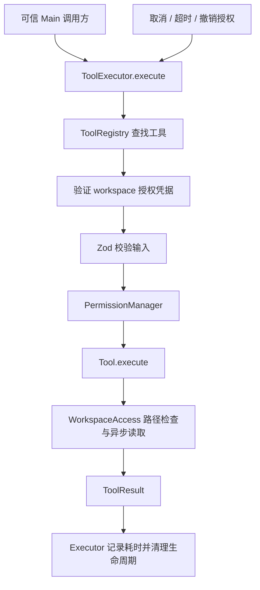

# Agent Tool System

> 当前产品策略（2026-10-06）：Agent 可读取文件、联网，通过 notebook:write 自动整理 Markdown，通过 workspace:execute 在当前笔记本 OS 沙箱执行[命令与脚本](AGENT_COMMANDS.md)。通用文件工具、Undo 与 external:execute 的 MCP 调用仍禁用，不能用已有审批绕过。下文说明通用工具与底层能力。

状态：已实现 Main 工具模块、只读工具与受统一权限管理的文件写入工具；写入预览具有独立审批窗口。[Agent Runtime](AGENT_RUNTIME.md) 核心循环已可通过 Provider 接口调用这些工具，现已通过 [Agent Execution UI](AGENT_EXECUTION_UI.md) 接入可选聊天模式及 Chat Completions Tool Calling 适配。日期：2026-09-27。

基础层提供 `ToolDefinition`、`ToolCall`、`ToolResult`、`ToolContext`、`ToolRegistry`、`ToolExecutor` 和三个只读工具。本页保留只读工具的接入与边界说明；新增 `write_file`、`edit_file` 的提案、审批、提交和 Undo 详见 [Agent 文件修改](AGENT_FILE_CHANGES.md)。Agent Loop 为独立模块；[权限系统](AGENT_PERMISSIONS.md) 已支持风险分级、会话/持久授权及命令结构分析。[Web Tools](AGENT_WEB_TOOLS.md) 已实现搜索、受限网页抓取和分块读取；[MCP](AGENT_MCP.md) 已通过统一 Registry/Executor 接入 stdio 外部工具。2026-10-06 接入独立 `workspace:execute` 的 [OS 沙箱命令与脚本](AGENT_COMMANDS.md)，由 Main 笔记本能力授权，不使用下面的只读 facade 执行进程。

## 目录与职责

```text
src/main/agent/
  types/tool.ts               统一类型、错误码、生命周期事件
  ToolRegistry.ts             defineTool、注册、Schema 描述与查找
  ToolExecutor.ts             校验、权限边界、取消、超时、结果与事件
  ToolError.ts                统一异常与安全错误输出
  WorkspaceService.ts         Main 授权凭据、撤销、受限异步文件访问
  policies/pathPolicy.ts      相对路径与目录边界检查
  registerReadOnlyTools.ts    注册本阶段三个工具
  tools/file/
    readFile.ts
    listDirectory.ts
    searchFiles.ts
tests/unit/
  agent-tools.test.ts
  agent-tool-executor.test.ts
```

工具不导入 Electron UI、LLM Provider 或 Renderer；只依赖 `ToolContext` 中的只读 workspace 能力。实际文件访问使用 Main 下的异步 Node 文件 API。

## 数据流



`defineTool()` 从同一份 Zod Schema 生成 JSON Schema 和 `parseInput()`，避免各维护一份格式。参数使用严格对象校验，拒绝未知字段；工具还执行路径、搜索条件等语义校验。`registry.descriptors()` 只输出描述和 Schema 的副本，不能执行工具。写入工具使用 `defineFileMutationTool()` 和 `prepare()`，无法直接获得写文件能力。

`ToolCall` 使用 `{ id, name, input }`，`id` 在同一个执行器的并发调用中必须唯一。未来 Agent Runtime 应使用包含 run/tool-call 关联信息的 ID，不要复用一个全局当前调用。

成功结果为 `{ success: true, output, metadata }`，失败为 `{ success: false, error: { code, message }, metadata }`。通过格式校验的调用由 Executor 写入实际单调时钟耗时、调用 ID 和工具名称；格式不合法的调用直接返回 `INVALID_INPUT`。错误不透传 Node 原始异常中的绝对路径。文件内容本身属于调用结果，未来发送给模型前仍需遵守用户授权范围。

## Main 接入示例

以下是独立只读工具实例的接入示例。应用 Main 另有 `agentFileTools` 组合实例，注册全部五个文件工具并配置写入审批窗口，Main 另外注册三个 Web 工具；聊天 Agent 入口经 Main Runtime 调度工具，Renderer 不能直接执行工具。

```ts
import { ToolRegistry } from './agent/ToolRegistry';
import { ToolExecutor } from './agent/ToolExecutor';
import { WorkspaceService } from './agent/WorkspaceService';
import { registerReadOnlyTools } from './agent/registerReadOnlyTools';

const registry = new ToolRegistry();
const workspaces = new WorkspaceService();
registerReadOnlyTools(registry);
const executor = new ToolExecutor(registry, workspaces);

// 仅在 Main 已完成明确的用户目录授权后调用。
// selectedDirectory 来自受信任的目录选择流程，不能来自 LLM 工具参数。
const workspace = await workspaces.authorizeWorkspace(selectedDirectory);
const abortController = new AbortController();
const result = await executor.execute({
  id: 'run_123_call_1',
  name: 'read_file',
  input: { path: 'README.md' }
}, { workspace, signal: abortController.signal });

// 取消单次调用；应用退出时可调用 cancelAll()。
executor.cancel('run_123_call_1');
// 撤销 workspace 会取消使用该凭据的进行中调用，并拒绝后续调用。
workspaces.revoke(workspace);
```

`WorkspaceGrant` 是服务实例在 Main 内保存的、不透明的对象凭据。复制其 ID、从 IPC 克隆对象、从另一个 WorkspaceService 获取凭据都不能取得访问权限。默认没有 workspace，不回退到 `cwd`、用户主目录或磁盘根目录。

workspace 授权凭据仅在进程内有效。聊天入口已有 Main 系统目录选择器、按对话保留的 workspace 和窗口所有权；授权不持久化。文件修改已有独立 PermissionManager 审批 UI，详见文件修改文档。workspace IPC 会先检查发送窗口/主 Frame，再从 Main 的授权映射获取凭据，不能提供任意路径的“授权”接口给模型。

## 工具参数与边界

| 工具 | 参数 | 行为与限制 |
| --- | --- | --- |
| `read_file` | `path`，`maxBytes?` | 完整读取 UTF-8 文本；默认 256 KiB，最多 1 MiB；超限报错；拒绝二进制和无效 UTF-8。保留 CRLF，UTF-8 BOM 由解码器去除 |
| `list_directory` | `path?`，`maxEntries?` | 默认根目录；只列直接子项及类型；默认 200 条，最多 1000 条；返回项排序并标记截断 |
| `search_files` | `path?`，`name?`，`glob?`，`keyword?`，`caseSensitive?`，`maxResults?`，`maxDepth?` | 至少提供一个搜索条件；多条件取交集；返回文件路径，内容匹配附首条命中的行号与最多 240 字符摘录 |

所有路径是使用 `/` 的 workspace 相对路径，例如 `src/main/index.ts`。拒绝绝对路径、`..` 路径片段、反斜杠、Windows 盘符/UNC/设备名称/ADS 路径和 NUL；不做 URL 解码或 shell 展开。

搜索细节：

- `name` 是文件名子串，`keyword` 是文本子串，不解释为正则表达式。默认忽略大小写，`caseSensitive: true` 可修改。
- `glob` 独立采用区分大小写的规则，支持 `*`、`?` 和独立路径段 `**`；不支持字符组、花括号、extglob。带 `/` 时相对于搜索起始目录匹配，否则匹配文件名。
- 默认最多 100 个结果，最大 200；默认子目录深度 8，最大 20。深度 0 表示只搜索起始目录直接包含的文件。
- 最多处理 5000 个目录项，内容读取单文件最多 1 MiB、一次搜索最多 16 MiB。二进制文件检测也计入读取量。
- 递归时跳过 `.git`、`node_modules` 和符号链接。这些默认排除用于控制搜索规模，不是额外的文件权限策略。
- 达到上限会返回 `truncated` 与 `limitsReached`；同时返回已扫描数量、读取量和跳过原因统计。达到结果数上限即保守标记截断，不再扫描其余文件确认是否还有结果。
- 单文件超限或非文本、搜索期间消失/替换的子项会计入跳过数量。workspace 失效、授权拒绝、取消、超时立即终止调用，不作为普通跳过项处理。

## 文件访问与生命周期

1. 授权时保存目录 canonical path 和设备/inode 标识；每次访问重新验证授权目录未被替换。
2. 使用路径片段检查、`lstat` 和 `realpath` 检查边界，拒绝文件及中间目录的符号链接，包括指向 workspace 内部的链接。
3. 普通文件使用只读方式打开；平台支持时加 `O_NOFOLLOW` / `O_NONBLOCK`，并对比打开前后的文件标识。读取前后再次检查路径，检测替换与读取期间的文件变化。
4. 读取分块进行，目录遍历使用异步迭代器，搜索在目录间让出事件循环。取消与授权状态在异步操作之间重新检查。
5. 默认超时 10 秒，可信 Main 可配置为 1–60000ms。单次调用只能降低该上限。超时或取消返回统一错误，并使旧 ToolContext 失效；正常完成也会使旧 context 失效。
6. 成功、错误、超时和取消都会清理 timer/listener。使用 `finally` 关闭文件句柄，目录迭代器完成或提前退出时关闭目录句柄。
7. 默认不打印日志；可注入只包含调用标识、状态和耗时的 `onEvent`，观察者异常不会改变工具结果。

上述只读 facade 是应用层访问限制，不是 OS sandbox。异步调用超时可及时结束等待，但不能强行终止已经进入内核的文件系统调用，或抢占未来恶意插件的同步代码。路径重复验证减少 TOCTOU 风险，不能宣称跨平台完全抵抗其他本地进程恶意反复替换目录。命令执行采用另行接入的 OS 沙箱和进程终止机制，不把 facade 当作任意子进程的隔离边界。

## 验证与下一阶段

单元测试使用临时 workspace 和合成文本，覆盖：Schema/注册冲突、文件读取和搜索语义、目录/结果上限、UTF-8/二进制处理、路径遍历、符号链接、伪造/撤销授权、目录替换、跨 workspace 并发隔离，以及执行器取消、超时、延迟返回、错误脱敏、计时和资源清理。

运行 `pnpm lint`、`pnpm typecheck`、`pnpm test`。本阶段不需要真实屏幕、录屏权限或外部 LLM 请求；Windows 文件系统行为仍需后续在 Windows 真机验证。

Main workspace 选择、Tool Calling 及消息关联已经通过聊天入口接通。文件审批保留独立 PermissionManager；Shell 使用当前笔记本专用能力、OS 沙箱与进程组取消，不复用单篇文件审批作为命令授权。
