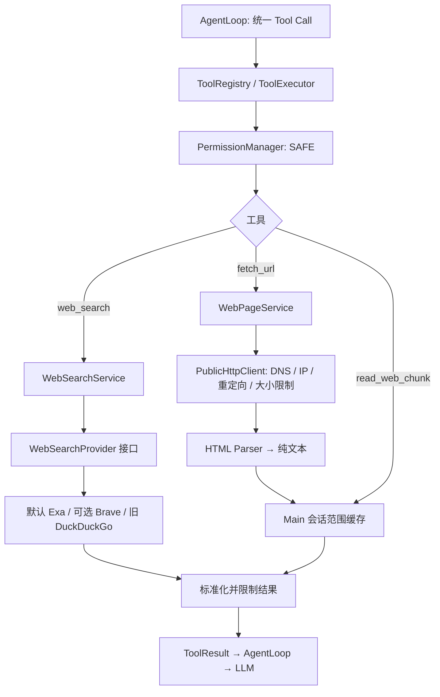

# Agent Web Tools

状态：`web_search`、`fetch_url` 和配套 `read_web_chunk` 已实现，并注册到 Main 的现有 Agent 工具系统。日期：2026-09-27。

工具通过 `ToolExecutor` / `AgentLoop` 使用，现已接入聊天默认开启的 [Agent 模式](AGENT_EXECUTION_UI.md)。另有当前笔记本内的 [沙箱命令与脚本](AGENT_COMMANDS.md)，该进程不联网；浏览器自动化尚未实现。

## 模块与数据流



- 三个工具均由 Registry 统一注册，经 Executor 的取消、超时、权限和错误处理执行。
- `network:read` 与文件能力分开。Web 工具不需要文件工作区，不会获得 `WorkspaceAccess`；文件工具继续要求明确 workspace 授权。
- `WebToolContext` 只有 `toolCallId`、`signal` 和 Main 提供的 `scope`。Renderer 不接触 Node 网络 API、DNS 或搜索密钥。
- `AgentLoop` 只看到工具描述与 ToolResult；没有 Brave、Tavily、Serper、Bing 或 HTTP 协议分支。
- 网页和搜索片段始终作为不可信数据。网页内容不会被当作系统提示、权限决策或可执行程序。

## web_search

输入：

```json
{ "query": "Electron IPC security", "additionalQueries": ["site:electronjs.org contextIsolation sandbox"], "maxResults": 16 }
```

- `query`：去除首尾空格后 1–200 个 UTF-16 字符。
- `maxResults`：1–20，默认 8，是所有查询合计最多返回数量。
- `additionalQueries`：可选，最多 2 个互补查询；与主查询合计最多 3 个，并发执行。批量查询各有 8 秒期限，保留原有 Executor 10 秒总期限；部分失败时返回成功结果与各查询状态，不把错误冒充零结果。
- 严格 Schema 拒绝额外字段；模型不能传 API key、header、供应商地址或关闭安全检查。

输出：

```json
{
  "results": [
    { "title": "页面标题", "url": "https://example.com/", "snippet": "简短内容摘要" }
  ]
}
```

结果去除 HTML 标记和脚本/样式、解码实体、移除重复 URL 与字面上的本机/内网 URL。每条标题最多 256 UTF-8 字节，snippet 最多 800 字节，总输出 JSON 不超过 7000 字节。预算紧张时先收短摘要，尽量保留更多链接，极长 URL 仍可能使结果少于 maxResults。批量结果按 reciprocal rank fusion 融合供应商排名，并适度降低同一域名连续占位；这不是事实真实性评分。结果 URL 去除 fragment 和常见追踪参数，保留有含义的查询参数。搜索结果不会自动读全文；后续 fetch_url 仍执行完整 DNS / SSRF 检查。成功搜索在 Main 会话范围内缓存 2 分钟，每个 scope 最多 32 项，不跨对话共享。

### WebSearchProvider

```ts
interface WebSearchProvider {
  readonly id: string;
  search(request: {
    query: string;
    maxResults: number;
    signal: AbortSignal;
  }): Promise<{
    results: Array<{ title: string; url: string; snippet: string }>;
  }>;
}
```

适配器负责服务协议与凭据，`WebSearchService` 负责超时、结果格式验证、清洗和最终大小限制。适配器必须把 AbortSignal 传到底层请求，并限制原始响应大小。自建适配器也是可信 Main 代码，不能从模型返回值动态加载或执行。

### 当前可用的 Brave 适配器

Main 检测 `SNIPVIA_BRAVE_SEARCH_API_KEY` 后优先创建 `BraveWebSearchProvider`。请求开启 extra_snippets，保留供应商真实返回且格式有效的发布日期；不以抓取时间代替发布日期。它使用固定 HTTPS 地址、专用请求 header、共享 PublicHttpClient、512 KiB 响应上限，并禁止所有重定向，避免密钥转发。密钥不进入工具 Schema、URL、结果、日志或 Renderer，也不写入新的配置文件。

开发时可以在终端隐藏输入专用搜索 key，再启动：

```zsh
read -s 'SNIPVIA_BRAVE_SEARCH_API_KEY?Brave Search API Key: '
export SNIPVIA_BRAVE_SEARCH_API_KEY
pnpm dev
```

不要把真实 key 写入源码、文档、命令历史或提交。通过 Finder 启动的安装版通常不继承这个终端变量；本期没有新增搜索设置 UI。产品接入时应使用既有 Main 凭据存储并向适配器注入取 key 的函数。

应用未配置 Brave Key 时默认注入 Exa 搜索适配器，无需额外 Key。独立构造且不注入 Provider 的 WebSearchService 仍返回 `SEARCH_NOT_CONFIGURED`；`fetch_url` 可独立使用。更换供应商只替换 Main 注入对象。Tavily、Serper、Bing 和自建服务尚未提供具体适配器。

### 默认免 Key 搜索

`ExaWebSearchProvider` 调用固定的 Exa 官方托管 MCP `web_search_advanced_exa`，取得结构化搜索结果与相关片段。官方支持带限额的匿名访问，参见 [Exa MCP](https://github.com/exa-labs/exa-mcp-server)。适配器只调用这个只读搜索方法，不暴露远程方法选择，不注册可任意执行的外部 MCP Tool；仍由现有 `web_search` 的 Registry、Executor 和 PermissionManager 调用。

请求使用 auto 搜索、每页最多 1000 字符正文与 800 字符相关片段；返回时优先 highlights，不调用远程总结模型。`site:域名/路径` 转为真实 includeDomains 过滤器，避免把限定仓库的查询泛化为整个 GitHub。JSON-RPC 的 JSON/SSE 响应都受 512 KiB 限制；正文再经过统一 URL、HTML、日期、字节预算清洗。限流、超时、服务错误或协议变化明确返回失败，不绕过验证，不冒充零结果。

`PublicHttpClient.postJson` 只供可信 Main 适配器使用，模型不能控制请求方式、方法、header 或服务地址；请求体上限 64 KiB，禁止重定向，继续执行 DNS/IP 固定、TLS、User-Agent、取消和解压大小检查。可由 Main 环境变量 `SNIPVIA_EXA_SEARCH_API_KEY` 注入专用 Key，仅放在 header，不进入 URL、日志或 Renderer。匿名额度和可达性依赖 Exa；没有付费账号可用性保证。

旧 `DuckDuckGoWebSearchProvider` 仍保留，开发时可用 `SNIPVIA_WEB_SEARCH_PROVIDER=duckduckgo pnpm dev` 显式选择。它请求 [DuckDuckGo 官方非 JavaScript 入口](https://duckduckgo.com/duckduckgo-help-pages/features/non-javascript)，不是稳定搜索 API；本次实测后续请求出现验证限制，因此不再作为默认。配置 Brave Key 仍优先使用 Brave，不会静默把专用密钥或失败请求转发给另一供应商。

搜索服务只收到工具生成的查询词和检索参数，不收到截图或完整对话。没有新增搜索设置页或新的凭据文件。

### 代理 Fake-IP 的 DNS 兼容

实测本机系统 DNS 把公网域名解析为 `198.18.0.6`，属于代理常见的测试地址段。`createSystemWebDnsResolver` 仅在所有系统 DNS 回答均为 `198.18.0.0/15` IPv4 地址时，通过固定公共 DNS `https://1.1.1.1/dns-query` 查询真实 A 记录。只发送域名，不发送 URL 路径、查询词、截图或密钥。

公共 DNS 请求验证 TLS、禁止重定向/代理，响应上限 32 KiB、5 秒超时，支持取消。取得的地址仍须通过原有公网校验，并在实际连接中固定该 IP、验证 TLS 主机名与 socket 对端；真实私网/localhost/混合私网答案不会触发 fallback，直接输入 Fake-IP URL 也不放行。不能取得真实公网地址时返回错误，不关闭 SSRF 防护。

## fetch_url

输入：

```json
{ "url": "https://example.com/article", "focus": "需要核实的关键词或报错" }
```

输出结构：

```ts
{
  url: string;       // 通过检查后的最终 URL，去除 fragment
  title: string;
  text: string;      // 本次有界文本片段
  metadata: {
    contentId: string;
    contentType: string;
    charset: string;
    fetchedAt: string;
    expiresAt: string;
    downloadedBytes: number;
    decodedBytes: number;
    storedTextBytes: number;
    extractionTruncated: boolean;
    truncated: boolean;
    offset: number;
    nextOffset: number | null;
    offsetUnit: 'utf16';
    source: 'untrusted_web';
  };
}
```

- 支持 `text/html`、`application/xhtml+xml`、`text/plain`、`text/markdown`。不接收附件、图片、PDF 或其他二进制文件，不保存下载文件到磁盘。
- 可选 `focus`（最多 300 字符）在缓存文本中选择与关键词相关的真实连续段落，返回实际 offset；无匹配回退到开头。可以使用 contentId 与 offset=0 回看开头，或 nextOffset 继续读，不是 LLM 生成的摘要。
- HTML 通过 `htmlparser2` 回调转为纯文本，优先非空 main/article/role=main 内容；没有语义正文时回退到 body。即使前面的模板文字达到输出上限，仍继续寻找正文。删除 script/style、注释、隐藏节点、导航、页脚、表单及嵌入对象等；保留标题、段落、列表、表格分隔和 pre 代码空白。
- 不创建网页 DOM，不运行脚本、CSS 或读取子资源；不执行 meta refresh。动态渲染页面、登录内容和完整浏览器布局不在本期范围内。
- 使用 HTTP header 声明的字符编码，缺省 UTF-8。未知编码返回明确错误；未实现基于 meta 标签或统计的编码探测。
- 最多保留 256 KiB 清洗文本；超出部分明确标记 `extractionTruncated`，无法通过分块恢复已丢弃的源文。
- 一次返回通常不超过 4000 UTF-8 字节文本，同时按完整 JSON 实际转义大小收紧到 7000 字节。为默认 8192 字节 ToolResult 上限留出空间，避免丢失分块游标。
- 超过下载硬上限直接返回错误，不把未完成的网络响应伪装成完整页面。

## 分块、缓存与会话

```json
{ "contentId": "由 fetch_url 返回的 UUID", "offset": 4000 }
```

调用 `read_web_chunk` 时，offset 必须使用上一块的 `metadata.nextOffset`，单位为 UTF-16 code unit，不是字节。返回相同结构；每次从准确的后续位置读取，不再联网。`nextOffset: null` 表示缓存中没有后续内容；若 extractionTruncated 仍为 true，不代表已读完整网页。

缓存只驻留 Main 内存，最多 16 个文档，每个文本不超过 256 KiB，默认 5 分钟有效。访问时检查有效期并清理；容量达到上限时淘汰最早文档，退出时清空。

contentId 不是权限凭据。同一 URL 在另一会话也不能凭已知 ID 读取原会话缓存。AgentLoop 已为每个 run 创建权限会话，自动作为分块 scope；可信 Main 可为连续对话复用同一 `PermissionSession`。

独立调用 Executor 时也应传 session：

```ts
const session = agentFileTools.executor.createPermissionSession();
try {
  const first = await agentFileTools.executor.execute({
    id: 'web_1', name: 'fetch_url', input: { url }
  }, { session, signal });
  // 读取 first.output.metadata，再以相同 session 调用 read_web_chunk。
} finally {
  agentFileTools.executor.endPermissionSession(session);
}
```

没有 session 的独立调用只能读取当次首段；不会默认共享一个全局缓存授权。若提供了有效 workspace capability，它可作为独立 Main 调用的备用 scope；产品对话应始终使用独立 session。降低 AgentLoop 的 maxToolResultBytes 到 8192 以下时，框架的第二层截断仍可能缩减结果；接入方需要同步调整网页片段预算。

## 网络边界

1. **URL**：只允许标准端口 HTTP/HTTPS，不含 userinfo；输入与规范化后的 URL 最多 2048 字符。拒绝本机、内部域名、非公网 IP、控制字符和反斜杠歧义。
2. **IP**：校验 IPv4/IPv6，阻止 loopback、private、link-local、CGNAT、multicast、reserved、文档/测试网段，以及 IPv4-mapped、NAT64、6to4 等转换范围。IPv6 仅接受原生全球单播范围。
3. **DNS**：读取全部解析记录；只要有一条私网或无效地址就拒绝。当前每次连接固定使用一条已验证地址，不会让 HTTP 栈再次解析域名。
4. **连接**：保留原始 hostname / Host / TLS 身份，用自定义 lookup 固定 socket IP；显式校验证书，再核对实际远端地址。使用每次请求独立 agent，不复用 socket，显式关闭环境代理。
5. **重定向**：手动处理，默认最多 3 次；每一跳重新验证 URL 与 DNS，拒绝循环和 HTTPS 降级。跨 origin 清除调用方附加 header；搜索适配器直接禁止重定向。
6. **状态**：不携带浏览器 cookie、不回放 Set-Cookie、不自动发送浏览器认证信息；网页读取仅 GET，固定搜索适配器可以发送有界 JSON POST，固定 User-Agent `Snipvia/0.1 (Agent Web Tools)`。
7. **大小**：响应 header 最多 32 KiB；声明 Content-Length 和实际字节分别检查。压缩前下载及解压后的正文分别最多 2 MiB，支持 gzip、deflate、br，拒绝未知/多重压缩格式。
8. **生命周期**：绝对 10 秒期限覆盖 DNS、重定向及完整读取；网页服务的期限也覆盖文本处理。AbortSignal 关闭请求和响应流，超时后的结果不进入缓存或 LLM。解析按块让出事件循环，嵌套深度最多 256。

边界以应用可观察的 DNS 和远端 IP 为准，不是 OS 级网络沙箱。系统路由、VPN 或透明网络设备仍由操作系统管理。本实现有意不提供 localhost/私网例外和环境代理通道；后续若需本地自建搜索，应另行设计明确授权的受限连接策略。

## 错误与实现入口

来源界面和研究策略详见 [联网研究与来源](AGENT_WEB_RESEARCH.md)。

新增错误：`URL_BLOCKED`、`DNS_FAILED`、`NETWORK_ERROR`、`HTTP_ERROR`、`REDIRECT_LIMIT`、`RESPONSE_TOO_LARGE`、`UNSUPPORTED_CONTENT_TYPE`、`SEARCH_NOT_CONFIGURED`、`SEARCH_FAILED`、`CONTENT_UNAVAILABLE`。继续使用 `TIMEOUT`、`ABORTED`、`INVALID_INPUT`、`INVALID_RESULT`、`UNSUPPORTED_ENCODING`。网络/供应商原始异常不直接回传，避免泄漏 header、密钥或响应正文。

```text
src/main/agent/
  registerWebTools.ts
  tools/web/
    webSearch.ts
    fetchUrl.ts
    readWebChunk.ts
  web/
    WebSearchProvider.ts
    WebSearchService.ts
    BraveWebSearchProvider.ts
    ExaWebSearchProvider.ts
    defaultSearchProvider.ts
    WebIconService.ts
    researchPrompt.ts
    relevantExcerpt.ts
    NetworkPolicy.ts
    PublicHttpClient.ts
    htmlText.ts
    WebPageService.ts
    WebContentStore.ts
    operation.ts
```

Web Tools 初次实现修改 `types/tool.ts`、`ToolRegistry.ts`、`ToolExecutor.ts`、`PermissionPolicy.ts` 和 Main 组合入口；本次来源界面额外接通 Renderer / Preload，详见 [联网研究与来源](AGENT_WEB_RESEARCH.md)。AgentLoop 不包含供应商逻辑。依赖固定为 `htmlparser2@12.0.0`、`ipaddr.js@2.5.0`；本次搜索改进没有新增依赖。

## 验证方式

- `agent-web-network.test.ts`：私网/保留地址、数字 IP、DNS 混合与重绑定、重定向、压缩炸弹、传输大小、超时/取消。
- `agent-web-transport.test.ts`：真实 Node 请求接口的 mock，验证原始 Host、pinned lookup、User-Agent、AbortSignal、显式 TLS 检查、禁用代理及远端地址检查。
- `agent-web-tools.test.ts`：HTML 清洗、Unicode、结果预算、缓存隔离/过期、搜索 Provider、Brave 协议转换及 AgentLoop 分块联调。

测试用合成网页、模拟 DNS/HTTP 和模拟 Provider，不依赖真实搜索 key，也不连接本机内部服务或打断桌面操作。真实 Brave 账户和跨平台公网代理环境尚未验证；API 可用性与额度取决于配置的服务。

实现参考：[Node.js HTTP 请求与 Agent](https://nodejs.org/docs/latest-v24.x/api/http.html)、[htmlparser2 Parser](https://github.com/fb55/htmlparser2)、[ipaddr.js 地址分类](https://github.com/whitequark/ipaddr.js)、[Brave Web Search API](https://api-dashboard.search.brave.com/app/documentation/web-search/get-started)。

### Web Tools 初次接入验证（2026-09-27）

- `pnpm lint`、`pnpm typecheck`、`pnpm build`：通过。
- `pnpm test`：28 个测试文件、432 项测试全部通过；其中 Web Tools 新增 109 项。
- 未运行桌面截图或窗口测试；本次没有 Renderer / Preload 变更。

### 默认联网 Agent 接入验证（2026-09-27）

- `pnpm lint`、`pnpm typecheck`、`pnpm build`：通过。
- `pnpm test`：33 个测试文件、511 项通过，新增只读策略、免 Key 搜索解析和 Fake-IP DNS 验证。
- 三项定向 Electron 测试通过，覆盖预测后启动 Agent、联网工具卡片、写入禁用及普通聊天回归，详见 [Agent Execution UI](AGENT_EXECUTION_UI.md)。模型服务在这些测试中使用模拟 SSE。
- 当前 macOS 网络实测：系统 DNS 返回 `198.18.x.x` 后，通过受限公共 DNS 查询并校验真实公网地址，免 Key 搜索成功返回 3 条结果，首条为 Electron 官方 `desktopCapturer` 文档。未改动系统代理或网络设置。
- 真实模型账号、Brave 账号及 Windows 公网环境未在本次验证。
