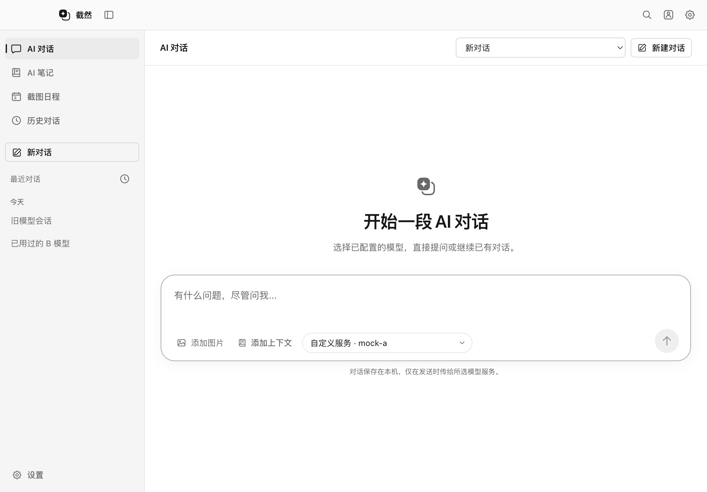
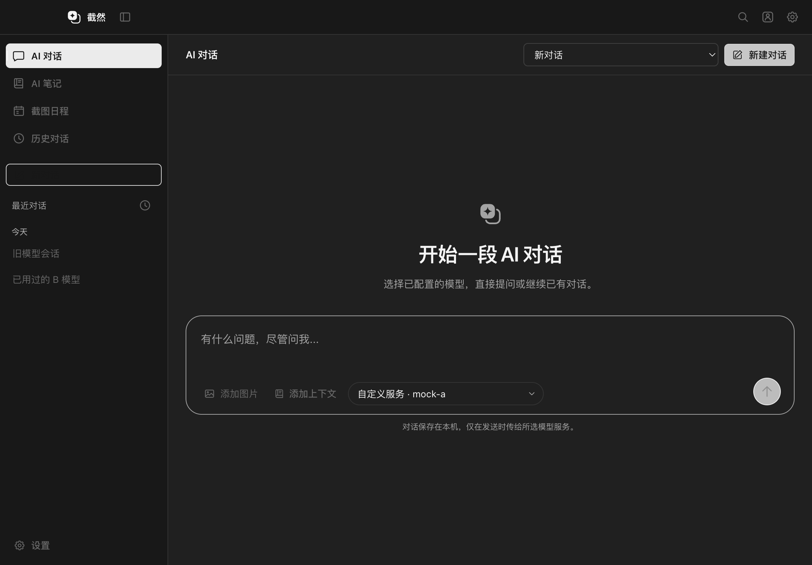
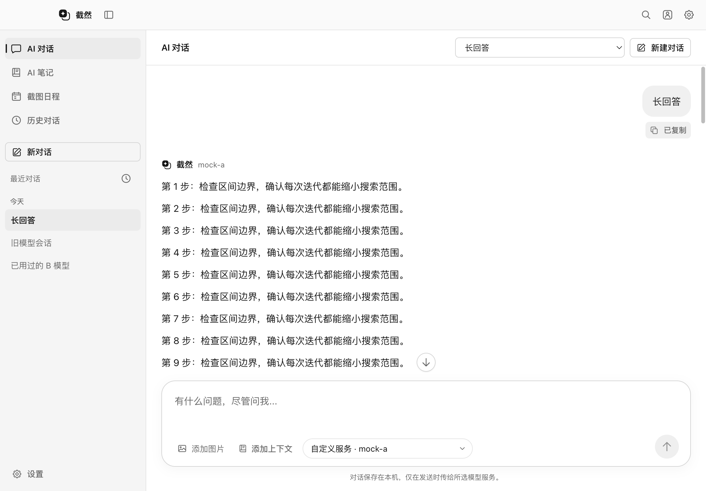
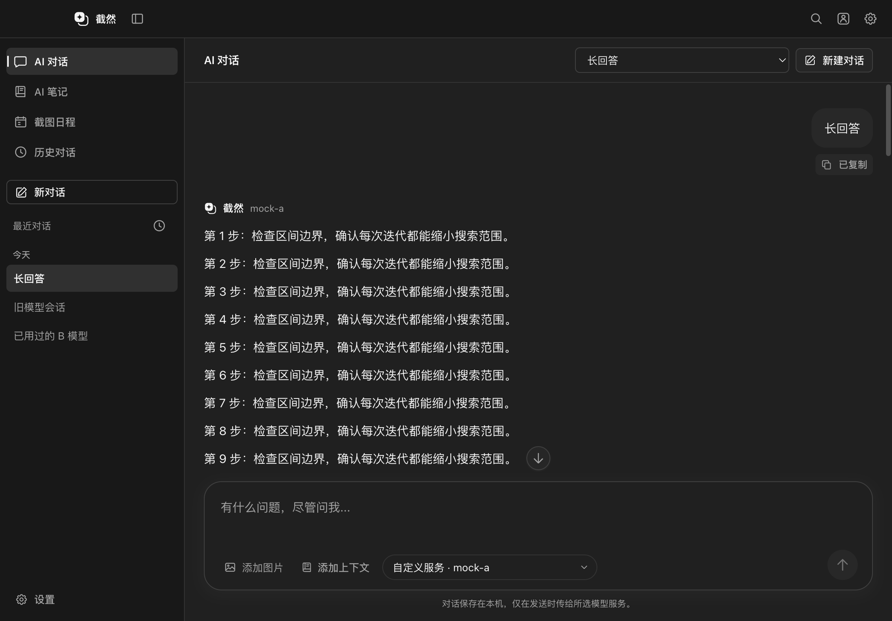
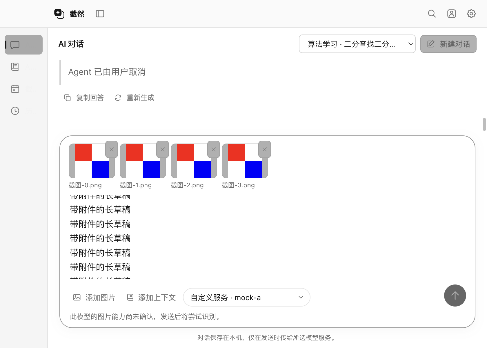
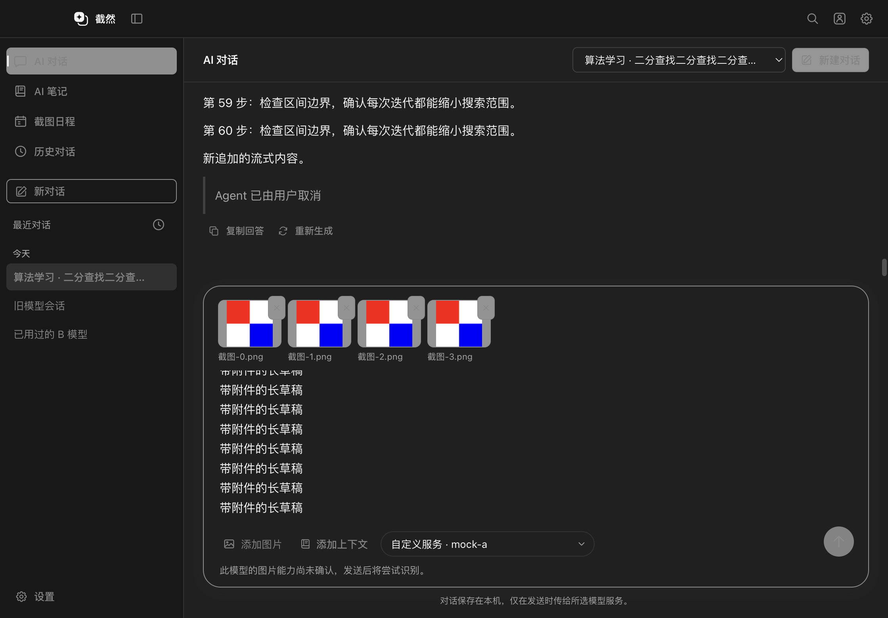

# AI 对话 UI 重构：实施与验收

实施日期：2026-10-14。基于已确认的只读审计方案，增量改造主窗口 AI 对话。前置能力见 [工作区 Phase 2](AI_CHAT_WORKSPACE_PHASE2.md)、[确认编辑 Phase 3](AI_CHAT_WORKSPACE_PHASE3.md)、[图片 Phase 4](AI_CHAT_WORKSPACE_PHASE4.md)。

## 布局与视觉

- 主窗口继续只有一个 `AppShell` 和一个侧栏。AI 对话页展开宽度 232px，保留 AI 笔记、截图日程和历史对话入口；增加新对话、按日期分组的最近会话、截断标题、当前会话和生成状态。其他页面的侧栏尺寸不变，折叠和紧凑窗口行为沿用现有实现。
- 复用 `WorkspaceHeader`，AI 对话工具栏为 56px，右侧保留会话选择和新建。品牌仍在系统标题栏，欢迎区域复用现有黑白品牌轮廓。
- 欢迎内容与输入框作为同一组居中：32px 图标、28px 标题、14px 说明，正文与输入框最大 840px。开始对话后输入区移到工作区底部，消息独立滚动；控制器和同一个 textarea 保持挂载。
- 输入框为一个 22px 圆角容器，最小约 134px；文字自动增高，最大高度随窗口约束，超出后内部滚动。Return 发送、Shift Return 换行，保留中文组合输入保护。
- 附件操作收敛到「添加图片」弹出菜单，保留原生选择、粘贴、已有截图和来源截图；键盘可用方向键、Tab 和 Escape。缩略图位于容器内，可移除或放大。
- 「添加上下文」复用原有选择 Dialog；选中后变为可移除的笔记或分支标签，长名称截断。图片可以与一种编辑上下文共存；笔记和分支仍二选一，不扩展原有 Schema。
- 模型选择为紧凑胶囊，显示真实厂商与原始模型 ID。发送 / 停止为 38px 圆形按钮，未具备发送条件时明确禁用。
- 用户消息靠右，用中性气泡并支持复制；AI 回复靠左自然排版，复用 Markdown、代码高亮、表格、引用来源、复制及重新生成。真实修改提案归属相应回复，生成中的提案显示在当前答复，不再挤占输入区高度。
- 所有新颜色引用既有 Monochrome Token；图片内容保持颜色。没有新增 UI 框架、主题系统、玻璃模糊、彩色渐变或蓝色强调。

## 会话、模型与滚动

### 重命名

新增窄 `history:rename` 入口，Main 校验 UUID、名称长度与控制字符，复用原子历史索引写入。仅修改名称和可选 `titleMode: manual` 元数据，不改消息、模型、图片或时间排序；后续回复、修改结果记录和重新生成不会覆盖人工名称。旧索引缺少该字段时保持原有自动标题行为，保存失败恢复内存与原索引。

删除继续调用原有服务，确认前无删除，默认聚焦取消。最近列表只使用已有历史摘要，不为显示列表批量读取消息或图片。

### 模型标识

审查和实际测试发现：`credentialScope` 只标识厂商与接口的密钥范围，不能标识具体模型；现有配置也仅保存每个范围的当前模型。此次不修改密钥结构，而为 AI 对话 UI 使用包含原始模型 ID 的独立选择标识。

选择列表由当前配置、当前运行期间见过的配置以及历史中确实使用过的模型组成；历史候选必须对应仍存在的厂商 / 接口范围，才能复用原有 Key。临时候选最多保留 100 项，不建立第二个模型或凭据服务。

恢复历史时，匹配原会话模型并复用既有设置切换流程。厂商或接口范围缺失时显示占位提示，发送被禁止，用户明确选择后继续；不会让浏览器默认选中第一项来掩盖配置缺失。单纯出现在列表中不代表真实厂商调用一定成功，模型被停用、账户权限或余额问题仍需实际请求判断。

未发送的模型选择在工作区内按会话保留；成功提交的轮次使用原历史 `profile` 持久化。恢复会话会更新原有全局当前模型，截图浮窗继续遵循同一设置体系。

### 单任务与滚动

只增加只读 `activeConversationId` 投影，让 UI 表达同一客户端原有的单生成任务限制；没有增加并发、排队或取消逻辑。用户可以查看其他会话，另一个会话生成时显示返回入口并阻止重复发送和选模。

滚动继续绑定会话。接近底部时跟随新内容；主动向上浏览时停止跟随，提供「回到最新消息」。通过 ResizeObserver 跟随正文、代码和输入区尺寸变化，不通过固定延时重置位置；回到会话时恢复已有滚动位置。欢迎区布局测量在同一帧读取，避免侧栏动画造成测试误判。

## 修改清单

| 范围 | 文件 |
| --- | --- |
| 工作区编排 | `src/renderer/src/chat/ChatWorkspace.tsx`、`workspace.css` |
| 输入组件 | `chat/ChatComposer.tsx`：自动高度、图片菜单、上下文标签、模型胶囊及发送状态 |
| 消息组件 | `chat/ChatMessages.tsx`：气泡、自然回复、复制及回复对应提案 |
| 侧栏 | `chat/ChatSidebar.tsx`、`sidebar.css`；`components/AppShell.tsx` 仅增加页面侧栏插槽 |
| 展示 Hooks | `chat/useChatScroll.ts`、`useConversationModel.ts`、`model-choice.ts` |
| 编辑展示 | `chat/EditingPanel.tsx`：仍只有一个现有控制器，提供上下文、消息提案与 Dialog 的组合呈现 |
| 主页面接线 | `src/renderer/src/App.tsx`：新会话操作、侧栏、切换锁与已有历史回调 |
| 图标 | `components/Icon.tsx`：增加与现有笔画一致的复制、编辑和操作图标 |
| 重命名 | `src/shared/history.ts`、`contracts.ts`、`src/preload/index.ts`、`src/main/{index,storage/history}.ts` |
| 生成状态 | `src/shared/agent/execution.ts`、`src/main/agent/ui/AgentExecutionService.ts`：只读活动会话投影 |
| 测试 | `tests/unit/{history,chat-model-choice}.test.ts`；`tests/integration/{chat-redesign,chat-images,desktop,monochrome,notes-drag}.spec.ts`：新流程、真实菜单入口、范围定位与原生窗口聚焦 |
| 文档 | 本报告、README 和 UI 设计语言 |

没有改变模型请求协议、密钥存储、图片传输和清理、确认编辑授权、笔记格式、截图捕获与浮窗、ScreenCaptureKit Helper 或更新链路。

## 验证

所有桌面数据使用临时目录、合成图片、本地 Mock 模型与会员服务，不使用私人笔记或真实截图。

| 检查 | 结果 |
| --- | --- |
| 全量单元测试 | 66 个文件、1045 项通过；新增 4 项覆盖模型标识、候选范围与重命名 |
| 原有聊天 / 图片 / 编辑确认 | 三项 Electron 流程通过；附件测试改为从实际菜单进入，未删减原断言 |
| 最终新增 UI 验收 | 通过；用户消息复制、模型箭头居中、发送就绪与实际亮暗窗口截图均检查 |
| `pnpm typecheck` / `pnpm lint` / `pnpm build` | 通过；最终冒烟包含重新构建与类型检查 |
| 最终 `pnpm test:smoke` | 41 项通过、0 项失败，3.6 分钟；11 项沿用真实录屏 / 打包 / 平台条件而未运行 |
| `git diff --check` / 残留颜色扫描 | 通过；新增 AI 对话样式未发现颜色常量、蓝色类或渐变 |

新增桌面验收覆盖：同一欢迎组对齐、一个侧栏、输入增高、中文组合输入、禁用发送、消息左右关系、流式向上浏览、回到底部、停止、重命名、取消删除与实际删除、同接口多模型真实请求 ID、原模型配置缺失、手动选择恢复、840 / 1120 / 1600px 亮暗布局、四张附件与长草稿、导航折叠、System 模式和重启后的标题 / 模型恢复。

实际视觉检查修正了旧 `select` 顶部间距引起的箭头偏移，箭头现在相对控件居中。首次完整回归发现仅有来源截图的会话被误当作空欢迎页，现保留这类会话的预览区域；对应桌面测试改用页面范围定位，并验证包含模型 ID 的新选择值。主题悬停与笔记拖拽曾在完整运行中失败、独立复测通过，最终夹具在原生鼠标操作前明确聚焦目标窗口，保留原断言，不改相关生产逻辑，也不新增跳过。

## 实际窗口截图

以下图片来自真实 Electron 窗口；模型回复、会话名称和图片均为合成测试数据。

| Light 欢迎页 | Dark 欢迎页 |
| --- | --- |
|  |  |

后续验收截图位于 `docs/ui/chat-redesign/`。

| Light 对话 | Dark 对话 |
| --- | --- |
|  |  |

## 验收边界

1. 本轮验证 UI 与原有业务接线，模型请求使用 Mock，没有新增付费 API 调用，也不宣称完成全厂商在线验证。
2. 恢复模型仍使用现有全局配置，不提供各窗口独立的凭据系统。未提交的新模型选择与未发送图片仍是运行期间草稿。
3. 预测分支仍是平面规则，笔记与分支保持单一授权上下文；所有修改仍须完整预览并显式确认。
4. 本轮不发布安装包、镜像或 GitHub Release。Windows 真机、真实多屏录制及打包条件检查沿用原有验收边界。
5. Main / Preload 增加了重命名入口，开发版需重启整个应用后再验收；只热更新 Renderer 不保证加载新桥接接口。
