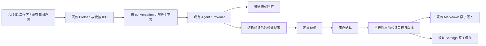

# AI 对话工作区：Phase 1 审计与实施方案

日期：2026-10-13（Asia/Taipei）。基线：当前 v0.2.2 源码工作区。本轮只审查代码、运行已有相关单测并编写本文，未修改业务代码、Schema、IPC 或正式 UI，未重新打包、发布。

## 1. 结论与实施边界

已有基础可以复用：主窗口保留截图对话页面，Agent 支持流式回答、停止、笔记本授权、联网工具与跨重启会话；笔记已经具备版本校验和原子保存；预测分支有现成 Schema。关键缺口是会话必须依附截图、AI 笔记修改直接提交、图片只有会话级单张来源。

推荐在现有 Agent / Provider / 历史存储上增量建设工作区，不增加第二套 API Key、对话数据库、状态管理框架或截图引擎。正式界面继续使用 AppShell、WorkspaceHeader、Monochrome Token 和已有主题同步。

本次“预测分支”对应客户端截图处理规则 `PredictionBranch[]`，不是树、工作流节点或 Git 分支。调整关系以匹配条件、列表优先顺序和笔记本绑定表达，不增加不存在的 parentId / children / edges。

安全策略建议统一：选择笔记授权读取；AI 的创建、追加、替换均先生成可审查提案，确认后才写入。现有截图浮窗通过同一笔记工具发起的写入也应遵循这条规则，避免保留自动保存旁路。普通手动编辑的自动保存保持原样；截图捕获、置顶、快捷键、焦点和返回软件行为保持原样。

## 2. 现有实现审计

### 2.1 导航与会话

| 已有实现 | 代码入口 | 审计结果 |
| --- | --- | --- |
| 主窗口截图对话 | `src/renderer/src/App.tsx` | `page === 'chat'` 内容仍存在；截图到达或恢复历史可进入此页；发送必须有 Capture |
| 侧栏和快捷导航 | `src/renderer/src/components/AppShell.tsx` | `AppPage` 包含 chat，但 destinations 没有 chat，⌘K 也因此没有入口 |
| 隐藏原因 | `docs/UI_DESIGN_LANGUAGE.md`、先前产品要求 | 产品暂缓该页面设计，主动隐藏；并非 AI 服务被删除 |
| Agent 状态和消息 | `agent/useAgentExecution.ts`、`agent/AgentExecution.tsx` | 已有订阅、revision 去旧、流式回复、停止、权限交互、Markdown、来源与笔记变更展示 |
| 截图浮窗 | `chat/QuickChat.tsx` | 已有 SSE 手动回答、Agent、输入快捷键和流式滚动；复用既有 BrowserWindow |
| 历史 | `src/main/storage/history.ts` | 本地 `history/conversations.json` 和 JPEG 文件；原子写索引；当前每条 Conversation 必须有 Capture |
| Agent 完整上下文 | `src/main/agent/AgentSessionStore.ts` | 按 conversationId 保存工具调用及结果，支持跨重启恢复，无需第二份会话存储 |

需要补齐：无图新建对话、逐会话输入草稿 / 模型选择 / 滚动位置、重新生成、消息复制、上下文入口。当前主窗口非 Agent 路径使用 `chat:send → askModel`，不是流式；`chat:stream` 只允许 quickChat，流事件也只发送给该窗口。

主进程当前 `capture / currentConversationId / conversationMessages` 是活动截图的单例。Agent 内部虽按 conversationId 保存 Session，`deps.context(captureId)` 仍只接受当前截图；`history:open` 会停止当前请求。这需要解除“查看其他对话即改变捕获会话”的耦合。初期保留现有全局一个生成任务的限制，允许切换查看其他对话，并明确显示仍在生成的会话；不新增并行模型请求。

### 2.2 模型配置与请求

- 配置来自 `src/main/storage/settings.ts`，Key 以 provider + endpoint 为范围，由 Electron safeStorage 加密；Renderer 仅获得 PublicSettings，不获得解密 Key。
- 普通问答复用 `src/main/ai/provider.ts`；Agent 复用 `LLMProvider`、`ChatCompletionsAgentProvider`、AgentLoop / AgentRuntime / ContextManager。
- Agent 已限制响应与工具参数大小、校验完整流及工具调用，过滤推理字段，支持超时、取消与上下文压缩。不完整或截断的工具调用不会执行。
- 当前实际问答和 Agent 采用 Chat Completions 兼容协议。模型目录和图片测试部分使用厂商原生协议；目录 / 测试通过不能作为真实对话、工具调用成功的证明。本轮没有厂商真实 Key 验证。
- `ModelCatalog` 与 `src/shared/models.ts` 已有 supported / unsupported / unknown、证据、缓存、刷新、主动图片验证及费用确认，可以复用。
- 当前模型选择针对截图，只显示已确认 Vision 模型；Settings Schema 还有针对一个纯文本模型的全局拒绝规则。新工作区应按请求场景判断能力：文本问答不要求 Vision，图片问答才检查 Vision，修改提案需要可校验的结构化响应路径。保留截图页面原筛选习惯，不把目录能力等同账号权限。
- `chat:send`、`chat:stream`、`agent:start` 当前都有会员校验。默认沿用这一规则；不通过新入口绕过资格，也不把“已配置自己的 Key”当成已获得会员。

### 2.3 AI 笔记

业务对象已明确：

```text
Notebook = { id, name, directory }
NoteDocument = { path, content, version }
NoteSaveResult = 成功后的文档，或 conflict + 当前磁盘文档
```

- 笔记本注册保存在 `notebooks.json`，正文仍是用户选定目录中的普通 Markdown，不是数据库记录。
- `NotebookService` 校验笔记本、相对路径、真实路径与链接；SHA-256 version 防止覆盖外部修改；原子替换保留 BOM、换行形式，编辑器上限 2 MiB。
- `notes/useNoteDocument.ts` 已有 400ms 手动编辑自动保存、串行保存、flush 与冲突处理。AI 读取和确认提交前需要与未保存草稿协调，不能只读取陈旧磁盘内容。
- `NotebookWriter`、`write_note / edit_note` 已支持创建、追加、唯一 SEARCH / REPLACE。当前选择整个笔记本后，工具直接写入；ToolExecutor 的 notebook:write 分支不等待用户审查。
- `NoteChanges`、`NoteCheckpoints` 与 diff 是保存后展示 / 撤销，不能代替保存前确认。
- `FileChangeService` 已有 prepare → approve → commit、版本快照、不可伪造确认凭证及 diff；但通用文件写入工具在产品中被禁用。应复用这些底层机制，仍只允许授权 Markdown，不开启通用文件写入。

新上下文须明确到笔记本 + 文件，而不是仅选笔记本就允许模型读取所有文件。创建笔记需选择目标笔记本 / 目录；编辑需绑定明确文件和版本。超出模型上下文或现有 AI 写入 / diff 上限时，提示选择段落或拆分；不得静默截断后替换整篇笔记。

### 2.4 预测分支

现有字段来自 `src/shared/screenshot-understanding.ts`：

```text
id, trigger, applicableContent?, label, runningLabel, prompt,
enabled, builtin, notebookId?, mode
```

| 现有约束 | 说明 |
| --- | --- |
| 数量 | 最多 30 条；ID 不重复 |
| 自定义 ID | custom:UUID；自定义分支不能标记 builtin，mode 只能为 ai |
| 字段限制 | 名称 40 字符；运行提示 60；适用内容 1000；指令 4000；AI 模式指令非空 |
| 内置规则 | 解释错误、解释代码、回答问题、创建日程草稿 |
| 绑定 | 可关联 notebookId，没有父子、图边或循环字段 |
| 手动操作 | SettingsPanel 可新增、编辑、开关；UI 仅对自定义分支显示删除 |
| 路由 | `analysis/auto-action-router.ts` 按匹配结果 / trigger 选择；回退路径优先自定义，同类规则顺序有意义 |

分支保存在当前 Settings.predictionBranches，profiles 也保存完整 Settings；模型切换 UI 会携带当前分支集合。当前通过完整 `settings:save` 保存，不存在专门的 Agent 分支编辑接口，也没有配置版本比较。

建议“拆成两个分支”生成两个自定义候选规则及原规则的处理提案；内置原规则可禁用，保持现有不可删除的 UI 约定。所谓“重组关系”展示条件 / 指令 / 顺序 / 笔记绑定差异。若确需树形关系，应另立 Schema 迁移任务，不在本轮隐式加入。

需要补主进程校验：不可冒充内置身份、不可修改已有 ID、不能新增无效笔记本引用、不能操作未授权分支 / 已删除分支、不能创建被迁移过滤的旧 ID。循环关系不适用于现有对象；传入不存在的关系字段应被严格拒绝。

### 2.5 图片和安全边界

现有图片导入 `capture:import` 只允许主窗口，PNG / JPEG，原文件最多 20 MiB；图片会立即成为当前 Capture 并中止既有 Agent。`prepareImage` 使用 JPEG 90、长边最多 2400px、Data URL 长度不超过 12 MiB。笔记附件另有 25 MiB 限制和粘贴 / 拖入能力，但属于笔记 assets，不能直接作为会话附件写入用户笔记本。

当前 Message 和 AgentMessage 都没有消息级图片字段；Provider 构造时接收一张当前截图，Agent 将它附到本轮最后一条用户消息。续拍替换历史 Capture 会删除上一张 JPEG，因此无法据此展示每轮原始图片。

已有安全基础保留：sandbox、contextIsolation、关闭 nodeIntegration、主 Frame + WindowRole 校验、Zod 入参、隐藏本地能力对象、禁止网页导航及新窗口；Markdown skipHtml，外部图片不加载，不执行模型返回的 HTML / 脚本。普通文本和 Markdown 代码块不得触发工具或落盘。

## 3. 推荐实现架构



### 3.1 会话与上下文

以现有 conversationId 为主键；Capture 降为可选的来源，不用空白截图伪装文本会话。旧 captureId IPC 保留兼容映射，截图主流程不改。

现有 JSON 历史增量扩展文本会话、稳定消息 ID、附件引用、提案摘要与显式上下文；兼容读取旧记录。完整 Agent 上下文继续由 AgentSessionStore 维护，图片只存引用，不塞入工具记录 JSON。新文本 / 多图片记录不承诺旧版客户端能够降级读取，迁移验证须单独覆盖。

Renderer 只保留每个会话的草稿、附件草稿、滚动位置与展示状态；不另建第二份正式消息存储。复用 useAgentExecution 并由会话引用订阅；主窗口和浮窗看到同一个真实会话。

笔记页“与 AI 讨论”携带 notebookId / path / version；设置中分支编辑页“用 AI 编辑”携带选定分支 ID 和规则版本。显式授权信息由 Main 校验，笔记内容和规则说明视为不可信数据。

### 3.2 统一修改提案

计划增加小型 Main 提案模块与共享 Zod Schema；它只管理待确认操作，存储和执行仍复用现有服务。这是必要的确认机制，不是第二套 AI 服务。

- 目标包括单篇 Markdown 与分支批量操作；先不提供跨多个笔记和设置文件的一键事务。
- 提案包含 proposalId、conversationId、上下文范围、基线版本、操作和状态；Main 保存审核过的实际 before / after，不信任 Renderer 或模型提供的“已确认 / 已保存”。
- Markdown 复用现有补丁、快照、diff 和原子提交；分支只允许 create / update / remove / reorder / bind-notebook 等受限操作，再验证整个现有分支列表。
- 模型生成提案不写文件；用户可取消、切换查看会话。确认只提交预览过的那份内容，不重新执行一遍模型指令。
- 仅允许本次明确确认，不使用“本次会话允许”绕过后续内容审查；确认凭证绑定提案哈希、窗口、会话和目标，重复点击幂等。
- 版本改变、文件移走、笔记本取消链接、分支不存在、模型配置范围变化或预览截断时，拒绝提交并提示重新生成 / 重新选择。
- 停止或取消撤销未提交提案；生成新版本使旧提案失效。重启后旧待确认提案不直接恢复执行权限。
- 普通回答可以复制 / 总结；只有主进程登记的结构化提案才有“应用修改”按钮。保存后再发送真实状态和文件链接，模型文字不充当保存成功证据。

新工作区的模型工具只开放授权上下文读取、提案和必要的既有只读工具；不开放 run_command / run_script / 通用文件修改 / 外部 MCP。现有独立命令功能保留其原授权机制，新工作区不会调用它。共享笔记写入路径需要改为确认，避免原浮窗直接调用 write_note / edit_note 自动落盘。

分支应用复用 settings 存储，但只合并 predictionBranches，保留密钥、厂商、快捷键和外观。添加分支集合 revision / 哈希检查及序列化提交；写失败不更新内存、不广播成功。执行中的截图预测不应用规则修改，提示等待，以保持现有捕获链路稳定。

### 3.3 图片附件

本地选择、DOM 图片粘贴和文件拖入统一到 Main 的暂存 / 校验入口；Snipvia 截图通过已知 captureId 读取选区图，不能读取全屏帧。发送前可移除，显示数量、缩略图和发送范围。

建议首轮默认限制（尚未实现）：每条消息最多 4 张，PNG / JPEG；单张与总原始字节均最多 20 MiB；归一化沿用长边 2400px / JPEG 90，编码后的总 Data URL 长度不超过 12 MiB。补充解码 / 像素上限验证，避免图片炸弹；WebP 等格式需验证厂商与本地解码后再开放，不假定当前截图导入已经支持。

已发送图片作为不可变附件存到既有本地历史资源范围，以 UUID 引用。发送前取消释放暂存和预览 URL；历史删除 / 清空同步清理附件。续拍和浮窗资源回收不删除已发送消息仍引用的图片。图片不会自动拷入笔记 assets，也不在日志中记录 Base64、路径或内容。

Provider 按消息组装 text / image 输入，复用既有适配器，避免把最新截图重复附给不相关问题。上下文预算计入图片，长对话不能无限重发所有图片。

能力为 unsupported 时阻止图片发送但保留文本草稿；unknown 显示未验证，不冒充支持或不支持，可由用户明确选择继续 / 使用已有付费验证。工具调用不支持时保留普通问答，不能宣称生成了可应用提案。错误分类复用已有 visionFailure 思路：鉴权、权限、余额、限流、网络与明确不支持分开；不得把通用 HTTP 400 一律标记不支持。

## 4. 工作区交互方案

沿用现有左侧导航，增加“AI 对话”及 ⌘K 入口。中央轻量 WorkspaceHeader 放“新建对话”和会话切换；会话列表按需展开，复用历史列表 / 搜索的组织方式，不常驻第三栏。已有历史页继续用于集中检索、只读预览及删除。

消息区复用 AgentChatMessages / SourceAnswer / MarkdownMessage；复用 NoteCodeBlock 的语法颜色、灰度 Token、语言复制与代码布局，提取为公共展示组件即可。消息级复制复用现有受控文本复制能力。

底部为多行输入框、图片附件、模型选择和发送 / 停止，展示“当前笔记 / 当前分支”上下文标签及清除入口。Return 发送、Shift+Return 换行，输入法组合输入不发送。流式滚动只在用户靠近底部时跟随，阅读旧消息时显示新内容提示。

重新生成优先针对最后一次用户提问：保留原回答，使用相同附件 / 显式上下文再生成候选；不重放旧写入，未应用的旧提案失效。消息 ID 与 Agent 锚点、syncedMessages 配套验证，避免重复问题或工具结果串线。

修改提案使用一套轻量摘要和公共差异弹层：笔记展示文件名、增删和 before / after；分支展示字段、顺序和绑定的变化。按钮为“取消 / 应用修改”，保存失败保留预览和原数据。界面兼容 Light / Dark / System，全部应用 UI 使用黑白灰，截图保持原色。

## 5. 分阶段实施与主要文件

以下为计划，不是已修改清单；新增模块名称可在实现时按实际复用程度收敛。

| 阶段 | 核心工作 | 主要现有文件 / 最小新增范围 | 验收 |
| --- | --- | --- | --- |
| Phase 2 | 开放导航；无图新建、恢复、流式 / 停止 / 复制 / 重新生成；会话身份和草稿保持 | `components/AppShell.tsx`、`App.tsx`；提取 `chat/ChatWorkspace.tsx`；`agent/useAgentExecution.ts`、`agent/AgentExecution.tsx`；`shared/contracts.ts`、`shared/agent/message.ts`、`shared/agent/execution.ts`；`main/storage/history.ts`、`main/agent/ui/AgentExecutionService.ts`、`main/index.ts`、`preload/index.ts` | 旧截图历史兼容、无图问答、切换不串线、模型未配置 / 超时、资格校验、浮窗交接 |
| Phase 3 | 明确上下文；笔记与分支提案 / 差异 / 确认 / 取消 / 冲突处理 | 新增共享提案 Schema 与 Main 提案模块；复用 / 调整 `NotebookWriter.ts`、`registerNotebookTools.ts`、`ToolExecutor.ts`、`FileChangeService.ts`、`PermissionManager.ts`、`WorkspaceService.ts`、`fileChanges/textPatch.ts`、`NoteCheckpoints.ts`；`main/storage/settings.ts`、`shared/screenshot-understanding.ts`；`NotesPanel.tsx`、`useNoteDocument.ts`、`SettingsPanel.tsx`；公共提案 / 差异 UI | 确认前零写入、取消零写入、CAS 冲突、非法 / 越权分支、原子保存失败、内置保护、重复确认 |
| Phase 4 | 本地 / 粘贴 / 拖入 / 选区截图；暂存、历史图片和能力提示 | 输入区附件组件；`shared/contracts.ts`、`shared/agent/message.ts`、`main/storage/history.ts`；Main 小型图片暂存 / 校验模块；`main/ai/llm/LLMProvider.ts`、`ChatCompletionsAgentProvider.ts`、`main/ai/provider.ts`；复用 `models/ModelCatalog.ts`、`models/vision-test.ts`、`shared/models.ts`；Preload 窄桥 | 大小 / 格式 / 数量、假 MIME、不支持 / 未知能力、失败不丢草稿、历史附件、删除与资源回收 |
| Phase 5 | 全部回归、构建与实际视觉 / 窗口验证 | 扩展现有单元与集成用例；更新 `docs/UI_DESIGN_LANGUAGE.md` 及实施报告；不修改发布链路 | 亮暗主题、导航、笔记保存、预测配置、截图延迟与复用、流式取消、Mac 构建、Windows Mock 边界 |

Phase 2 先完成无图会话和安全工具范围；已有笔记工具不能在新入口自动写入。Phase 3 再开放确认后的编辑。Phase 4 补齐图片入口和历史附件。每阶段单独报告真实修改、测试与限制，不提前宣称后续能力完成。

## 6. 测试结果与后续测试矩阵

本轮执行以下已有测试：

```bash
pnpm exec vitest run \
  tests/unit/history.test.ts \
  tests/unit/notes.test.ts \
  tests/unit/agent-note-writing.test.ts \
  tests/unit/agent-note-checkpoints.test.ts \
  tests/unit/settings.test.ts \
  tests/unit/agent-chat-provider.test.ts \
  tests/unit/model-catalog.test.ts
```

实际结果：7 个文件、170 项测试通过。使用 Mock AI / 模型接口和临时目录，没有真实 API 调用、截图或用户数据写入。现有自动写笔记用例的通过只证明当前行为，不表示已经符合本次确认策略；实施时应改为验证确认前不写、确认后才写。

本轮未运行完整 Lint / 类型检查 / Electron 冒烟或 Mac 打包，因为未修改业务代码；不引用昨天的发布结果当作本轮新功能验证。

后续必测：

- 会话：无图、多会话、切换和重启、最后回答重新生成、停止 / 截断流、过期事件不能写回别的会话。
- 笔记：新建、润色、追加、唯一路径匹配、未保存草稿、外部程序改动、移动 / 删除 / 取消链接、BOM / CRLF、失败和取消保持原内容。
- 分支：数量和长度、重复 / 不存在 ID、内置身份、无效笔记绑定、配置变化、非法字段、批量操作全部验证后一次保存、写失败不改变原数组或其它设置。
- 审查：只确认当前提案、重复点击、过期 / 更换上下文 / 再生成、模型伪造“已保存”、工具拒绝后改用命令绕过。
- 图片：纯文本、四种入口、正常与损坏图片、超限、Unsupported / Unknown、权限 / 余额 / 429 / 网络错误、取消移除、历史查看与删除资源。
- 回归：现有截图快捷键、预创建 / 复用窗口、置顶与焦点、主窗口返回、会员限制、原笔记保存、主题同步、更新器和签名构建链路。

## 7. 需保护的兼容性与实施风险

1. 截图与对话目前共享全局单例；只开放菜单无法满足无图与会话隔离。需兼容旧 captureId 路径，并保持捕获性能入口不变。
2. 当前 AI 笔记自动提交是已有产品行为；本次确认优先策略会改变这条写入规则，需要在浮窗和主窗口一致表达。单纯追加确认弹窗而不改变 Main 写入权限无效。
3. 新消息级附件和文本会话需要历史 Schema 增量扩展；笔记格式完全保持，旧历史继续读取，新结构的降级兼容不作承诺。
4. 自动保存、文件监听、分支手动编辑和提案可能并发；目标版本与上下文授权要在生成、确认和实际提交时再次核对。
5. 现有编辑器上限 2 MiB 与 Agent / 通用预览更小的限额不一致；不会为了支持大笔记直接移除资源限制或静默截断保存。
6. 厂商接口和模型能力不能仅靠目录判断。此阶段没有真实 Key 验证；图片加工具调用需要按实际配置进一步测试。
7. Windows 当前不开放 Agent 命令功能。新增工作区使用跨平台会话、文件和图片桥，维持该边界；Mac / Windows 真机、多屏和混合 DPI 不能以 Mock 代替。
8. 待确认提案不授予永久或会话级写入许可；模型返回的路径、图片内容、笔记和分支指令不能改变用户授权。

## 8. 本轮交付与确认点

唯一新增文件是本文。建议确认以下方案后再实施：工作区以 conversationId 为中心；分支保持现有平面规则；所有 AI 专用笔记写入改为确认提案；新工作区不开放命令；沿用会员规则、Key 存储、Monochrome 与现有截图窗口机制。确认后从 Phase 2 开始，不在 Phase 1 提前改动业务。
