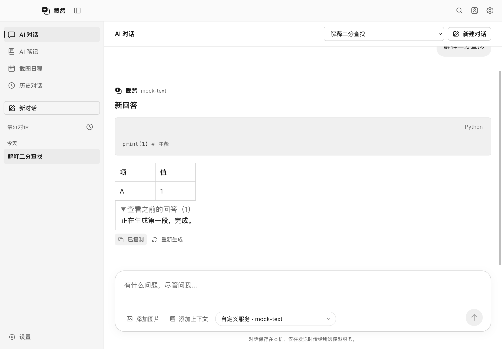
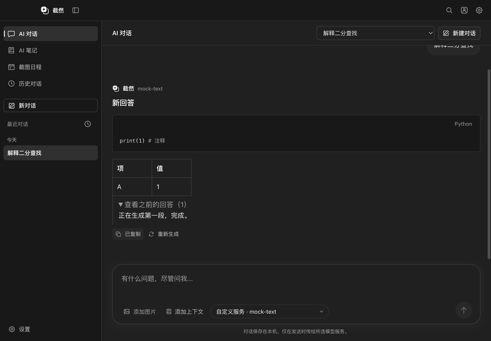

# AI 对话工作区 Phase 2 实施与验收

日期：2026-10-13。基于 [Phase 1 审计](AI_CHAT_WORKSPACE_PHASE1_AUDIT.md)。本轮完成正式导航与基础对话，不提前开放 AI 笔记或预测分支的修改提案。

## 已实现

- 侧栏和 ⌘K / Ctrl+K 快捷导航新增「AI 对话」，复用 `AppShell` / `WorkspaceHeader`，支持 Light / Dark / System。
- 纯文本新建：不要求截图、不生成占位 JPEG；仍使用现有本地历史索引与 Agent 服务。
- 选择已保存的会话、从历史页继续对话、重启后继续；已有截图会话可展开查看来源图片并继续图文问答。
- 复用现有模型配置和安全密钥存储。主窗口不维护另一套 Key。自定义兼容服务沿用 Key 可为空的规则；官方厂商未配置 Key 时提供设置入口，接口鉴权失败由现有调用链反馈。
- 流式显示、停止生成、复制回答、Markdown / GFM 表格、复用现有代码高亮与语言按钮复制；Return 发送、Shift Return 换行，中文输入法组合期间不发送。
- 切换页面和会话保留草稿、已保存消息与滚动位置，不自动取消另一会话的任务。可在生成中编辑下一条草稿。
- 重新生成最后一条回答：输入不重复携带原来的问答轮；失败或取消不覆盖原回答；成功时校验原始完整消息仍一致，原子保存新回答，并保留最近 5 个旧答案供查看。
- 停止普通回答后保留已生成内容，并明确标记取消状态；晚到状态不能覆盖更新的状态。
- 新工作区发起的任务只允许联网读取与计划工具，不提供本地文件、笔记写入、命令或 MCP 权限。限制由 Main 控制，不能通过 Renderer 或 LLM 参数关闭。
- 已有截图任务向主窗口交接时保留停止、权限确认和结果；先前实际提交的笔记变更仍可打开、查看差异和通过原有确认流程撤销。历史引用通过 conversationId 验证，截图浮窗不能使用主窗口会话引用接口。

## 复用与边界

没有新增 Provider、AgentRuntime、对话数据库、密钥存储、状态管理框架或运行时依赖。新会话与截图会话共用 `conversations.json`；旧截图读取接口保持必有 Capture 的类型，新工作区读取允许 Capture 缺省。旧记录可继续读取，截图 JPEG 管理流程保留。

会话中的普通回答不直接触发文件保存。新工作区不重放以前笔记工具的结果，向模型提供最多最近 500 条、2 MiB 的纯消息上下文，再由既有上下文管理器限制模型预算；完整历史仍保存在本机。视图缓存最多保留 5 个完整会话，其他会话的草稿和滚动位置仍保留。

原有会员校验继续应用于 AI 请求。普通截图、截图浮窗、ScreenCaptureKit Helper、快捷键、窗口预创建与复用、模型请求协议、笔记文件格式及保存协议未重写。当前仍沿用已有 Agent 的单任务并发限制；可以切换查看另一会话，但不能同时启动第二个 Agent 任务。

## 修改文件

| 文件 | 修改 |
| --- | --- |
| `src/shared/contracts.ts` | 新增可无截图的工作区会话、旧答案和历史创建 / 变化通知契约，保留截图会话类型 |
| `src/shared/agent/execution.ts` | conversationId 请求校验与工作区方法；历史笔记引用兼容原 captureId 接口 |
| `src/main/storage/history.ts` | 无图会话、元数据读取、重新生成一致性校验 / 原子保存、旧答案与删除兼容 |
| `src/main/index.ts` | 复用同一个 Agent 服务，新增 Main 专用工作区入口、历史通知及按会话访问已有变更 |
| `src/main/agent/ui/AgentExecutionService.ts` | conversationId 目标、只读范围、上下文隔离、重新生成与停止内容保留 |
| `src/main/agent/AgentLoop.ts`、`src/main/agent/types/agent.ts` | Main 控制的工具权限上限，未公布工具的执行请求仍被拒绝 |
| `src/preload/index.ts` | 在现有 agent / history 命名空间桥接窄接口 |
| `src/renderer/src/App.tsx` | 接入工作区，移除依赖当前截图的旧主窗口对话状态；历史继续不替换当前截图 |
| `src/renderer/src/components/AppShell.tsx`、`Icon.tsx` | 正式导航与单色对话图标 |
| `src/renderer/src/chat/ChatWorkspace.tsx`、`workspace.css` | 会话选择、消息、草稿 / 滚动保持、生成控制与单色布局 |
| `src/renderer/src/chat/MarkdownMessage.tsx`、`agent/SourceReferences.tsx` | 工作区复用现有代码块，安全 Markdown 与来源继续复用 |
| `src/renderer/src/agent/AgentExecution.tsx`、`useAgentExecution.ts`、`NoteChanges.tsx` | 截图任务交接、可选 Capture 类型与已有笔记变更入口兼容 |
| `src/renderer/src/history/HistoryPanel.tsx` | 同时预览纯文本和截图会话 |
| `tests/unit/chat-workspace.test.ts`、`history.test.ts` | 新增权限、会话隔离、长消息上下文、停止、重新生成及无图历史测试 |
| `tests/unit/agent-execution-ui.test.ts`、`agent-session-store.test.ts` | 明确旧截图测试夹具的 Capture 类型 |
| `tests/integration/chat-workspace.spec.ts` | 新工作区完整 IPC / UI / 持久化 / 主题 Mock 集成测试 |
| `tests/integration/desktop.spec.ts`、`agent-execution.spec.ts`、`agent-notebooks.spec.ts`、`workspace-browsing.spec.ts`、`screenshot-membership.spec.ts` | 更新新的导航、工作区控件及会话隔离预期，保留原业务断言 |
| `tests/integration/capture-window-visibility.spec.ts`、`quick-chat-workspace.spec.ts` | 新输入入口、浮窗交接焦点及会话引用隔离断言 |
| `README.md`、`docs/UI_DESIGN_LANGUAGE.md` | 当前能力、界面语言与阶段边界 |

## 验证结果

- `pnpm typecheck`、`pnpm lint`、`pnpm build`、`git diff --check` 通过。
- 最终 `pnpm test`：63 个文件、1,009 个用例通过。
- 全量 `pnpm test:smoke` 首次执行：34 项通过、4 项失败、11 项依据原有环境条件未运行。失败包括旧三入口断言和主窗口未呈现历史笔记变更；均已修复，没有删除测试或增加跳过条件。
- 最终针对性 Electron 复验：8 项通过，覆盖新工作区、截图浮窗、笔记变更 / 撤销、会员限制、命令沙箱和任务交接。之前通过的主题同步、窗口显示、笔记导航、历史浏览、Markdown、模型目录、更新器与合成截图性能等用例保持记录在全量冒烟日志中。
- 在本机实际 Electron 窗口获得 Light / Dark 截图，并检查导航选中色、消息布局、代码、表格、工具栏与输入区。修正旧全局 header 样式和工具栏收缩导致的间距问题。
- 外层开发沙箱限制 macOS 子进程 / 窗口启动，因此单元和 Electron 测试在获准的桌面环境下复验；测试使用临时存储、合成截图、本机 Mock API 和测试会员，无真实模型调用。

截图：

| Light | Dark |
| --- | --- |
|  |  |

## 限制与下一阶段

1. 本报告记录 Phase 2 交付时的边界；2026-10-14 的 [Phase 3](AI_CHAT_WORKSPACE_PHASE3.md) 已加入笔记 / 分支授权上下文、结构化修改提案、差异预览与确认保存，并把截图浮窗专用笔记工具迁移为逐次确认。
2. 本报告交付时图片仅限已有截图来源；2026-10-14 的 [Phase 4](AI_CHAT_WORKSPACE_PHASE4.md) 已接入消息级图片附件、粘贴和拖放。
3. 没有真实 Key 的跨厂商调用验证；目录可用不代表实际推理或工具调用成功。沿用现有 Provider 接口兼容范围。
4. 真机录屏、混合 DPI、多显示器、签名打包及 Windows 真机用例需要对应环境；未对真实截图延迟作新的性能提升声明。
5. 无图会话是历史索引的增量扩展。新版本可读取旧截图记录，但旧安装版不能保证读取新增无图记录；勿让旧版本共用此开发数据目录。
6. 当前完成源码实现与 macOS 构建，没有改变版本号、打包或发布。开发版重启后可测试；已安装正式版需之后另行发布。
