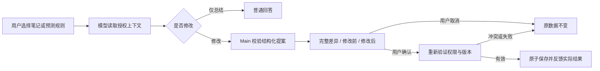
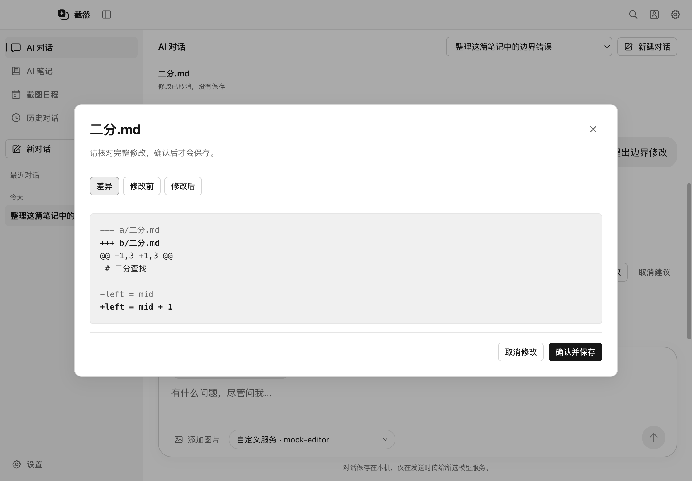
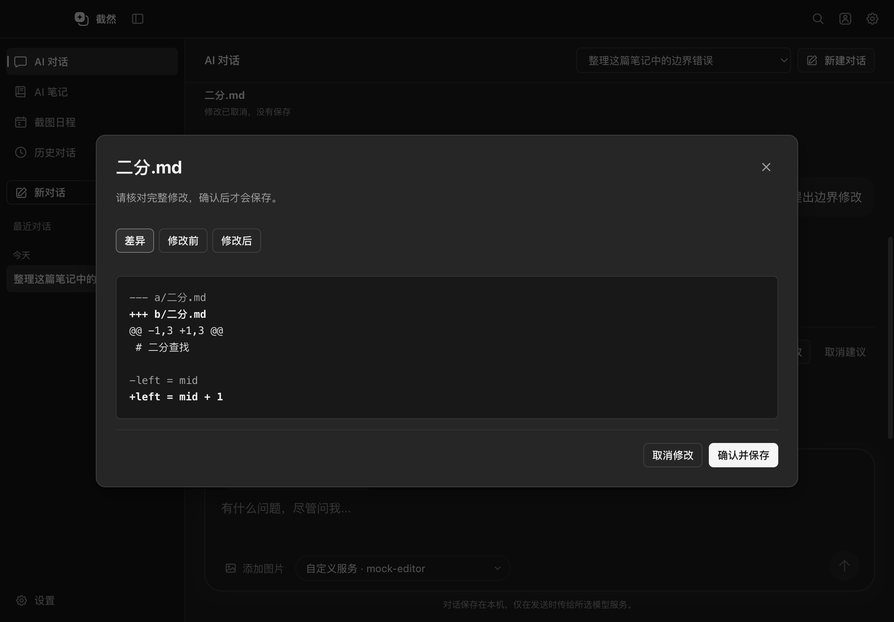
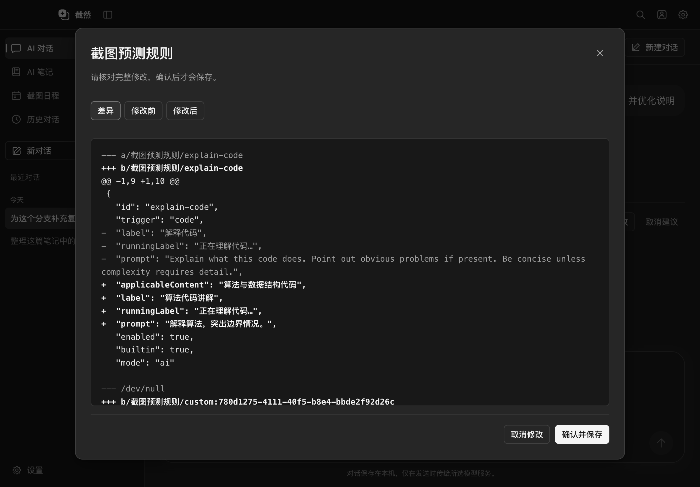
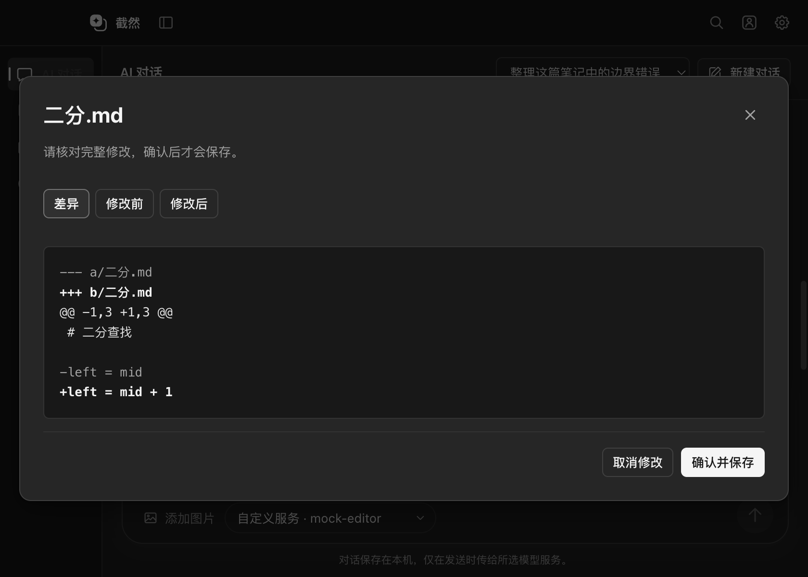

# AI 对话工作区 Phase 3：授权上下文与确认编辑

交付日期：2026-10-14。前置：[现状审计](AI_CHAT_WORKSPACE_PHASE1_AUDIT.md)、[Phase 2](AI_CHAT_WORKSPACE_PHASE2.md)。本轮仅实现笔记与预测分支编辑，不发布安装包或云端镜像，图片附件属于 Phase 4。

## 已实现的流程

- AI 对话底部的「选择笔记或预测分支」明确授权一篇笔记、新建笔记范围或一组已保存预测规则。
- 笔记页的「与 AI 讨论」先保存编辑器草稿，再携带笔记本、相对路径与文件版本；分支编辑弹窗的「用 AI 编辑已保存分支」只携带已保存规则，未保存表单不会被偷偷应用。
- 复用现有模型配置、Key 安全存储、Agent 工具调用、历史与流式输出。普通回答不触发写入，不从自然语言回答提取文件操作。
- 笔记支持创建、全文改写、追加与 SEARCH/REPLACE 局部编辑。已有笔记只能改所选文件；新建上下文只能创建所选笔记本已有父目录内的新 Markdown，不能覆盖同名文件。
- 提案显示目标、状态与实际候选增删行；完整预览包含差异、修改前与修改后三个视图。「确认并保存」才提交；「取消修改」不落盘。关闭预览可继续保留提案。
- 保存后显示实际状态，笔记可点击打开；复用现有变更清单与单文件检查点撤销。重新启动后已保存笔记仍可通过历史变更打开。
- 同时修正截图浮窗的专用笔记工具：每次显示差异并等待允许一次，旧会话或持久授权不能绕过。确认前无写入，实际提交后才继续最终回复；停止不会伪造已回滚结果。

## 预测分支的真实数据结构

现有对象是 `PredictionBranch[]`，最多 30 条平面规则，字段包含 ID、识别类型、适用内容、名称、运行提示、执行指令、启用状态、内置标记、执行模式及可选笔记本绑定。不存在父子关系、连线或图结构。

| 提案操作 | 实际约束 |
| --- | --- |
| 创建 | Main 生成 `custom:UUID`，固定自定义与 AI 模式；可指定有效插入位置 |
| 更新 | 仅授权规则的名称、运行提示、适用内容、执行指令、启用状态与有效笔记本绑定 |
| 删除 | 仅授权的自定义规则；内置规则提示改为禁用 |
| 排序 | 重排全部仍存在的已授权规则；未授权规则位置保留，不允许重复或非法引用 |

候选列表整体通过既有 Schema 后才能预览和提交。模型不能改写已有规则的 ID、内置身份、执行模式或引入虚构关系。分支差异使用固定字段顺序，并按发生变化的规则与列表顺序分段，避免把未改动的规则显示成整段删除；修改前后视图仍包含完整列表。规则保存只合并规则字段，保留当前模型、加密 Key、快捷键和主题。原规则在生成、查看、取消及任何失败阶段保持不变。

## 安全、冲突与资源边界

- 编辑上下文与工具能力由 Main 保存，绑定窗口和会话。新工作区只获得 `read_edit_context`、`propose_note_change`、`propose_branch_changes` 和既有计划工具；选中编辑上下文时不开放联网、通用文件、命令或外部 MCP 执行。
- 所选笔记正文通过分块读取提供，单块最多 1500 字符并限制 JSON 字节；全文替换前必须完整读取，局部修改保留未匹配原文。不读取其他笔记正文；分支绑定只提供已登记笔记本的名称与 ID。
- 预览绑定确定候选、源版本、上下文和模型配置摘要，Renderer 不能通过应用 IPC 替换候选正文。必须先请求完整预览并显式确认，才允许提交。
- 提交前重新核对会员资格、对话存在性、笔记本链接、目录身份、文件版本、当前规则和模型配置；编辑器草稿先按现有机制保存。人工修改、移动、取消链接、旧提案或模型切换会拒绝覆盖。
- 复用既有 `WorkspaceService.commitSnapshot` 与设置原子保存。保留 UTF-8、BOM、CRLF 与文件权限；路径穿越、附件 / 隐藏目录、软硬链接和无效编码继续拒绝。
- 每轮最多 4 项提案，单篇修改最多 256 KiB，完整差异最多 512 KiB，待确认预览总量限制 8 MiB。上下文快照最多保留 10 个会话，摘要记录有界。
- 待确认提案 10 分钟过期；停止、失败、重新生成、继续对话或更换上下文使相关未提交提案失效。重启不恢复临时编辑授权和未提交正文，需重新生成。已保存结果保留在既有本机历史。
- 文件 / 设置保存失败仍保留原数据。实际提交成功但附属历史或撤销记录保存失败时，如实显示「修改已保存，但记录保存失败」，不宣称未写入。
- API Key、图片 Base64 和正文不添加到日志。发送到用户已配置模型的选中上下文是明确的数据传输；本地历史与既有撤销检查点仍保存在原有位置。

## 修改文件

| 层级 | 文件与职责 |
| --- | --- |
| 共享协议 | `src/shared/agent/editing.ts`、`src/shared/contracts.ts`：严格上下文、候选操作、提案摘要和窄 API |
| Main 提案 | `src/main/agent/editing/EditingProposals.ts`、`branches.ts`、`registerEditingTools.ts`：授权、读取、验证、预览、确认与冲突处理 |
| 既有 Agent | `ToolRegistry.ts`、`ToolExecutor.ts`、`AgentLoop.ts`、`createFileToolSystem.ts`、`types/{agent,tool}.ts`：复用执行链并限制工具范围 |
| 会话与投影 | `src/main/agent/ui/{AgentExecutionService,ExecutionPresenter}.ts`：上下文能力、提案生命周期与实际状态 |
| 截图笔记确认 | `src/main/agent/notes/{NotebookWriter,registerNotebookTools}.ts`、`PermissionManager.ts`：逐次预览、授权与原子提交 |
| 存储与 IPC | `src/main/storage/{history,settings}.ts`、`src/main/index.ts`、`src/preload/index.ts`：原索引增量摘要、规则合并、Main 专用 IPC 与事件 |
| Renderer | `src/renderer/src/chat/{ChatWorkspace,EditingPanel}.tsx`、`editing.css`：上下文选择、完整差异、确认、取消与结果 |
| 现有页面入口 | `App.tsx`、`notes/NotesPanel.tsx`、`settings/SettingsPanel.tsx`：进入工作区携带明确目标 |
| 既有浮窗反馈 | `agent/{AgentExecution,AgentNotebook}.tsx`：完整差异入口与逐次确认说明 |
| 单元验证 | `tests/unit/{editing-proposals,agent-permissions,settings,history}.test.ts`；既有笔记、检查点和命令 fixtures 明确注入审批器 |
| 桌面验证 | `tests/integration/editing-workspace.spec.ts`、`agent-note-writing.spec.ts`；Dock 图标测试等待真实 UI 挂载后正常退出 |
| 文档 | 本报告、README、UI 设计语言、AI 笔记说明、写入流程与 Phase 2 后续状态 |

没有修改 ScreenCaptureKit Helper、截图窗口架构、Markdown 存储格式、主题状态管理、模型请求协议或服务端预测接口。

## 验证结果

测试使用临时笔记本、合成截图和本地 Mock 模型，不代表真实 API Key 或全厂商调用验证。

| 检查 | 结果 |
| --- | --- |
| `pnpm typecheck` / `pnpm lint` / `pnpm build` | 通过；没有新增依赖 |
| `pnpm test` | 64 个文件、1027 项通过；本轮新增 18 项用例 |
| 完整 Electron 套件 | 38 项通过，11 项沿用原有真实录屏 / 打包 / 平台条件而未运行；新增工作区用例因模糊标签定位失败，修正为精确定位后独立复测通过，合计 39 个不同用例通过 |
| 最终相关 Electron 复测 | 最终构建的工作区编辑与截图逐次确认两项通过（15.0 秒），刷新亮暗与紧凑窗口截图 |
| 实际视觉检查 | Light / Dark 的完整预览、规则预览与紧凑窗口；主操作可见，无横向布局溢出 |
| `git diff --check` | 通过 |

首次完整检查还发现 Dock 图标测试在 React 保存监听挂载前退出，图标断言已通过但退出超时。测试现等待真实 UI 就绪，最终完整套件该用例通过；生产退出保护没有删改。没有删除测试，也没有增加条件跳过来隐藏失败。

新增单元验证覆盖：确认前无写入、完整预览、摘要不匹配、重复点击、取消、停止、过期、越权窗口 / 会话、伪造能力、未读取上下文、完整读取要求、创建覆盖、BOM/CRLF、人工修改、移动、取消链接、模型变化、非法分支字段 / 引用 / 排序 / 内置删除 / 超量、绑定失效、保存失败、保留密钥与主题、授权缓存不能跳过确认。

真实 Electron 流程验证笔记页进入 AI 对话、授权内容最小化、修改预览三个视图、取消、确认落盘、打开文件、分支设置进入对话、新增与更新规则、主题切换及非主窗口 IPC 拒绝。既有截图浮窗验证逐次确认、先保存后回复、本地草稿保留、历史打开、实际变更撤销、提交后停止与检查点。

## 实际窗口截图

所有截图均来自使用临时测试数据的 Electron 窗口。

| Light 笔记预览 | Dark 笔记预览 |
| --- | --- |
|  |  |

## 遗留边界与下一阶段

1. 本报告记录 Phase 3 边界；2026-10-14 的 [Phase 4](AI_CHAT_WORKSPACE_PHASE4.md) 已加入本地图片选择、粘贴、拖放、多附件与已有截图输入，同时保留截图捕获路径。
2. 单轮选一种上下文，不能跨多篇笔记批量确认事务；超长全文改写受现有 Agent 迭代 / Token 限额约束，可要求局部修改或拆分。
3. 没有预测关系图；新规则在确认时分配最终 ID，不提供同一操作数组中引用尚未分配 ID 的新规则。目录创建、文件移动与任意脚本不开放给新工作区。
4. 本轮使用 Mock 验证工具调用协议；真实厂商的工具支持、账号权限和 Key 仍需用户配置后验证。
5. Windows、真实录屏、多显示器 / 混合 DPI、公证与安装包更新未在本轮验收；不宣称真实截图性能提升，不上传镜像或 Release。
