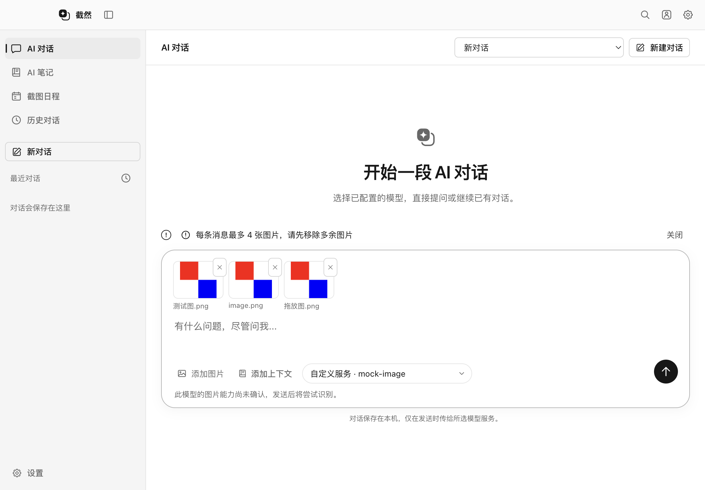
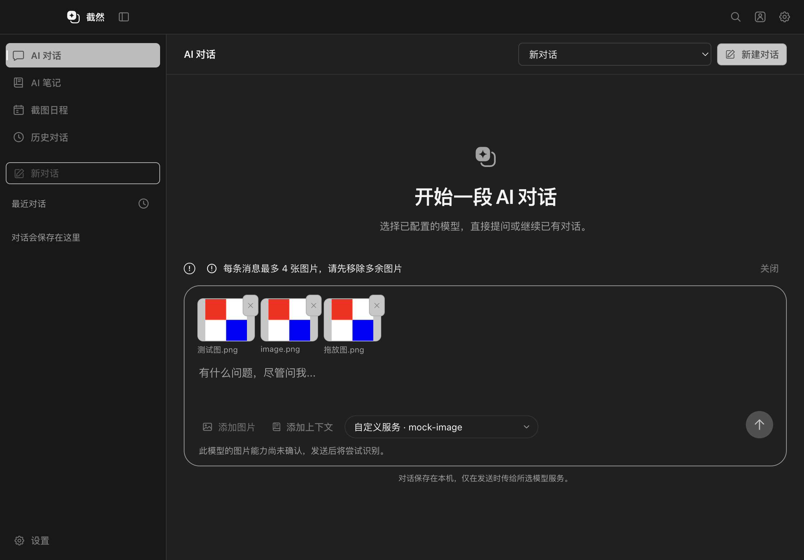

# AI 对话工作区 Phase 4：图片输入与历史附件

> 2026-10-18 更新：本文保留当时的实现与验收记录。所选笔记已改为无需逐次审批的自动保存，预测规则仍需确认；当前行为见[操作优化](CHAT_CONTROLS_2026_10_18.md)。

交付日期：2026-10-14。前置：[现状审计](AI_CHAT_WORKSPACE_PHASE1_AUDIT.md)、[Phase 2](AI_CHAT_WORKSPACE_PHASE2.md)、[Phase 3](AI_CHAT_WORKSPACE_PHASE3.md)。本轮增量实现主窗口 AI 对话的图片输入，复用现有模型、Agent、历史和确认编辑链路。

## 使用流程

1. 进入「AI 对话」，沿用设置中已配置的模型与 API Key。
2. 点击附件图标选择本地 PNG / JPEG；也可在输入框按 Command + V、点击「粘贴图片」，或拖入本地图片。
3. 「添加已有截图」选择本机历史中的截图选区。截图浮窗点击「返回软件」进入对应对话后，还可点击「使用来源截图」。不重新捕获完整屏幕。
4. 输入区显示待发送缩略图，可移除或点击放大；支持图文同时发送，只有图片时默认提问「请分析这些图片」。添加过程中仍可输入文字，待图片处理完成再发送。
5. 可同时选择 Phase 3 的笔记或预测分支上下文。模型根据图文生成回答或结构化提案；提案仍须经过完整预览与用户确认，才允许保存。
6. 已发送图片归属于对应的用户消息，AI 对话与历史详情均可查看。继续对话、重新生成及重启后打开历史保留该关联。

普通文字粘贴不受影响。远程图片地址不会被拖放入口自动下载；未经发送的草稿不落盘，重启不恢复。

## 模型与协议复用

- 复用 `ChatCompletionsAgentProvider`，以既有 `image_url` 消息部件发送图片，保留流式响应、工具调用、取消和请求配置。
- 多张图片附在各自的用户消息上；历史图片不会被拼接到最新问题，也不会转换为声称识别过的文字。图片仅在 Main 内生成短生命周期的请求 Data URL。
- 使用同一个 `ModelCatalog` 与现有 Key 范围缓存、明确官方映射和用户主动验证结果。查询能力不会调用模型或产生测试费用。
- 已确认不支持图片的模型：当前带图发送在 Renderer 和 Main 两层拒绝；移除待发送图片后可正常问答，历史图片不上传并显示提示。
- 未知能力：保留 `unknown`，明确提示将尝试既有多模态接口，不冒充已确认支持。
- 鉴权、权限、余额、限流、明确图片不支持与一般参数错误采用现有能力测试的错误分类。错误正文只用于有界分类，不把厂商返回的敏感正文显示到界面。
- 没有创建第二套模型、Key 或对话管理系统，没有改写厂商 API 协议。真实厂商是否接受图文、工具组合及其接口权限仍须实际 Key 验证。

## 图片与资源限制

| 范围 | 限制与处理 |
| --- | --- |
| 格式 | PNG / JPEG；根据文件签名、尺寸及实际解码校验，不依赖扩展名 |
| 单张源文件 | 最多 10 MiB、2000 万像素；拒绝异常尺寸与无法解码内容 |
| 规范化 | 保留真实颜色，等比缩小至最长边 2048，转为 PNG；结果最多 4 MiB |
| 单条新消息 | 最多 4 张，批量导入全部校验成功后才加入草稿 |
| 单次模型上下文 | 当前图片优先，随后保留最近历史图片；最多 8 张、16 MiB PNG 数据，不含 Base64 编码开销 |
| 历史超限 / 缺失 | 不阻断纯文本问答；提示部分图片未附带，要求模型不能假设已看到 |
| 未发送草稿 | 每个窗口最多 16 张，全应用规范化草稿最多 64 MiB；发送、移除、窗口销毁或进程退出释放 |
| Renderer 预览 | 缩略图按可见区域加载；离屏或卸载释放 Blob URL，放大预览拥有独立生命周期 |

本轮不支持 GIF、WebP、SVG、PDF、视频或远程 URL 导入，也不引入 OCR。图片不会自动复制到笔记 `assets`；根据图片修改 Markdown 继续使用 Phase 3 提案确认流程。

## 存储与安全边界

- `userData/history/attachments/<UUID>.png` 保存规范化后的已发送图片；历史 JSON 和 Agent 上下文只保存受 Schema 校验的元数据或 UUID 引用，不保存 Base64、Renderer Blob URL 或任意文件路径。
- Main 负责原生文件选择、剪贴板读取、规范化、图片 ID、会话绑定和请求组装。Renderer 只能提交有界二进制图片或访问当前会话内已有引用。
- 图片 IPC 仅供主窗口使用，复用既有窗口来源验证。截图浮窗与捕获 Overlay 不能调用该入口；异步文件和剪贴板操作后再次验证窗口与会话。
- 图片草稿绑定窗口和会话，发送时锁定，不能在另一会话使用或发送中删除。新草稿关联空对话后再交给已有 Agent。
- 已发送附件使用原子临时文件写入，目录权限 `0700`、文件权限 `0600`；读取检查尺寸、文件类型与链接情况。图片写入成功但历史索引失败时清理新文件，解锁并恢复未保存草稿。
- 删除或清空历史同时清理附件，启动时清理无索引引用的孤儿附件。文件删除失败将在之后启动时再次尝试。
- API Key、图片 Base64 与新增图片内容不进入日志。图片只发送给用户配置的模型接口；已有笔记修改仍必须经过结构验证与用户确认。
- 本地附件是普通本机文件，沿用现有历史的磁盘隐私边界；本轮没有新增静态加密方案。

## 修改文件

| 层级 | 文件与职责 |
| --- | --- |
| 共享协议 | `src/shared/chat-images.ts`、`contracts.ts`、`agent/{execution,message}.ts`：图片限制、元数据与窄 API |
| Main 图片输入 | `src/main/chat/{ChatImages,image-validation,provider-images}.ts`：草稿、验证、历史图片选择与生命周期 |
| 本机附件 | `src/main/storage/chat-images.ts`、`history.ts`：私有图片文件、可选历史元数据与清理 |
| 既有模型与 Agent | `src/main/ai/llm/{ChatCompletionsAgentProvider,LLMProvider}.ts`、`ai/models/ModelCatalog.ts`、`agent/{ContextManager,ui/AgentExecutionService}.ts`：多图片请求、能力与释放 |
| IPC | `src/main/index.ts`、`src/preload/index.ts`：复用现有窗口验证、服务与调用入口 |
| AI 对话 | `src/renderer/src/chat/{ChatWorkspace,ImageAttachments}.tsx`、`workspace.css`、`image-attachments.css`：附件输入、预览与能力提示 |
| 历史详情 | `src/renderer/src/history/HistoryPanel.tsx`：复用附件预览，不改历史业务格式 |
| 单元测试 | `tests/unit/chat-images.test.ts`、`agent-chat-provider.test.ts`、`model-catalog.test.ts` |
| Electron 测试 | `tests/integration/chat-images.spec.ts`、`editing-workspace.spec.ts`、`windows-capture-ui.spec.ts` |
| 文档 | 本报告、README、UI 设计语言、Phase 2 / 3 的后续状态 |

没有增加依赖，也没有修改 ScreenCaptureKit Helper、截图捕获架构、快捷键、窗口复用、笔记保存协议、主题状态或服务端预测接口。

## 验证结果

测试使用临时存储、合成图片、本地 Mock 模型与 Mock 会员服务。真实 macOS Electron 窗口验证了原生选择、剪贴板及图片解码；模拟 Windows Renderer 不等同于真实 Windows 运行验证。

| 检查 | 结果 |
| --- | --- |
| `pnpm test` | 65 个文件、1041 项通过；本轮新增 14 项 |
| 最终相关单元复测 | 图片、Agent Provider 与模型目录 3 个文件、125 项通过 |
| 图片 / 编辑 / Windows 界面模拟复测 | 最终构建 3 项通过，14.0 秒 |
| `pnpm typecheck` / `pnpm lint` / `pnpm build` | 通过；最后一次冒烟包含重新构建和类型检查 |
| 最终 `pnpm test:smoke` | 40 项通过，2.8 分钟；11 项沿用真实录屏 / 打包 / 平台条件而未运行，0 项失败 |
| `git diff --check` | 通过 |
| 亮暗视觉检查 | 已查看真实 Electron 的 Light / Dark 附件界面；控件使用 Monochrome Token，合成图片颜色保留 |

图片单元测试覆盖签名与尺寸、恶意格式、限制、批量原子性、窗口 / 会话隔离、发送锁、文件权限、回滚、历史恢复、删除清理、严格引用、未知能力、文本模型、历史图片预算及 HTTP 错误脱敏。

Electron 流程覆盖原生 PNG / JPEG 文件选择、真实 Command + V、拖放、超量与移除、放大预览、图文发送、重新生成、重启恢复、历史详情、模型不支持时 UI / IPC 双层拒绝、纯文本仍可发送、鉴权失败、截图选区进入工作区、浮窗拒绝附件 IPC、删除历史清理文件。编辑用例同时发送合成图片与已授权笔记，继续验证差异预览、取消和确认才落盘。

首次完整回归有一项 Windows 界面模拟测试在启动阶段失败：夹具写死了 `path.join`，新构建的导入变量名为 `path$1.join`，导致夹具抛错后无法创建窗口。夹具现匹配经过验证的打包导入名称，并在启动 Electron 前检查目标唯一性；独立复测已通过。没有删除用例、增加跳过或修改生产截图路径。

之后完整回归还发现分支编辑用例在点击确认后立即读取设置，可能早于异步会员核验与实际保存。该用例现等待界面报告「修改已保存」后再检查真实设置与密钥保留；保存结果断言未删减，也没有添加固定睡眠。

## 实际界面截图

截图使用合成彩色测试图片，红蓝色块属于真实图片内容，不是 UI 强调色。

| Light | Dark |
| --- | --- |
|  |  |

## 验收边界

1. 没有使用真实厂商 Key；不宣称所有厂商、多模态与工具组合已在线验证。复用既有 Chat Completions 调用路径，未扩展原生 Messages / Gemini 协议。
2. 未运行需要真实录屏、安装包或特定平台条件的既有用例；没有宣称真实截图性能提升，也没有完成 Windows 真机验收。
3. 未发送图片是进程内草稿；停止、失败和历史保存以现有会话行为为准。无法处理的图片需要缩小或转为 PNG / JPEG 后重试。
4. 没有发布新安装包或镜像。旧安装版不会自动获得本轮变更，需要之后构建发布；开发版重启后可验证。
