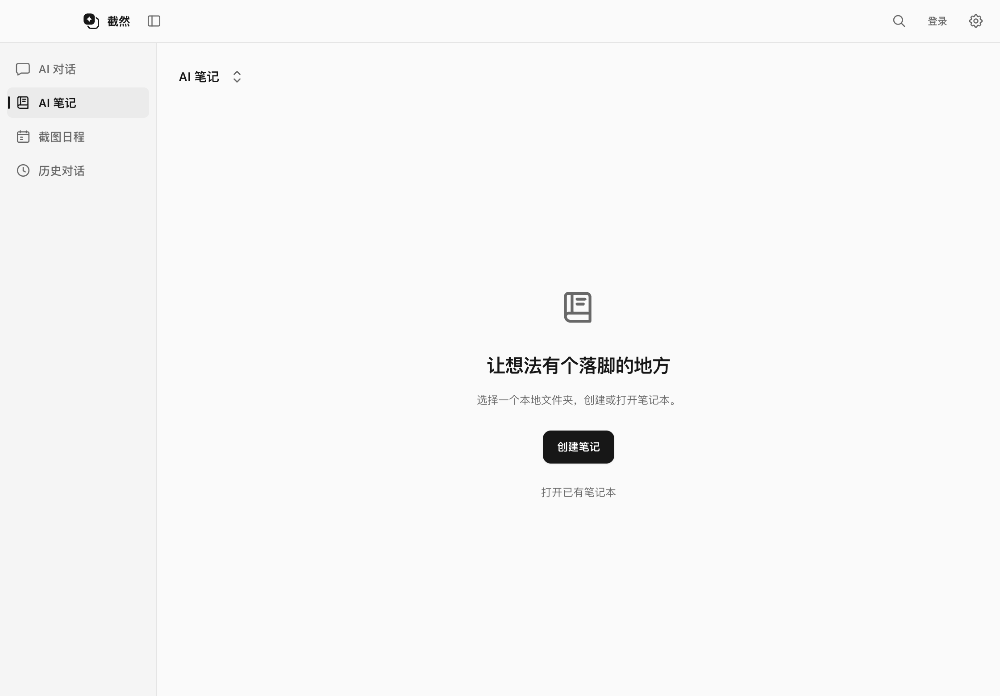
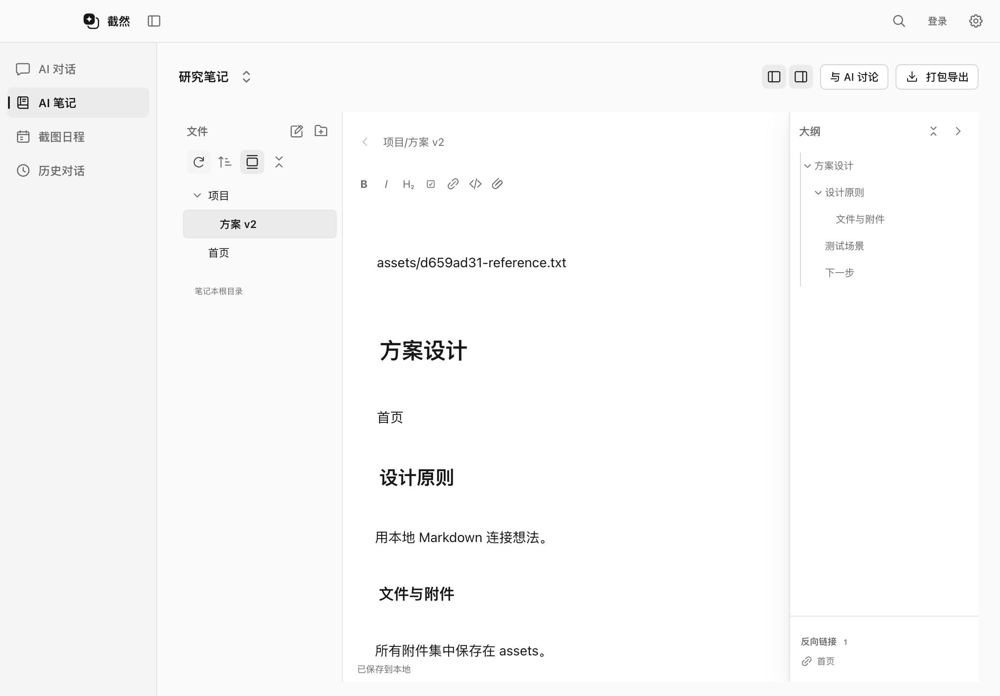
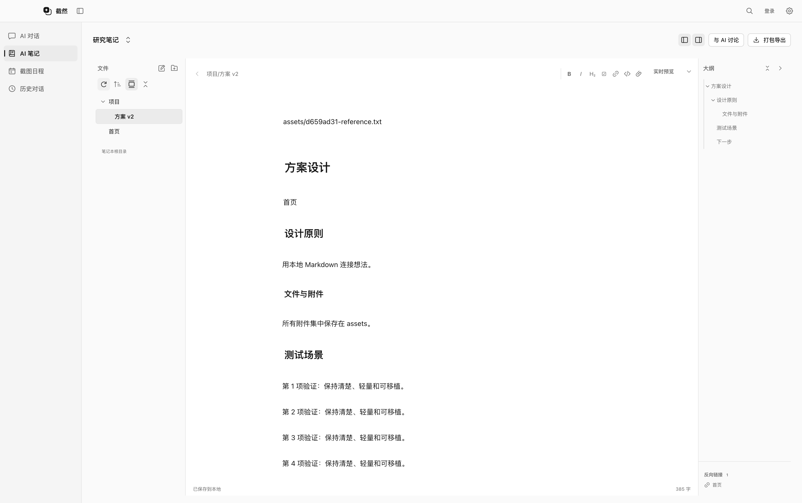
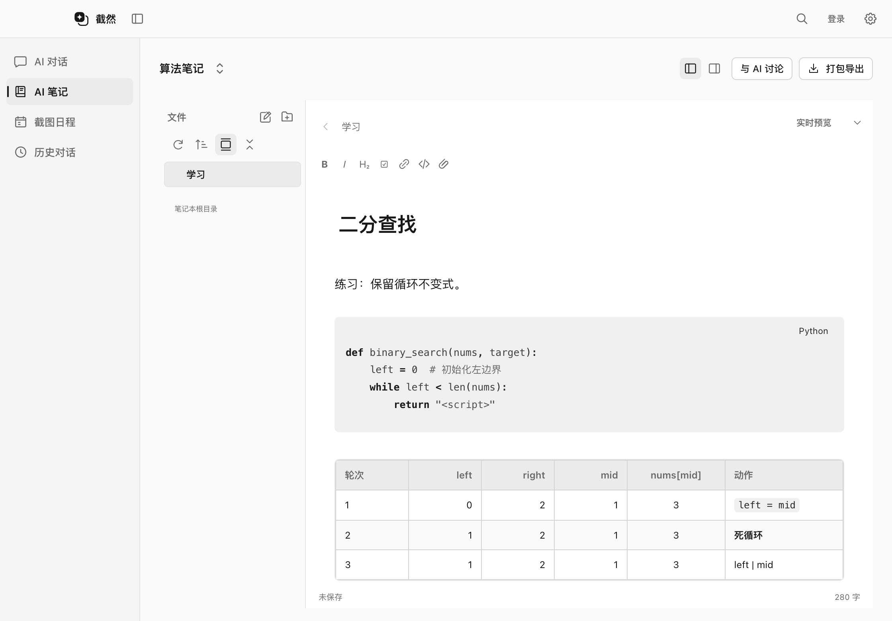
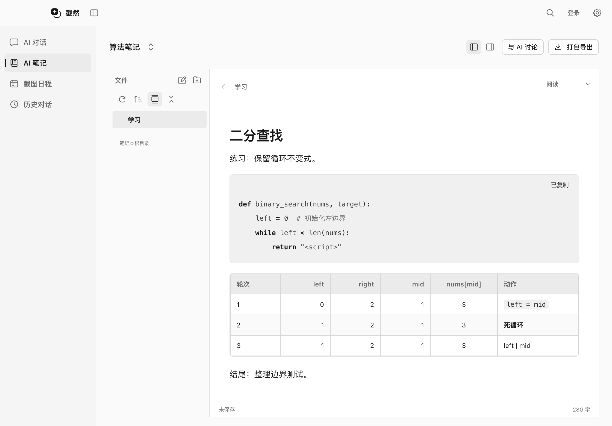

# AI 笔记

AI 笔记是 Snipvia 主窗口中的本地 Markdown 工作区。本次实现笔记本、编辑、链接、附件和导出；用户直接编辑不会自动调用模型或上传内容。已选笔记本可供 Agent 自动整理 Markdown，写入有单独的 Main 能力，通用文件修改仍未开放。

## 创建和切换笔记本

1. 左侧菜单进入 **AI 笔记**，点击中央的 **创建笔记**。
2. 在系统目录选择器中选择保存位置，再为笔记本命名。
3. Snipvia 在该位置创建同名文件夹。初始只有空的 `assets/` 附件目录，不生成示例笔记。
4. 点击左侧文件栏的「新建笔记」按钮，输入名称后开始编辑。
5. 点击左上角笔记本名称，可以切换、创建或打开已有笔记本。切换后恢复上次打开的 Markdown 文件。

已有笔记本直接读取原目录，不复制文件，不迁移或删除原来的附件。

### 移除笔记本链接

点击左上角笔记本名称，在列表右侧点击「移除链接」图标，然后确认。该操作仅将笔记本从 Snipvia 的授权列表移除，原目录、笔记和附件全部保留；需要再次使用时，选择「打开已有笔记本」并选中原目录。

移除当前笔记本前会等待保存；发生冲突或保存失败时保留编辑并停止移除。当前笔记本移除后回到创建 / 打开界面，其他笔记本仍可通过名称菜单选择。相关对话取消笔记本选择及读写范围，正在回答或选择笔记时需要等待完成。已有预测分支中绑定的旧链接会提示无法打开，需要重新选择绑定。




## 界面与编辑

- **左侧文件目录**：新建笔记、新建文件夹、排序、自动定位当前笔记、全部展开或折叠；右键或行末菜单支持重命名、移动、在系统文件管理器中显示、移到废纸篓。根目录 `assets` 及其中内容隐藏，附件仍正常保存、预览和导出。
- **中央编辑区**：实时预览、源码、阅读三种模式。实时预览隐藏非当前行的常见标记，显示链接、图片和可勾选待办；当前行保留 Markdown 编辑语法。
- **右侧标题大纲**：从当前 Markdown 的标题生成层级目录，支持展开、折叠和点击跳转；下方显示引用当前笔记的反向链接。
- **收起侧栏**：页头右侧两个图标分别控制文件列表和标题大纲，可以独立收起或展开。宽度连续过渡，正文随之扩展，输入内容和文件夹展开状态保留。主菜单采用相同动画；系统开启「减少动态效果」时关闭过渡动画。
- **窗口适配**：页头和笔记工作区使用窗口内全部可用宽度。全屏时中央编辑区随窗口扩展，左右目录保持合适宽度；缩小窗口后仍保留三栏，文件、大纲及正文各自滚动。
- **拖动**：文件和文件夹可以拖入其他目录，或拖到列表空白处 /「笔记本根目录」行移回根目录。源行和目标文件夹区域高亮，光标旁显示名称与「移动到…」浮层。悬停在折叠目录上会自动展开，靠近列表上下边缘会滚动。松开前用 Esc 取消；同名冲突、原位置或拖入自身 / 子目录会显示原因并拒绝移动。拖进编辑器继续用于插入笔记链接。
- **自动保存**：停止输入约 400ms 后保存；切换文件、切换笔记本、导出和正常退出前等待保存完成。强制结束进程或断电不能保证保留尚未保存的输入。





### 代码块与表格

实时预览和阅读模式使用相同的代码颜色：关键字、变量、字符串与数值分色，注释灰色。围栏代码块位于比正文更深的浅灰框内，右上角显示语言名称；点击名称复制代码，短暂显示「已复制」。复制不包含 Markdown 围栏，不执行代码。源代码模式保留围栏和完整 Markdown，同时提供语法颜色。

语言解析采用 [CodeMirror 官方语言包](https://github.com/codemirror/language-data)，按需加载本地打包的语法模块；支持 Python / py、JavaScript / js、TypeScript / ts、C / C++、Java 等包内语言。未知语言保留原文，超过 256 KiB 的单个阅读代码块使用纯文本，以免长代码阻塞界面。语法高亮不会上传代码或从 CDN 获取脚本。

表格按 GFM 解析，展示表头、单元格边线、交替行底色与 Markdown 指定的对齐。支持单元格内代码、强调和转义竖线。宽表在自身区域横向滚动，正文与两侧目录不会被撑开。实时预览中，点击单元格或聚焦表格后按 Enter，会展开 Markdown 源码并将光标定位到对应单元格；光标移出表格后恢复预览。当前不是独立的可视化表格编辑器。

编辑继续使用 CodeMirror 6；阅读与表格预览使用 [React Markdown](https://github.com/remarkjs/react-markdown) 和 remark-gfm。未启用原始 HTML 或任意脚本。实时预览通过 StateField 直接提供布局装饰，标题使用 padding 形成间距，避免 margin 与编辑器测量不一致造成点击光标下移。





### 快捷键

以下快捷键在 AI 笔记页生效；Windows 使用 Ctrl 替代 Command。

| macOS | 操作 |
| --- | --- |
| Command + N | 新建笔记 |
| Command + S | 立即保存 |
| Command + E | 切换编辑与阅读 |
| Command + B / I | 粗体 / 斜体 |
| Command + F | 编辑器内查找 |
| Command + Z / Shift + Command + Z | 撤销 / 重做文本编辑 |
| Command + 点击链接 | 在源码或当前编辑行中打开链接 |

## 链接与附件

```md
[[研究计划]]
[[项目/研究计划|显示名称]]
[[研究计划#测试场景]]
[[研究计划#^block-id]]
[研究计划](项目/研究计划.md)
![[assets/example.png]]
![[另一篇笔记]]
```

- 输入 `[[` 提示可链接的笔记，输入 `[[#` 提示当前笔记的标题。
- 短文件名唯一时可直接使用；存在同名笔记时应使用完整路径。
- 点击尚不存在的笔记链接，会先询问是否创建；不会静默创建文件。
- 在 Snipvia 内重命名或移动文件，会同步更新能够确定目标的 Wiki 链接和 Markdown 链接，保留别名及标题锚点，不改代码块中的内容。
- 移动前等待当前笔记保存；文件夹连同内容移动，打开的笔记跟随新路径。保存冲突时保持原位置及编辑内容。
- 支持基本标题、块引用跳转；阅读模式支持一层笔记嵌入，嵌入预览最多显示 20000 字符。
- 粘贴图片、拖入文件或点击「添加附件」时，文件复制到当前笔记本的 `assets/`，使用独立文件名避免覆盖，并插入相应链接。
- 支持 PNG、JPEG、GIF、WebP 本地图片预览。其他附件可在系统文件管理器中找到；不在页面执行 HTML/SVG，也不自动加载远程图片。

示例目录：

```text
研究笔记/
├── 首页.md
├── 项目/
│   └── 研究计划.md
└── assets/
    ├── 7bf10a92-image.png
    └── 603f953a-report.pdf
```

## 外部编辑、冲突和导出

可以用其他 Markdown 编辑器打开这些文件。目录变化或重新聚焦 Snipvia 时会刷新；当前笔记有未保存修改时不会被后台刷新替换。

保存使用内容版本校验、临时文件写入和重命名，保留原文件 UTF-8 BOM 与 CRLF 换行。检测到版本冲突时保留编辑内容，用户选择「载入磁盘版本」或「我的编辑另存副本」。文件系统不提供跨应用事务，仍建议避免多个程序同时重命名同一组笔记。

右上角 **打包导出** 将 Markdown、普通附件、目录结构打包为 ZIP，保存位置由系统对话框选择。ZIP 包含笔记本根文件夹；不包含 Snipvia 配置、API Key、隐藏文件（含 `.obsidian`）或符号链接。导出目标需在笔记本之外，导出前会保存当前笔记。

## 与截图对话关联

- 输入框附近的「选择笔记」选择整个笔记本，为当前对话提供按需检索与自动 Markdown 记录范围。没有笔记本时，直接进入创建流程，创建后关联当前对话。
- 在「模型与设置 → 截图预测 → 编辑分支」中选择「绑定笔记本」，也可以保留「不绑定笔记本」。内置与自定义分支都支持。
- 截图命中有绑定的分支时自动选中对应笔记本；之后仍可手动更换或取消。主窗口、截图悬浮窗和续拍共享当前对话的选择。
- 0.3.1 起，Agent 在用户选择的笔记本或笔记范围内直接新建、追加和精确编辑 Markdown，无需逐次审批。截图浮窗与主窗口均在真实保存后回复，保留完整差异、实际变更列表和撤销。未选择上下文不提供笔记写入能力；只读指令、取消和文件冲突继续受保护。预测规则与命令工具保留各自确认和授权。详见[当前写入边界](AGENT_NOTE_WRITING_PLAN.md)和[操作优化验收](CHAT_CONTROLS_2026_10_18.md)。

当前写入范围、冲突检查、取消和后续撤销边界见 [自动笔记写入说明](AGENT_NOTE_WRITING_PLAN.md)。

选定笔记本后，Agent 也可以使用 [沙箱命令与脚本](AGENT_COMMANDS.md) 创建主题目录、移动笔记或运行算法验证。JavaScript 使用应用内置 Node，Python 使用系统已有解释器。执行过程仍是一行状态，完成后再回复，实际 Markdown 变更可从清单打开；明确要求只读时命令不能修改笔记本。命令移动不自动触发 Wiki 链接改写，需要 Agent 按任务核对引用。

## 实现边界

- 这是 Obsidian 常用本地笔记工作流的实现，不是完整 Obsidian 兼容层。暂不包含插件、图谱、多标签、PDF 内嵌阅读、数学公式、同步、自动附件保存。Agent 写入可按轮撤销，见[自动笔记写入说明](AGENT_NOTE_WRITING_PLAN.md)。
- 新导入附件统一进入 `assets/`，在文件树中隐藏；打开已有目录时不自动改写其原有附件布局。已有普通文件可在笔记本内整理到其他文件夹或根目录；附件根目录本身保留。
- 单篇笔记最多 2 MB，单个附件最多 25 MB，每次最多导入 20 个附件。目录最多 10000 个条目、40 层，ZIP 原始内容合计最多 512 MB。
- 所有文件操作位于 Main；只允许已由系统目录选择器授权的笔记本。拒绝路径穿越、符号链接和硬链接写入，IPC 仅允许主窗口调用。
- CodeMirror、笔记组件及代码语法模块按需加载；截图浮窗不加载笔记编辑器。

## 代码与验证

| 层级 | 入口 |
| --- | --- |
| 类型与 IPC Schema | `src/shared/notes.ts` |
| Markdown 标题、链接、重命名改写 | `src/shared/note-markdown.ts` |
| 目录、文件、附件、ZIP | `src/main/notes/NotebookService.ts` |
| 主进程 IPC、系统对话框 | `src/main/notes/registerNotesIPC.ts` |
| 界面与编辑器 | `src/renderer/src/notes/` |
| 窄接口桥接、退出保存 | `src/preload/index.ts`、`src/main/index.ts`、`src/renderer/src/App.tsx` |

验证命令：

```sh
pnpm lint
pnpm typecheck
pnpm test --maxWorkers=1
pnpm build
pnpm exec playwright test tests/integration/notes.spec.ts tests/integration/desktop.spec.ts
```

单元测试涵盖目录授权、路径与符号链接限制、保存冲突、UTF-8/换行、链接改写、附件与实际 ZIP 内容。Electron 测试使用临时目录和合成图片，覆盖创建、编辑、大纲、链接、附件粘贴、切换笔记本、导出、紧凑布局、退出前保存及原桌面流程。Windows 未在本阶段进行真机验证。

2026-09-27 验证结果：Lint、TypeScript、构建通过；37 个单元测试文件共 555 项通过；上述两项 Electron 测试通过。桌面回归测试补充了点击截图区域的明确聚焦步骤，再验证 Enter 触发预测，保留原断言。

2026-10-05 布局调整验证：文件目录移至左侧、标题大纲与反向链接移至右侧，笔记页头与工作区铺满可用宽度。Lint、TypeScript、构建与 594 项单元测试通过；笔记及桌面两项 Electron 联调通过，新增原生全屏、紧凑窗口的布局边界检查与截图。验证使用临时笔记本；Windows 本次未进行真机验证。

2026-10-05 导航与链接管理验证：Lint、TypeScript、构建及 606 项单元测试通过；桌面、笔记工作流和新增笔记导航三项 Electron 检查通过，账号和对话笔记本联调也通过。逐帧验证主菜单、文件列表与大纲的连续收起，检查图标居中、编辑器保持及减少动态效果。临时笔记本验证保存冲突阻止移除、取消保留链接、移除后文件与附件不变、旧 ID 无法访问及重新打开。单元测试覆盖登记文件写入失败回滚、已移动目录取消链接、等待保存完成和对话只读授权撤销。Windows 本次未进行真机验证。

2026-10-05 拖拽移动验证：Lint、TypeScript、构建及 610 项单元测试通过；笔记拖拽、笔记工作流和笔记导航三项 macOS Electron 检查通过。使用临时笔记本和真实鼠标拖拽，验证文件与文件夹移入目录、移回根目录、目标区域高亮、浮层提示、悬停展开、边缘滚动、取消拖拽、保存后移动和打开路径跟随；检查链接更新、同名冲突与自身子目录保护。`assets` 及内容从文件列表隐藏，附件内容、预览、导入与导出保持正常。交互截图见 [移入文件夹](ui/notes-drag-folder.png) 和 [移回根目录](ui/notes-drag-root.png)。Windows 本次未进行真机验证。

2026-10-06 Markdown 展示与光标验证：先在旧版复现点击第一段文字后输入落在下一行，再验证修复后标题间的段落、滚动末尾与侧栏收起后的文字均定位正确。代码单元测试覆盖语言别名、语法分类、源码保留和未知 / 超大代码回退；Electron 使用临时笔记验证实时与阅读模式高亮、真实剪贴板复制、代码行鼠标输入、表格列对齐、转义竖线、单元格定位、恢复预览、HTML 不执行和窄窗口。Lint、TypeScript、构建通过，47 个单元文件共 705 项通过；完整桌面回归 17 项通过、10 项真机或打包条件测试跳过。新增用例：`tests/unit/note-code-language.test.ts`、`tests/integration/notes-markdown.spec.ts`。Windows 本次未进行真机验证。

交互参考：[Obsidian 链接](https://help.obsidian.md/links)、[编辑与阅读](https://help.obsidian.md/edit-and-read)、[文件列表](https://help.obsidian.md/plugins/file-explorer)。
