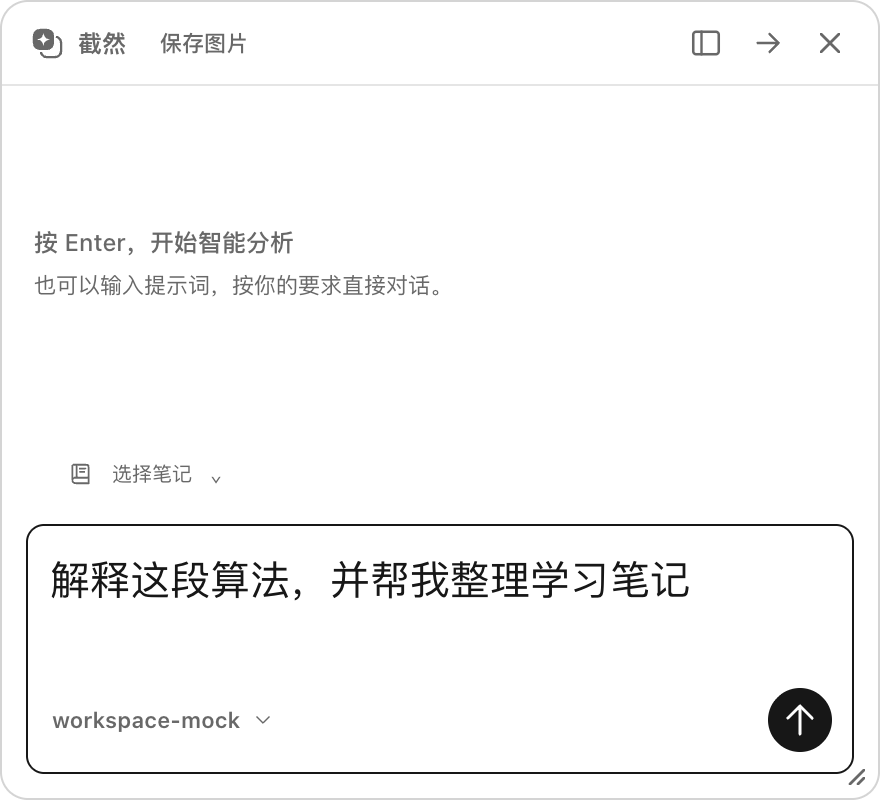

# 笔记与对话操作优化（2026-10-18）

本轮在客户端分支 `codex/local-chat-controls` 本地实现，基线为发布验收提交 `7527c01`。功能验收在打包前已完成。后续按已确认的 0.3.1 推送与打包，结果见 [0.3.1 打包记录](RELEASE_0_3_1.md)；既有 v0.3.0 标签与安装包保留。

## 已实现

| 用户需求 | 行为与入口 |
| --- | --- |
| 笔记无需逐次审批 | 截图 Agent 的 `write_note/edit_note`、主窗口明确选择笔记的 `propose_note_change` 直接保存，真实提交成功后才回复。保留实际修改列表、完整差异与撤销 |
| 对话框可调大小 | 截图对话右下角拖拽手柄；方向键微调 20px，Shift 为 50px，Home 恢复默认。紧凑/展开模式分别记住本次应用运行期间的尺寸，不持久化跨重启窗口大小 |
| AI 对话字体可调 | 设置 → 外观 → AI 对话字号，12–24px、默认 15px。Main 原子保存并同步已有窗口，重启保留；对话正文、输入与代码跟随字号，笔记编辑器与界面控件不缩放 |
| 设置层级清楚 | 分组标题 16px / 650、行名称 13px / 500、说明 12px / 400，通过留白与灰度区分，保留原黑白灰主题与分组设置结构 |

## 继续保留的安全与数据边界

- 笔记仍只在用户选择的笔记本或单篇上下文内修改 Markdown；不开放通用文件写入、附件、隐藏目录、越界路径或外部 MCP 执行。
- 继续检查未保存编辑器内容、源版本、链接身份、模型与运行能力；只读声明与停止前取消仍阻止新提交。已经原子提交的修改不伪装成回滚。
- 同一轮主窗口对同一笔记多次修改合并为同一撤销记录，保留最初版本与最终差异；记录保存失败时明确提示。
- 预测规则仍须查看完整差异后确认；脚本及高风险命令仍使用原审批与 OS 沙箱。没有将笔记自动保存扩展成命令自动执行。
- 新字号只进入原设置的 `appearance.chatFontSize`，旧文件缺少该值时默认 15；保留主题、模型、快捷键、加密 Key 与原用户数据目录。
- 新 IPC 按窗口角色校验：只有 Main 设置字号，只有截图对话调整自身尺寸；Main 验证有限整数并约束到显示器工作区。保留 `sandbox`、`contextIsolation` 与禁止 Node 注入。
- 沿用已有 Windows DIP 尺寸保护，保存请求尺寸以避免截图移动时累积膨胀；Windows 原生手柄、混合 DPI 仍需真机验收。

## 验证结果

| 验证 | 结果 |
| --- | --- |
| `pnpm lint` | 通过 |
| `pnpm typecheck` | 通过，最终构建再次执行 |
| `pnpm test` | 63 文件、988 项通过 |
| `pnpm build` | 通过，第三方通知生成通过 |
| 相关 Electron 集成 | 8 个文件、9 个不同用例通过；关键笔记与浮窗流程在最后构建后复测 |

Electron 覆盖：自动写笔记、编辑器草稿保留、完整差异、撤销、停止后已提交记录、无记录声明、预测规则确认、脚本审批、通用文件工具禁用、窗口角色拒绝、实际鼠标拖拽/键盘调整、对话正文及代码字号、跨窗口主题/字号同步、旧设置读取与重启恢复。全部使用临时目录、本地模拟模型和合成截图。

本轮没有重跑完整 Electron 套件，不宣称既有完整套件中的时序失败已修复。没有验证 Windows 真机、真实厂商模型或已签名新版本的安装升级。本次调整不需要用户数据迁移。

## 文件入口与恢复

- 自动保存：`src/main/agent/notes/NotebookWriter.ts`、`editing/EditingProposals.ts`、`ToolExecutor.ts`、`ui/AgentExecutionService.ts`、`ui/ExecutionPresenter.ts`。
- 字号存储与同步：`src/shared/appearance.ts`、`src/main/storage/settings.ts`、`src/main/appearance.ts`、`src/preload/index.ts`、`settings/AppearanceSettings.tsx`。
- 浮窗：`src/shared/chat-window.ts`、`src/main/windows/quick-chat-placement.ts`、Main IPC、`chat/ChatResizeHandle.tsx`、`QuickChat.tsx`。
- 设置与对话样式：`settings/settings.css`、`chat/quick-chat.css`、`chat/workspace.css`、`refined.css`。
- [脱敏验证记录](ci/chat-controls-2026-10-18.json)；[当前设计规范](UI_DESIGN_LANGUAGE.md)；[自动笔记边界](AGENT_NOTE_WRITING_PLAN.md)。

测试重写的旧截图已先保留到本地忽略目录，再恢复为本轮开始时的字节，仅新增本轮的合成验收图片。基线提交、全部验证日志与原截图备份位于本地忽略的运行记录中；未使用 reset、clean 或改写 Git 历史。回退本轮源代码时，保留用户设置文件及本地笔记，不删除用户数据。
