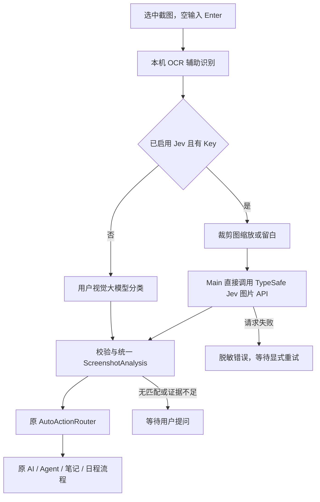
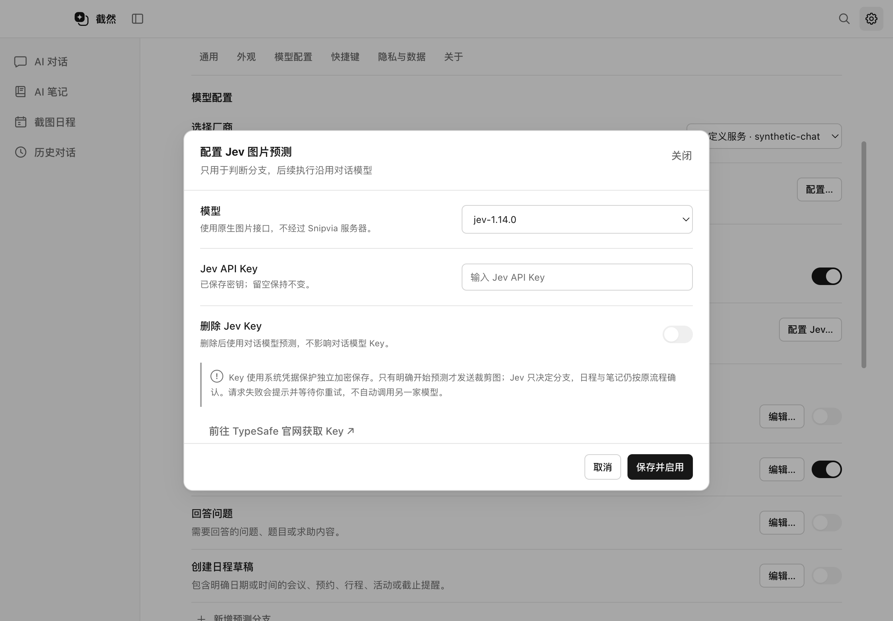
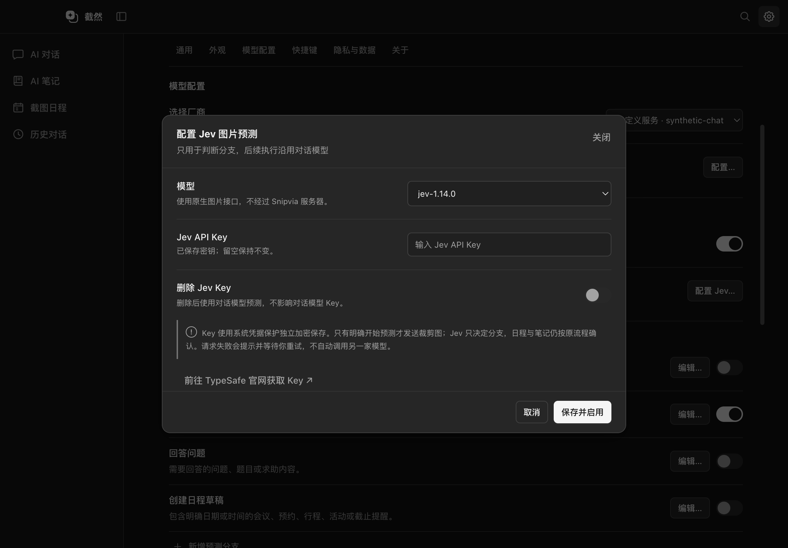

# Jev 图片预测与分支执行

2026-10-17。当前客户端提供可选的 Jev 原生图片预测，用户自行配置 Key；不依赖 Snipvia 登录、会员或服务端。这里的“本地使用”表示由桌面 Main 直接调用用户选择的 API，**不是在本机运行 Jev 权重，也不是离线推理**。

## 路径审计与本次变化

改动前的真实路径为：截图完成 → 等待用户输入 → 空输入 Enter → `beginAutoUnderstanding` → 本机 OCR 辅助识别 → `PredictionService` 调用用户视觉模型 → 校验分支 → `AutoActionRouter` → `executeAutoAction`。输入提示词和续拍仍跳过预测。

本次只在预测服务增加可选策略，不改截图入口、分支规则或后续执行器：

实现入口：

| 文件 | 职责 |
| --- | --- |
| `src/main/index.ts` | 拍摄后明确开始预测，捕获分支/模型设置；配置变化时取消旧预测；保持后续执行流程 |
| `src/main/analysis/PredictionService.ts` | Jev 可用时选择 Jev，否则调用原视觉模型；Jev 路径不读取聊天模型 Key |
| `src/main/ai/jev/JevPredictionClient.ts` | 固定 HTTPS API、原生图片协议、三个有类型问题及严格响应映射 |
| `src/main/ai/jev/image.ts` | 只处理选中裁剪图，保持比例缩放并在必要时补白，不引入完整屏幕像素 |
| `src/main/storage/prediction-settings.ts` | 独立系统加密凭据与版本化配置，不接触原聊天模型/主题/快捷键文件 |
| `src/shared/prediction-settings.ts`、`src/preload/index.ts` | 窄化配置契约；只有读取状态、保存配置和打开固定官网三个接口 |
| `src/renderer/src/settings/PredictionSettings.tsx` | 现有设置行和原生 Dialog，Key 输入保存后清空；提供关闭、删除和官网入口 |

## 用户配置与失败行为

在「模型与设置 → 模型配置 → 预测模型」点击「配置 Jev…」，选择 `jev-1.14.0`（默认）或 `jev-1.13.0`，填写自己的 Key，点击「保存并启用」。可点击固定链接前往 [TypeSafe 官方控制台](https://console.typesafe.ai/) 获取 Key。该站可能需要厂商账号和充值，Snipvia 本身不要求账号。

- 从未配置、关闭 Jev 或删除 Key：下一次预测使用原用户视觉模型；不会请求 Jev。
- 已启用且有 Key：裁剪图直接交给 Jev 判断；不先请求聊天模型生成文字描述。
- Jev 鉴权、网络、超时、格式或模型不匹配：显示脱敏分支模型错误，等待用户明确重试；不自动调用另一家模型或产生第二次预测请求。
- Key 无法解密：视为配置错误，不伪装成“无 Key”回退。配置文件损坏或未知版本时保留原文件，拒绝覆盖，其他本地功能不因此要求登录。
- 所有分支关闭：不读取预测凭据，也不发预测请求。
- Jev 只决定分支。命中后对话、Agent、日程提取仍需要原用户模型及其配置；笔记/系统写入授权、确认和取消行为不变。

## 实际协议与约束

核对的 TypeSafe 官方来源：[HTTP API](https://docs.typesafe.ai/api)、[图片输入](https://docs.typesafe.ai/images)、[模型](https://docs.typesafe.ai/models)。官方将图片能力列为实验功能，可能调整协议；本次固定具体模型 ID，未依赖未知别名。

Main 只向 `https://api.typesafe.ai/v1/systemone` 发送 Bearer 认证的 JSON，并附图片 opt-in 头。图片放在顶层 assets，通过 state 引用；截图不会被转换成自由文本后再发一遍。没有新增第三方 SDK 或依赖。

三个问题分别判断：候选分支、主要内容类型、是否存在有明确时间的可执行日程。分支以本次启用集合的索引编码发送，附适用内容、自定义标记和日程要求；执行 prompt、notebookId、笔记路径、Cookie、聊天模型 Key 均不发送到 Jev。响应必须匹配固定模型、问题集合、答案类型、候选集合、合法概率分布和用量格式。概率最高项须与选择一致，再映射回本地分支 ID；模型自由文本不能作为执行指令。

原 Router 的最低置信度 0.65 和日程额外信号检查保留；Jev 日程 Noul 至少 0.82 才标记 `hasSchedule`。无匹配和低置信度不自动执行。请求仍有 45 秒超时、128 KiB 响应上限、取消传播、拒绝重定向和不附 Cookie。

官方图片要求每边 280–1568 像素。客户端将裁剪图等比例缩至最长边不超过 1568，再把小于 280 的边居中补白，导出静态 PNG；小图不会拉伸，极窄长图可能因缩小而影响准确率。图片只发给 Jev；命中后任务执行仍可能按原流程把同一裁剪图发给聊天模型，不能宣称整个任务只发生一次模型请求。

## 数据与回滚

新增 `userData/prediction-settings.json`，版本 1，存储 `enabled`、固定模型 ID 和系统 safeStorage 密文。目录/文件权限按本机规则限制，原 `settings.json`、历史和笔记格式没有迁移；应用 ID、Bundle ID、正式 userData 路径不变。查询接口只返回 `hasApiKey` 和安全错误状态，不提供读明文 Key 的 IPC。Linux 的 basic_text 后端不接受保存新密钥。

旧版本忽略新增文件。关闭 Jev 即恢复原大模型预测；删除 Key 不删除聊天模型凭据或本地数据。损坏文件须先备份，再在新副本中修复，不能为了恢复设置直接删用户原件。本轮开始前的完整源码快照和文件哈希保存在 `.dev-runtime/jev/`，没有推送、公开、正式发布或操作私有仓库。

## 验证范围

本轮 lint、typecheck、build 与 62 个文件的 977 项单元测试通过。完整 Electron 回归未全绿，结果和未接入 Jev 的基线对照如下，不能将局部复查代替完整套件结论。测试只使用临时数据、合成图片与合成 Key，未调用收费 Jev 或真实厂商服务。模拟协议通过不代表已经验证 Jev 实际连通、图像准确率、收费或服务保留政策。Phase 3 的发行门槛仍有效，没有因加入 Jev 自动解除。

| 验收项 | 结果 |
| --- | --- |
| lint / typecheck / build | 通过；生成 Main / Preload / Renderer 及第三方通知，既有 lazy-val 许可门槛未解除 |
| 单元测试 | 62 文件、977 项通过；新增 32 项预测与配置安全断言；POSIX 文件权限位只在适用系统断言 |
| 完整 Electron | 第一次完整运行 43 通过 / 11 既有条件跳过；增加损坏配置验收后的最终完整运行 41 通过 / 11 跳过 / 3 失败，208.5 秒。新增 Jev 两项在最终完整运行均通过 |
| 配置与凭据 | 合成 Jev Key 真实系统加密、重启读取，Main 查询/磁盘明文/日志不泄露；聊天设置文件在 Jev 保存时不变 |
| 直连预测与原执行器 | 合成裁剪图规范化后只交 Jev，Jev 使用独立 Bearer Key；原 Agent 用聊天 Key 执行，分类不读取聊天 Key |
| 无 Key、关闭与失败 | 关闭/删除/无 Key 使用原模型；HTTP 失败只显式重试；配置变更取消迟到响应；损坏文件保留且不阻断本地启动 |
| 平台与真实服务 | macOS arm64 合成验收；未进行 Windows / Intel 真机、真实 Jev Key 或准确率评测 |

本轮新增 / 修改的业务文件只有上表所列预测、凭据、IPC 和设置组件，以及有界传输的错误阶段参数；默认传输语义保持一致。测试为 `tests/unit/jev-prediction.test.ts`、`prediction-settings.test.ts` 与 `tests/integration/jev-prediction.spec.ts`；原 HTTP 提示测试仅更新对应模型说明文字。当前文档入口也同步纠正旧服务端预测描述。原 Phase 2/3 报告保留，依赖、锁文件、更新和发布实现没有因 Jev 功能再次变动。

新增合成界面图：

## 回归失败与基线对照

最终完整套件的 3 项失败为两个 backend 的 `tests/integration/capture-window-visibility.spec.ts:170`（续拍取消后 mainShows 预期 0、实际 1），以及 `tests/integration/notes-markdown.spec.ts:26`（CodeMirror 虚拟行“第一段”定位后滚动超时）。本轮没有修改这两份测试、窗口显隐或笔记编辑器实现，也没有删除或跳过它们。

将同样的 4 项定向用例在 Phase 3 独立源码副本 `dist/phase3-clean-source` 中执行，复现同一窗口断言与同一编辑器超时：2 通过 / 2 失败；两个测试文件的 SHA-256 与当前客户端相同。该副本的 Main 构建和 PredictionService 未包含本轮 Jev 改造。因此可确认两类问题在 Jev 接入前已存在，不能声称本轮已经定位根因或修复稳定性；随后当前 Jev 客户端对同样 4 项用例复查全部通过（22.3 秒），表明问题存在时序不稳定性；不能用这次局部通过把最终完整套件改写为通过。两边的对照结果保存在 `.dev-runtime/jev/comparison-results.json`。

失败 trace 和上下文已另存 `.dev-runtime/jev/failed-complete-artifacts/`，不会用后续通过覆盖失败证据。后续应独立复查续拍取消后的激活事件及 CodeMirror 虚拟滚动/模式切换时序，保留有效的“主窗口不闪现”和“编辑定位正确”验收要求。Phase 3 的正式发行 No-Go 继续有效。

最终源码敏感模式扫描记录为 `.dev-runtime/jev/source-scan-final.json`；仅发现已核对的既有合成 URL 拒绝测试，无新增未决敏感命中。原 Phase 2/3 文档、锁文件、发布配置及上述失败测试均经哈希对照保留。旧自动验收图片已恢复，本轮仅新增两张 Jev 合成设置图并纳入素材清单。

本轮产物为新客户端源码和 `out/` 构建，可从本工作区使用 `pnpm dev` 体验设置入口；未重新生成含 Jev 的安装包。Phase 3 留存的内部应用仍是当时快照，不应误当成本次功能包。
