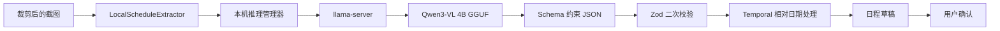

# 截图日程本地模型方案（二）

## 文档状态

- 状态：备选方案，暂存，尚未进入正式实现。
- 记录日期：2026-09-20。
- 目标平台：优先 macOS Apple Silicon，保留 Windows 扩展可能。
- 当前结论：技术上可行；需要先完成真实模型、真实截图和资源占用基准测试，不能将本文中的工程估算描述为已验证结果。

## 目标

使用本机视觉语言模型完成截图日程识别，使截图、提示词和识别结果无需发送到云端。第一阶段采用 `llama.cpp` 的 `llama-server` 运行量化视觉模型，通过本机回环地址向 Snipvia 提供 OpenAI 风格的 Chat Completions 接口。

建议首个候选模型为：

- `Qwen3-VL-4B-Instruct`
- GGUF `Q4_K_M` 或经过质量对比后确定的同级量化版本
- 推理运行时：`llama.cpp` / `llama-server`

Ollama 可用于原型对比和提示词调试，但不作为正式版本的强制外部依赖。

## 不在本方案内

- 不把数 GB 模型直接塞进默认安装包。
- 不自动把本地识别失败的截图发送到云端。
- 不允许模型绕过草稿确认直接写入 Snipvia 或 Mac 日历。
- 不用本地模型替代现有的 Zod 校验、相对日期计算和用户确认。
- 第一阶段不为普通截图对话切换本地模型；先验证范围更明确的截图日程任务。

## 与当前实现的适配关系

现有 [`src/main/ai/provider.ts`](../src/main/ai/provider.ts) 已经使用以下请求形式：

- `POST /chat/completions`
- OpenAI 风格的 `messages`
- `image_url` Data URL 图片输入
- 非流式返回
- `AbortSignal` 取消和 120 秒超时

`llama-server` 支持 OpenAI 兼容的 `/v1/chat/completions`、Base64 图片和 Schema 约束输出，因此当前请求链路可以复用。设置系统也已允许 `localhost` 或 `127.0.0.1` 的 HTTP 地址，并允许无认证的本地服务留空 API Key。

以下能力继续作为模型之外的可信边界：

- [`scheduleDraftSchema`](../src/shared/contracts.ts) 验证字段类型和事件约束。
- `Temporal` 根据截图时间和用户时区重新计算“今天、明天、后天、大后天”。
- `unresolvedFields` 和 `warnings` 显示缺失信息与推断。
- 用户核对草稿后，才允许保存到 Snipvia 或选择 Mac 日历写入。

## 建议架构



模型实现不应继续直接写在单个供应商函数里。进入实现阶段后，建议抽象：

```ts
interface ScheduleExtractor {
  availability(): Promise<{
    available: boolean;
    reason?: string;
  }>;

  extract(input: {
    image: string;
    capturedAt: string;
    timezone: string;
    signal: AbortSignal;
  }): Promise<ScheduleDraft[]>;
}
```

预期实现：

- `CloudScheduleExtractor`：封装当前云模型请求。
- `LocalLlamaScheduleExtractor`：调用由 Snipvia 管理的 `llama-server`。
- 后续可以增加 `AppleFoundationScheduleExtractor`，但不与本方案耦合。

## 本机推理服务生命周期

### 启动

1. 用户选择“本地模型”并首次执行日程识别。
2. 主进程检查模型文件、校验哈希并检查剩余空间。
3. 主进程选择空闲随机端口，启动随应用提供或按需安装的 `llama-server`。
4. 服务只监听 `127.0.0.1`。
5. 通过健康检查确认模型加载完成，再发送识别请求。

不应在 Snipvia 启动时立即加载模型，以免应用长期占用数 GB 统一内存。

### 保持与卸载

- 完成识别后短时间保持模型热加载，减少连续截图的重复冷启动。
- 达到空闲时间、系统内存压力升高或用户退出应用时关闭服务。
- Snipvia 退出前终止自己启动的推理进程，不能误杀用户独立运行的其他本地模型服务。
- 同一时间只处理一个本地视觉识别任务，其余任务进入队列，并在 UI 中继续显示“等待识别”。

### 取消与异常恢复

- 用户删除识别任务时，取消当前 Fetch 请求。
- 本地服务失去响应时先终止当前任务，再尝试一次干净重启。
- 重启仍失败则把任务标记为失败，保留来源截图供用户重试。
- 不在失败后自动改用云模型；是否切换必须由用户明确选择。

## 结构化输出

当前实现主要依赖提示词要求模型返回 JSON，再用 Zod 拒绝坏结果。本地模型接入时应同时使用 `llama-server` 的 `response_format` JSON Schema 约束：

1. 从可表达的基础日程结构生成 JSON Schema。
2. 通过约束解码保证顶层对象、数组和字段类型稳定。
3. 返回后继续执行 Zod 校验。
4. `event` 与 `deadline` 的互斥字段、开始结束顺序等跨字段规则仍由应用代码验证。

约束解码只能提高结构可靠性，不能保证模型识别出的日期、人物和地点一定正确。

## 模型资源管理

### 下载方式

- 默认安装包不包含模型。
- 用户首次启用本地模型时显示下载大小、保存位置和删除入口。
- 下载到临时文件，完成长度和 SHA-256 校验后再原子移动到正式位置。
- 支持断点续传属于后续优化；首版至少要能安全取消和清理不完整文件。

### 存储建议

```text
Electron userData/
└── models/
    └── qwen3-vl-4b/
        ├── model.gguf
        ├── mmproj.gguf
        └── manifest.json
```

`manifest.json` 记录：

- 模型与量化版本
- 下载来源
- 许可证信息
- 文件大小和哈希
- 推理运行时最低版本
- 安装时间

### 更新策略

- 固定经过验收的模型和运行时版本，不跟随上游自动升级。
- 新版本作为可选更新发布，先跑相同的回归数据集。
- 保留回滚到上一个模型版本的能力。

## 安全边界

- 推理服务仅绑定回环地址，使用随机端口。
- 为每次启动生成随机访问令牌，即使服务只监听本机也不开放无认证接口。
- 不启用 `llama-server` 的工具、文件访问、MCP 或外部网络功能。
- 仅把裁剪后的 JPEG 传给本地服务，不传完整屏幕帧。
- 默认不记录请求正文、Base64 图片、提示词全文或模型原始输出。
- Renderer 不直接访问推理服务；所有调用继续经过 preload 白名单和主进程 sender 校验。
- 下载地址、哈希和许可证元数据由应用版本固定，不接受 Renderer 传入任意可执行文件地址。

## 设置界面规划

实现时继续使用 [`UI_DESIGN_LANGUAGE.md`](UI_DESIGN_LANGUAGE.md) 中的设置页面语言。

“日程识别模型”设置行左侧显示标题与说明，右侧选择：

- 当前云模型
- 本地模型

选择“本地模型”后，在同一分组增加：

- 模型状态：未下载、下载中、可用、正在加载、错误。
- 下载或删除按钮。
- 模型占用空间。
- 隐私说明：识别在本机完成，不自动回退到云端。

下载进度和错误放在配置弹窗或状态弹窗中，不创建第三种页面外壳。

## 性能预期

当前开发机为 Apple M1 Pro、32GB 统一内存。4B 级 4bit 视觉模型在容量上具有可行性，但尚未在 Snipvia 中实测。

进入验证后必须记录：

- 首次模型加载时间。
- 热启动单张截图耗时。
- 首个 Token 时间和总生成时间。
- 峰值统一内存。
- 典型截图与高分辨率截图的视觉 Token 数量。
- 连续识别后的温度、能耗和 UI 响应。

初期优先测试 4B 模型。只有当真实准确率明显不足且资源开销仍可接受时，才评估 8B 模型。

## 质量评估集

至少准备 100 张不包含个人隐私的合成或人工制作截图，并提供人工标注答案。覆盖：

- 简体中文、英文以及中英混排。
- 单个与多个事项。
- 会议、行程、预约、全天事件和截止事项。
- 今天、明天、后天、大后天、下周、月底前等相对表达。
- 只有日期、精确时间、时间范围和缺失结束时间。
- 跨天、多列、表格、聊天记录和海报布局。
- 小字号、低对比度、模糊和局部遮挡。
- 含有“忽略规则”等提示注入文字的截图。
- 没有任何日程的负样本。

建议记录以下指标：

| 指标 | 含义 |
| --- | --- |
| 事项召回率 | 截图中的真实事项有多少被找到 |
| 误报率 | 普通文字被错误识别为日程的比例 |
| 日期时间准确率 | 日期、时区、开始和结束字段完全正确的比例 |
| 多事项完整率 | 一张图中所有事项都被提取的比例 |
| 无依据补全率 | 模型编造标题、时间、地点或人物的比例 |
| Schema 成功率 | 受约束输出经过 Zod 校验的比例 |
| 冷启动与 P95 延迟 | 首次和稳定运行时的等待时间 |
| 峰值内存 | 模型加载和识别期间的最大统一内存占用 |

通过真实数据确定发布阈值。本文不预先把目标值描述为已经达到。

## 分阶段实施

### P0：外部服务验证

- 用户自行运行 `llama-server` 或 Ollama。
- 通过当前“自定义服务”配置连接本机模型。
- 验证模型能读取截图并返回现有日程格式。
- 不修改安装包和模型下载逻辑。

### P1：提取器抽象与约束输出

- 引入 `ScheduleExtractor`。
- 为本地服务增加 JSON Schema 约束输出。
- 增加能力检测、队列、取消和错误分类。
- 使用固定测试集比较云模型和本地模型。

### P2：内置运行时与模型管理

- 打包和签名受控的 `llama-server`。
- 实现模型下载、校验、删除和版本固定。
- 实现延迟加载、空闲卸载和进程恢复。
- 完成设置页面和状态反馈。

### P3：跨平台与发布验收

- 在 Apple Silicon 不同内存规格上测试。
- 验证 Windows x64 的运行时、GPU 后端和安装包。
- 检查许可证展示、下载来源和离线安装方式。
- 完成真实权限、冷启动、长时间运行和升级回滚测试。

## 主要风险

| 风险 | 处理方向 |
| --- | --- |
| 小字号或密集表格识别不准 | 保留原图核对；比较图片缩放、切片和系统 OCR 辅助 |
| 4B 模型漏掉多个事项 | 建立多事项回归集；必要时评估 8B 或分块识别 |
| 模型编造缺失时间 | 强化 `unresolvedFields`；应用层禁止无依据补齐 |
| 模型文件过大 | 按需下载、显示空间、允许删除，不塞进默认安装包 |
| 冷启动等待长 | 懒加载、短时保温、明确加载状态 |
| 本地服务被其他进程访问 | 回环绑定、随机端口、随机令牌、关闭工具能力 |
| 上游模型或运行时升级造成回归 | 固定版本、固定哈希、离线评估后再更新 |
| Windows 与 macOS 性能差异 | 分平台基准和模型配置，不推断跨平台结果 |

## 待决策事项

- 首个基准模型最终使用 Qwen3-VL 4B 还是同时比较 8B。
- 是否以 `llama.cpp` 作为正式运行时，还是只支持用户已有的 Ollama。
- 模型默认下载源以及中国大陆网络环境的备用下载源。
- 模型存储是否允许用户选择目录。
- 空闲卸载时间与最大并发队列长度。
- 本地识别不可用时，产品是否只提示切换，还是提供一次性的云端发送确认。

## 参考资料

- [llama.cpp 多模态支持](https://github.com/ggml-org/llama.cpp/blob/master/docs/multimodal.md)
- [llama-server OpenAI 兼容接口与结构化输出](https://github.com/ggml-org/llama.cpp/blob/master/tools/server/README.md)
- [Qwen3-VL-4B-Instruct 模型说明](https://huggingface.co/Qwen/Qwen3-VL-4B-Instruct)
- [Ollama 结构化输出](https://ollama.com/blog/structured-outputs)

