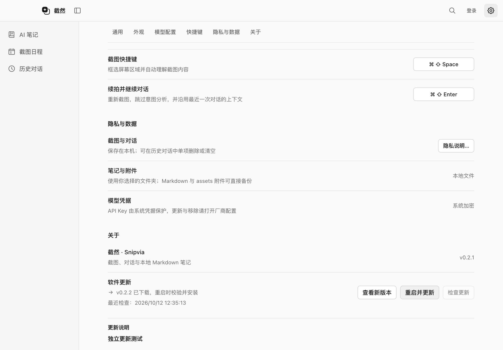

# macOS 应用内更新实机测试

## 测试范围

日期：2026-10-12。环境：Apple Silicon Mac、macOS 27、Node.js 24.15.0、Electron 44.4.1、electron-builder 26.15.3、electron-updater 6.8.10。

本轮验证用户明确下载、确认重启后，由原生 Squirrel.Mac 更新器实际替换 APP 并启动新版的流程。两份测试 APP 使用独立 Bundle ID、独立缓存和临时笔记，不替换正式安装版或开发版，不读取现有账号凭据与笔记，不占用截图快捷键。

测试使用现有 Developer ID `F76JCDMA4Y` 签名、严格验证 APP，并通过本机回环服务提供真实 ZIP 与 SHA-512 清单。Release JSON 是合成数据；下载和原生安装器没有 Mock。测试包不提交 Apple 公证、不加下载隔离属性、不上传 GitHub，不能作为正式发行包分发。

## 发现与修复

1. **签名校验阻止下载**：原 `codesign -R <表达式>` 会把表达式当成要求文件路径，返回 `invalid requirement specification`。改为内联要求 `-R=anchor ...`，保留 Developer ID 类型与固定团队校验，并增加命令参数断言。内联要求语法参见 [Apple TN3127](https://developer.apple.com/documentation/technotes/tn3127-inside-code-signing-requirements)。
2. **原生重启被复用窗口阻止**：截图选区与钉图窗口拦截 `close` 以保留窗口供下一次截图使用。Mac `quitAndInstall()` 先关所有窗口，之后才触发 `before-quit`，所以只在普通退出处理器销毁窗口会卡住。在笔记保存、任务检查通过且用户确认更新后，通过原有 `destroy()` 释放这两个闲置窗口，再调用更新器。正常截图路径和窗口复用行为保持原样。时序参见 [Electron autoUpdater 文档](https://www.electronjs.org/docs/latest/api/auto-updater#autoupdaterquitandinstall)。
3. **下载提示矛盾**：支持更新时 `unavailableReason: null` 被空值回退改成“仅支持检查版本”。支持状态现在保留 null，不再显示错误限制提示。

首次原生测试的重启阶段超时。诊断脚本随后关闭测试进程，使更新继续完成；这不计入自动重启通过结果。最终验收要求新版启动标记、实际安装版本、签名及笔记内容全部通过，之后才允许测试脚本关闭应用。

## 执行与证据

先运行 `pnpm build`，再执行：

```bash
node scripts/macos-release/test-update.cjs --execute
```

命令需要本机已批准的签名环境和完整 Xcode。目前仅支持 Apple Silicon 实机。每次在 `dist/macos-update-test/<时间戳>-<随机标识>/` 创建新目录；使用 ZIP 构建目标，让 builder 写入实际 `app-update.yml`，再正式签名并生成最终测试 ZIP。

证据包括：`report.json`、`native-events.jsonl`、原生 `ShipIt_stderr.log`、`launched-0.2.1.json`、`launched-0.2.2.json`、`downloaded.png` 与测试笔记。失败报告不会标记 `realNativeInstall: true`。结束时只清理本次测试的应用进程、Squirrel 启动任务及缓存，不删除产品缓存。

最终实机测试通过，原始目录为 `dist/macos-update-test/1791779551185-84a7eafa/`。持久化证据见[JSON 报告](ci/macos-update-2026-10-12.json)。

| 验收项 | 实际结果 |
| --- | --- |
| 新版发现、版本与说明 | 合成本机 Release `v0.2.2` 正确显示 |
| 真实 ZIP 下载 | 实际请求签名 ZIP 与最终 SHA-512 清单 |
| 等待用户确认 | 下载后仍运行 0.2.1，没有提前启动新版 |
| 原生退出 | `update-downloaded` → `before-quit-for-update` → `app-will-quit`；未由脚本代为退出 |
| 原生替换与重启 | 原位置自行启动 0.2.2，实际 Info.plist 版本匹配 |
| 数据保留 | 使用原临时 userData，编辑后的 Markdown 字节完全相同 |
| 完整性 | 更新后的 APP 深度严格签名验证通过 |
| 脚本最终状态 | `realNativeInstall: true`、`notePreserved: true`、退出码 0 |



## 其他验证与发布限制

- 构建、类型检查、全仓 Lint、996 项单元测试通过。
- 6 项相关 Electron 回归通过：更新状态与 IPC 隔离、更新前保存笔记并释放两份截图窗口、两套主题及跨窗同步、截图关闭 / Dock 恢复、浮窗会话保持。这些回归的下载和安装器仍为 Mock，与上述真实安装测试区分。
- 公开更新源 `https://api.github.com/repos/yuyeyuyy/Snipvia/releases/latest` 本次匿名查询返回 HTTP 404，未携带 Token。不能由此判定仓库是否私有；也不能宣布线上推送已验证。
- 待发布版本仍需完成正式 APP / DMG 公证与 Staple，并上传同一公开 Release 的最终 `latest-mac.yml` 和各架构 ZIP / DMG。未启用更新的旧安装包仍需先手动升级一次。
- Intel Mac、真实用户录屏权限保留、公网 CDN / 弱网 / 中断恢复、隔离下载后的 Gatekeeper 路径及 Windows 发布者签名不在本轮已验证范围。

完整机制见[版本检查与更新](UPDATE_CHECK.md)与[macOS 发布流程](MACOS_RELEASE.md)。

同日后续已迁移到公开 `Snipvia-releases`，匿名客户端版本读取和公开发行资产校验通过；本报告中的私有仓库 404 是迁移前记录。新分发验证见[迁移报告](RELEASE_DISTRIBUTION.md)。

## 本轮修改文件

- `src/main/updates/ElectronUpdateInstaller.ts`：修正内联代码签名要求。
- `src/main/updates/UpdateCheckService.ts`：修正可下载版本的限制原因。
- `src/main/index.ts`：确认安装后释放两份闲置截图窗口。
- `tests/unit/update-installer.test.ts`、`tests/unit/updates.test.ts`：签名参数与限制原因回归断言。
- `tests/integration/updates.spec.ts`：复用真实安装前钩子，验证窗口从 2 份变为 0 份，保留其他 Mock 安装步骤。
- `scripts/macos-release/test-update.cjs`：隔离签名构建、真实下载 / 原生升级与报告、测试资源清理。
- `docs/UPDATE_CHECK.md`、`docs/MACOS_RELEASE.md`、本报告、验收 JSON / 截图及 README：同步验证范围。
