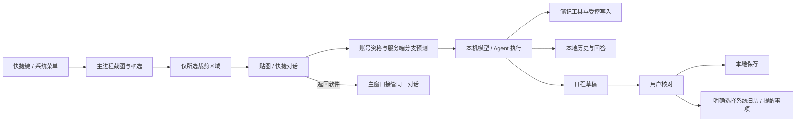

# Snipvia UI 2.0：阶段 1 设计审查与方案

日期：2026-10-09。状态：**待用户确认，尚未进入正式应用重构**。

本轮新增独立原型和设计文档，未修改客户端、服务端、官网或现有设计规范。以下「建议」「规划」不代表已经实现。原型使用合成截图、笔记、对话和日程，不调用模型、IPC、文件系统业务接口或系统日历。

- [交互原型与启动说明](../prototypes/ui-2.0/README.md)
- [主题 Token 源文件](../prototypes/ui-2.0/tokens.json)
- [UI 审查文件清单](../prototypes/ui-2.0/AUDIT_INVENTORY.md)
- [原型验证记录](../prototypes/ui-2.0/VALIDATION.md)

## 1. 设计判断

推荐 **方案 A：紧凑导航 + 统一上下文栏 + 按任务分栏**。主导航展开 176px、收起 52px；笔记以编辑器为中心，日程以月历浏览为主、日期详情为辅，历史以对话详情为中心。截图后的工作留在独立浮窗，只有明确选择「返回软件」才转交主窗口。

2.0 的主要变化是信息架构和窗口内空间分配。统一外观只是基础，不应该靠增加一层覆盖 CSS 完成。

五个需要解决的问题：

1. 同一窗口的布局和控件规则分散，长期靠样式覆盖维持一致性。
2. 小字号、过大的页面留白和过宽的固定导航同时出现，空间没有优先给内容。
3. 日历占据主要面积，待核对草稿和单日详情需要进入弹窗才清楚。
4. 历史打开对话后离开列表，连续检索和比较成本高。
5. 截图贴图与对话是两个原生窗口，当前轻量态和深入处理态缺少统一的空间关系。

## 2. 审查范围与当前架构

已逐项阅读 renderer 的页面、组件、辅助模块和样式，核对 preload 接口、主进程窗口创建与退出/转交路径，以及相关存储入口。完整清单见 [审查目录](../prototypes/ui-2.0/AUDIT_INVENTORY.md)。本轮没有真实模型请求、真实日程写入或权限重置验证。

### 2.1 Electron 窗口

| 窗口 | 当前机制 | 重设计约束 |
| --- | --- | --- |
| 主窗口 | `src/main/index.ts`；默认 1120×780，最小 840×600；隐藏标题栏，Mac 原生红绿灯，Win 控制区覆盖 | 保留原生控制、拖动安全区、托盘驻留和退出时笔记 flush |
| 框选/标注 | `CaptureOverlayWindow`；透明、无边框、预热、跨 Spaces；以 session 及 renderer/image ready 信号确认显示 | 不把白色主窗口主题背景带入透明框选层；不更改显示时序和坐标换算 |
| 截图贴图 | `ScreenshotToAllWindow`；透明、置顶、复用并重置截图会话；`#pin` renderer | 关闭和复制不弹主窗口；旧会话和迟到消息不能污染新截图 |
| 快捷对话 | 主进程创建独立 `BrowserWindow`，默认 390×520，最小 340×360；`#quick-chat` | 当前与贴图分离；位置按屏幕 workArea 限制，须保护小数 DPI 和多屏逻辑 |
| Agent 权限 | 独立 `#agent-permission` 入口与对话内确认；具有请求 ID、风险和作用域 | 不因隐藏普通工具步骤而隐藏审批；只允许拥有任务控制权的窗口批准 |

`closePinnedFlow` 终止当前流程并关闭浮窗，不打开主窗口；`returnPinnedConversationToMain` 显式转交任务与对话。主窗口关闭通常隐藏到菜单栏，Dock 的手动激活仍打开主窗口。以上是产品行为，不属于可以随视觉重设计一并改变的细节。

### 2.2 React、导航与状态

- `main.tsx` 按 hash 选择主窗口、框选、贴图、快捷对话、权限页。不是普通网站路由。
- `App.tsx` 的 `page` 本地状态控制页面，没有引入路由器或全局状态库。默认 AI 笔记；截图对话入口已从主导航隐藏，内部 chat 页面仍用于恢复对话。
- `AppTitleBar` 已负责品牌、收起导航、账号和设置。未登录显示登录，登录后显示头像框图标。
- `WorkspaceHeader` 是工作区共同语义，但页面有自己的大标题、操作和宽度规则。
- `NotesPanel` 在访问后保持挂载，隐藏时仍处理保存、文件变化与 Agent 写入前 flush。不能为了整洁路由把它简单卸载。
- 页面和组件普遍直接调用 `window.snipvia`。这种做法目前可用，但展示布局、异步请求、错误和生命周期交织，重排组件时容易触发重复订阅或丢失状态。

阶段 2 建议继续使用现有 React 状态与 IPC，先抽出 UI 布局状态和语义组件。暂不新增 Redux、路由库或第二个业务 Service。

### 2.3 五条主要数据流

以下为审查时的正式应用数据流；本轮原型已按用户反馈将本地日程改为自动保存，正式入口需在第二阶段同步。



| 领域 | renderer 展示与状态 | 底层所有权 | 耦合点 |
| --- | --- | --- | --- |
| 截图 | Overlay、ScreenshotEditor、PinnedCapture、QuickChat | 主进程会话、平台捕获、坐标、裁剪 | 就绪信号、焦点、同一会话的提交去重与取消 |
| 笔记 | NotesPanel、useNoteDocument、CodeMirror、文件树/大纲 | NotebookService、watcher、路径限制、冲突与原子写入 | 400ms 保存、导航前 flush、Agent 写入前 flush、外部修改 |
| 对话 | App/QuickChat 消息流、AgentExecution、SourceAnswer | Provider、Agent runtime、history store | captureId 过滤、拥有者、迟到流事件、窗口转交 |
| 日程 | SchedulePanel 的月份、日期、事件编辑与识别记录 | schedule store、Temporal、平台日历/提醒适配 | 全天/时区/跨日、去重、草稿确认和系统写入目标 |
| 设置 | SettingsPanel、ModelSelectRow、快捷键录制器 | settings store、加密凭据、模型目录缓存、globalShortcut | 保存整组设置、凭据 scope、未保存 Key、异步旧响应 |

### 2.4 样式与主题

当前包含 `style.css`、`refined.css` 以及 notes/account/agent/capture 等局部 CSS。基础样式已有通用 `header`、`nav`、`input` 等规则；精修文件后半段又覆盖外壳和浮窗。大量颜色是字面值，部分地方使用 `!important`。当前不具备完整的 Light / Dark / System 语义主题。

近期已经修复基础样式和精修样式的加载顺序，保证标题栏横跨、侧栏贴左。**不要把用户提供的历史错位截图当作当前构建仍未修复的证明。** 2.0 要解决的是这种冲突仍容易复发的结构性风险。

现有规范中「账号侧栏底部」等段落与后来标题栏设计存在不同版本描述。第二阶段应在批准后更新原规范，明确当前规则；本轮保留原规范，避免把提案写成已生效事实。

## 3. 当前 UI 问题与改善优先级

| 优先级 | 问题与代码依据 | 对使用的影响 | 2.0 建议 |
| --- | --- | --- | --- |
| 高 | 外壳样式跨 `style.css`、`refined.css` 多次定义；全局元素规则也影响弹窗 | 页头、控件、滚动区互相覆盖 | 一个 AppShell 布局定义；控件和页面样式明确作用域 |
| 高 | QuickChat 同时管理自动预测、手动意图、消息流、Agent 运行和浮窗退出 | 重绘/合并窗口可能重复执行，或者焦点与状态丢失 | 展示组件与现有控制状态分离，先保护会话与退出行为 |
| 高 | NotesPanel 同时管理文件操作、文档生命周期、冲突、对话转交 | 改布局可能误删文件或丢失未保存编辑 | 复用存储和保存 hook，仅替换布局与控件外观 |
| 中 | 日程主视图是大型月份网格，识别记录和编辑在弹窗 | 用户难以快速核对「今天有哪些安排」与「还有什么没保存」 | 主月历 + 紧凑日期详情 + 自动保存状态 |
| 中 | HistoryPanel 单列表，没有搜索；App 打开时进入独立 chat 页面 | 查找另一个会话需要返回，比较成本高 | 列表与详情同屏，搜索保留选中与滚动位置 |
| 中 | 页头常见 30×38px 留白和大标题；导航 212px/190px，字号又多为 9–11px | 内容可视面积小，信息重要性与占地不匹配 | 44px 上下文栏，176px/52px 导航，辅助文字底线 12px |
| 中 | 设置为一整页长滚动；多个 modal 状态由 div 实现 | 定位某组设置和键盘焦点管理成本高 | 局部分类导航 + 分组行；统一焦点约束的 Dialog |
| 中 | 笔记控件与工具条分散，新建、排序、定位等同时占据空间 | 编辑区视觉中心弱 | 常用操作保持一处，其他放上下文菜单；大纲按需出现 |
| 中 | 工具过程仍有展开的时间线，旧步骤卡片样式残留 | 工具内部细节可能抢占回答 | 默认仅当前动作状态行，完成后仅结果/文件链接；审查与错误仍明确展示 |
| 中 | 凭据、模型目录、能力确认与真实调用是不同状态 | 「刷新成功」容易被理解为「模型可用」 | 简短目录状态与调用验证状态分开，保持已有 Vision 筛选与手动 ID |
| 低 | Icon、NoteIcon、EditorIcon 各自定义笔画与坐标 | 小图标看起来不一致 | 统一 24px viewBox、16/18px 显示与 1.6px 笔画，标注工具可保留专用图标 |

不把历史上已经修复的光标错行、表格渲染、文件夹箭头旋转描述为待修复现象。当前 CodeMirror 的布局装饰、代码高亮和 GFM 表格应复用，并把这些回归场景纳入 2.0 验收。

## 4. 两种主窗口布局

### 4.1 A：紧凑导航与任务分栏（推荐）

```text
┌ 红绿灯 · 截然 · 折叠 ───────────────── 搜索 · 账号 · 设置 ┐
│ 主导航 176 / 52 │ 统一上下文栏：页面 / 当前对象      局部操作 │
│ AI 笔记        │ 文件树 208 │        编辑器        │ 大纲184 │
│ 截图日程       │ 月历约60%                  │ 日期详情约40% │
│ 历史对话       │ 对话列表300│        对话详情                │
└───────────────────────────────────────────────────────────┘
```

优点：入口始终可见，切换功能无需离开任务；三个主要入口足够紧凑；全宽内容和局部分栏有一致规则。未来增加一个明确功能也有余地。

代价：宽屏笔记页同时显示主导航和文件树，需控制导航宽度；必须区分主导航折叠与文件树折叠，按钮名称和悬停说明不能含糊。

默认保留图标与文字；小窗口自动用图标栏，但允许用户主动展开。折叠保留选中页面、正文、编辑器 undo、滚动和当前操作。折叠后的图标仍有名称与提示。


### 4.2 B：顶部工作台与内容导航

```text
┌ 红绿灯 · 截然 │ AI笔记 · 日程 · 历史 ────── 搜索 · 账号 · 设置 ┐
│ 当前对象 / 路径                                     局部操作 │
│ 文件树208 │                编辑器                  │ 大纲184 │
│ 或：月历约60%                          │ 日期详情约40%     │
│ 或：对话列表300 │             对话详情                      │
└────────────────────────────────────────────────────────────┘
```

优点：省出左侧主导航列；长时间写作时更聚焦，局部侧栏就是当前内容的导航。原型能够实际切换此方案，不只是把 A 改成另一种颜色。

代价：顶栏同时承载窗口控制、页面导航和全局操作；小窗口拥挤，新增功能扩展受限；首次用户不如左导航容易识别。设置等辅助页面不在三项标签中，返回关系需要保留上一个工作区。


### 4.3 比较与推荐

| 维度 | A | B |
| --- | --- | --- |
| 首次理解 | 左侧入口明确 | 需要识别顶栏标签 |
| 长时间写作 | 折叠后接近 B | 默认最集中 |
| 跨功能任务 | 稳定入口与未查看提示 | 入口横排，较紧凑 |
| 小窗口 | 主导航自动图标栏 | 顶栏必须压缩低频控件 |
| 未来扩展 | 适合少量扩展 | 顶栏容量有限 |
| 迁移成本 | 与现有 AppTitleBar / sidebar 接近 | 需要更改主导航语义与小窗口策略 |

推荐 A 作为唯一默认外壳，先不增加「布局 A/B」用户设置。A/B 切换只属于本轮审查工具。B 可作为将来的专注工作台方向，避免首版 2.0 同时维护两套正式主导航。

## 5. 共同框架与导航规则

### 5.1 标题栏和上下文栏

- 窗口标题栏目标高 44px；保留真实 macOS 红绿灯，不用 Web 画按钮替代。原型的三颗圆点仅为示意。
- 正式实现的红绿灯安全区按现有原生坐标和平台实测确定，不能照搬原型 11px 圆点位置。44px 是待真机验证的目标，不先改 `trafficLightPosition`。
- 顶栏左：品牌与主导航折叠；右：搜索、账号、设置。截图入口保留在快捷操作、快捷键、系统菜单和日程页中。拖动仅作用于空白，控件全部 `no-drag`。
- 上下文栏目标高 44px。显示当前页面与对象，操作在右。笔记用「AI 笔记 / 算法学习」，不再另外占一行巨大的笔记本标题。
- 页面标题只保留一次；正文的文档标题、所选日期、对话标题仍属于内容，不因去重而删除。
- 设置分组用 macOS 设置语言，不引入第三种客户端页面壳。浮窗是独立工作表面，不是新主导航项。

### 5.2 搜索与快捷操作

顶栏放一个搜索入口，应用内 `⌘K`；Windows 使用 `Ctrl+K`，只在当前窗口处理。`⌘,` 打开设置。截图继续用现有可配置的全局快捷键，不强行恢复默认。

建议搜索笔记标题、历史标题和操作。**现有应用没有跨域全局搜索，本轮仅提供命令筛选演示**；阶段 2 先接现有数据索引，不把全部笔记正文读入 renderer，也不为本地检索上传数据。

当前页搜索可以更具体：历史列表的搜索始终可见；文件搜索入口放文件列表顶部或快捷菜单。全局与局部入口职责不同，不重复放两个相同的按钮。

### 5.3 状态与可访问性

- 页面保留稳定框架，加载/失败发生在内容区；可局部重试，不覆盖主导航。
- 无内容时只有一项明确主操作；笔记应引导打开/创建笔记本，而非一律引导截图。
- 所有图标按钮有可访问名称与 tooltip；常规控件高度 30–32px，目标区域最少 28px。
- 选中同时有背景和结构/字重变化；识别中、错误、保存状态不能仅依赖颜色。
- 键盘焦点使用 2px focus ring；收起的面板设为 inert，不能 Tab 到不可见控件。
- 输入法组合期间不发送消息或批准操作；Return 发送、Shift+Return 换行；Esc 的层级为先关闭弹层，再停止当前任务，空闲时退出浮窗。

## 6. 五个页面设计

### 6.1 截图日程：主月历 + 紧凑日期详情

**布局**：主内容左侧月历约占 60%，右侧约占 40%，展示所选日期的全天事项和时间顺序列表。按 2026-10-09 用户最新反馈，移除待核对队列、视图切换和确认保存弹窗；识别结果直接进入本地日程。日期格高度 48–64px；详情保留至少 320px，1050px 以下至少 300px，小窗口允许比例适度调整以保持可读。记录入口保留在上下文栏，失败记录不会混入已保存日程。

**信息层级**：所选日期 → 日程标题与时间 → 来源/保存状态 → 次要目标。月历日期用点表示已有安排，不在格子内塞满长标题。

**保存流程**：截图 → 识别与字段校验 → 自动保存到截然本地日程 → 更新日期标记与右侧列表。取消单独的待核对步骤。用户可以在保存后打开日程详情，正式版保留编辑和删除入口。重复识别同一条截图日程不重复创建。

**核心操作**：上下文栏「从截图创建」；点击日期更新右侧，点击条目打开已保存的日程详情。原型使用固定合成结果，点击「从截图创建」后自动加入所选日期，无确认按钮；只保存在当前页面内存，刷新还原。

**旧新差异**：由巨型日历和弹窗记录变为「找日期 + 看内容」，本地日程由手动确认保存改为识别成功自动保存。这是用户明确要求的产品流程变更，第二阶段需要同步 Main 保存入口、状态与回归用例，不能只隐藏确认控件。

**主题**：Light 月历背景轻灰，详情白底；Dark 月历较浅面板、详情深色画布；今天用强调色文字，选中日期用实色底。来源与保存结果使用低对比度文字。

**边界**：全天、截止事项、时区与跨日准确表达；识别失败或字段无效显示简短错误，不伪造日期时间。自动保存仅针对截然本地日程；添加到 Mac 日历或 Mac 提醒事项仍是单独明确操作，ICS 只称导出，不称同步。原型不写入文件或系统日历。

### 6.2 AI 笔记：编辑器优先

**布局**：文件列表 208px、编辑器弹性宽度、大纲 184px。主导航 176px，可独立收起。编辑器正文舒适宽度约 720px，宽内容模式约 880px；代码和表格可独立横滚。

**信息层级**：文档标题/正文优先；文件路径在编辑器上方的紧凑工具行；保存状态在底部；文件树和大纲降低背景与字号层级。反向链接放大纲底部，不增加一个与正文竞争的大卡片。

**核心操作**：笔记本切换位于上下文栏，使用居中的上下组合箭头；文件列表新建入口一个，排序、刷新、展开全部、导出、移除链接归到上下文菜单。阅读/实时预览/源码模式保留，独立文件/大纲按钮位于上下文栏。

**旧新差异**：减少标题留白和文件工具条，屏幕增加的空间优先分给编辑器；宽屏不会因为外层 max-width 让整套分栏集中在小框里。

**主题**：Light 正文白底、文件树轻灰、代码块更深冷灰；Dark 正文深灰、文件树略深、代码块更深，分别维护 syntax Token。语言标签在代码右上，可点击复制，复制后短暂显示「已复制」。注释是有足够对比度的灰色，不是正文黑色。

**交互保护**：沿用 CodeMirror + Lezer 与 ReactMarkdown/remark-gfm。主题和面板宽度变更不重建 EditorView，不丢光标/undo；必要时 reconfigure 主题并 requestMeasure。不得给 CodeMirror 行设置影响位置测量的 margin。

**文件操作**：复用现有拖拽/文件名冲突校验、650ms 悬停展开、拖动目标反馈及根目录目标；`assets` 隐藏仅属于展示过滤，附件访问与保存正常。移除笔记本只取消链接，明确保留磁盘文件；文件/文件夹删除仍是独立的废纸篓操作。

**状态**：外部修改冲突、磁盘不可写、保存中、已保存、未链接笔记本独立展示，不把未保存内容用错误页替换。原型 textarea 只用于验证操作位置和草稿保持，不是替代 CodeMirror 的方案。

### 6.3 历史对话：紧凑列表 + 详情

**布局**：264–300px 列表与弹性详情同屏；列表带搜索与日期分组。详情顶部是对话标题与来源截图入口，底部固定继续提问。消息区独立滚动，正文最大宽度约 720px。

**信息层级**：列表一行标题、一行结果摘要/时间，不为每条记录放大卡片或厂商 logo。详情以用户问题和回答为主，模型/来源是次级信息。

**核心操作**：点击行仅替换详情，不离开列表；搜索时保留正在阅读的对话。复制回答、查看引用、文件变更在回答附近；历史清空和单条删除放更多菜单并确认，确认默认焦点在取消。

**旧新差异**：由「列表 → 独立 chat 页 → 返回」变为持续可见的列表。主导航依然不增加截图对话入口，现有 chat 业务可作为历史详情内部渲染器复用。

**主题**：Light 浅色列表、白色详情；Dark 列表面板与正文仅少量明度区分。用户消息用轻量底色；AI 回答不用大面积有色气泡。文件结果用细边线的小清单，点击打开笔记，可查看 diff/撤销。

**业务差额**：现有 summaries 没有全文检索字段和完整结果摘要。第一步搜索标题，文件结果仍从 detail 读取；搜索正文需后续受控 main 接口和索引，不能宣称已经支持。

### 6.4 截图 AI 浮窗：快捷态与展开工作台

**快捷态**：目标约 620×330（按内容和 workArea 调整），缩略图 170px + 轻量问题输入。显示当前分支、笔记本、模型来源，Return 自动预测或发送，复制/关闭是直接操作。低频控件不占据一整行工具条。

**展开态**：目标 900–1000×620，截图约 40%、回答约 60%；输入固定在对话侧底部。截图支持缩放适配，代码/公式截图不能靠把窗口无限加高来展示。

**信息层级**：所选截图与任务 → 当前动作状态行 → 回答 → 修改文件结果。查看目录、搜索文件、读文件、脚本等普通工具过程只更新状态行。失败用简短可行动提示；审批必须保留完整命令/作用域与明确允许/拒绝。

**核心操作**：缩略图区域复制并关闭；顶栏展开/关闭；返回软件在截图工具区；停止在输入区；没有会员资格时禁用 AI，但普通截图、复制和关闭继续可用，提示联系管理员。

**旧新差异**：由两个相邻窗口、各自工具条，转向一个视觉连续的工作台。快捷态不用先打开主窗口；展开不是页面跳转；收起不丢回答和输入草稿。

**主题**：Light 冷白背景、清晰细边线与一层浮窗阴影；Dark 深灰底与较明显外轮廓。截图像素不随主题调色。禁止用整屏玻璃或大面积模糊影响文字可读性。

**原生实现选择**：最终体验倾向一个组合浮窗。但当前贴图与对话确实是两个 BrowserWindow，不能在本轮假装已完成合并。阶段 2 先复用控制逻辑，另开原生 Mock 验证合并窗口、IPC role 和 owner 转交；通过多屏/焦点/取消回归后才替换现有窗口拓扑。未通过时，保留原生双窗口，先统一两窗视觉与动作位置。

**流程**：空输入 Return → 预测 → 执行/可能请求批准 → 写入完成 → 回复 → 已编辑文件链接。手动问题优先于未完成的预测；续拍保留上下文并跳过分支预测；未知分支继续等待输入。不能靠固定定时器驱动正式任务状态，原型的定时状态只属于演示。

### 6.5 设置：macOS 分组行

**布局**：局部分类导航 144–156px；内容最大 720px，组间距 24px。分类为外观、模型与服务、快捷键、截图预测、隐私与权限；账号仍由顶栏进入并复用设置语言。

**信息层级**：分类 → 小组标题 → 行标签/说明 → 右侧控件。开关、select、密码输入、快捷键录制器使用同样高度和对齐规则，不为每个设置建立卡片。

**核心操作**：普通偏好即时应用；厂商凭据和分支编辑保留「保存并使用/保存修改」。未保存草稿、目录查询、真实调用验证是不同状态。刷新按钮在模型选择左边，刷新结果直接进入选择列表；不恢复被用户移除的厂商或模型能力大表格。

**旧新差异**：由长页面叠多个大分组，转成有分类的短页面；权限与隐私信息集中，常用配置不必滚到很下方。

**主题**：Light 白底分组 + 冷灰分隔线；Dark 分组轻微抬高明度，输入背景略亮。选中分类与主导航共享语义 Token；密码字段不因为 Dark 自动变成高亮彩色。

**边界**：厂商 API Key 仍由 main 安全保存，renderer 只持有用户正在输入的短期草稿；切换 endpoint/地区清空旧输入。保留目录缓存、refresh、vision=supported 筛选和手动模型/Endpoint ID；不从模型 ID 推断图片能力。官网或控制台设置不能混入本机模型密钥表单。

## 7. 亮暗主题与颜色系统

### 7.1 主题策略

- Light：白正文、冷灰导航、轻灰辅助面板，蓝色只用于当前选择和主要动作。
- Dark：深灰正文、略深导航、略亮面板、更深代码区，文本避免纯白；强调色单独调亮，以可读性为目标。
- System：保存用户选择 `system`，由 macOS 系统主题解析为 Light 或 Dark；不是第三套颜色。原型监听 `prefers-color-scheme`，正式 Electron 需用现有设置存储扩展外观字段，并由 `nativeTheme` 同步各 renderer 与 BrowserWindow 背景。
- 浮窗、权限窗口、笔记阅读与编辑必须同时更新。透明截图层维持透明，不应用 `bg-window`。
- 活跃/非活跃选中分别有 Token，不能仅用同一纯蓝背景。原型展示活跃状态，非活跃窗口状态待原生验证。

颜色的机器可读源为 [tokens.json](../prototypes/ui-2.0/tokens.json)，生成 [tokens.css](../prototypes/ui-2.0/tokens.css)。所有值为阶段 1 建议，尚未写入正式 CSS。

| Token | Light | Dark | 用途 |
| --- | --- | --- | --- |
| `bg-desktop` | `#E7EAF0` | `#0C0E12` | 原型桌面背景（正式内容不使用） |
| `bg-window` | `#FFFFFF` | `#171A20` | 正文/窗口画布 |
| `bg-chrome` | `#F8F9FB` | `#1C1F26` | 窗口控制栏 |
| `bg-nav` | `#F4F5F8` | `#14171D` | 主导航 |
| `bg-panel` | `#F8F9FB` | `#1B1E25` | 辅助面板 |
| `bg-raised` | `#FFFFFF` | `#242831` | 弹层/抬高表面 |
| `bg-hover` | `#E9ECF2` | `#2B303B` | 悬停 |
| `bg-input` | `#FFFFFF` | `#20242C` | 输入背景 |
| `bg-disabled` | `#EFF1F5` | `#242831` | 禁用背景 |
| `bg-selected` | `#E8F0FD` | `#263B5A` | 活跃选中背景 |
| `bg-selected-inactive` | `#E9ECF2` | `#2B303B` | 非活跃选中背景 |
| `bg-overlay` | `#10182855` | `#020408A6` | 弹窗遮罩 |
| `bg-user-message` | `#EFF2F7` | `#282E39` | 用户消息 |
| `text-primary` | `#20242C` | `#E8EBF0` | 主文字 |
| `text-secondary` | `#535C6B` | `#B4BDCB` | 次级文字 |
| `text-muted` | `#69717F` | `#9AA4B4` | 辅助文字 |
| `text-disabled` | `#9199A6` | `#657083` | 禁用文字 |
| `text-on-accent` | `#FFFFFF` | `#0D1A2B` | 强调色底上的文字 |
| `text-selected` | `#125FC1` | `#A7CAFF` | 选中文字 |
| `border-subtle` | `#E4E7ED` | `#2A2F39` | 内部弱分隔 |
| `border-default` | `#D7DCE5` | `#363D4A` | 标准边界 |
| `border-strong` | `#B4BDCA` | `#586377` | 强分隔/控制轮廓 |
| `accent` | `#0969D8` | `#81B4FF` | 主要动作/链接 |
| `accent-hover` | `#075BBB` | `#A6CCFF` | 主要动作悬停 |
| `focus` | `#0969D8` | `#81B4FF` | 键盘焦点 |
| `success` | `#197454` | `#7FD5AC` | 成功文字 |
| `success-bg` | `#EDF7F1` | `#18382C` | 成功背景 |
| `warning` | `#8B570B` | `#E9BC70` | 警告文字 |
| `warning-bg` | `#FFF6E5` | `#3A2E1A` | 警告背景 |
| `danger` | `#BA3434` | `#F59B9B` | 错误/删除文字 |
| `danger-bg` | `#FDEFEF` | `#432629` | 错误/删除背景 |
| `code-bg` | `#EFF1F5` | `#111419` | 代码区背景 |
| `code-text` | `#303844` | `#DCE1EB` | 代码正文 |
| `code-comment` | `#606C7C` | `#8D99AC` | 代码注释 |
| `code-keyword` | `#AD2673` | `#E99CCB` | 关键字 |
| `code-string` | `#327047` | `#A3CF9D` | 字符串 |
| `code-number` | `#7652BE` | `#B9A5F3` | 数字 |
| `code-function` | `#146C92` | `#91C9EB` | 函数 |
| `code-variable` | `#196F75` | `#85D1D2` | 变量 |
| `scrollbar` | `#B6BEC9` | `#465064` | 滚动条 |
| `scrollbar-hover` | `#8893A3` | `#68778F` | 滚动条悬停 |
| `shadow-popover` | `0 8px 28px #1B27351F, 0 1px 4px #1B27351A` | `0 8px 28px #00000066, 0 1px 4px #00000066` | 弹层阴影 |
| `shadow-window` | `0 20px 64px #17283B24, 0 2px 8px #17283B14` | `0 20px 64px #00000070, 0 2px 8px #00000055` | 窗口/浮窗阴影 |

## 8. 初步组件与尺寸规范

| 项目 | 建议 |
| --- | --- |
| 字体 | UI 用系统字体：SF/PingFang SC，Windows 回退 Segoe UI；代码 SF Mono/Menlo/Consolas。无远程字体 |
| 字号 | 辅助 12，控件 13，普通正文 14，笔记 15；上下文栏 13；内容页标题 22，文档 H1 28–30 |
| 字重 | 正文 400，选择/控件 500，组名/标题 600；避免满页粗体 |
| 行高 | UI 1.5；文档 1.8；代码 1.7–1.8，编辑与阅读统一基线 |
| 间距 | 4/8/12/16/20/24/32/48px；页面内边距 20–28；正文不跟外壳一起套大边距 |
| 控件 | 30–32px，icon button 30px、图标 16–18px；同一组左说明右控件，窄处允许说明换行 |
| 圆角 | 控件 6，面板 10，弹窗 12，浮窗 12；主窗口轮廓遵循系统，原型 14 仅示意 |
| 分隔 | 1px，边界用细线/背景层次，不依赖多重阴影 |
| 阴影 | 只用于浮窗、弹层、窗口预览；正文与普通分组不投影 |
| 导航行 | 34px，图标固定位置、文本单行省略；激活、hover、focus、inactive 分开 |
| 列表行 | 文件约 30–32px；历史 60–64px；日程 72–86px，长标题合理换行 |
| 对话 | 回答流式展示，AI 正文不用彩色整块卡片；用户气泡仅轻底色 |
| Dialog | 约 480–560px，差异预览可到 850px；真正约束焦点、Esc 关闭并回到触发按钮 |
| 动画 | hover 120ms、显隐 180ms、宽度/展开 220ms；`cubic-bezier(.2,.7,.2,1)`，支持途中反向 |
| 动态偏好 | `prefers-reduced-motion` 关闭位移/旋转过渡；仍有文字状态，不用动画作为唯一反馈 |

统一的最小组件集：`AppShell`、保留名称的 `WorkspaceHeader`、`IconButton`、`PreferenceGroup/Row`、`SearchField`、`SegmentedControl`、`StatusLine`、`Dialog`、文件变更结果。不要新建第二套模型配置 Service 或 Markdown 编辑器。

## 9. 窗口尺寸与响应式策略

主窗口保持当前默认 1120×780、最小 840×600作为第一轮目标。下面宽度指正式窗口 CSS 内容区，原型测试尺寸还包含审查工具栏与窗口展示留白，不等同 Electron 边框尺寸。

| 宽度 | 行为 |
| --- | --- |
| ≥1440 | A 默认完整导航、文件树与大纲；文档限制行长，但背景和分栏利用全宽；无需额外右侧空白卡片 |
| 1201–1439 | 继续三栏；正文灵活收缩，大纲可主动收起 |
| 1051–1200 | 大纲不占布局宽度，按按钮浮出；不能默认压住文档 |
| 840–1050 | 主导航默认图标栏，可主动展开；文件树 184–208；历史列表264；月历优先占宽，日期详情至少300；正文仍可编辑 |
| <840 | 非首版桌面支持范围；浏览器原型额外降级部分布局，只用于发现极端问题，不承诺正式窗口支持 |

高度不足时，文件树、正文、消息、日历、日期详情各自滚动，标题和必要操作不滚出视图。折叠使用布局宽度连续变化，不把整个窗口 transform 缩放。对大纲 overlay 的 focus/关闭层级单独验证。

浮窗按实际显示器 workArea 限制；展开空间不足时使用可滚动截图预览和上下布局，不强制跑到另一块显示器。合并窗口后的最小尺寸和 620×330 快捷态需经过真正原生窗口验证再定稿。

## 10. 可以复用与需要重设计的模块

| 模块 | 处理方式 |
| --- | --- |
| AppTitleBar、WorkspaceHeader | 保留职责与语义，重设计尺寸和动作组织 |
| NotesEditor、live-preview、NotePreview、NoteCodeBlock、code-language | 保留技术栈、解析、高亮和安全边界，增加主题 reconfigure/统一 Tokens |
| NotesTree、note-drag、NotesOutline | 保留数据及拖拽算法，精简工具区与重做 responsive/focus 行为 |
| useNoteDocument、NotesPanel 文档 flush/冲突逻辑 | 复用；可逐步抽离展示，但不改变生命周期 |
| MarkdownMessage、SourceAnswer、NoteChanges | 保留安全渲染、引用、打开文件、diff/撤销；统一视觉与结果位置 |
| AgentExecution、useAgentExecution、activity | 保留状态机、控制权、审批；减少普通步骤展示 |
| SettingsPanel、ModelSelectRow、ShortcutRecorder | 保留请求、缓存、错误、scope 和快捷键校验，重组分类与表单外观 |
| SchedulePanel | 复用日期/时区与编辑事务，重新拆分月历导航、详情与记录布局，本地识别结果改为自动保存 |
| HistoryPanel + App 内 chat 区 | 重设计为 master/detail，复用历史读取、消息提交与取消逻辑 |
| ScreenshotEditor 和 draw/model | 第一轮保护现状，只做必要 Token/控件对齐，不重做标注计算 |
| main 窗口/平台/存储/provider/agent | 第一轮不重建；主题背景与后续浮窗拓扑列为独立原生改动 |

## 11. 后续重构文件清单（本轮未改）

### 第一批：设计系统与外壳

- `src/renderer/src/App.tsx`：导航壳与工作区选择，保留 notes 的常驻与转交。
- `src/renderer/src/components/AppTitleBar.tsx`、`WorkspaceHeader.tsx`、`Icon.tsx`：统一尺寸、上下文与基础动作。
- `src/renderer/src/main.tsx`：明确共享/透明窗口样式加载，保留已经修复的加载顺序。
- `src/renderer/src/style.css`、`refined.css`：逐段迁移为基础 token、组件、页面样式；不新增第三个覆盖层。
- `src/shared/contracts.ts`、`src/main/storage/settings.ts`、`src/preload/index.ts`、`src/main/index.ts`：若批准主题持久化，同步外观 schema、公开设置与 nativeTheme。先兼容旧配置默认 system，再考虑额外布局设置。
- `docs/UI_DESIGN_LANGUAGE.md`：批准后同步 2.0，消除旧段落冲突；保留工作区/设置两种语言。

### 第二批：内容页面

- `schedule/SchedulePanel.tsx` 及相关样式；可新增本模块内 CalendarNavigator、DayAgenda、EventDetails 等展示组件。
- `notes/NotesPanel.tsx`、`NotesTree.tsx`、`NotesOutline.tsx`、`NotesEditor.tsx`、`notes.css`；代码/阅读 Token 对齐涉及 `NotePreview.tsx`、`NoteCodeBlock.tsx`、`live-preview.tsx`。
- `history/HistoryPanel.tsx`、`chat/MarkdownMessage.tsx` 与 `App.tsx` 内聊天展示；标题搜索可先用已有 summaries，正文索引另立范围。
- `settings/SettingsPanel.tsx`、`ModelSelectRow.tsx`、`account/AccountPanel.tsx`、`account.css`、`permissions/ScreenPermissionCard.tsx`；保留现有配置保存/资格事务。
- `agent/AgentExecution.tsx`、`NoteChanges.tsx`、`SourceReferences.tsx` 与三个局部 CSS：状态、文件结果、审批与来源的共同视觉。

### 第三批：浮窗（独立风险批次）

- `capture/PinnedCapture.tsx`、`chat/QuickChat.tsx`、`capture/pinned-window.css` 及 quick-chat 样式。
- `src/main/windows/screenshot-to-all-window.ts`、`quick-chat-placement.ts` 和 `src/main/index.ts`：若合并窗口，重核 role、owner、定位、关闭、转交和 resize。
- `capture/CaptureOverlay.tsx`、`capture/editor/ScreenshotEditor.tsx`、`capture-window.css`：只在受影响时适配主题控件，保持全屏帧和裁剪像素行为。
- `tests/integration/desktop.spec.ts`、`provider-settings.spec.ts`、`model-catalog.spec.ts` 与已有 screenshot/note/agent 单测：增加正式改动对应的回归，不用原型测试替代 Electron 测试。

以上为真实现有路径；建议新增的组件名称只是方案，不表示文件已经存在。

## 12. 必须保护的业务与窗口行为

1. 框选预热、renderer/image/session ready、当前屏幕与 DIP/像素坐标转换；仅裁剪区域上传，完整帧和私密日志不泄露。
2. 普通截图和 AI 资格限制分离。无资格允许普通截图，AI 提示联系管理员；不因为新入口绕过 main 校验。
3. 复制、关闭、Esc、保存取消都不自动打开主窗口；明确「返回软件」才转交。用户手动点击 Dock 仍能打开。
4. Return 自动预测、手动意图优先、续拍跳过预测、请求去重、取消与捕获 ID 检查；不能因切主题重复触发。
5. QuickChat → main 的 Agent owner 转移、对话 ID、部分流文本、审批与笔记本上下文一致；订阅必须正确解除。
6. 切页、打开文件、移动文件、外部编辑、Agent 写入、退出前的 notes flush；冲突保存副本、失败保留编辑、watcher 的 generation 检查。
7. 笔记本取消链接不删除文件；assets 隐藏不影响附件；路径越界/符号链接/重名/自包含移动由主进程独立校验。
8. CodeMirror 选区、undo、GFM 表格、代码复制、wiki-link 与 attachment 映射；布局动画后重新测量但不重建编辑器。
9. 真正写入成功后再告诉用户完成；文件结果关联正确新路径；撤销复核当前版本，不覆盖后续用户编辑。
10. Agent 操作审批的请求 ID、风险、工作区/参数范围和拥有者；不能用 Return 默认批准，关闭/过期等同拒绝。普通工具步骤隐藏与审批隐藏不同。
11. 日程 timezone、全天和跨日、缺失字段、去重、原子写入与失败回滚；本地日程按用户要求自动保存，系统日历/提醒事项仍需单独明确操作；不把导出当作同步。
12. API Key 主进程加密存储；endpoint/厂商 scope 隔离；目录成功不等于调用成功；保留 unknown 能力与手动模型 ID。
13. 历史与日程索引原子写入、失败回滚、真实删除范围；详情首次加载不把所有截图解码到 renderer。
14. macOS 权限应用身份、Dock/菜单栏图标、托盘驻留；Windows 标题栏安全区、缩放与多屏不可被 Mac 外观覆盖。

## 13. 原型范围与验证限制

原型可切五页、A/B、Light/Dark/System，演示折叠、编辑草稿、历史搜索、月历/自动存入日程、浮窗展开/状态、模型表单、分支表单与权限拒绝。所有操作在内存中，刷新还原；不会读取真实笔记、上传截图、发验证码或收集 API Key。

以下尚未验证：真实 Electron 拖动/原生按钮、合并浮窗定位和跨 Spaces、真实权限弹窗、Windows 真机、CodeMirror 2.0 外观下的点击测量、系统主题热切换、真实模型/文件/日历事务，以及长列表性能。详细证据和可复现步骤见 [验证记录](../prototypes/ui-2.0/VALIDATION.md)。

## 14. 官网品牌方向

本轮五页为客户端，不重做已有 `apps/website`。官网继续采用 [独立官网视觉系统](WEBSITE_VISUAL_SYSTEM.md)：品牌讲清截图到理解到笔记的流程，短标题、克制蓝色、清楚下载入口与真实产品截图。

DeepSeek Harness 的官网参考主要用于品牌留白、字体与少量动作的组织。深色 Hero 不直接变成客户端的 Dark 主题，也不复制其文案或版式。2.0 通过正式客户端验收后，官网再替换产品图，不能把浏览器原型当作已发布功能宣传。

## 15. 分阶段实施与验收门槛

| 阶段 | 内容 | 完成标准 |
| --- | --- | --- |
| 1（本轮） | 审查、两方案、Tokens、独立五页原型 | 用户确认布局、密度和浮窗方向；正式 UI 保持原状 |
| 2A | 主题与基础组件、唯一 AppShell、统一上下文栏 | Light/Dark/System；导航折叠不丢编辑；构建与开发样式顺序回归通过 |
| 2B | AI 笔记与历史 master/detail | CodeMirror 点击/undo/保存/冲突与文件拖拽通过；历史切换/继续对话/取消通过 |
| 2C | 主月历/日期详情、自动保存与设置分类 | Temporal/跨日/自动保存/去重/失败回滚通过；系统目标仍独立操作；模型凭据与目录 scope 无回归 |
| 2D | 原生 Mock 浮窗验证，再接业务 | 两态尺寸、工作区限制、复制/关闭/Dock/返回转交、审批拥有者和多屏通过 |
| 2E | macOS 真机 + Windows 真机、性能与可访问性 | 多 DPI、输入法、键盘焦点、减弱动态效果、长列表及启动截图性能通过 |
| 3 | 文档与发布 | 更新现有规范、真实产品图、打包 smoke；单独确认版本和发布范围 |

每批先跑已有相关测试，再跑 lint/typecheck/unit 与实际 Electron smoke。不要一批同时替换布局、存储、推理调用和窗口拓扑。可按小提交推进，不迁移用户本地数据格式来配合视觉设计。

### 进入第二阶段前需确认的设计点

1. 采用 A 紧凑左导航，还是 B 顶部工作台；推荐 A。
2. 接受 12–15px 的内容密度、176/52px 导航与编辑器优先的分栏。
3. 日程采用约60%的主月历 + 紧凑日期详情；历史采用搜索列表 + 同屏详情。
4. 浮窗快捷态与展开双栏的方向，并接受合并原生窗口单独验证后再落地。

未确认前不接入生产路由，不改现有窗口或 Provider，不重新打包发布。

阶段 2A 已进入正式实施，范围和验证见 [阶段 2 实施记录](UI_2_0_STAGE_2.md)。原型仍独立，不用于生产路由；本轮保留现有 48px 原生标题栏安全区。

## 16. 参考来源

- [Linear：UI redesign](https://linear.app/now/how-we-redesigned-the-linear-ui)：参考层级、密度与稳定框架之间的取舍。本文的尺寸和导航方案为 Snipvia 自己的设计判断。
- [Linear：New Linear UI](https://linear.app/changelog/2024-03-20-new-linear-ui)：参考亮暗界面中导航、标题和内容的对比关系。
- [Raycast AI 手册](https://manual.raycast.com/ai)：参考快捷提问到持续对话的渐进展开方式，不复制完整界面。
- [Apple HIG：Windows](https://developer.apple.com/design/human-interface-guidelines/windows)、[Sidebars](https://developer.apple.com/design/human-interface-guidelines/sidebars)、[Dark Mode](https://developer.apple.com/design/human-interface-guidelines/dark-mode)：规范入口；最终 native 细节以 SDK 与真机验证为准。
- [DeepSeek Harness](https://www.deepseek.com/en/harness/)：已查看页面视觉，参考官网品牌的留白与层级；不把品牌官网视觉强加给工作区。
