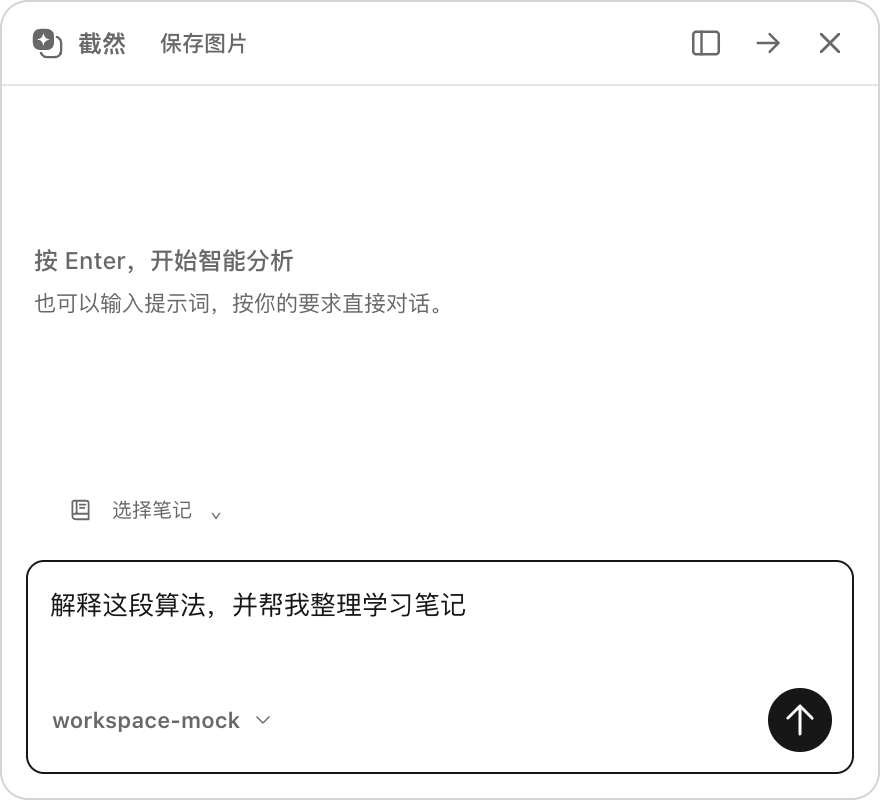
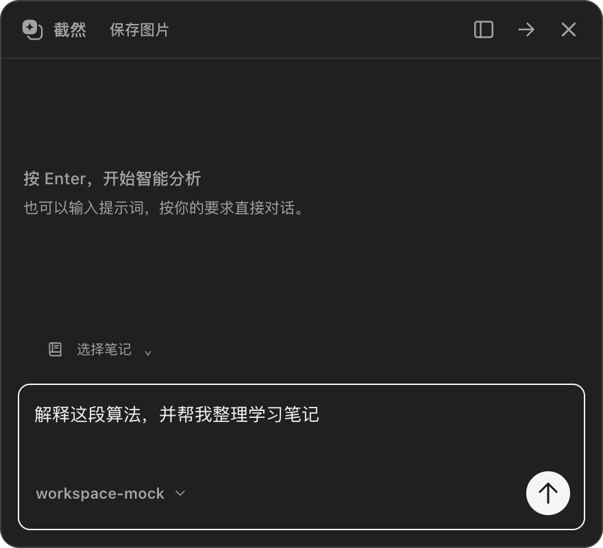
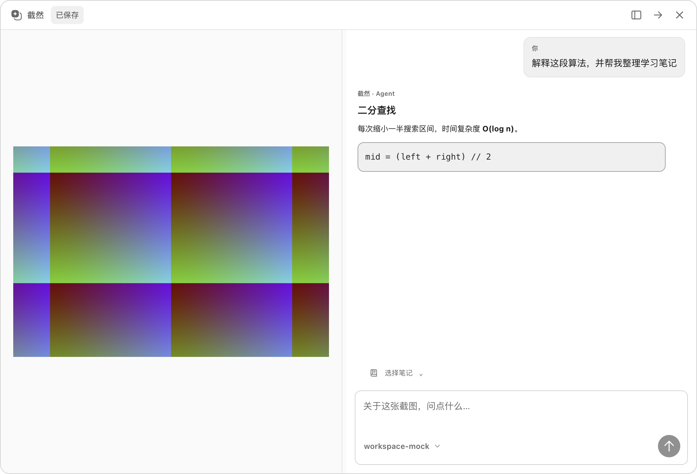
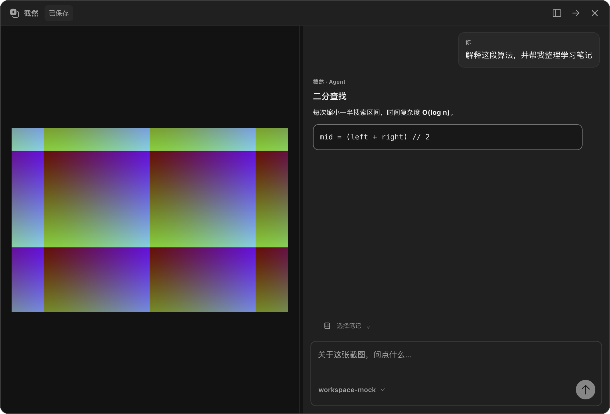
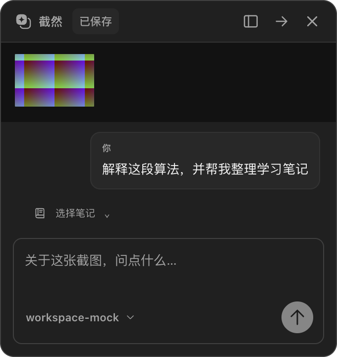

# UI 2.0 阶段 5：截图 AI 浮窗

## 实现范围与原有链路审查

本轮改造已进入客户端源码，尚未生成新的安装包。继续使用现有 Monochrome Token、原生主题同步、Agent 会话和公共 Button / IconButton / Dialog。

现有链路：快捷键 → CaptureEngine → ScreenCaptureKit Helper（或 Electron fallback）→ 预创建的 CaptureOverlayWindow → 裁剪与历史关联 → 可复用 ScreenshotToAllWindow → QuickChat。截图窗口收到图片、完成 sessionRendered 后打开会话；后续 sessionVisible 继续记录显示指标，不作为打开会话的阻塞条件。

本轮未更改 Helper、捕获后端、坐标转换、图片协议、截图显示握手、预创建和复用机制。QuickChat 仍按原设计在截图流程中创建、结束时销毁，不将它误描述为预创建窗口。PNG 基础截图和 AI JPEG 路径保持；保存按钮导出当前 AI 截图 JPEG，不再压缩或改色。

## 两种布局

### 紧凑模式

默认 440 × 400 DIP，最小 340 × 360。顶部是可拖动标题栏，右侧依次为展开、返回软件、关闭；按最新反馈移除整行缩略图 / 当前截图 / 复制操作区，只保留标题栏「截然」右侧的保存图片按钮；底部保留笔记选择、输入、模型与发送 / 停止。

为了保留现有截图使用习惯和显示性能路径，紧凑模式仍保留旁边的独立置顶截图。不是将两个原有窗口强制合并。

### 展开模式

默认 1000 × 680 DIP，并限制在截图所在显示器的工作区内。左侧截图，右侧会话；默认截图占 42%，可拖动到 28%–60%。分割条可用左右方向键、Home、End 调整。620px 以下改成上下排列，避免窄窗口横向溢出。

展开只隐藏独立截图的 BrowserWindow，保留活动 session 和图片引用；收起后恢复截图，不调用会清空 session 的 ScreenshotToAllWindow.hide()。两种布局复用同一个 QuickChat React 实例和会话窗口，输入、消息、模型及正在运行的任务不会因切换布局重建。

## 交互与视觉

- 所有新增颜色引用现有语义 Token，截图保持原色，不使用灰度滤镜。
- 细中性分割线、14px 窗口圆角、原生窗口阴影；不增加多层面板。
- 120–140ms 内容淡入；减少动态效果设置下禁用。窗口尺寸使用原生 setBounds，不插入捕获前动画或延迟。
- 截图后与布局切换后自动聚焦输入。⌘⇧E / Ctrl+Shift+E 切换布局；Enter 发送，Shift+Enter 换行，原有空输入自动分析与复制快捷键保持。
- 点击展开模式的截图打开共享原生 Dialog，原比例预览支持滚动；Esc 只关闭该 Dialog，并恢复焦点。
- 原有 Esc 停止 / 关闭语义、预测状态、Agent 审批与笔记写入流程不变。
- 复制并关闭、关闭浮窗不打开主窗口；只有返回软件执行原有会话交接。手动 Dock 激活行为保持。
- 保存图片使用原生文件选择器，取消不报错，不清空输入、不关闭会话；保存期间截图变化会拒绝写入旧截图。

## 窗口行为修改与安全边界

新 IPC 仅允许 quickChat 角色：`chat:set-expanded` 只接受布尔值，不接收任意窗口参数；`chat:save-image` 不接收调用方路径或图片数据。图片来自主进程当前 pinnedJpeg，路径由用户的原生保存对话框指定。`pin:return-to-app` 增加 quickChat 角色以复用原有交接。

风险是展开后独立截图隐藏、会话意外关闭时可能无可见窗口；因此 native closed 处理恢复独立截图。完整结束仍走 closePinnedFlow，终止请求、关闭会话、重置截图、释放活动图片引用。历史中已保存的图片保留原有存储语义。

## 修改文件

| 文件 | 本轮变更 |
| --- | --- |
| `src/renderer/src/chat/QuickChat.tsx` | 紧凑 / 双栏、缩略图、分栏、放大、复制保存、键盘与焦点 |
| `src/renderer/src/chat/quick-chat.css` | 作用域限定的 Monochrome 浮窗样式与响应式布局 |
| `src/main/index.ts` | 默认窗口尺寸、展示模式切换、图片保存、返回软件授权 |
| `src/main/windows/quick-chat-placement.ts` | 展开窗口工作区定位与尺寸约束 |
| `src/preload/index.ts` | 两个窄 IPC 方法 |
| `src/shared/contracts.ts` | 两个 IPC 方法的结果类型 |
| `tests/unit/quick-chat-placement.test.ts` | 负坐标显示器、小工作区定位 |
| `tests/integration/quick-chat-workspace.spec.ts` | 新浮窗完整交互与亮暗截图 |
| `tests/integration/agent-execution.spec.ts` | 标题栏有新工具后保留对预测标签的原语义断言 |
| `README.md`、`docs/UI_DESIGN_LANGUAGE.md`、本文与 `docs/ui/ui2-stage5/` | 实施记录、规范、截图及性能数据 |

对本轮开始时的源码快照核对，仅上述六个生产源码文件发生变化。原有未提交修改未回退。

## 验证结果

- `pnpm lint`、`pnpm typecheck`（包含在最终 `pnpm build`）、`pnpm build` 通过。
- `pnpm test`：58 个测试文件，938 项通过。
- Electron 回归：11 个不同用例通过（分两批执行，其中新浮窗用例重复验证）。覆盖 Agent 预测 / 流式 / 停止 / 交接、两后端窗口退出策略、性能、主题同步与重启、会员门禁、历史查看与恢复。
- 新浮窗测试覆盖：自动聚焦、输入保留、两种布局、拖动与键盘分栏、图片放大 / Esc、保存取消与真实 JPEG 落盘、拒绝其他窗口调用新 IPC、连续截图重置、图片预览清理、关闭不唤起主窗口、展开后返回并聚焦主窗口。
- 真实 Electron 亮暗与窄窗口截图已逐张检查；图像为合成彩色素材，模型与账号是本地 Mock，不包含私人屏幕内容。

### 性能比较

同一台 macOS arm64、Electron 44.4.1，1728 × 1117 DIP / 2× Retina。前后各 9 次（小、中、大各 3 轮），捕获源是合成图像；窗口、IPC、NativeImage、图片编解码和文件系统真实运行。结果见 [完整采样数据](ui/ui2-stage5/performance.json)。

| 指标 | 修改前 | 最终构建 |
| --- | ---: | ---: |
| 触发到截图选择层可见，中位数 | 104.20ms | 101.48ms |
| 框选完成到置顶截图可见，中位数 | 163.64ms | 150.76ms |
| 框选完成到置顶截图可见，最大值 | 333.44ms | 246.35ms |
| 最后一轮会话窗口创建到文档加载完成，单次 | 141.93ms | 155.91ms |
| 最后一轮截图可见到 Mock 首个回答增量，单次 | 327.47ms | 456.31ms |

本次小样本捕获指标未观察到变慢，但不据此宣称性能提升。会话加载单次增加约 14ms，首个回答单次增加约 129ms；后者包含测试等待、模型 Mock 请求和调度，不能用作真实厂商延迟结论。文档加载完成不等于像素实际可见。本轮没有新增会话首帧测量事件，也没有用旧的 ScreenCaptureKit 实机性能报告替代本轮结果。

## 尚存风险与未验证项

- ScreenCaptureKit 回归以注入合成帧验证原生后端分支与窗口策略，没有启动真实 Swift Helper 采集屏幕。
- 未完成真实多显示器、混合 DPI、Spaces / 全屏窗口切换、Windows 实机和长时间连续截图压力测试。负坐标 / 小工作区为单元测试，不能替代硬件测试。
- 模型请求为 Mock，没有验证真实 API Key、网络和实际模型耗时。
- 会话窗口初次加载的额外成本和紧凑模式双窗口总体占用，需要后续实机持续采样；本轮没有为视觉合并而重写捕获窗口架构。
- 未打包、签名或发布新版本。
