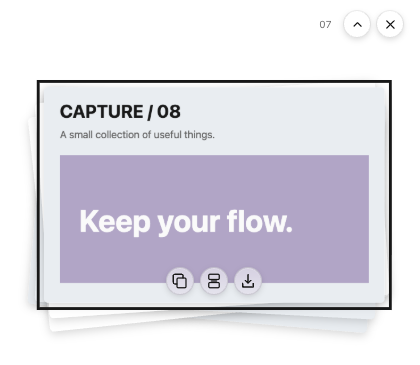
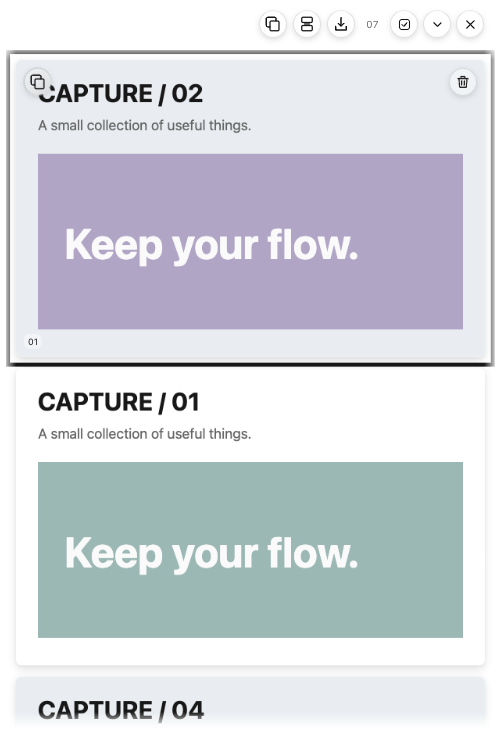
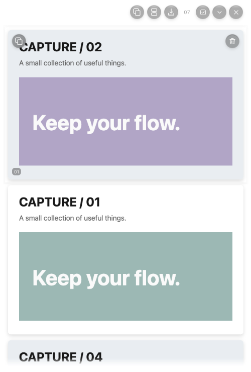

# V2 界面设计语言

## 两套现有语言

设置中心、权限和偏好使用分组行：左侧标签/说明，右侧控件。Shelf、框选、编辑和预览为工作区表面；Shelf 复用 WorkspaceHeader。不要新增第三套主页面壳。

保持 Light / Dark / System、系统字体、黑白灰语义 Token 和键盘焦点。页面标题 24px、分组标题约 15–16px、标签 13px、描述 12px；截图及标注保持原色，不通过灰度滤镜改变图片。Token 来源是 src/shared/design-tokens.json，由 scripts/generate-design-tokens.mjs 生成 CSS。

## 设置与收纳

设置保留通用、快捷键、截图、存储、关于；日程仅 Coming Soon。反馈 Dialog 展示 QQ 群号 643251313，并提供复制、成功/失败提示及焦点恢复。

Shelf 使用透明图堆，不绘制面板背景、外框或页面底板；照片保持原始比例和原色。收起时最近 5 张以小角度叠放，充分使用宽度，允许在预览中放大小尺寸截图。展开后是右侧单列，按各图比例紧凑排列，常规图片间距 12 DIP。点击收起的图堆只向下展开列表；默认列表窗口占当前屏幕工作区高度的 3/4，图片少也不缩短，超出视口后滚动。宽度只在设置中调整，顶栏不再显示加宽按钮。

收起时，鼠标悬停或键盘聚焦照片，在照片底部显示同排三个 28 DIP 半透明图标：全部复制、合并复制、导出 PNG。展开后，这三个输出按钮固定移到顶栏，与多选、收起和隐藏并排；照片上仅保留悬停/聚焦时出现的左上复制、右上删除。全部复制提交全部独立原图；多选只影响合并和导出，选择按钮仅在进入多选后出现。普通拖动将原图作为文件拖出，供支持文件拖放的文件夹、聊天/附件输入区域接收；按住 Alt 拖动排序，Alt+方向键仍可排序；不显示底部尺寸拖柄、三点菜单或尺寸浮层。

展开后再点击单张照片，以 340ms 的 transform 动画放大到所在屏幕工作区中央；使用现有 Shelf 原生窗口承载原图预览，不创建额外窗口。点击图片、空白或 Esc 以 240ms 动画返回；保留复制、定住、删除和关闭。顶栏复用 WorkspaceHeader，以小型悬浮控件显示展开和隐藏，语义标题仍可被辅助技术读取。

复制或导出真正成功后，对应按钮显示对号，1000ms 后恢复，不显示成功文字条。取消不显示对号，失败仍明确提示。按钮保留 title、aria-label 和键盘焦点。照片阴影反向补偿卡片缩放；旋转轮廓、滚动和窗口边缘预留 16 DIP 渐隐空间，仅改变透明度，不加底板或图片滤镜。

默认鼠标离开 1800ms 后向右贴边收起，只留下 22×84 DIP 透明窗口中的拉出手柄；鼠标悬停手柄即平滑恢复，也保留点击和键盘入口。拉出手柄不依赖窗口聚焦，不会因此打开设置窗口。拖拽、合并/导出和居中预览期间保持面板。设置中心新增“收纳区”，沿用左侧标签/说明、右侧控件的分组行，管理宽度 280–960 DIP、展开高度模式（屏幕 3/4 或自定义 300–1600 DIP）、自动收起与等待时间、合并参数和确认清空。超出工作区的尺寸自动限制，不显示额外页面壳。

新增截图以 showInactive 显示反馈。飞入使用 340ms 的连续采样弧线、等比例缩放和 cubic-bezier(.22,1,.36,1)；先解码图片，再通知 Main 恢复透明窗口可见度后播放。结束由动画 ACK 收敛到图堆，超时兜底；新截图使旧 presentation/epoch 失效。Reduced Motion 及用户隐藏状态使用小型数量反馈。截图入口先把收纳窗置零透明度、禁用鼠标和焦点，不在首帧路径反复隐藏原生窗口。macOS 快速截图/收纳退出时通过 app.hide 释放前台，再无焦点显示图堆；编辑与贴图保持原焦点路径。显式隐藏仍隐藏原生窗口。关闭/隐藏不清空收纳。

截图为合成图片的离屏 Electron 验收结果，透明区域在 PNG 查看器中可能显示为黑色。验证边界及原生收起/预览状态见[本轮记录](v2/SHELF_DRAG_REPORT.md)；Windows、多屏和混合 DPI 仍需真机验收。旧反馈动画记录见[透明图堆优化记录](v2/TRANSPARENT_SHELF_REPORT.md)。

## 连续截图输出状态

框选松手后关闭遮罩，复制/收纳在独立队列执行，不用全屏等待编码。成功状态仍以系统剪贴板提交或 Collection 更新为准。失败沿用现有错误区域，托盘提示待处理/失败；原生菜单提供重试和需确认的放弃。队列满时给出明确错误，不静默丢图。指针选区每 RAF 更新，松手坐标即时计算；不新增页面壳或主题。

原生自排除截图在取帧前激活窗口，用透明度和新会话 ACK 交接旧像素与输入；允许先框选、后等待冻结帧完成输出。Electron fallback 抓图期间禁止晚到 ACK 恢复窗口。原生呈现状态不使用遮挡感知的 isVisible 代替。

## 截图标注与钉图

编辑器沿用现有悬浮工具栏和黑白灰选择框；不改变标注原色。裁剪控制点视觉仍小型，命中区 22 DIP，四条边均可拖动；选中矩形、椭圆或打码后显示方形缩放点。文字工具点击已有文字直接编辑，选择工具双击编辑，保留原图层位置和撤销。

钉图保持透明工作区窗口，图片按原比例展示；悬停或键盘聚焦时在右上显示两个 28 DIP 半透明图标：复制并关闭、关闭。动作区域为 no-drag；图片区域接收双击移除及拖动，边缘仍可原生缩放，不新增面板壳。拖动超过 4 DIP 才移动，拖动产生的双击通知不移除钉图；普通双击仅关闭当前钉图，不删除已保存文件。每张图单独关闭；新截图临时隐藏既有钉图，结束后 showInactive 恢复。未隐藏的钉图获得焦点时不弹设置。实现、验证和平台边界见[修复记录](v2/EDITOR_PIN_FIX.md)。
