# Snipvia（截然）界面设计语言

本文固定 Snipvia 的两套界面语言。新增页面和调整现有页面时，先按页面职责选择其中一套，不在同一页面混用两套布局骨架。

官网和管理后台已迁入独立私有仓库；本规范仅约束桌面客户端的两套页面语言，不引用已迁出的官网规范。

## V2 Phase 2 截图收纳

Shelf 是工作区语言的小型浮窗，复用 WorkspaceHeader、Button 与现有黑白灰 Token，不增加主页面壳。收起时 184×58 DIP，展开时至多 420×540 DIP，靠截图显示器工作区右上角；主动展开才聚焦，新增图片 showInactive。缩略图保留原色；删除、排序与清空均作用于稳定 ID。清空使用原生确认框。展开态支持逐项选择、预览、删除、拖拽/方向键按钮排序；底部提供最大宽度、间距、合并复制与 PNG 导出。收纳只在本次应用运行内保留，容量上限明确报错。隐藏后小型数量反馈自动结束，减少动态效果时不飞入。实际截图、性能保留项与验证见 [Phase 2 报告](v2/PHASE2_CONTINUOUS_CAPTURE_REPORT.md)。Phase 1 中“不增加收纳窗口”的说明仅代表当时范围。

## V2 Phase 1 当前界面（2026-10-23）

以下历史工作台规范保留其原有验收范围。V2 开发分支当前以设置语言为唯一主窗口：通用、快捷键、截图、存储、关于；日程只以 Coming Soon 条目和旧记录只读入口存在。删除 AI 对话、笔记、历史工作台与快捷导航，不新增第三套页面骨架。

沿用原 AppShell 的 48px 原生标题栏、公共 Button/Dialog、黑白灰 Token、主题广播与分组行语言。去掉业务侧栏。24px 页面标题、15px 分组标题、13px 行标签和 12px 描述区分层级；正文在右侧控件旁保持清晰换行。顶部分类定位到实际设置区域，不创建虚假配置开关。宽窗口最大内容宽度 900px，窄窗口收紧间距；更新说明保留安全 Markdown、拒绝外链图片与不安全 URL。

主窗口只初始化设置与权限状态，点击「查看旧记录」才读取旧索引；旧记录 Dialog 只读展示及导出，原 Markdown 从原文件夹备份。反馈保留 QQ 群号与复制，通用剪贴板 IPC 已从 notes 命名空间提取。截图 Overlay/贴图使用原来的透明窗口和握手；标注工具栏移除「问 AI」。不增加收纳窗口、动画或未来功能入口。

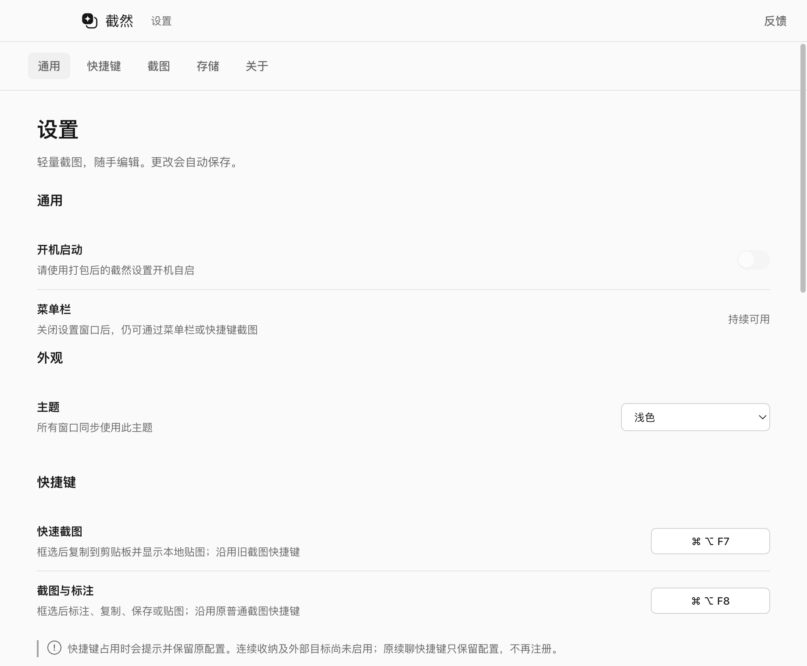

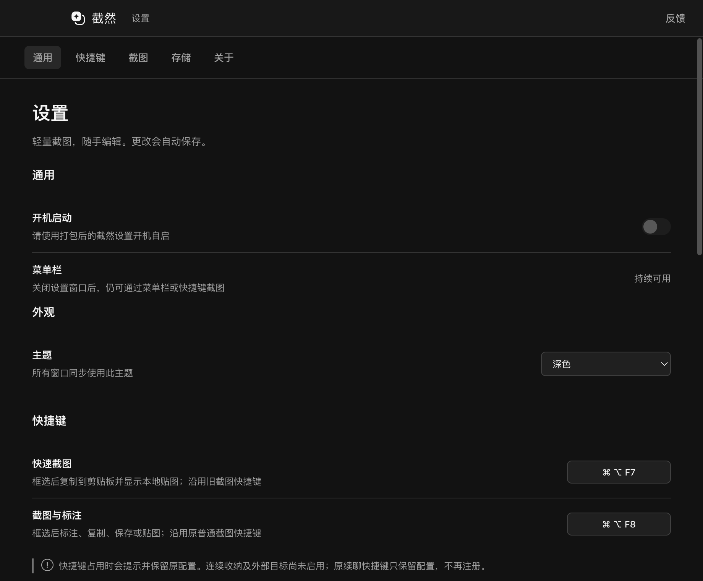

## 页面归属

| 设计语言 | 适用页面 | 当前范例 |
| --- | --- | --- |
| 工作区页面 | 用户查看内容、执行截图任务、处理记录 | 截图日程、截图对话、AI 笔记、历史对话 |
| 设置页面 | 用户选择偏好、配置厂商、录制快捷键、管理权限 | 模型与设置 |

## 共同原则

- UI 2.0 支持 Light / Dark / System，默认跟随系统。客户端统一采用 Monochrome Minimalism：浅色为中性白灰，深色为独立优化的中性深灰；主要动作、选中和焦点均使用黑白灰。颜色统一引用 [语义 Token](../src/shared/design-tokens.json)，组件不写颜色常量。
- 使用 macOS 原生工具的克制感：细边框、少量阴影、中性状态色及明确图标和文字；深色层次通过不同表面区分，避免反转浅色颜色。
- 使用系统字体栈，以 SF Pro 显示为优先；标题明确，辅助说明降低对比度。
- 导航使用 `bg-nav`，窗口使用 `bg-window`，分组表面使用 `bg-panel`，弹出层使用 `bg-raised`。保持清楚的导航和稳定的内容宽度。
- 左侧导航只在「截图日程」有未查看识别记录时显示数字；进入日程页后清零。历史对话等其他入口不显示记录总数。
- 控件只在当前任务需要时出现；不使用彩色数据块、厚重阴影或 SaaS 仪表盘式卡片堆叠。
- 文字使用 `text-primary / secondary / muted / disabled`，边线使用 `border-subtle / default / strong`；代码块使用独立的 `code-*` 灰度语法层级，关键字加重，注释标灰并使用斜体。
- 选中使用 `bg-selected / text-selected`；主要动作使用 `accent / text-on-accent`，聚焦使用 `focus` 的清晰实线描边，不使用蓝色光晕。截图像素与标注色不随主题变化；跨截图背景的遮罩和尺寸标记使用固定对比度的 `capture-*` Token。
- 品牌图标以 `UI/` 中的设计为源：macOS 使用 `Snipvia-2-mac.icon` 分层图标，标题栏使用与托盘轮廓一致的 `currentColor` 黑白矢量图标；彩色应用素材仍保留原件，Windows 使用 `Snipvia-Win.png`，应用与托盘使用 `Snipvia-Win.ico`。中文名为「截然」，打包文件及权限身份继续使用稳定的 `Snipvia.app` 与 `com.snipvia.desktop`。更新 Mac 源图标后运行 `pnpm icons:build`；开发启动器同步 ICNS 和分层资源、更新图标声明并重新登记固定开发应用，系统权限图标的验证与刷新见 [开发说明](DEVELOPMENT.md#开发应用的系统图标)。
- 弹窗使用 `bg-overlay` 遮罩和紧凑标题栏；公共原生 Dialog 使用 `radius-dialog`、`shadow-popover`。已有业务弹窗本轮接入主题，内部布局后续按页面逐步调整。

## 主窗口标题栏与导航

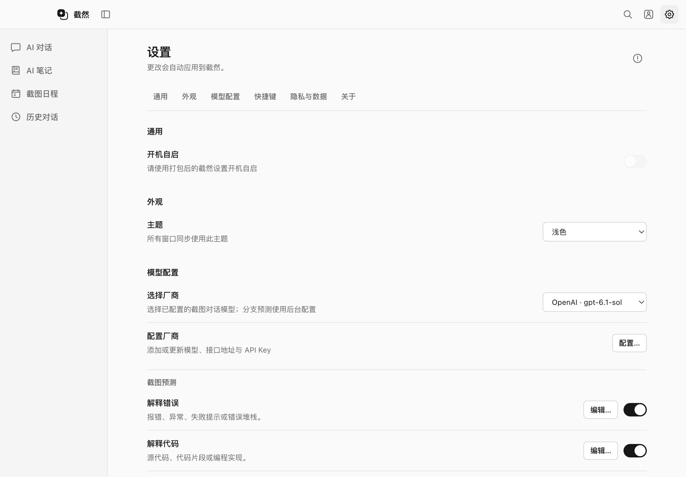

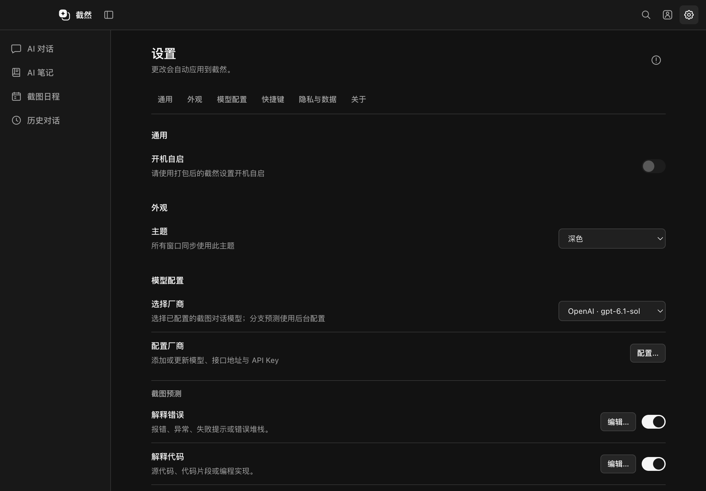

- 主窗口使用 48px 高的统一标题栏，保留系统原生窗口控制。macOS 为红绿灯按钮预留左侧空间，Windows / Linux 通过窗口控制覆盖区域预留安全空间。标题栏空白处可拖动窗口，按钮区域正常响应点击。
- 「截然」图标和名称位于标题栏左侧，旁边放菜单栏收起 / 展开按钮。快捷导航（⌘K / Ctrl+K）和设置位于右侧；客户端没有登录或账号入口，设置显示对称的齿轮图标。图标按钮均有可访问名称、悬停提示和选中状态。
- 左侧提供 AI 对话、AI 笔记、截图日程、历史对话四个入口；主窗口默认进入 AI 笔记，AI 对话也可通过快捷导航进入，不显示截取区域按钮、工作空间字样、账号邮箱或本机存储说明。截图入口继续位于任务页、系统菜单、托盘和快捷键中。
- 展开时导航宽度为 176px，AI 对话页为 232px；不超过 1050px 的窗口默认收起，允许手动展开；收起后为 52px，只显示菜单图标，隐藏文字和数字。宽度与图标位置连续过渡，文字淡出；展开、收起过程中可反向切换。通过悬停提示查看名称及未查看日程数量，收起状态在下次启动时恢复，切换时保留当前页面和编辑内容。系统开启「减少动态效果」时直接切换。
- 历史图标使用完整圆环与时钟指针，不附带回转箭头；设置图标的齿轮外轮廓和中心圆保持对称。
- 标题栏与左侧导航属于共同应用框架，内容页继续使用工作区或设置两套既有设计语言。
- 基础样式先加载，共享精修样式随后加载，避免开发模式中的异步加载顺序覆盖窗口网格。标题栏必须横跨窗口，侧栏从标题栏下方贴左排列，主内容与侧栏相邻；展开、收起和紧凑窗口均校验边界，不预留额外空列。
- 2026-10-09 布局修复已通过构建版窗口边界与收起动画检查，以及开发版延迟基础样式 500ms 的实际加载验证。设置页范例见[修复后布局](ui/settings-layout.png)。
- 2026-10-07 已接入 UI 目录中的新版平台图标。Mac 标题栏与固定开发应用的图标同步、签名检查及桌面回归通过；Mac 应用目录包含新 `Assets.car` 和 ICNS，Windows 交叉构建的 EXE 包含新 ICO 全部 7 种尺寸。Windows 界面仍待真机确认。
- 开发版的运行中 Dock 图标通过导出的 PNG 设置；ICNS 只用于应用包资源。实测 Electron `nativeImage.createFromPath` 读取该 ICNS 会返回空图像；启动及每次恢复 Dock 显示后均重新应用 PNG，防止系统沿用旧图标。参见 [Electron NativeImage](https://www.electronjs.org/docs/latest/api/native-image)。
- macOS 顶部菜单栏使用新版品牌的双圆角方块与四角星黑白图形。前层星形镂空，后层只描边，背景透明；资源为 `build/TrayTemplate.svg` 及其 18px / Retina 36px PNG。Main 将其标记为系统模板，颜色由 macOS 根据菜单栏外观处理；不使用彩色应用图标。修改 SVG 后运行 `pnpm icons:tray`，完整图标导出命令也会生成这两份资源。

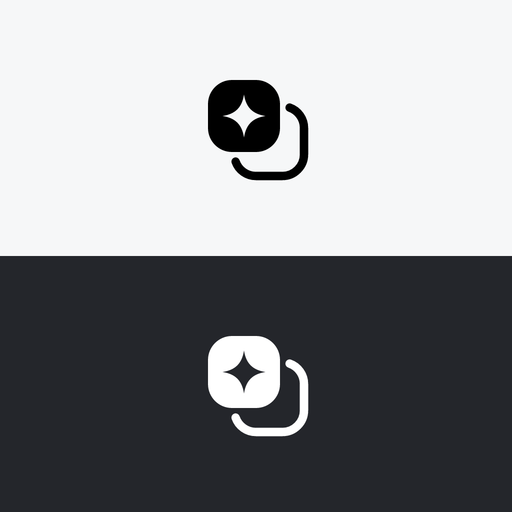
- 2026-10-05 已在 macOS 验证登录状态切换、收起状态恢复、键盘导航、笔记内容保持及全屏 / 紧凑布局。Windows / Linux 的原生窗口控制按 [Electron 自定义标题栏文档](https://www.electronjs.org/docs/latest/tutorial/custom-title-bar) 实现，仍需对应平台真机验证。

## UI 2.0 主题与公共组件

- 主进程统一保存外观模式并通过 Electron `nativeTheme` 解析实际主题；运行时系统变化自动同步到已创建窗口，新窗口通过 Preload 的只读内存快照初始化。
- 在「设置 → 外观 → 主题」实时切换。偏好独立于模型配置，模型切换不重置主题。旧设置默认 System，密钥仍保留原有加密存储。
- 主窗口只有一个 `AppShell`。笔记保持现有挂载与保存行为；已访问的其余页面通过 React `Activity` 保留状态，隐藏时暂停页面 Effects，不创建额外布局盒。
- 新公共 Button / IconButton / Input / Select / Dialog / LoadingState 使用 Token；原有 Popover、Tabs、Switch、空状态和滚动区域复用现有结构并接入语义颜色。Tooltip 保留原生 `title`，不添加 UI 依赖。
- Token 修改后运行 `node scripts/generate-design-tokens.mjs`。CSS 在 HTML 中先于 React 加载，浅色 / 深色均有启动前样式，透明截图与浮窗根节点保留透明。
- 主题持久化与同步机制见 [阶段 2 实施记录](UI_2_0_STAGE_2.md)；当前黑白灰 Token、状态与验证见 [阶段 2.5 Monochrome 修正](UI_2_0_MONOCHROME.md)。
- 普通说明文字在浅灰选中背景上也保持至少 4.5:1 对比度，浅色次要文字采用 `#686868`。成功、警告、错误不依赖颜色：保留操作结果文字，并显示勾选、感叹号或叉号。禁用控件使用降低对比度和不可操作状态。

## 工作区页面设计语言

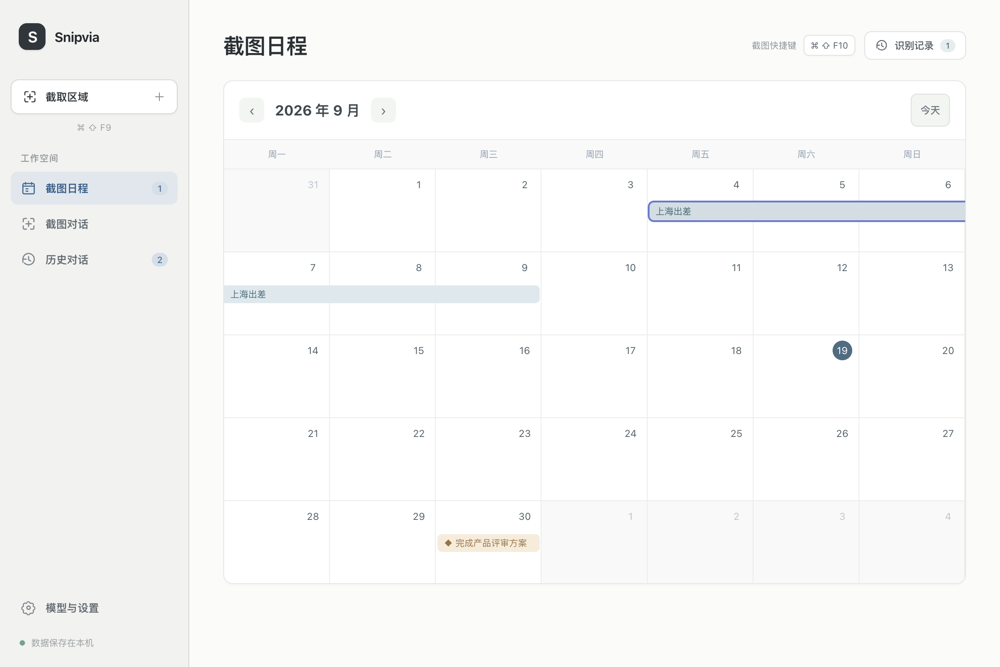

工作区页面强调当前任务和主要内容。日程、对话、历史必须共享同一页头和内容容器规则。

### 布局

- 页面使用 `workspace-panel`：公共留白为纵向 16px、横向 24px，紧凑窗口为 12px / 16px。业务页面各自适配内容宽度；笔记采用阶段 4 的沉浸式编辑布局。
- 页头复用 `WorkspaceHeader`，至少 44px 高，标题为 14px / 600 字重。右侧放快捷键、记录入口或当前任务操作，不增加重复标题栏。
- 页面不叠加第二层全局工具栏，也不重复显示同一个标题。
- 主内容位于页头下方 18px。笔记、日历与历史优先采用连续表面、留白和细分隔线；只有确有边界的任务容器使用 `workspace-card`。

### 表面与控件

- 主内容卡片使用 1px 中性边框、11px 圆角和极轻阴影。
- 页头按钮高度 32px、8px 圆角，使用白色或浅灰背景；图标与文字保持紧凑间距。
- 快捷键显示为小型 `kbd` 标签，放在操作区，不占用主内容。
- 日历使用紧凑连续网格和日期详情；历史使用无外框的紧凑列表与同屏预览；截图对话保留现有内容容器，逐阶段改造。
- 空状态仍放在主要内容卡片内，使用单一图标、标题、说明与必要操作。

### 交互

- 主操作靠近它影响的内容。页面级操作放页头，内容级操作放卡片内部。
- 历史删除、清空等破坏性操作使用明确的文字和中性高对比描边，仅在可执行时出现。
- 记录详情、识别历史和编辑器使用统一弹窗，不在页面上并排堆叠额外面板。

### 截图日程与历史对话（阶段 3）

- 日程采用月历主区域与 272–360px 日期详情，窄内容区域缩到 250px；不足 600px 时上下排列，独立内容滚动。日期格为 64–84px，不塞长事件标题，不使用大面积选中色块。
- 今天是高对比实心日期，选中日期有灰底小标签及边线；实心点表示日程，空心点表示来源截图，菱形表示截止事项。点击日期或用方向键更新真实日期详情，Home / End 选择本周边界，PageUp / PageDown 切月；月份长度变化正确限制日期。
- 日期详情按全天、时间安排、截止事项分组，并列出当天创建的来源截图。跨日与时区继续使用既有 Temporal 日期规则；午夜结束的时间段不额外占下一天。缺少日期的结果不会被放入今天，识别失败记录仅出现在实际截图日期的来源区与识别记录中。
- 识别记录与事件编辑复用公共 Dialog；保存到截然、Mac 日历与提醒事项仍为原有明确操作。本阶段保持现有业务，并未引入自动保存或新的待核对队列。
- 历史为 240–300px 紧凑列表与弹性详情。每行约 56px，日期分组标题可吸顶；灰底、字重和短竖线表示当前对话，删除按钮悬停或键盘聚焦时显示。
- 搜索标题、模型与厂商，不为搜索批量读取消息或图片。厂商筛选与清除搜索复用公共控件；空结果、空记录、读取中和读取失败分别表达。
- 预览使用只读 `history:read`：不改变活动截图、不取消 Agent、不发送模型请求或更新记录。只有「继续对话」调用既有恢复入口；来源图片按需展开，消息复用现有 Markdown 与网页来源展示。
- 删除与清空使用公共原生 Dialog，默认聚焦取消，确认前不写存储。清空明确作用于全部记录而非筛选结果。列表与预览独立滚动，每条预览的滚动位置在页面及主题切换时保留。
- 小窗口减少详情留白；内容宽度不足 580px 时切为列表 / 详情两态并提供返回按钮。两页共享 WorkspaceHeader、Monochrome Token 与原有主窗口骨架。
- [阶段 3 实施、验证与真实窗口截图](UI_2_0_STAGE_3.md)。

### 代码入口

- 共享页头：`src/renderer/src/components/WorkspaceHeader.tsx`
- 工作区样式：`src/renderer/src/refined.css` 中的 `Shared workspace language`
- 页面实现：`App.tsx`、`schedule/SchedulePanel.tsx`、`history/HistoryPanel.tsx`

### AI 笔记工作区

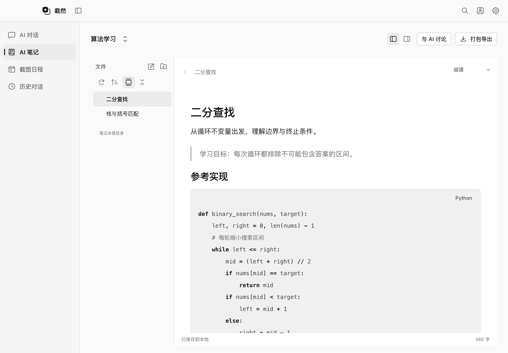

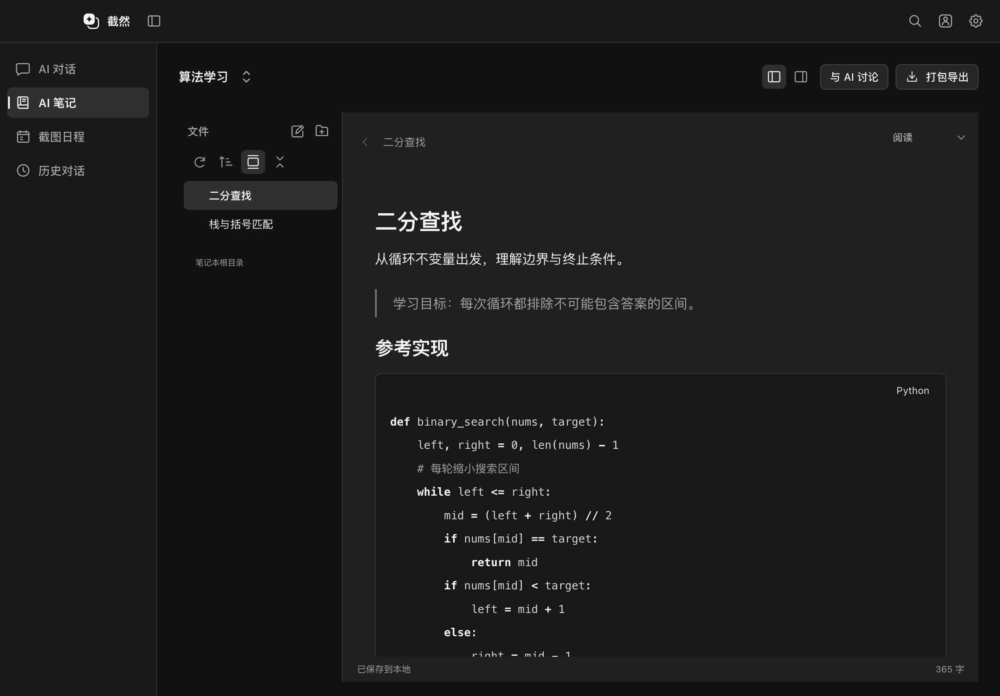

AI 笔记复用 `workspace-panel` 与 `WorkspaceHeader`，移除内层卡片外框和阴影，使用连续编辑表面，不新增第三套页面壳。

- 页头左侧是可切换的笔记本名称，使用居中的上下双箭头；右侧依次放文件列表、大纲显示按钮和打包导出。首次进入时，内容中央显示创建笔记和打开已有笔记本。
- 默认采用左侧文件树与中央编辑器；大纲默认收起，按需打开，反向链接位于大纲下方。宽内容区域的文件树 / 大纲均为 200px；内容不足 900px 时文件树为 184px，大纲改为 212px 辅助浮层；不足 620px 时文件树也以辅助浮层展开，保留关闭入口，避免三栏同时挤压正文。
- 文件列表与大纲可独立收起，宽度连续缩小、内容淡出；恢复入口始终保留在页头。两侧全部收起后正文使用完整工作区宽度，编辑器、目录展开状态和输入内容保持。隐藏栏退出键盘导航；系统开启「减少动态效果」时关闭动画。
- 页头与编辑工作区使用全部可用宽度，正文最大 760px（含横向留白），居中排版；编辑器 15px 系统字体与 1.85 行高。宽屏不会把每行文字无限拉长；实时预览和源码模式仍使用原 CodeMirror 实例、Undo 历史和高度测量逻辑。
- 文件栏标题旁放新建笔记 / 文件夹，下面一行放刷新、排序、自动定位与折叠图标。行末更多操作按需显示，不为每个文件堆叠按钮。
- 文件夹和大纲使用 SVG 箭头，以图标中心旋转。大纲用标题缩进、细纵线和折叠箭头表达层级。点击跳转；反向链接在大纲下方，使用轻量文本行。
- 文件树隐藏根目录的 `assets` 和其中条目，附件仍可在正文中使用。拖动文件或文件夹时，源行使用黑白高对比，目标文件夹及已展开子树使用灰色背景；光标旁显示深色紧凑浮层，包含文件 / 文件夹图标、名称和「移动到…」。源行、目标和浮层均复用 Monochrome Token，保留用户附件原色。
- 文件夹行和其子项区域接收拖入；列表空白处及「笔记本根目录」行接收移回根目录。悬停 650ms 展开折叠目录，靠近列表上下边缘连续滚动。松开后等待保存并执行移动，跟随打开文件的新路径、保留文件夹展开状态，更新可确定的笔记链接。禁止移入自身 / 子目录、同名覆盖和无效目标，浮层显示原因；Esc、取消或离开窗口结束提示与滚动。
- 返回、路径、格式动作与模式选择合并进轻量文档栏；紧凑窗口格式动作可换行，阅读模式隐藏格式动作。保存状态与字数放在 28px 底栏，发生冲突时就地显示明确的版本选择。
- 实时预览与阅读模式中的围栏代码块使用更深的浅灰底、细边线和 7px 圆角，保留等宽字体与缩进。语言按钮位于右上角，点击复制源码并反馈「已复制」；使用灰度区分语法：关键字 / 运算符加重，注释降低对比并使用斜体；不改变代码文本。阅读引用使用中性竖线与次要文字，行内代码使用 `code-bg / code-text`。源代码模式保留 Markdown 围栏。
- GFM 表格使用表头底色、细单元格边线和轻量交替行色，遵守 Markdown 列对齐；过宽时在表格内部横向滚动。实时预览点击单元格展开到对应源码位置，移出后恢复；不把源码表格作为最终阅读形式。
- 编辑器标题间距使用 padding，布局装饰由 StateField 直接提供，保证高度参与 CodeMirror 测量；不能给编辑行添加无法被高度计算覆盖的上下 margin。
- 创建、命名、移动和删除确认沿用统一弹窗。系统目录选择和 ZIP 保存使用原生对话框。
- 笔记本选择弹窗中，每行提供「移除链接」图标。确认文案说明保留本地文件，可重新打开目录；默认焦点在取消。当前笔记先保存，冲突时保留编辑并终止移除。移除只更新授权列表并清除相关对话选择，不移走笔记文件或附件。

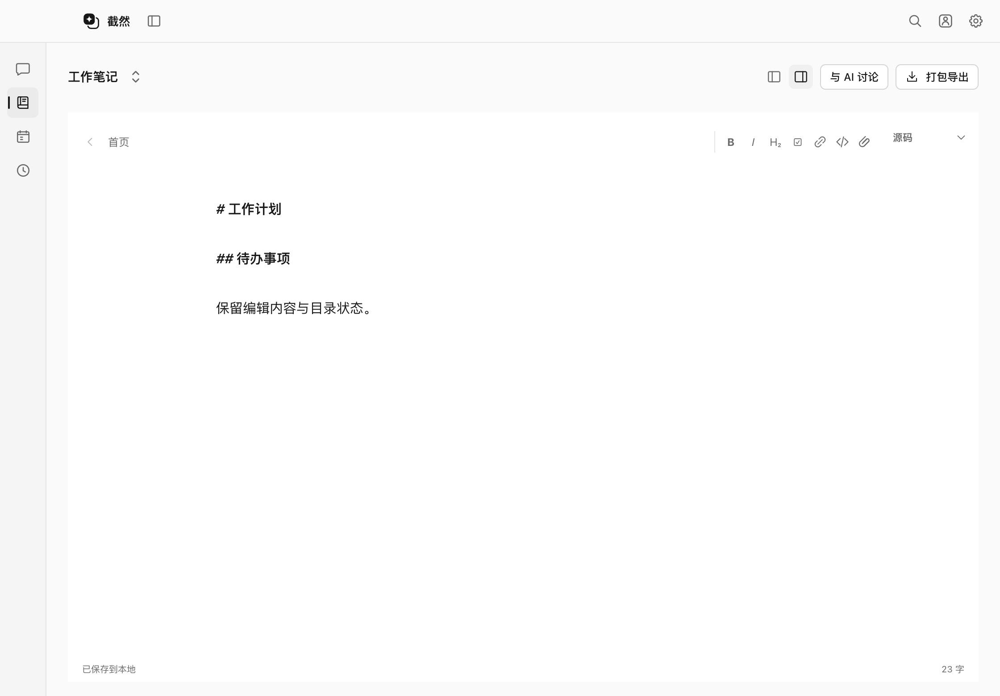

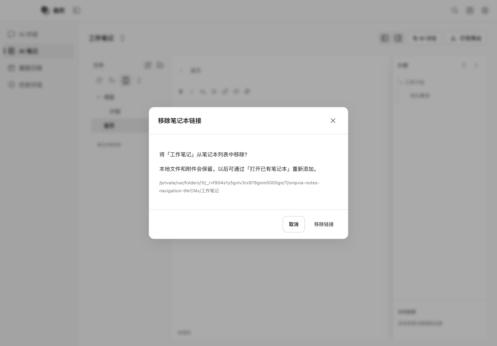

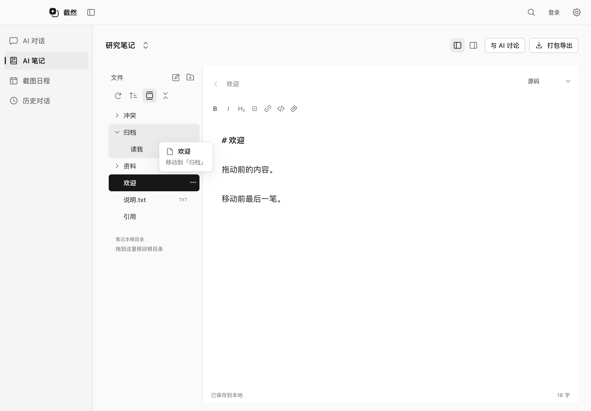

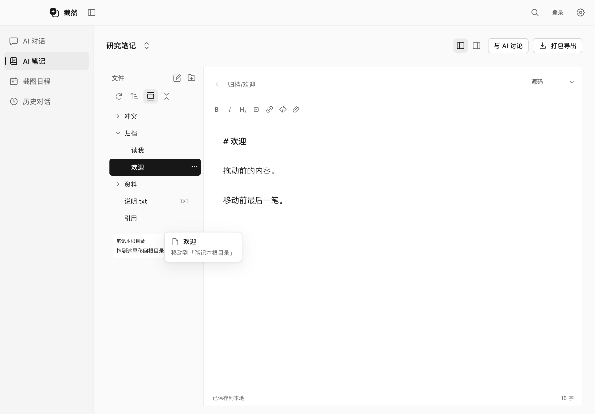
- 代码入口：`src/renderer/src/notes/`；使用说明与边界见 [AI 笔记](AI_NOTES.md)，[阶段 4 实施与截图](UI_2_0_STAGE_4.md)。
- 截图对话输入框外的「选择笔记」使用轻量文字按钮，显示当前笔记本名称，点击打开笔记本列表；没有笔记本时进入创建流程。选择笔记本的弹窗说明 AI 可在所选范围直接整理 Markdown，完成后可查看差异与撤销。目录操作只显示状态行并汇入时间线；写入阶段显示「正在编辑 文件名.md」，直接提交，等待实际保存完成后回复，下方展示净增删行与文件清单；点击打开 AI 笔记，另提供变更预览。
- 预测分支弹窗中的「绑定笔记本」采用设置语言：左侧标题与说明、右侧下拉框，包含不绑定选项。绑定的是笔记本，不是某篇 Markdown。

### 悬浮截图流程

悬浮截图属于工作区任务的延伸界面，继续使用低装饰、轻边框和中性主题表面。

- 截图本体是可拖动的置顶浮窗，图片占据主要面积；关闭按钮叠放在右上角，任务按钮集中在图片下方。
- 图片下方只显示当前对话动作，使用脱离图片边框的半透明胶囊；Agent 在后台判断是否生成日程草稿，不显示单独的「记入日程」按钮。
- 置顶截图获得焦点时，`Control+C` 复制当前裁剪图到系统剪贴板并结束当前截图流程；胶囊中使用低对比度快捷键提示，不增加独立主按钮。
- 侧边对话窗与截图保持 10px 间距，根据左右可用空间自动换边，并随着截图移动；用户可以调整窗口大小，移动截图时保留当前尺寸。
- 侧边对话顶部保留空白，只在预测完成后于右上角显示只读分支标签，不展示品牌、标题、模型或分隔线。
- 笔记本选择位于输入框外的左上方，长名称省略显示，悬停查看完整名称。悬浮对话固定使用默认 Agent 能力，不展示 Agent 开关、「联网 · 只读」和「本地文件需授权」说明；新增笔记本目录仍通过系统文件夹选择器授权。
- 模型选择放在输入框内部左下角，通常只显示模型编号（如 `qwen3.8-max`），不展示头像。同一模型出现多份配置时增加轻量厂商 / 接口后缀，使用户能区分平台及凭据。右下角使用 32px 高对比圆形按钮，浅色为深底白图标，深色为浅底深图标，向上箭头表示发送，小方块表示停止；使用可访问名称和悬停提示，不展示发送、停止或快捷键说明文字。
- 悬浮对话窗口、输入框及内容分隔使用 1px 中性黑色细线；输入框聚焦只加深现有边线，无蓝色光晕或 textarea 双重描边。键盘按钮、模型选择的焦点使用当前主题的中性高对比细描边；发送/停止按钮、悬停和按下状态均为黑白灰。
- 新截图先显示安静的输入空状态「按 Enter，开始智能分析」，输入框自动聚焦。空输入 Enter 才进行预测；有提示词则直接开始对话，跳过预测。等待期间不显示旋转进度或停止按钮，空输入的发送按钮显示「开始分析」含义；Shift+Enter 换行，输入法确认不提交。
- 分支预测使用消息区的单行状态，与 Agent 分析、联网状态共用样式；预测完成后在页头右上角显示只读分支标签，不展示置信度栏或分支下拉菜单。分支的启用、编辑仍在设置页管理。
- 2026-10-06：置顶截图首轮加载并显示后即打开对话窗口；后续两帧可见确认只记录性能，不再阻塞对话创建。加载失败在置顶图中显示可重试错误。以下为旧账号版历史：截图对话曾要求登录与资格，失败时转普通标注器；该限制已在免费客户端移除，当前截图、编辑和对话入口无需账号。普通截图、复制、保存、贴图和本地笔记保持可用。
- 截图开始时隐藏主窗口，原生和 Electron 后端行为一致。点击「返回软件」才关闭浮窗并在主窗口继续同一段对话；复制、保存、关闭、取消截图、取消续拍和截图失败均不自动恢复主窗口，也不产生短暂闪现。关闭截图会同时关闭侧边对话。用户主动点击 Dock、选择「显示截然」或查看笔记等明确打开操作仍正常显示主窗口。
- 代码入口：`capture/PinnedCapture.tsx`、`chat/QuickChat.tsx`，样式位于 `refined.css` 的 `Movable screenshot pin` 段落。

### 普通截图标注器

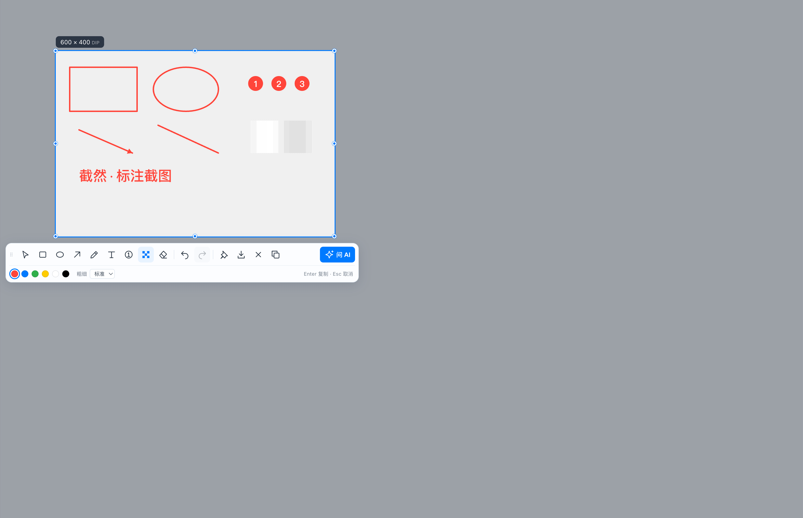

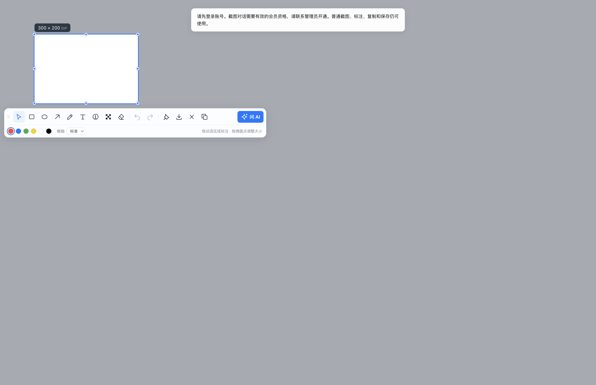

普通截图编辑器属于工作区的悬浮任务界面，沿用上述中性主题表面，不新增独立页面壳。

- 普通截图使用独立可录制快捷键，松开框选后停留在编辑状态。原有 AI 截图与续拍流程保持各自入口。
- 框选保留八个调整圆点和尺寸标识；工具栏放在选区外，空间不足时调整到上方，也可拖动握柄。
- 第一行按「选择 / 标注、撤销 / 重做、输出、问 AI」排列，第二行放颜色、粗细和低对比度操作提示。
- 工具栏采用当前主题的中性背景、13px 圆角、轻边线和少量阴影；当前工具用灰度选中态，「问 AI」使用高对比黑白主按钮；白色选区外框配深色细边，确保跨真实截图背景可见。
- 复制、保存、贴图都使用最终合成图片。普通截图和贴图在点击「问 AI」前不执行模型任务、不创建对话记录。
- 长截图暂不展示可点击入口，待功能完成后再加入。
- 代码入口：`capture/editor/ScreenshotEditor.tsx`、`capture/editor/draw.ts`、`capture/editor/model.ts`；样式位于 `capture/capture-window.css`。

## 设置页面设计语言

2026-10-09：模型目录合并进现有配置表单的“模型”行。右侧为 34px 刷新图标按钮和模型下拉框，按钮在左并与下拉框居中对齐；支持键盘焦点、加载状态及减少动态效果。刷新结果直接替换可选列表，仅包含图片理解为 supported 的模型，不展示下方目录表、能力筛选或测试卡片。加载 / 失败提示就近放在下拉框下面，失败保留同一配置的已有列表。手动 ID / 接入点保留独立输入行，未知模型不伪装成已确认。配置弹窗恢复 650px 宽，内容滚动、页头和保存按钮固定在弹窗内。四家移除厂商的历史配置以“自定义服务”展示，密钥作用域保持。视觉验收截图见[模型选择](ui/client-model-catalog.png)，详细规则见[模型目录说明](MODEL_DISCOVERY.md)。

2026-10-06：客户端厂商配置继续使用现有分组行弹窗，增加 DeepSeek、Kimi、智谱、豆包、硅基流动、OpenRouter。选择厂商后显示官方 API 地址，多来源厂商提供「接口来源」，右侧选择与 Key 对应的平台 / 地区；业务空间地址使用输入框。切换来源清空未保存的 Key 输入，各来源的已保存密钥独立保留。设置页说明客户端对话模型与服务端分支预测配置的区别，第三方聚合服务在配置说明中标明图片经过该平台。

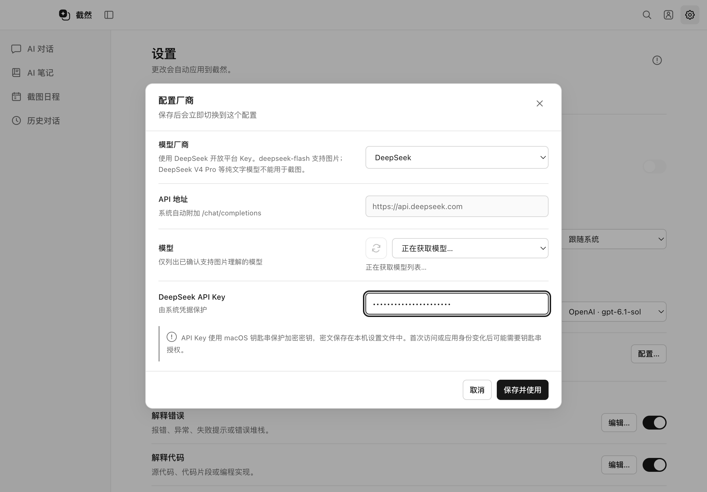

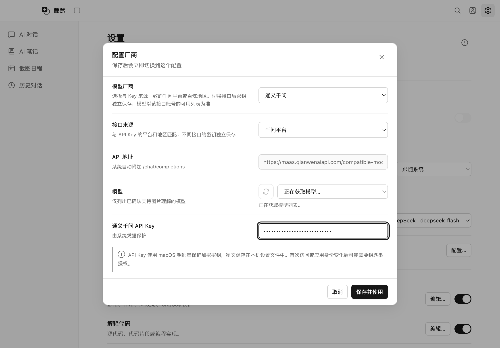

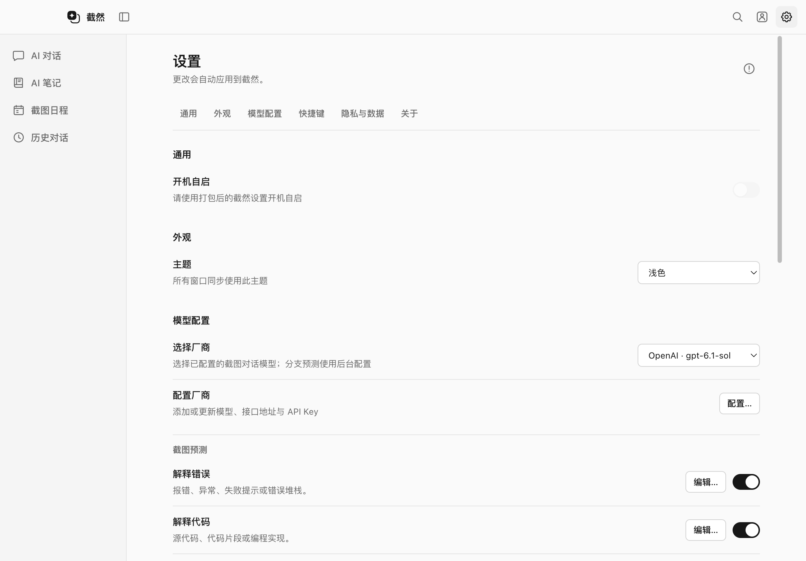

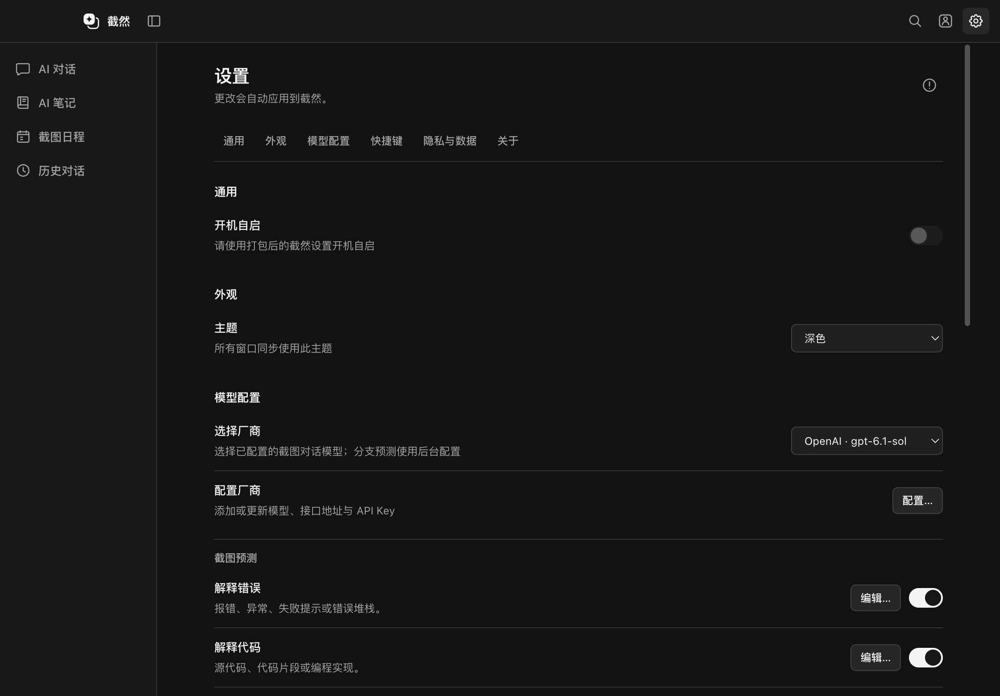

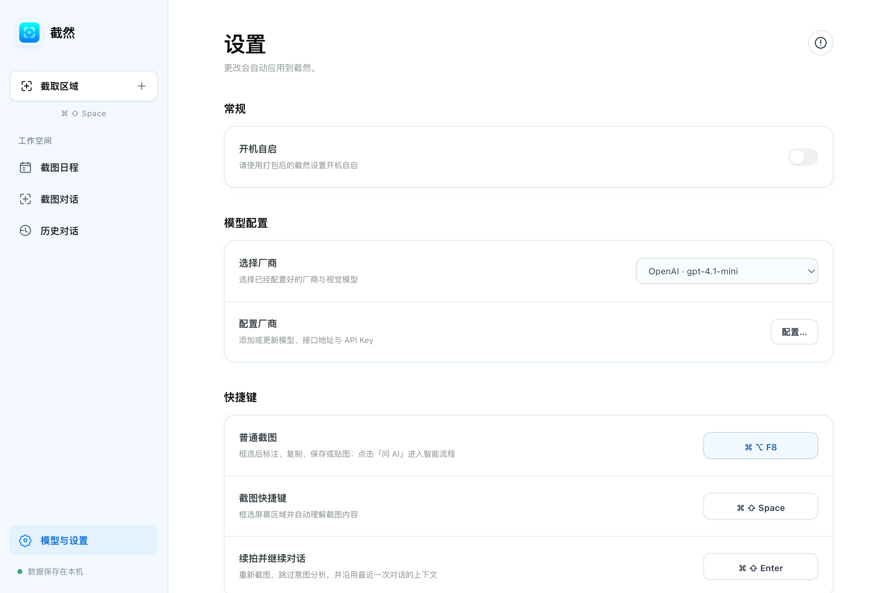

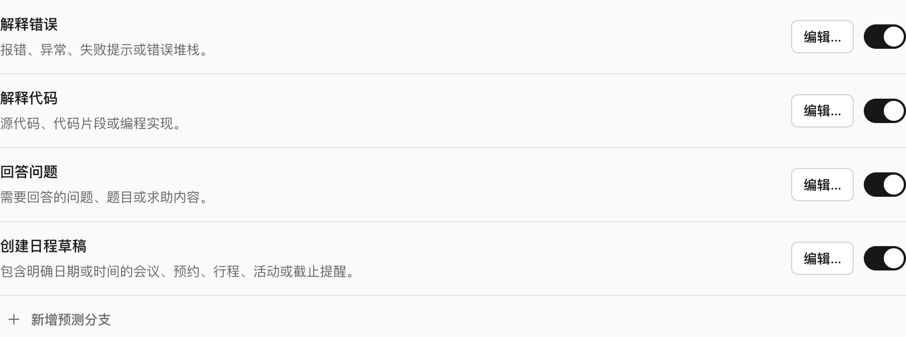

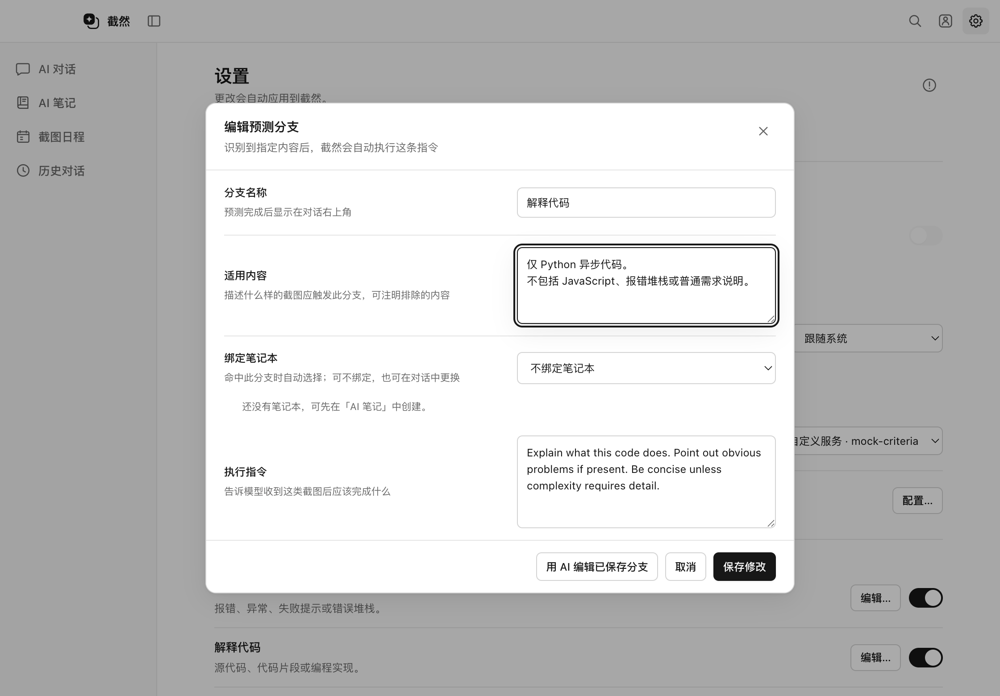

设置页面参考 macOS 系统设置的分组列表。它用于表达“名称和解释在左，当前值或操作在右”。

### 布局

- 页面继续使用 `settings-preferences`，最大宽度 880px，纵向 24px、横向 32px 留白。
- 页面顶部使用 20px 标题和简短说明，辅助入口复用 IconButton；其下是可吸顶的六个分类跳转按钮：通用、外观、模型配置、快捷键、隐私与数据、关于。点击只滚动当前页，不改变路由或卸载组件。
- 可选 Jev 预测模型属于模型配置子分组，沿用左侧名称/说明、右侧配置按钮/开关和原生 Dialog；未保存 Key 时不启用开关，配置框明确标注图片能力、厂商费用与直接发送裁剪图，Key 保存后清空。
- 分组使用 16px / 650 标题，子分组使用 13px / 600；截图预测属于模型配置的子分组；`preference-card` 只作为既有行容器，不再绘制卡片外框、阴影或背景块。
- 每行最小高度 60px。左侧使用 13px 名称与 12px 描述，右侧对齐下拉框、按钮、开关或快捷键录制器；窄窗口预测行的操作可移至下一行。

### 表面与控件

- 分组使用连续页面背景，通过 32px 分组留白、较大的标题与行间 1px 中性分割线建立层级。选项名称为 13px / 500，说明为 12px / 400 的次要文字；不把分组标题与行名称设成相同大小。
- 同组设置使用细分隔线，不把每一项拆成独立卡片。
- 右侧控件保持紧凑，宽度由内容决定；同一分组内对齐控件右边缘。
- 开关使用高对比黑白开启状态和灰色关闭状态，圆点位置与明暗区分开关；快捷键录制使用中性高对比描边和灰底。
- 截图预测使用同一分组列表：分支名称和实际适用描述在左，编辑按钮和开关在右；长描述正常换行，保留用户填写的分行。分组底部用轻量 `+` 操作新增自定义分支。内置和自定义分支均通过同一弹窗编辑名称、适用内容和模型指令；「适用内容」使用多行文本框，可填写场景与排除条件，最多 1000 字符，空白不能保存。该文本参与预测匹配，保存后再次打开保留原内容。日程分支的指令是可留空的提取补充要求，仍然生成待确认草稿。
- 内置预测分支仅有「解释错误」「解释代码」「回答问题」「创建日程草稿」四项；升级时同步清理旧配置中的其他内置分支，保留用户自定义分支。
- 开机自启位于「通用」分组，右侧使用开关。显示系统实际状态，开发模式下禁用并说明需要打包版；Windows 登录启动后进入托盘，手动启动正常显示主窗口。

### 交互

- 单值选择、开关和快捷键修改后立即保存并生效，不设置页面级“保存”按钮。
- 关闭预测分支后，该分支不参与自动匹配；没有可用或匹配分支时保留截图并等待用户提问。描述匹配按具体程度选择，同等条件下自定义分支优先于内置分支；模型无法确定匹配时等待用户提问。
- API 地址、模型和密钥等相互依赖的多字段配置放入弹窗，使用“保存并使用”一次提交完整有效配置。
- 自定义厂商的 API 地址支持 HTTP 和 HTTPS。编辑预测分支使用“保存修改”一次提交，保留分支原有的启用状态，后续执行使用更新后的指令。
- 快捷键分为普通截图、AI 截图、续拍并继续对话三行，彼此不得重复。
- 快捷键必须读取用户真实按下的组合键；不让用户输入 Electron 快捷键字符串。
- 保存失败时保留原设置，并在当前页面或弹窗内显示明确错误。

### 代码入口

- 页面实现：`src/renderer/src/settings/SettingsPanel.tsx`
- 快捷键转换：`src/renderer/src/settings/shortcut.ts`
- 设置样式：`src/renderer/src/settings/settings.css`；通用控件仍复用 `design/controls.css` 与既有设置分组结构。
- 厂商、预测分支、隐私与笔记弹窗复用公共原生 Dialog，包含 Tab 焦点约束、Esc、初始焦点与关闭后焦点恢复。模型刷新 / 凭据作用域 / 配置提交不因布局改动而变化；主题仍使用原持久化与跨窗口同步。
- 隐私与数据只提供真实存储说明和既有隐私说明入口；不增加未实现的清理 / 同步开关。关于版本读取项目包版本，不使用 UI 2.0 设计编号冒充发行版本。
- 关于分组增加「软件更新」行：左侧显示检查状态与最近检查时间，右侧提供「检查更新」，发现新版时提供「查看新版本」。版本号与更新说明直接展示在本行下方，说明区域跨两列，使用细分隔线及现有安全 Markdown；长内容在 240px 高度内滚动，空说明给出真实提示。成功、失败使用灰度符号与明确文字区分；查询期间禁用重复点击，不使用弹窗抢占焦点。复用公共 Button 与分组行，不增加新页面。见[版本检查与亮暗范例](UPDATE_CHECK.md)。
- 已启用签名更新的正式 Mac 安装版显示「下载更新」，过程使用中性进度条与百分比，下载完成后才显示「重启并更新」。保存确认在 Main 完成；失败以原有状态文字展示，不关闭编辑器。开发 / 不支持的包禁用下载并说明原因；窄设置区域操作换到下一行。不会下载后自动重启，也不在普通退出时安装。

### Agent 权限确认

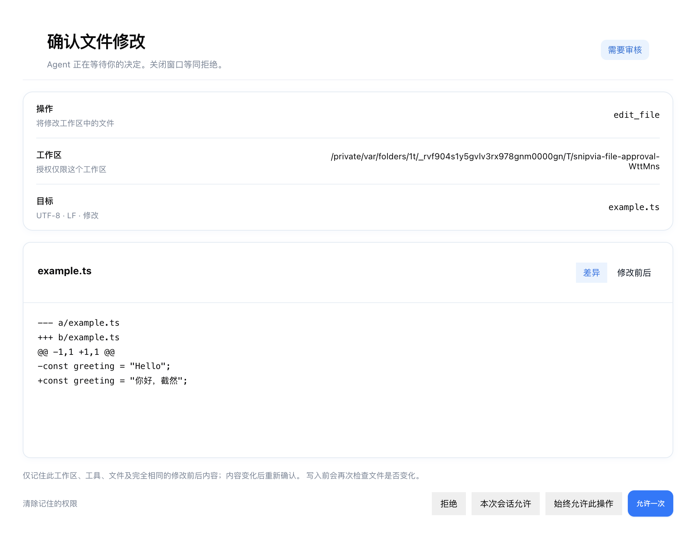

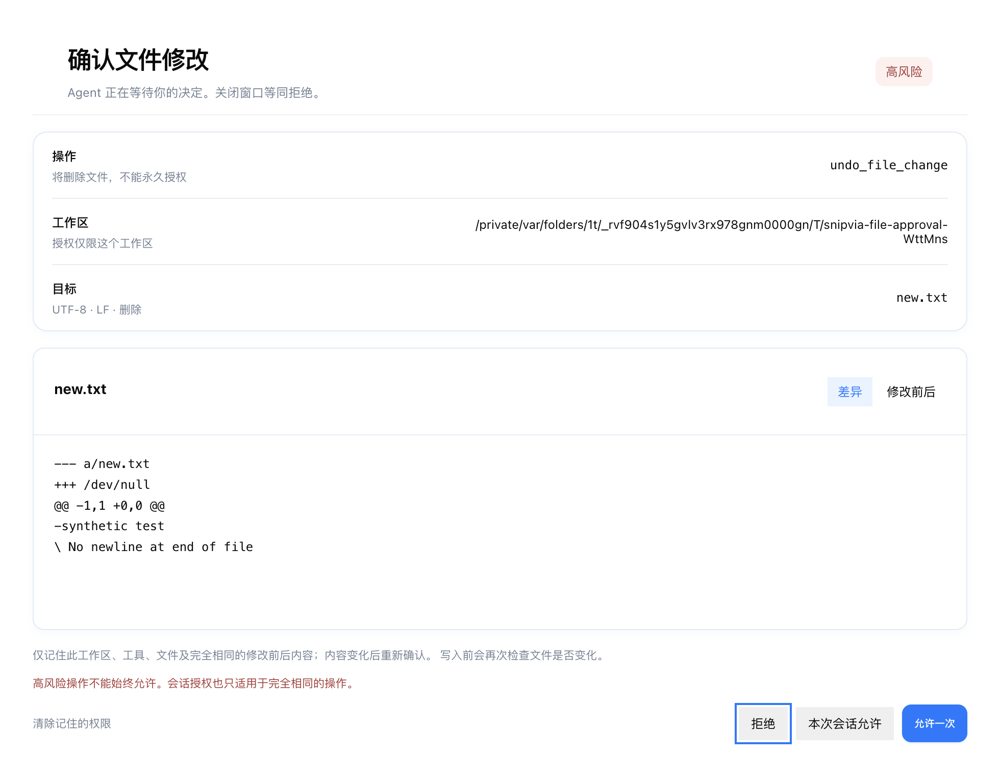

- 不属于聊天 run 的权限请求（例如 MCP Server 启动）使用现有设置页面骨架，在独立隔离窗口显示；名称和说明在左，工具、工作区、目标和风险在右，不新增第三种设计语言。
- 文件修改嵌入单张内容卡片，右侧切换「差异」与「修改前后」。diff、命令及完整参数都是纯文本，不执行其中的 HTML、Markdown 或指令。
- 底部提供「拒绝」「本次会话允许」「始终允许此操作」「允许一次」。默认焦点在拒绝按钮，关闭窗口等同拒绝；高风险不显示始终允许。只有 Main 已配置会话或持久存储时才出现相应选项。
- 按钮上方明确授权仅匹配同一工作区、工具与相同参数/文件变更；左下角提供低对比度的「清除记住的权限」。
- 文件内容区域可滚动；窄窗口允许操作按钮换行，保持拒绝入口可见。
- 代码入口：`agent/AgentPermissionPanel.tsx`、`agent/file-approval.css`。窗口仅可读取自己的请求并回复请求 ID 与决策，不能发起工具调用或提交改写后的文件内容。

### 聊天内 Agent 步骤

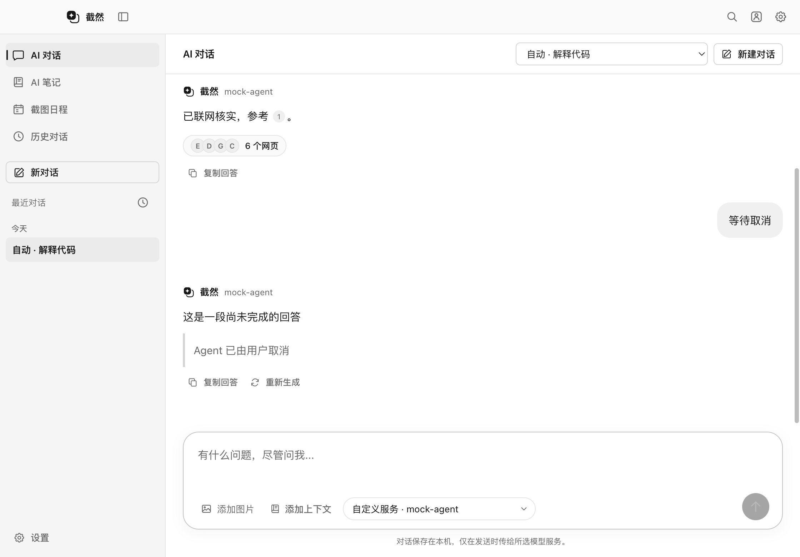

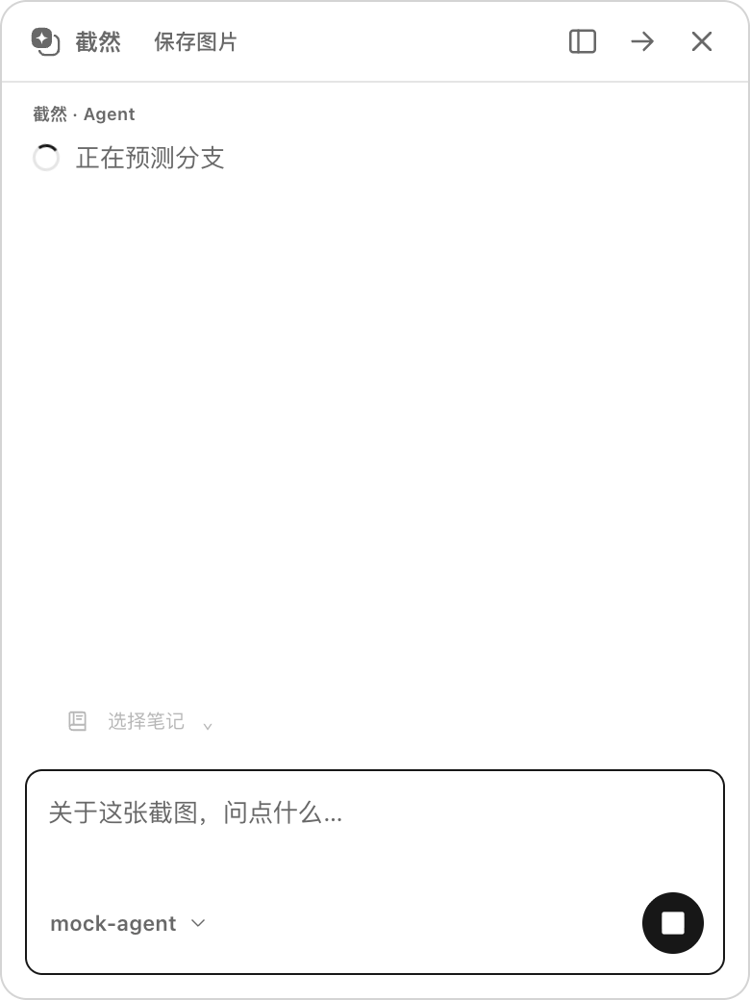

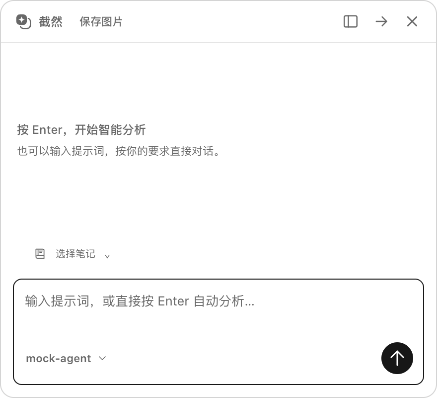

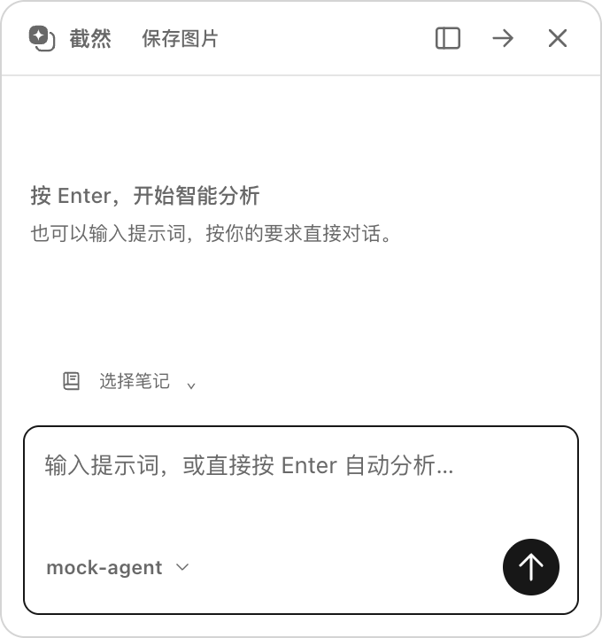

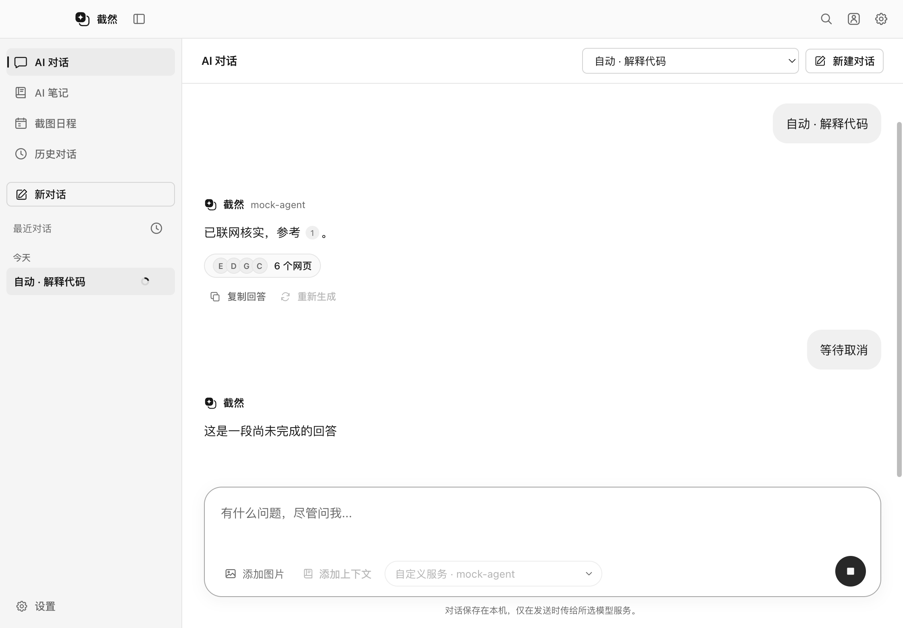

- 主聊天和 QuickChat 使用同一 `AgentChatMessages` 与 `AgentActivityLine`，沿用现有工作区与浮窗容器，不增加第三种页面语言。
- 主窗口输入框上方保留默认开启的 Agent 开关和笔记本按钮；未选笔记本时显示「联网 · 只读」，选择后显示「联网 · 笔记」，运行时在发送位置显示「停止」。悬浮对话使用上文精简输入区布局，能力与权限边界一致。模式初始化不能取消预测。
- 分支预测、准备操作、Agent 分析和联网均使用 `AgentActivityLine` 单行状态，同一任务不重复展示进度。预测完成后右上角只读标签显示分支名称，长名称省略并提供完整提示；不能点击切换分支。续拍显示延续上下文提示，不再次预测，也不沿用旧分支标签。
- 服务端预测失败使用浮窗现有的简短错误条，明确视觉/Jev阶段及已脱敏 HTTP 状态，不展示操作卡片或上游原文。失败时输入区恢复可操作，空输入按 Enter 可明确重试；不自动重试，也不重复启动进行中的预测。成功但没有适用分支仍等待用户提问。
- 联网搜索、读取网页和分块读取不显示步骤卡片。用同一行低对比度状态替换「正在分析任务」：地球图标 +「正在搜索 关键词」或「正在读取 域名」。全网搜索没有明确目标网站时显示真实查询，不虚构网站名；长文本单行省略，悬停可见全文。
- 联网完成后状态转为「正在整理回答」，正文开始流式输出后收起状态行；不保留成功卡片或「任务完成」徽章。失败保留简短文字提示。
- Agent 回复采用参考 OpenCode 的时间线（2026-10-07）：底部 `AgentActivityLine` 状态行显示当前动作（正在思考、正在联网搜索、正在读取、正在编辑、正在执行命令、等待你确认）；已完成、失败或待确认的工具调用在上方逐行列出，左侧 1px 中性灰竖线，行内为状态图标、中文动作名、等宽目标文本和右侧灰色结果摘要/耗时，不显示工具英文名。成功用中性勾号，失败用中性叉号并在下方给出简短原因，待确认用灰度边框与明确文字。`todo_write` 计划在时间线顶部以细边框清单显示，进行中项加粗，完成项置灰。任务结束后时间线折叠为「已执行 N 个步骤」文字按钮。这是消息内部的展示方式，不是新的页面外壳。
- 「已编辑笔记」卡片右上角在「查看变更」左侧提供「撤销」。点击后在卡片内展开中性灰底的确认区，说明恢复范围，取消在左、中性高对比描边的「确认撤销」在右，不使用弹窗；完成后以灰色文字显示「已撤销，恢复了 N 篇笔记」并隐藏按钮。

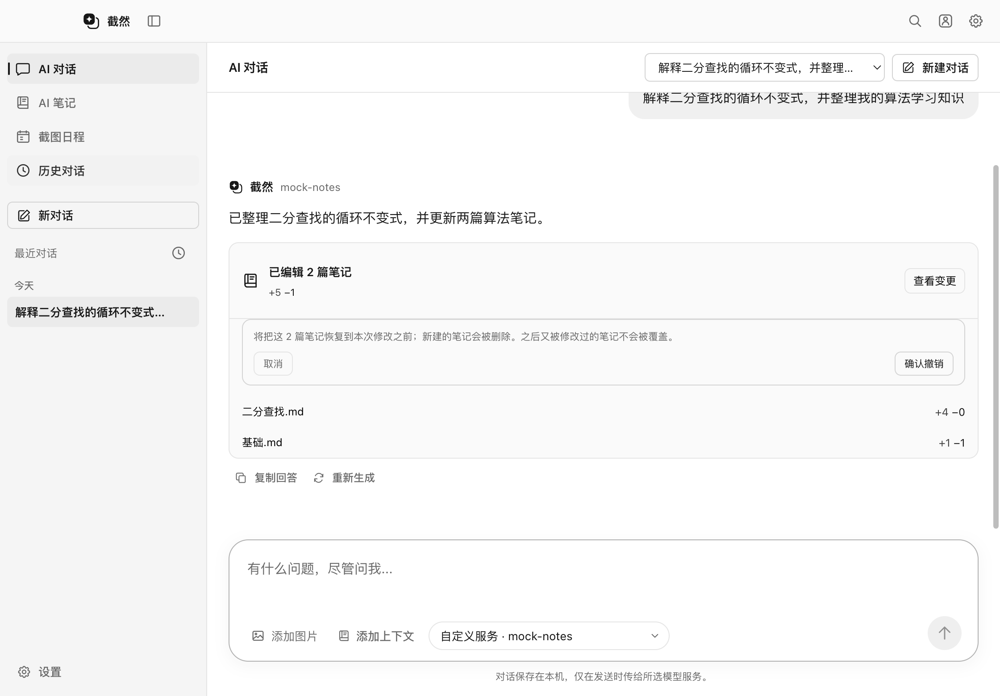
- 沙箱命令与脚本也使用此状态行：显示「正在执行命令」或「正在运行 JavaScript / Python / Shell 脚本」，不展示命令正文和 stdout 卡片。最终笔记清单中移动项显示「旧路径 → 新路径」，点击打开新位置；删除项标记「已删除」并禁用打开，差异仍可查看。
- 最终答复随模型正文增量显示，保留 Markdown；不展示结构化推理字段和 `<think>` / `<analysis>` 区块。停止后保留已显示的部分回答并标记停止，不再追加迟到文字。
- 回答末尾用“站点图标叠放 + N 个网页”胶囊展示来源，数量来自真实工具结果并按 URL 去重。正文已有来源链接转换为小型引用编号，点击胶囊或编号打开同一「搜索结果」弹窗；普通非来源链接保持直接打开。
- 来源弹窗沿用主题面板、细中性边框、15px 圆角。列表显示域名、实际返回的发布日期（没有则不显示）、序号、标题与摘要，并区分搜索摘要和已读取网页。点击条目通过 Main 在系统浏览器打开，关闭按钮/Esc 返回对话。
- favicon 由 Main 受限加载并转换为 PNG；只请求已属于当前对话的来源同源图标，失败显示站点首字母，不通过第三方图标服务泄露访问来源。

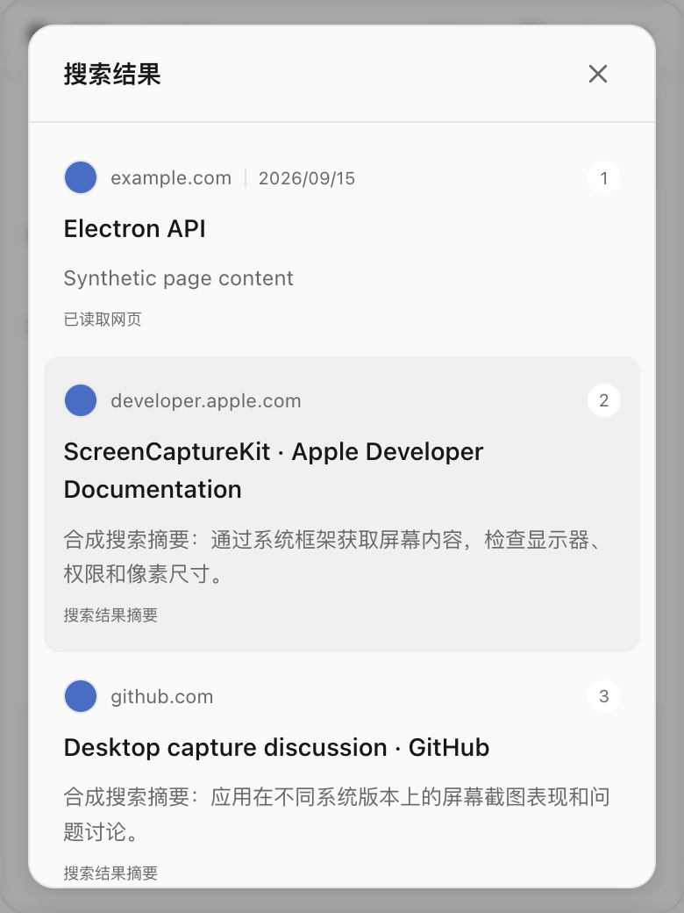

- 通用文件修改与外部执行仍禁用，选定笔记本使用独立的自动 Markdown 能力。需要确认的操作使用嵌在时间线中的非模态卡片，展示命令或脚本、原因列表和工作目录；高风险卡片使用中性灰底、较强边线、警告图标和风险文字。拒绝在左，单次批准在右，回车不能默认批准。只有拥有任务控制权的窗口显示审批。
- Diff 使用原生 dialog 保持键盘焦点，Esc 关闭；纯文本预览，中性表面配合 `+ / −` 前缀区分增减行，长内容滚动。
- 确认弹窗中的长路径允许换行；窄浮窗操作按钮换行，停止入口始终在输入区。内置 [命令与脚本](AGENT_COMMANDS.md) 使用当前笔记本的独立 OS 沙箱能力：只读与笔记本内整理命令直接执行，运行脚本和其他命令先在时间线中确认；审批不授予关闭沙箱的权限。
- 详见 [Agent Execution UI](AGENT_EXECUTION_UI.md)。代码：`agent/AgentExecution.tsx`、`agent/execution.css`。

## 桌面账号

账号页复用设置语言：分组行左侧标签与说明，右侧输入或状态，不增加登录弹窗或第三种页面壳。侧栏底部有独立账号入口，登录后显示邮箱并对长邮箱省略；输入框使用可见标签、验证码冷却、处理中状态和中文错误。资格展示沿用单张设置卡片，网络中断明确标记信息待更新。

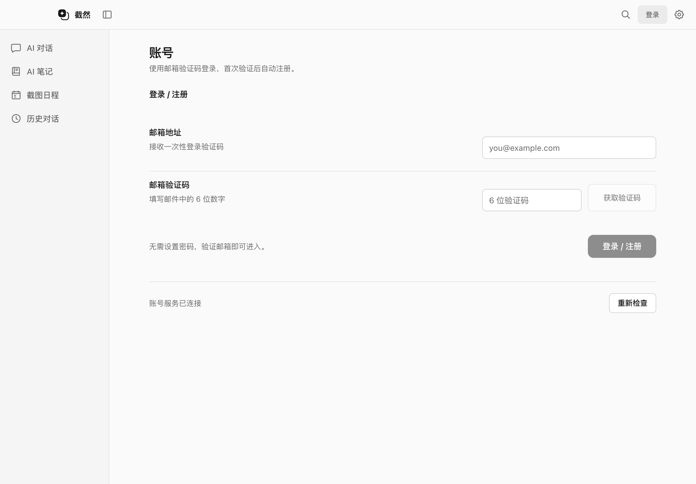

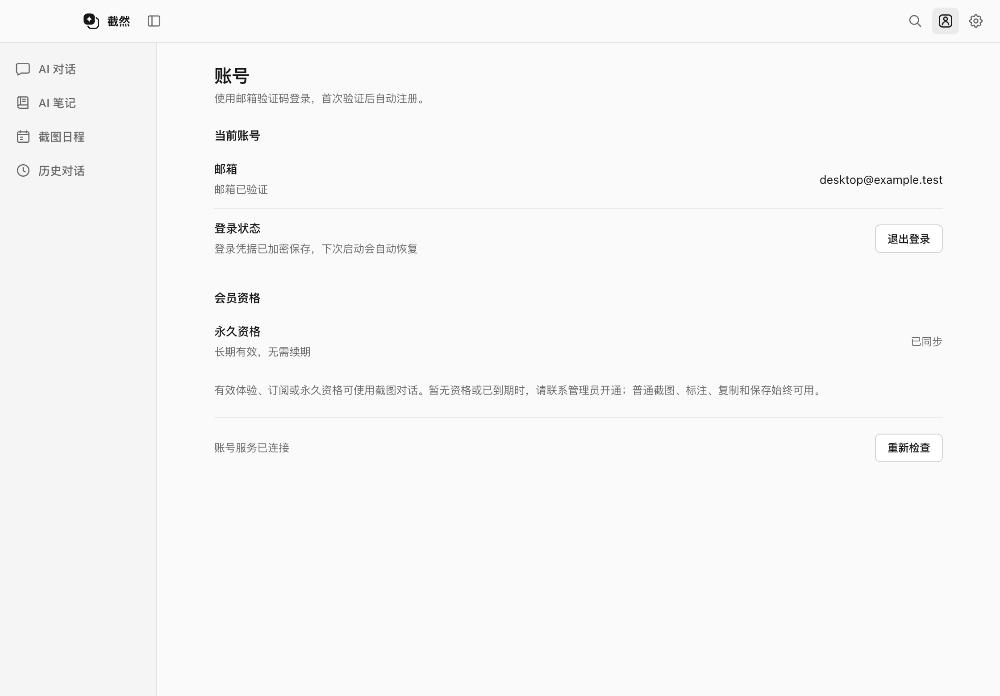

## 历史网页控制台

管理控制台及其主题、登录与资格管理说明已随私有工程归档，不适用于当前免费客户端。当前文档不再链接已迁出的控制台源码、验收图片或部署说明；历史内容可在保留的私有归档中核对。

## 新页面检查清单

1. 先判断页面属于工作区还是设置。
2. 复用对应的页面容器、页头、卡片和弹窗类，不复制一套近似样式。
3. 检查标题是否重复，页面是否出现多个竞争视觉中心。
4. 检查说明文字和次要状态是否降低对比度。
5. 检查按钮是否只在当前上下文需要时出现。
6. 在 1120×780 窗口和较窄窗口下检查留白、滚动与控件对齐。
7. UI 修改后更新本文范例截图，并运行 Electron 冒烟测试。

## UI 2.0 阶段 5：截图浮窗

截图浮窗延续现有任务表面，使用共享 Monochrome Token、Button / IconButton / Dialog。默认 440×400 的紧凑输入窗口，按需展开为截图与对话双栏；分栏可拖动和键盘调整。模型、笔记、发送 / 停止保持在会话底部，保存图片位于顶部「截然」右侧；紧凑模式不显示缩略图操作行，展开模式保留截图预览。窄窗口改为上下布局。截图内容保持原色，动画遵从减少动态效果偏好。

紧凑模式保留独立置顶截图，钉图窗口仅展示原色截图，不显示右上角关闭按钮或底部操作栏，窗口按截图比例适配，不预留按钮空间。返回软件与关闭入口统一位于右侧对话标题栏，钉图继续支持拖动、复制快捷键和 Esc；错误时仍显示必要的文字提示。展开时仅隐藏其原生窗口，保留 session，收起恢复。关闭 / 复制不唤起主窗口，返回软件才交接会话。详见[布局、截图、性能与验证范围](UI_2_0_STAGE_5.md)。本阶段未改变捕获底层或新增页面外壳。

## UI 2.0 阶段 6：视觉回归约束

2026-10-10 Windows 截图浮层继续沿用原框选与标注 UI，只在原灰度提示条加入「Enter 全屏」：未框选时按 Enter 选择鼠标所在显示器的整屏，Esc 取消。macOS 提示和快捷键行为保持原样，不增加页面外壳。下面的画面使用 macOS Electron、Windows Renderer 平台模拟和纯白合成截图，只证明提示条视觉；Windows 原生透明窗口与 DPI 仍待真机验证。

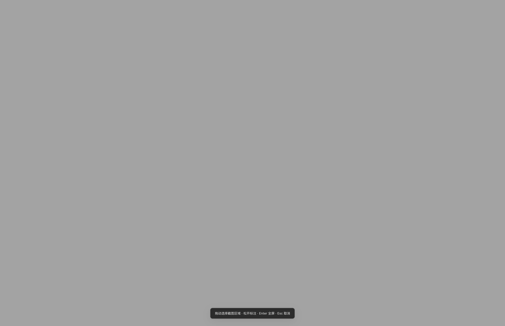

客户端主题验收同时检查手写样式和第三方运行时样式。CodeMirror 的搜索匹配、选中词、搜索按钮与输入框必须使用共享 Token；不能依赖组件默认主题。搜索复选框不得继承整行输入的宽度与高度。

每个主要亮暗截图点使用 `tests/helpers/neutral-chrome.ts` 检查可见 DOM、伪元素和 SVG 的颜色；图像像素及截图标注颜色保留原值。此检查不能替代系统原生弹出层与多显示器实机验收。详见[全局视觉审查、性能采样和剩余风险](UI_2_0_STAGE_6.md)。

## AI 对话工作区 Phase 2（2026-10-13）

- 主窗口使用现有 `AppShell` 与 `WorkspaceHeader`，上方切换会话和新建对话，中间是适合阅读的连续消息区，底部为轻量输入框与现有模型选择器。沿用 Light / Dark / System 中性主题，不新增页面外壳。
- 新建对话可以直接发送文字，不创建占位截图。已保存的截图会话按需展开来源图片；切换会话不替换底层当前截图，也不取消另一个会话的运行。草稿与滚动位置在本次运行期间保留。
- Return 发送，Shift Return 换行，中文输入法组合期间不发送。生成中允许停止、切换会话和编辑下一条草稿；普通消息保存在既有历史索引，重启后可继续。
- 最后一条回答支持重新生成。失败或停止重新生成时保留原回答；成功后替换该轮回答，并最多保留 5 个旧版本供查看。生成过程中展示实际状态，模型输出不作为文件操作指令。
- 主窗口新发起的任务只有问答、联网检索和计划能力，不读取笔记工具历史、不授予本地文件或命令权限。截图浮窗已发起的任务可继续交接，既有权限确认、来源及停止行为保留。
- Phase 3 已增量加入下述编辑上下文与确认流程；本地附件选择、粘贴和拖放属于 Phase 4。

## AI 对话工作区 Phase 3（2026-10-14）

> 本节记录当时的确认编辑流程。2026-10-18 起，已选笔记改为直接保存；下面的逐次确认只继续适用于预测规则。当前笔记差异与撤销见[操作优化](CHAT_CONTROLS_2026_10_18.md)。

- 复用现有输入区域，在其上方放置轻量上下文按钮；单轮选择一篇笔记、新建笔记范围或一组现有预测规则。笔记页「与 AI 讨论」和分支设置「用 AI 编辑已保存分支」跳转时明确显示所选目标。
- 模型通过提案工具建议修改；生成和查看均不写入。上下文选中时不提供网络、任意文件或命令工具。普通总结仍是文本回答。
- 提案列表仅展示目标、状态与净增删行，不把普通搜索、读取等工具变成卡片。「查看修改」打开共享 Dialog，支持完整差异、修改前、修改后三个视图；灰度、字重与加减号区分变化，不引入彩色强调。
- 「确认并保存」仅在回答结束、完整预览读取成功、提案仍有效时可用。取消明确显示「没有保存」；文件、规则或授权变化显示原因，不覆盖新版本。关闭预览可保留待确认提案，继续对话或重新生成会使旧提案失效。
- 已保存笔记提供「查看笔记」，原有实际变更与撤销继续复用；内置预测规则只能编辑或禁用，不能删除。预测分支是平面规则列表，不提供虚构的父子关系编辑器。
- 同时迁移截图浮窗专用笔记工具：显示完整差异入口，仅允许本次确认，不能用记住的会话授权跳过。流程及截图见 [Phase 3 报告](AI_CHAT_WORKSPACE_PHASE3.md)。

## AI 对话工作区 Phase 4（2026-10-14）

- 输入框顶部使用现有 IconButton / 轻量文字按钮提供本地图片、粘贴图片和已有截图入口；截图浮窗返回软件后，来源截图可明确加入输入框。拖入本地图片只显示临时中性描边提示，不下载远程图片地址。
- 待发送图片采用 96 × 72px 缩略图，支持移除和点击查看；数量、错误和模型能力提示使用图标、文字与灰度。实际图片保持原始颜色，不使用灰度滤镜。
- 消息级图片同时显示在 AI 对话与历史详情，点击使用共享 Dialog 查看。图片按可见区域读取，离开可见区域或卸载时释放缩略图 Blob URL；查看弹窗单独保留当前图片，关闭后释放。
- 每条消息最多 4 张 PNG / JPEG，原图小于 10 MiB。主进程校验真实格式、尺寸与解码结果，移除元数据并按需等比例缩到最长边 2048px。纯文本编辑不被导入动作阻断，发送等待当前导入完成。
- 已确认不支持图片的模型禁用带图发送，并在 Main 复核；移除图片可正常发送文本。未知图片能力明确提示但允许尝试，不添加假 OCR 或静默改用其他服务。
- 复用 Phase 3 的修改确认机制；图片本身不授予笔记、分支或命令权限。图片输入与上下文读取后仍需用户确认才能保存修改。实现与实际截图见 [Phase 4 报告](AI_CHAT_WORKSPACE_PHASE4.md)。

## AI 对话 UI 重构（2026-10-14）

- AI 对话复用唯一 AppShell；该页侧栏为 232px，加入按日期分组的最近会话、新对话、重命名、删除确认与设置入口，其他页面保持既有导航尺寸。
- 欢迎品牌、28px 标题、说明与输入框整体居中，正文 / 输入框最大 840px；进入对话后同一个输入组件保持挂载并移至底部，消息独立滚动。
- 输入容器为 22px 圆角，自动增高，附件与上下文留在内部；底部使用「添加图片」菜单、上下文入口、模型胶囊和 38px 发送 / 停止按钮。
- 用户消息靠右用中性气泡；AI 回复自然排版，保留完整 Markdown、代码和表格。提案附于回复，完整预览与确认保存不变。
- 模型选择值区分厂商、接口与原始模型 ID；密钥范围不变，恢复历史会话沿用原配置。配置范围缺失时提供明确占位提示，禁止静默选择第一项。
- 主题与焦点使用既有 Token。真实图片保留颜色，输入区和工具栏间距仅限该页调整；滚动在用户向上浏览时停止跟随。
- 实施、验证范围和真实亮暗窗口截图见 [AI 对话 UI 重构](AI_CHAT_UI_REDESIGN.md)。

## 对话与设置操作优化（2026-10-18）

- 所选笔记的创建、追加和编辑由 Agent 直接保存；主窗口显式选择的笔记上下文也使用自动提交。继续保留 Main 的相对路径、Markdown、只读、冲突、取消、原子提交与撤销保护。预测规则与脚本/高风险命令仍需要确认。
- 截图对话右下角有可聚焦的调整尺寸手柄，拖动改变宽高，方向键每次微调 20px、Shift 为 50px，Home 恢复当前布局的默认尺寸。紧凑与展开模式在本次应用运行期间分别记住尺寸；Main 限制在当前显示器工作区，不改变截图像素或会话。
- 「设置 → 外观 → AI 对话字号」支持 12–24px，默认 15px，即时保存并同步到已有窗口，重启后保留。正文、输入文字与代码按比例调整；工具栏、设置控件与笔记编辑器使用原有度量。
- 分组标题为 16px、行名称为 13px、说明为 12px；保持黑白灰、既有分组行和设置页骨架。以下图片均由临时数据的真实 Electron 窗口生成。

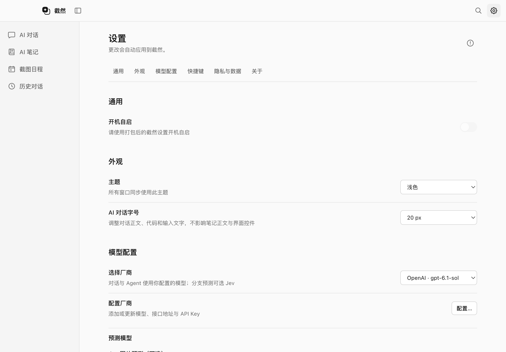

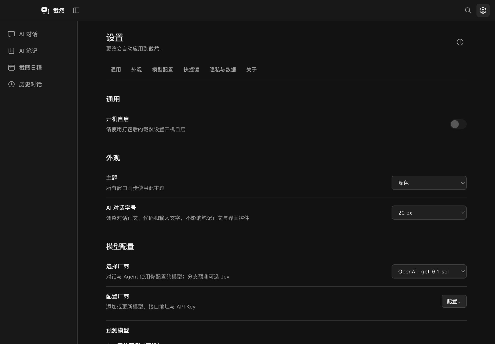

验证、边界及文件入口见[操作优化记录](CHAT_CONTROLS_2026_10_18.md)。

## 反馈入口（2026-10-19）

- 主窗口标题栏右侧增加「反馈」文字按钮，所有主窗口页面共用，不随侧栏收起隐藏。移除 AI 对话侧栏左下角重复的设置入口，设置统一从右上角进入，快捷导航与原快捷键继续可用。
- 点击复用现有原生 Dialog，标题为「意见反馈」，显示 QQ 群号 **643251313**；群号可选中复制，右侧提供「复制群号」按钮；成功显示「已复制」，失败可重试，重开弹窗恢复默认状态。使用现有中性色、表面与按钮，不新增页面壳。
- 关闭按钮、Esc 或点击遮罩可关闭，焦点回到反馈按钮；弹窗打开时快捷导航不抢占焦点。当前页面、对话草稿与本地数据保持不变。
- 此入口本地展示群号，点击复制时复用既有 Main 校验的文本复制接口；不读取剪贴板、不新增 IPC、模型请求、反馈上传或自动唤起 QQ。
- 已通过 lint、构建（含类型检查）和一项真实 Electron 定向冒烟：笔记页入口、对话草稿保留、设置页窄窗口、亮暗主题、关闭与焦点恢复，以及复制成功、失败重试和重新打开后的状态恢复。使用临时数据与 Main 剪贴板写入替身，没有改动实际系统剪贴板或调用真实模型；Windows 原生标题栏仍待真机确认。本轮未重跑与此改动无关的功能套件，未打包或发布。

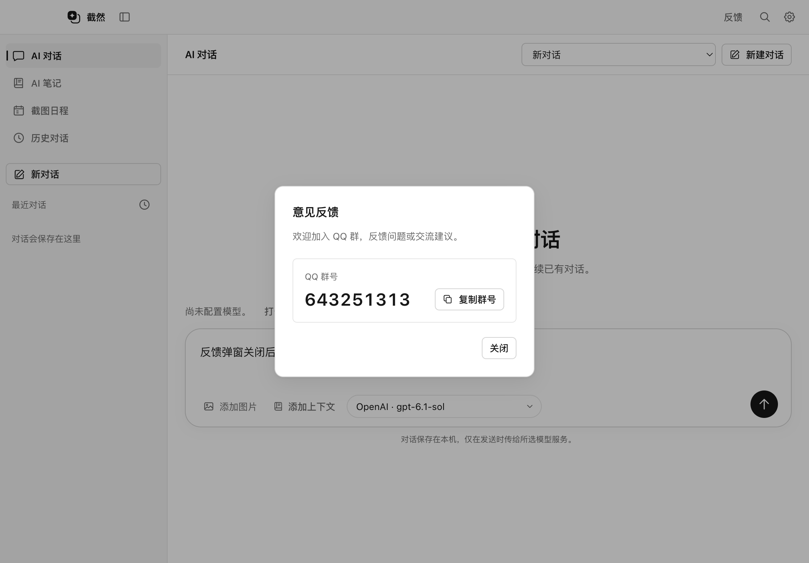

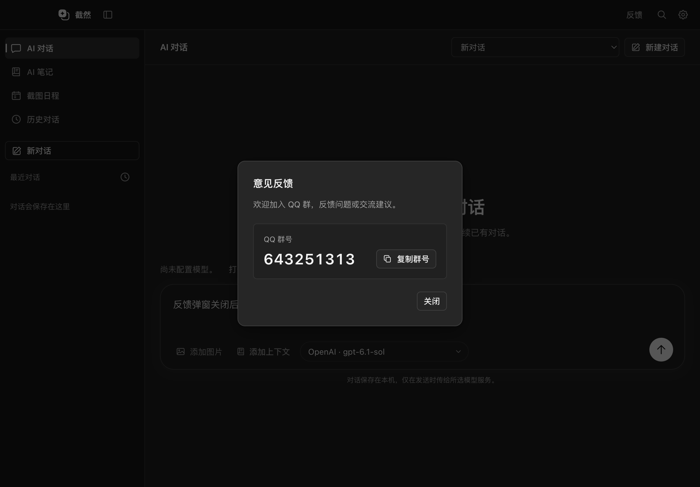

2026-10-19：上述反馈、复制群号与侧栏精简已随 0.3.2 发布，见[本次打包发布记录](RELEASE_0_3_2.md)。此前功能验收继续复用，发布仅确认新包中已加入这些功能。
