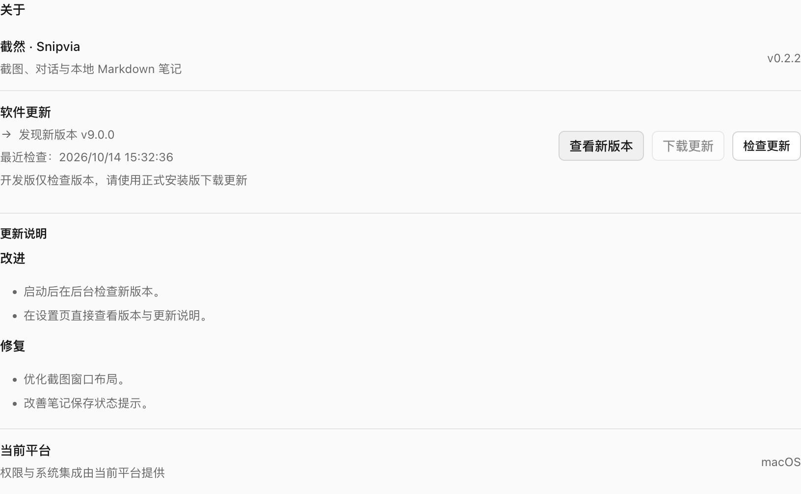
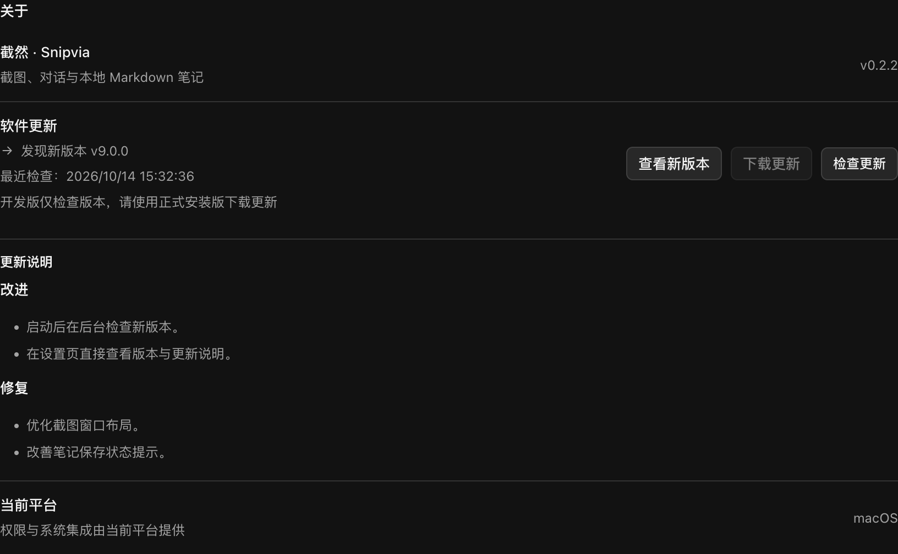
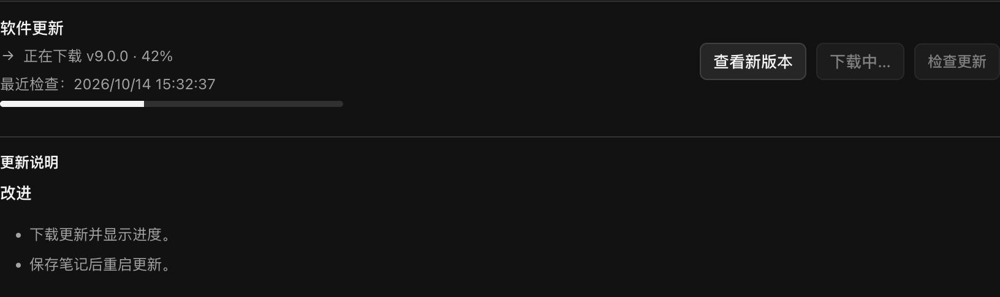
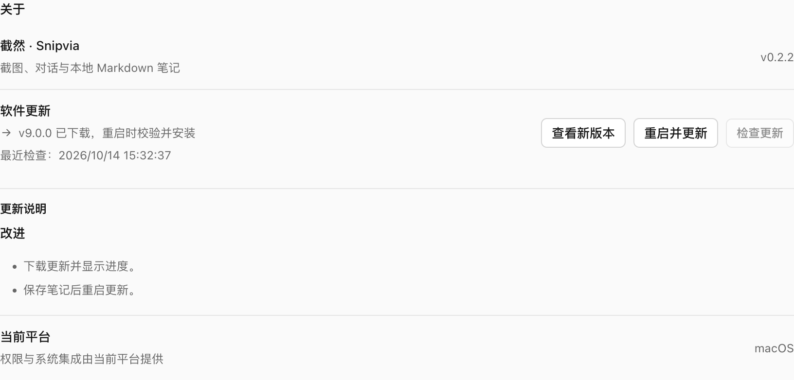
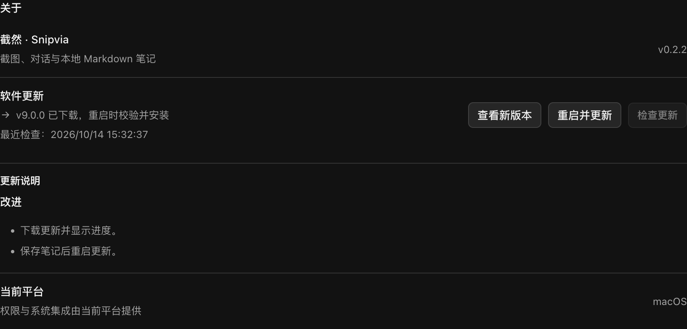

# 客户端版本检查与更新

## 当前行为

- 正式安装版完成主窗口加载后约 10 秒，主进程在后台检查一次新版本。不等待检查完成，不打开窗口或抢占焦点，不阻塞截图、笔记与模型请求。
- 开发版与现有打包验收模式不自动查询；开发版仍可在「设置 → 关于 → 软件更新」手动检查。
- 正式版使用 Electron 应用版本，开发版使用项目包版本，避免将 Electron 运行时版本误当成截然版本。
- 自动检查与手动检查共用主进程状态，同一时间的请求合并。启动计时器触发前已经手动检查时，不重复查询；失败没有自动重试循环。
- 设置行分别显示正在检查、发现新版本、无需更新和失败原因，以及最近检查时间。正在检查时按钮禁用；失败后可以重试。页面重新打开仍读取本次运行的结果。
- 发现新版时显示版本号及该 Release 的 `body` 更新说明，复用现有安全 Markdown 展示；支持标题、列表、引用、代码与表格。长说明限制展示高度并可滚动，外部图片只显示占位文字，HTML 不执行，链接仅在用户点击后通过原有 Main 安全接口打开。未填写、空白或 null 说明显示明确提示，不虚构更新内容。重新检查、失败或无需更新时清除旧说明。
- 发现新版后仍可点击「查看新版本」打开发布页。正式签名且启用更新的 Mac 安装版提供「下载更新」，完成后显示「重启并更新」；开发版、旧安装包、未签名的 Windows 内部包与其他平台保留发布页手动安装。
- 下载由用户点击触发，显示真实进度；完整 ZIP 由 `electron-updater 6.8.10` 校验 SHA-512，使用独立更新缓存。完成下载不会退出或替换应用，普通关闭也不自动安装。更新期间保留版本号与说明，暂时禁用重复检查；下载失败可以重试。
- 更新组件在用户下载时才加载，不进入启动或截图热路径。
- 点击「重启并更新」先检查截图 / AI 任务已完成，并复用原笔记保存确认与队列等待。保存失败或冲突时保留下载和编辑内容，允许处理后重试。Mac 原生 Squirrel 校验签名并安装后重启；原生安装失败时需重新打开应用再试，不在同一进程自动反复安装。
- 确认安装时先释放闲置截图选区与钉图窗口，避免其用于日常复用的关闭拦截阻止 Mac 更新器退出。此动作只发生在用户确认安装且笔记保存通过后，正常截图预创建 / 复用机制不变。
- 退出时清理启动计时器并取消请求及进行中的下载；版本与进度状态不写入账号、模型凭据或笔记文件。下次启动重新检查版本，点击下载时由更新组件重新校验缓存，不能直接安装未知或损坏的旧缓存。

## 更新源和发布要求

源码仓库保持私有，客户端使用独立公开分发仓库 `yuyeyuyy/Snipvia-releases` 的 GitHub Release。统一配置位于 `src/shared/release-source.json`，版本检查、发布清单与正式打包复用同一仓库：

```text
GET https://api.github.com/repos/yuyeyuyy/Snipvia-releases/releases/latest
```

接口与字段依据 [GitHub 最新 Release 官方文档](https://docs.github.com/en/rest/releases/releases#get-the-latest-release)。只接受已发布、非草稿、非预发布版本；Tag 使用 `v0.2.2` 或 `0.2.2` 等三段版本号，允许 build 元数据。按版本数值比较，避免 `0.10.0` 被当成比 `0.9.0` 旧。不会建议降级；同版本正式版可以替换本机预览版。

后续发新版需在此仓库发布正式 Release，在 Release 描述中填写更新说明，并按现有发布规范提供对应平台安装包。仅创建 Git Tag、上传 ACR 镜像或修改官网版本不会被识别为桌面新版本。已有旧安装包不会凭空获得本功能，需要先手动安装一次包含该功能的新签名版本。

2026-10-12 迁移：公开仓库新增安装 / 更新 / 维护说明与独立资产校验工作流；原已发布 `v0.2.1` 按原哈希迁移，保留手动安装与旧签名边界，没有添加自动更新清单。包含本次新更新源的版本须重新构建，并使用比 `0.2.1` 更高的版本号发布；旧包不会因修改仓库而获得更新能力。历史 404 与此前本机测试属于迁移前结果，参见[分发迁移记录](RELEASE_DISTRIBUTION.md)。

正式 Mac 发布配置增加固定的通用更新源及 `snipviaAutoUpdate: true` 应用标识。它不会自动上传；现有发布命令仍使用 `--publish never`，签名、公证、验收及公开发布授权流程继续保留。未来正式发布的 `verified/` 增加 `latest-mac.yml`，在 APP / DMG 公证、Staple 和 ZIP 验收完成、文件冻结后重算最终大小与 SHA-512，不能上传旧 builder 元数据。

公开上传使用独立入口，先检查计划，再明确执行：

```bash
pnpm release:publish --directory dist/macos-release/<发布目录>/verified --notes <公开说明.md>
pnpm release:publish --directory dist/macos-release/<发布目录>/verified --notes <公开说明.md> --execute
```

发布器要求本次报告记录正确的公开更新仓库、启用更新标识与双架构公证通过；旧报告不能冒充新自动更新发行。它只上传四个最终 Mac 安装文件、`latest-mac.yml` 和 `SHA256SUMS.txt`，不上传源码、内部验收报告或本机资料。先上传草稿并核对 GitHub 资产哈希与大小，全部通过后设为正式最新版本；不覆盖已发布版本，可继续内容一致的未完成草稿。

需要同时上传该版本的 `latest-mac.yml`、`Snipvia-<version>-arm64.zip`、`Snipvia-<version>-x64.zip` 及对应 DMG。更新客户端将元数据地址固定到用户选择的那个 Release，检查版本一致、文件名、架构、大小与哈希，禁用差分更新及 Web Installer。两种架构在同一个 Mac 清单中，由更新组件选择合适 ZIP。

对旧冻结产物可以单独生成新元数据文件，不修改原有已签名文件：

```bash
node scripts/macos-release/update-metadata.cjs \
  dist/macos-release/<发布目录>/verified \
  /tmp/latest-mac.yml
```

命令拒绝覆盖输出，并根据 `verification.json` 核对固定团队、完整文件名单及 SHA-256。不要把指向旧版本的清单上传到新版本 Release。具体机制依据 [electron-builder v26 更新文档](https://www.electron.build/v26/docs/features/auto-update/)，本项目固定 6.8.10，不采用 v27 的不同安装 API。

未发布正式版本、仓库不公开、限流、网络断开、超时、损坏响应分别保留失败状态，不能视为“已经最新”。GitHub 在部分网络环境不可达时可手动重试；尚未接入国内镜像更新源。

## 安全与隐私

- 固定 HTTPS GitHub API，不接受 Renderer 自定义查询地址或发布链接。链接由主进程使用固定仓库与校验后的 Tag 构造。
- 不携带 GitHub Token、邮箱、账号会话、模型 Key、截图、笔记或请求正文；服务仍可看到普通 HTTPS 请求的来源 IP。
- 版本查询拒绝重定向，8 秒超时，响应大小上限 256 KiB。下载只使用固定 GitHub Release 目录中的规范文件名；GitHub 自身的资源 CDN 跳转由更新组件处理。上游原始错误和异常细节不进入 UI 或日志，更新组件日志关闭。
- IPC 仅允许主窗口的顶层 Frame 查询、打开发布页面、下载及请求重启；截图浮层、钉图等窗口没有这些权限。Renderer 无法传入下载 URL、安装路径或脚本。
- Mac 下载前验证当前 APP 的完整代码签名及固定 Developer ID 团队 `F76JCDMA4Y`。替换包由原生更新机制验证，不编写自行覆盖应用或执行 Shell 安装包的路径。Windows 当前没有受信发布者签名配置，所以禁用此安装路径，保留手动更新。

## 代码与验证

| 文件 | 职责 |
| --- | --- |
| `src/shared/updates.ts` | 统一检查状态与窄 API |
| `src/main/updates/UpdateCheckService.ts` | 版本比较、受限查询、启动调度、状态与退出取消 |
| `src/main/updates/ElectronUpdateInstaller.ts` | 正式 Mac 更新组件适配、签名门槛、进度与原生安装 |
| `scripts/macos-release/update-metadata.cjs` | 最终冻结文件的更新清单生成 |
| `scripts/macos-release/test-update.cjs` | 独立 Mac 签名包的真实下载与原生重启验收 |
| `scripts/macos-release/publish.cjs` | 正式验收资产的公开草稿上传、哈希核对与发布 |
| `src/shared/release-source.json` | 私有源码与公开分发的统一目标配置 |
| `src/main/index.ts` | 复用主进程生命周期及窗口权限校验 |
| `src/preload/index.ts` | 只暴露读取、检查、打开发布页及状态订阅 |
| `src/renderer/src/settings/UpdateSettings.tsx` | 关于页的软件更新行 |
| `tests/unit/updates.test.ts` | 版本比较、异常、并发、超时和调度 |
| `tests/integration/updates.spec.ts` | 临时 Electron 实例、模拟后台检查与手动刷新、主题和 IPC 隔离 |

日常自动化回归使用模拟 GitHub Release、下载和原生安装器及临时应用数据。另提供独立签名实机测试，验证真实下载和原生升级；它只替换测试目录的独立 APP，不修改现用安装。公开发行包、权限保留、缓存恢复和不同网络环境仍需发布前验证。原冻结产物只用于只读验证元数据生成。

2026-10-12 验证：构建（含 TypeScript）、全仓 Lint、978 项单元测试通过；最终更新检查测试及主题 / 浮窗 / 截图窗口相关 6 项 Electron 回归通过。截图使用模拟版本 `v9.0.0`，只表示检查界面的验收结果。

同日更新说明增量：构建、类型检查、全仓 Lint、983 项单元测试与更新检查 Electron 测试通过；额外验证 Markdown 展示、长说明滚动、空说明提示、旧说明清理、HTML / 外部图片 / 不安全链接处理，并重新检查 Light / Dark 截图。

同日下载 / 重启增量：构建（含类型检查）、Lint、996 项单元测试与 6 项相关 Electron 回归通过；最终更新窗口再次验收，检查真实临时笔记在模拟安装调用前落盘。下载及原生安装器为 Mock，没有执行实际升级。旧冻结 `0.2.1` 的四个文件只读生成了临时元数据，最终文件大小、SHA-256 与清单匹配；未修改既有发行目录，未签名新包或上传 Release。真实签名版本升级及 Windows 发布者配置仍为发布门槛。

同日 Mac 实机增量：修复签名要求参数格式、复用截图窗口阻止更新退出与矛盾限制提示。构建、类型检查、Lint、996 项单元测试及 6 项 Electron 回归通过；独立 Developer ID 签名测试包实际从 `0.2.1` 下载、确认后原生重启升级到 `0.2.2`，签名与笔记保留校验通过。测试使用本机更新源、未公证或公开发布，不等于公网发行包验证。公开 GitHub 最新 Release 本次返回 404，线上推送尚未验收。完整证据与限制见 [Mac 更新实机测试](MACOS_UPDATE_TEST.md)。











## 2026-10-12 Mac v0.2.2 正式发行

[v0.2.2](https://github.com/yuyeyuyy/Snipvia-releases/releases/tag/v0.2.2) 已发布，提供 Apple 芯片 / Intel 的 Developer ID 签名、公证 DMG 与 ZIP、最终更新清单和 SHA-256 清单。公开文件哈希匹配本机冻结文件，公开 Actions 实际下载校验通过；匿名客户端版本检查与更新清单读取通过。

从旧版需要先手动安装一次 v0.2.2，之后可使用应用内检查、下载与确认重启更新。本次只发布 Mac，Windows 保留 v0.2.1 预览版。签名、公证、测试与剩余平台边界见[正式发行报告](MACOS_RELEASE_0_2_2.md)。官网源码下载配置同步，本次未部署官网。
