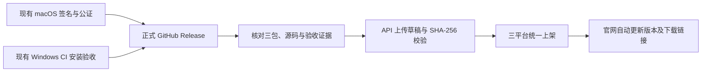

# Release 发布后自动同步官网

## 范围与使用

工作流：`.github/workflows/website-release.yml`，Actions 中名称为 **Sync published Release to website**。



工作流只负责 **已正式发布的 Release → 官网**。不重新构建、签名、公证或发布 GitHub Release，不变更客户端更新渠道，不需要 Apple 凭据。现有打包和发布操作继续使用[macOS 发布入口](MACOS_RELEASE.md)及 Windows 内部构建工作流。

启用后，正常操作为：完成两个平台原有验收，将三个正式安装包放入同一个稳定版 Release 并点击 Publish。`release: published` 自动触发同步；预发布和草稿不参与。官网 API 成功接收三个包后一次性上架，页面在每分钟轮询或重新聚焦时更新，不重建网页镜像。

## 首次启用

2026-11-14 用户已明确授权启用。`website-production` 环境及 `WEBSITE_RELEASE_TOKEN` Secret 已完成配置，允许部署来源仅为 `main` 分支和 `v*` 标签，无强制人工审批。本工作流随本次提交交付默认分支，未来正式 Release 发布后自动触发；本轮不创建新 Release，也不执行托管 Actions。以下步骤用于首次配置说明或未来重新部署，当前环境无需重复创建：

1. 将本轮工作流、脚本、测试及文档正常提交并合入公开客户端仓库 `yuyeyuyy/Snipvia` 的默认分支；未来发行标签应包含此工作流。
2. 在 GitHub 仓库 **Settings → Environments** 创建 `website-production`；如已有环境，保留其保护规则。在该环境添加 **Secret** `WEBSITE_RELEASE_TOKEN`，使用已经配置好的专用官网发布凭据。
3. 建议将该环境的允许部署来源限制为默认分支和 `v*` 标签。手动重试只能从默认分支发起。若设置 Required reviewers，执行会等待批准；无人工审批要求时不启用此规则。
4. 新正式 Release 发布后查看 Actions 结果。既有 Release 不会因合入配置自动重新发布或回填；可以手动选择现有最新正式标签做一次同步。

专用凭据已保存在本机 `~/.config/snipvia-release/umbraticus.cn.json`（600，父目录 700）。不要复制到代码、发行说明、Issue 或聊天。环境创建完成后，可使用以下安全管道把专用凭据写入 GitHub Secret，实际值不会显示在终端或命令参数中：

```bash
bash <<'BASH'
set -euo pipefail
node --input-type=module <<'JS' | gh secret set WEBSITE_RELEASE_TOKEN --repo yuyeyuyy/Snipvia --env website-production
import { lstatSync, readFileSync } from 'node:fs';
import { homedir } from 'node:os';
import { join } from 'node:path';
const file = join(homedir(), '.config/snipvia-release/umbraticus.cn.json');
const stat = lstatSync(file);
if (!stat.isFile() || stat.isSymbolicLink() || (stat.mode & 0o077) !== 0 || stat.size > 4096) throw new Error('凭据文件权限不正确');
const value = JSON.parse(readFileSync(file, 'utf8'));
if (value.origin !== 'https://umbraticus.cn' || !/^[a-f0-9]{64}$/.test(value.token ?? '')) throw new Error('凭据来源或格式不正确');
process.stdout.write(value.token);
JS
BASH
```

此操作需要已登录且有权限管理目标仓库环境 Secret 的 `gh`。它只存放官网专用发布凭据，不上传服务器配置、会话密钥、SMTP、Apple 证书或钥匙串。需要轮换时同时更新服务器专用凭据和此 Secret，保留原管理员会话密钥。

## 自动核验规则

| 环节 | 必须满足 |
| --- | --- |
| Release | 固定公开客户端仓库；当前最新稳定版；可解析标签的完整源码 SHA；拒绝预发布、草稿或旧版回退 |
| 文件 | `Snipvia-VERSION-arm64.dmg`、`Snipvia-VERSION-x64.dmg`、`Snipvia-Setup-VERSION-x64.exe` 唯一且已上传；名字、字节数和 GitHub 提供的 SHA-256 完整，每包不超过 512 MiB |
| Windows 来源 | 来自同仓库 `windows-internal.yml`、同源码 SHA、成功的 `workflow_dispatch` 任务；安装、合成运行、卸载及上传步骤全部实际成功，跳过不算通过 |
| Windows 字节 | 从该 CI 的未过期 `windows-unsigned-internal` 产物读取构建元数据和实际 EXE，与 Release 摘要和大小逐一匹配；不运行新的 Windows 构建 |
| Mac 字节 | 从固定仓库正式 Release 下载两个 DMG，实际摘要和大小匹配 |
| Mac 信任 | 只读验证 Developer ID 团队 `F76JCDMA4Y`、签名、时间戳、DMG 与内置 APP 的 Staple 票据和 Gatekeeper；包内版本、Bundle ID、最低系统与架构匹配，APP 启用 Hardened Runtime |
| 发布前一致性 | 再读 GitHub 元数据，确认 Release、标签与最新版本没有在核验中改变 |
| 官网 | 复用已上线的限权 API，流式上传草稿，服务端校验 SHA-256 后原子发布三个平台，最后核对公开 API |

自动查找同源码最近 20 条成功 Windows 任务中的最新 5 条候选，匹配正式 EXE 的字节；也可以手动指定 Run ID，避免选择不相关重跑。错误候选、缺失或过期产物不会被视为通过。

Mac 收据的 `verification: stapled-ticket-and-Gatekeeper` 表示本轮检查到 Apple 公证票据并获得 Gatekeeper 接受。没有重新向 Apple 提交，没有凭空生成公证提交 ID，`submissionId` 为 `null`；原始公证提交记录继续保存在原发行验收中。

## 重试与故障处理

在默认分支的 Actions 页面选择 **Run workflow**，填写最新正式标签，例如 `v1.0.3`。`windows_run` 可留空自动匹配，也可填写已通过的原始 Windows Run ID。

命令行方式（会真实上传官网；仅在准备发布时执行）：

```bash
gh workflow run website-release.yml --repo yuyeyuyy/Snipvia --ref main \
  -f tag=v1.0.3 -f windows_run=成功的RunID
```

发布任务全局串行，不取消正在上传的上一轮。上传失败时未完整版本不切换；再次执行相同文件会安全跳过，不覆盖同版本不同字节。若发现指定版本不是最新正式版本，流程拒绝回退。后台原有安装包和下载统计保留。

每次核验成功后，仅将不含密钥的 `PUBLICATION.json` 作为 Actions 产物保留 30 天，即使后续上传失败也保留。Windows 内部产物当前仍只保留 7 天；若已过期，自动核验会停止，不能把历史成功状态当作实际包证据。应及时同步并另行保存发行收据。已有可靠归档收据时，可使用独立 `website:publish` 工具进行受控恢复；不通过修改脚本跳过验证，也不把新构建的不同字节冒充旧包。

仅核对当前 Release 计划、不下载或上传：

```bash
pnpm website:sync:prepare --tag v1.0.2 --plan
```

独立上传工具也可本地使用（沿用已验收收据）：

```bash
pnpm website:publish \
  --credentials "$HOME/.config/snipvia-release/umbraticus.cn.json" \
  --receipt /路径/PUBLICATION.json \
  --directory /路径/已验收安装包
```

## 权限与实现边界

- `GITHUB_TOKEN` 仅 `contents: read` 和 `actions: read`；没有 Git 写入、Release 修改或推送能力。
- 核验使用默认分支工具，不执行下载的 EXE 或 APP，不运行 Release 附带的脚本，也不安装客户端依赖。
- 工作流只在上传步骤将官网 Secret 写入 runner 临时文件（600），之后从环境取消该变量，退出时清除文件；不把凭据写入 Actions 输出、缓存或产物。
- 官网来源固定为 `https://umbraticus.cn`，不接受外部输入重定向发布凭据。公开 Fork 的工作流不会访问官网环境。
- Actions 固定完整提交 SHA；`macos-15` 只用于读取已签名成品的 Apple 系统验证工具，不承担签名与打包。
- 通用 `scripts/publish-website-release.mjs` 复用已上线私有工程中的独立发布工具，不包含任何私有服务代码或契约依赖；私有工程保留其独立部署副本。变更传输契约时需同步维护两份工具。

GitHub 的事件与权限行为参见[官方触发事件说明](https://docs.github.com/en/actions/reference/workflows-and-actions/events-that-trigger-workflows)、[工作流语法与权限](https://docs.github.com/en/actions/reference/workflows-and-actions/workflow-syntax)。若未来改为由另一个 Actions 任务通过 `GITHUB_TOKEN` 发布 Release，需要显式调用同步任务或 `workflow_dispatch`；不要假设该 Token 创建的发布事件会启动第二个工作流。

本轮实际结果及未验范围见[工作流验收记录](review/WEBSITE_RELEASE_WORKFLOW_ACCEPTANCE.md)。
