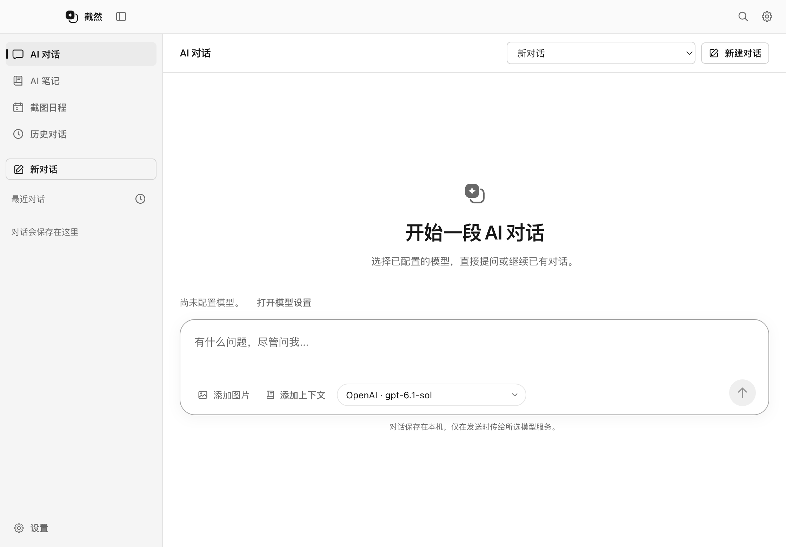

# Snipvia Phase 1 实施报告

日期：2026-10-16。范围：维护者指定私有远程、将新更新源改为当前 Snipvia 仓库，并执行 [REFACTOR_PLAN](REFACTOR_PLAN.md) 的 Phase 1。原分离结果见 [SEPARATION_REPORT](SEPARATION_REPORT.md)；该报告描述 Phase 1 之前的账号兼容状态。

## 交付结论

客户端源码已移除官方账号、注册、登录、Cookie 会话和会员限制，截图与既有本地功能无需官方服务。用户模型用于普通对话、Agent 和默认截图分支预测；未配置托管模型 Key 时，在网络请求前提示配置。自定义本地模型允许无 Key。可选 Jev 的配置和直连仍属于 Phase 2，本阶段不调用 TypeSafe。

私有服务、后台和官网已推送到维护者提供的 [Snipvia-server](https://github.com/yuyeyuyy/Snipvia-server)，远程验证为 Private。客户端以不包含旧服务端 Git 历史的独立基线保存到 `codex/local-first-phase1` 分支，没有合并旧 main。

**Phase 1 本地实现通过验收；当前整个 GitHub Snipvia 仓库公开仍为 No-Go。** 旧 main、test、版本标签及 PR #1 引用仍存在，不能把“干净客户端分支”当作“整个 GitHub 仓库历史已干净”。本轮没有强推、删除远程引用或修改可见性。

## 私有远程交接

私有工作目录：`../Snipvia-private-candidate/`。

| 私有远程内容 | 状态 |
| --- | --- |
| `main` | 完整保留 server、console、website、后台契约、原依赖锁、部署工具及测试；另有迁移与交接提交 |
| `codex/archive-original-test` | 保全原 Snipvia 的 test，提交 `39d2c41e26aba16e7e0ca8286c4995085038305b` |
| `codex/archive-original-pr-1` | 保全原 PR #1 的 head，与原 test 相同 |
| `v0.1.0`、`v0.2.0`、`v0.2.1` | 原标签对象及相应历史完整保留，没有重造版本标签 |
| 实际环境、数据库、Apple 材料及用户数据 | 未复制或提交；原运行数据留在原位置 |

读取原远程补全引用后再次扫描完整私有对象库：没有新增凭据指纹。既有命中仍为之前复核过的模板和合成测试值。未联网验证本地 SMTP 凭据，没有部署、停服或删除生产资源。

## 已实施的客户端变更

### Main 与本地安全边界

- `src/main/index.ts` 移除 AccountService 组装、账号 IPC、资格检查、会员到期计时和账号驱动的任务中断。
- AI 截图不再降为普通截图；框选、置顶、导入、“问 AI”、续拍、主窗口对话、截图对话及 Agent 不等待账号服务。
- 保留捕获 session/generation 检查、窗口复用、图片 lease、大小/格式校验、取消、模型超时、历史身份检查及系统权限。
- 笔记写入仍先 flush 编辑器，再经过原有目录授权、冲突检查、diff 和用户确认；没有扩大 Agent 工具权限。Windows 命令沙箱仍未开放。
- 旧 `userData/account` 继续属于 Agent 受保护目录；既有 `session.json` 不读取、不解密、不自动删除。appId、userData、模型 Key、历史、笔记与日程格式和位置不变。

### UI、Preload 与 IPC

- `src/preload/index.ts` 和 `src/shared/contracts.ts` 移除 account API、账号事件和 checkingAccess 状态。
- `App.tsx`、`AppShell.tsx`、`AppTitleBar.tsx` 移除登录面板、账号按钮、账号页面及命令导航项。
- `CaptureOverlay.tsx` 及相关样式移除会员降级提示；普通截图与 AI 截图的用途仍分别保留。
- 旧账号服务、会话存储、共享账号/资格类型、账号面板与专用旧测试从当前源码移除，原文件完整保存在 Phase 1 前快照中。

没有增加第三种 UI 页面骨架。标题栏保持快捷导航和设置，四个主要工作区保留。



### 默认用户模型预测

| 文件 | 行为 |
| --- | --- |
| `src/main/analysis/PredictionService.ts` | Phase 1 仅使用用户模型；复制配置快照、过滤启用分支、校验模型配置、归一结果与安全错误 |
| `src/main/analysis/screenshot-analyzer.ts` | 保留 OCR 文本；取消服务端预测和高置信度 OCR 代替模型的捷径；模型错误不退回本地自动选分支 |
| `src/main/ai/provider.ts` | 仅发送选中图和启用分支的适用条件；要求 matchedBranchId 为有效 ID 或 null；校验响应及显式截断状态 |
| `src/main/ai/json-request.ts` | 128 KiB 响应上限、45 秒超时、取消、UTF-8 与 JSON 检查、禁止重定向、`credentials: omit`；不回显上游错误正文 |
| `src/main/ai/model-configuration.ts` | 托管模型未配置 Key 时不联网；普通问答、Agent 和预测共用配置检查 |
| `src/shared/prediction-failure.ts` | 错误指向用户的模型设置，不再提示联系管理员；只保留阶段、原因和脱敏 HTTP 状态 |

未命中、低置信度、不存在/停用分支、坏 JSON、显式截断和取消不会自动执行分支。日程仍要求相应信号并经过用户确认。历史中缺少 matchedBranchId 的旧记录仍可读取；新模型结果要求更严格，不借此重写旧数据。

分类配置在操作开始时复制；模型配置改变会取消进行中的预测。分类不发送分支执行 prompt、notebookId、文件路径或 Cookie。用户后续主动对话和授权工具调用仍按原链路发送上下文，本地优先不表示默认离线推理。

## 更新源与旧版本过渡

`src/shared/release-source.json` 已改为 `yuyeyuyy/Snipvia`。现有更新检查、签名 Mac 下载、更新元数据和发布计划从这个单一来源读取；对应单元和模拟更新验收已调整。

本轮没有创建 Release、上传安装包、签名、公证、自动安装、改变 appId 或调整签名信任规则。开发源码版本号仍为原值，不能把本地改动当作已分发的新免费安装包。

旧安装包内仍是 `Snipvia-releases` 更新源，源码改动不会修改已安装二进制。新免费版要使用更高且未使用的版本号，并安排旧更新源上的过渡发布或手动下载引导；迁移完毕前保留旧 Release。老客户端可能仍依赖账号，不因本次源码验收就停用后台。当前 Snipvia 仍私有，且本轮没有验证新仓库存在可用的匿名安装包。

## 验证记录

环境：macOS、Node.js 24.15.0、pnpm 11.1.3。没有使用生产模型或账号。

| 检查 | 结果 |
| --- | --- |
| `pnpm lint` | 通过 |
| `pnpm typecheck` | 通过 |
| `pnpm build` | 通过，Main、Preload、Renderer 均完成构建 |
| `pnpm test` | 58 个文件、929 项通过；旧账号测试保存在快照，不再要求账号运行时代码留在当前测试集 |
| 完整 `pnpm exec playwright test` | 38 通过、11 条件跳过、1 个过时状态断言失败；修正该测试后笔记写入、确认、撤销与取消复验通过。没有把这些描述为一次全绿运行 |
| 无账号关键验收 | 旧账号环境变量和损坏 Cookie 无效、没有账号 UI/API/IPC、本地截图和置顶转对话无需账号、没有模型时可见提示且无账号请求；2 项复验通过 |
| 网络停滞与预测 | 快捷键和置顶聊天不等待 fetch；直接模型失败、显式重试、手动提问和分支条件验收通过 |
| 更新源模拟测试 | 检查、下载地址与发布计划使用 Snipvia；未进行线上安装 |
| 独立客户端候选 | lint、构建、58 个文件的 929 项单元测试及同一次运行的 8 项关键 Electron 验收全部通过 |
| 源码扫描 | 凭据模式命中 0；运行源码没有旧官方域名、账号环境变量、账号 API、资格函数或中央预测路径 |

31 个现存集成测试文件直接使用新的纯桌面 helper；账号、会员和账号延迟用例按新行为归档、替换，没有移除 Agent、图片、笔记、编辑、截图或文件授权的回归来绕过失败。

旧 helper 里的登录过程曾隐式等待窗口预加载。现在 helper 显式等待主窗口、CaptureOverlay 和 Pin；没有增加产品中的“测试免登录”开关。笔记测试原断言短暂“正在编辑”状态，去掉账号网络等待后更快进入确认状态；本轮改为断言“等待你确认”，随后实际确认、写入、撤销和取消继续验证。

真机录屏、混合 DPI、Intel、Windows 安装及原生命令执行差异、签名自动更新仍需后续验收。11 项条件跳过不计为平台通过。Swift 源码没有改动，双架构编译与合成协议验证沿用已完成的分离验收。

## 公开前历史风险与下一步选择

本轮读取原远程得到以下引用，均未删除或改写：

| 引用 | 当前历史 |
| --- | --- |
| `main` | `c414cdd991733ffb8bb4ee88dd53cdb22a691744`，含旧服务端源码 |
| `test` | `39d2c41e26aba16e7e0ca8286c4995085038305b` |
| `refs/pull/1/head` | 同上；GitHub PR 引用 |
| `v0.1.0`、`v0.2.0`、`v0.2.1` | 原历史标签 |

另外已只读确认三个同名 GitHub Releases 仍存在，PR #1 虽已关闭但引用仍可读取。不能因 PR 已关闭就认定历史已移除。

因此仅推送干净分支、将其设为默认分支，或只强推 main，都不足以证明整个现有仓库可公开。GitHub 说明 PR 引用与缓存可能在普通历史重写后保留，且支持清理有受理范围限制，不能承诺普通私有源码一定能由支持团队清除。见 [GitHub 官方历史清理说明](https://docs.github.com/en/authentication/keeping-your-account-and-data-secure/removing-sensitive-data-from-a-repository)。

更可控的公开路径是保留旧仓库为私有归档，再使用独立干净仓库；若必须沿用 `yuyeyuyy/Snipvia` 名称，需要单独确认旧仓库改名/归档及新干净仓库的建立方式。另一条路径是明确批准远程历史与引用清理，并核验 PR/缓存问题。两者都会影响现有仓库协作元数据或历史，需要维护者选择，本轮不代替该决定。

原目录 `.git` 仍含旧历史，禁止从该目录直接整体推送公开。用于交付的 `../Snipvia-public-baseline/` 使用独立对象库，在原干净根提交后提交 Phase 1，不导入原远程 main、标签或 PR 对象。没有执行公共仓库创建或可见性切换。

正式 LICENSE、NOTICE、贡献者和图片授权问题仍按分离报告待人工确认；本轮没有把 `UNLICENSED` 擅自改成 Apache 2.0。

## 数据保全与回滚

Phase 1 前快照：`../Snipvia-migration-backups/20261016-phase1/`。包括 709 个文件哈希、工作区源码、原 `.git` 和客户端候选 `.git`。

```sh
# 仅校验，不修改文件
python3 ../Snipvia-migration-backups/20261016-phase1/restore.py

# 恢复到不存在的新目录，拒绝覆盖
python3 ../Snipvia-migration-backups/20261016-phase1/restore.py \
  --target ../Snipvia-phase1-before-review
```

运行数据始终留在原位置，没有删除旧 Cookie、模型 Key、笔记、截图或历史。测试生成的旧文档图片变化保存在验证产物中，恢复原图；只另存一张合成的新客户端界面供本报告审阅。精确源码修改、删除与新增清单见 [phase1-manifest.json](phase1-manifest.json)。

本地快照、扫描工具、远程引用记录及日志均保存在受保护备份目录。回滚不要求删除候选或破坏任何远程历史；如果回到旧客户端，必须继续提供其所依赖的账号服务。正式发布、旧更新源过渡、历史切换、Phase 2 和停服仍需后续确认。
