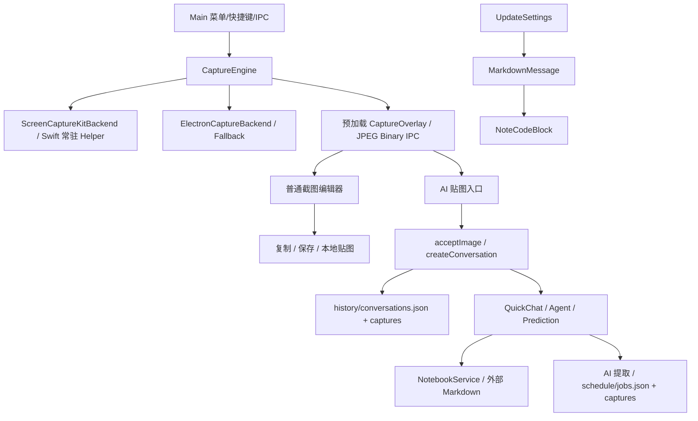

# Snipvia V2 Phase 1 依赖审计

日期：2026-10-23。审计基线 d1673f08bc2875be4218ddea86105d28611d8b0d（0.3.2 发布记录），工作区干净。当前 refactor/snipvia-v2 从该提交建立；本地 main 仍是旧阶段，不作为本次基线。不执行 pull、reset、clean、远端操作或自动合并。只读检查已执行 git status、branch -a、log -5。可恢复源码归档与核心逐文件哈希位于 .dev-runtime/v2-phase1/。

## 实际依赖图

## 分类与处置

| 分类 | 真实路径 | 原因与本阶段处置 |
| --- | --- | --- |
| KEEP | src/main/capture/*、native/*、src/main/windows/capture-overlay-window.ts、screenshot-to-all-window.ts | 原生通信、健康、熔断、坐标、预热、生命周期均已有实现，不重写 |
| KEEP | src/main/performance/*、platform/*、updates/*、src/renderer/src/capture/editor/* | 保留截图采样、权限、系统集成、标注和更新；移除编辑器 AI 按钮 |
| REFACTOR | src/main/index.ts | 2171 行，启动时创建 Agent/MCP/笔记服务并读取对话和日程；清理业务实例与 IPC，保留采集函数 |
| REFACTOR | src/renderer/src/App.tsx、components/AppShell.tsx、settings/SettingsPanel.tsx | 默认打开笔记并并发拉取历史、日程；改为设置中心，复用分组行与主题 |
| REFACTOR | src/shared/contracts.ts、src/preload/index.ts | 现 Capture 强制 conversationId；新 Screenshot 类型独立，桥接只暴露实际 V2 能力 |
| ISOLATE | storage/history.ts、schedule.ts、settings.ts 及其数据契约 | 旧索引格式需要保留；提供只读读取/导出，不主动初始化、修复或清空原始数据 |
| REMOVE | renderer/chat/*、notes/*、history/*、schedule/*、agent/* | 删除旧业务界面、入口与路由；更新说明先提取安全 Markdown 渲染 |
| REMOVE | main 的 Chat/Prediction/Agent/MCP/Note 业务调用和 IPC | 未发现非 AI 采集对这些能力的依赖；保留数据兼容所需契约，清理真正无人引用实现 |

## 审计结论

- 截图引擎自身不依赖 Conversation；Main 的 acceptImage 在 AI 截图展示后调用 createConversation，普通 editor copy/save/pin 不需会话，但 pin 仍虚构 conversationId。
- QuickChat 在 startCapture 的 AI 路径预建，并在 presentAiCapture 展示。可删除 QuickChat，而保留现有两个复用窗口及普通标注器。
- AI Provider 同时服务对话、Agent 和日程提取；不能只删除一个 import。V2 全部停止主动 AI 调用，旧日程只读，不继续提取。
- Schedule 有独立索引与截图目录，不依赖 history/conversations.json；新 ScreenshotStore 不应引用 Schedule。
- NotebookService 管理用户选定的外部 Markdown 路径。升级不得 unlink、trash、重写这些目录；不再打开编辑器，因此退出和更新也不能等待原笔记 flush。
- UpdateSettings 的 MarkdownMessage 间接引用 NoteCodeBlock，需要提取纯展示、安全链接及禁图片渲染，避免清理笔记破坏更新说明。
- IPC 按窗口 sender 与 mainFrame 校验。移除 chat、agent、editing、prediction、notes 写入、history 写入及 schedule 写入通道；保留 capture/permissions/appearance/updates，新增独立 screenshot 和只读 legacy 接口。

## 旧数据与最小迁移

保留 userData、App ID、Bundle ID、settings.json、encryptedKeys、credentials、history、schedule、notebooks.json 和用户 Markdown 原位。新截图存入独立 screenshots/，元数据不持有 Base64。旧截图采用显式按需、可重复导入，按旧 capture.id 去重，复制到新库不改源；失败回滚新文件和索引。对话/笔记/日程提供只读查看或导出。损坏旧文件单项报错，不阻塞启动及截图。凭据不在导出中，不调用 readKey。

新模式仅 quick/edit 可用，collect 与 External Target/Collection 快捷键只预留、未注册。旧 AI shortcut 对应本地 quick，旧 editorShortcut 对应 edit；continueShortcut 原值保留但停用，避免假装续聊仍可用。

## 预计修改与验证

新增 shared/screenshot.ts、shared/capture-mode.ts、main/storage/ScreenshotStore.ts、main/capture/CaptureModeRouter.ts、main/legacy/LegacyDataService.ts、renderer/settings/LegacyDataPanel.tsx；改 Main/Preload/主设置/贴图/Overlay/编辑器和对应测试。先审计和安全分支，再业务与设置，再模型/路由及回归，按逻辑分批提交。旧业务专属 UI 测试需随产品删除明确退役，不能用 skip 隐藏；截图、原生、回退、生命周期、权限、安全、更新测试保留并按新输出适配。不开启 500/1000 次高负载测试。

最终报告记录实际命令、退出码、截图测量和未测平台边界，不以历史报告充当本轮实测。
\n实施细化：V2 活跃快捷键改用 capture-preferences.json，仅继承旧值，不回写旧模型配置；设置桥接只返回两个有效快捷键。旧设置的外观字段继续由原主题服务保存，启动不迁移/删除旧凭据。\n