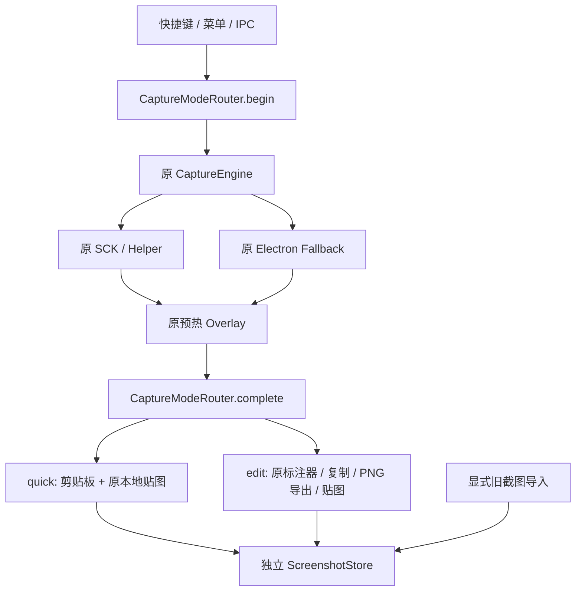

# Snipvia V2 Phase 1 Refactoring Report

日期：2026-10-23，Asia/Taipei。工作目录：/Users/macbook/IdeaProjects/Snipvia-public-baseline。

本阶段源码重构与轻量功能回归完成：主窗口为设置中心；AI 对话、笔记产品、Agent 与主动日程提取退出运行链路；截图不再创建 Conversation；独立 ScreenshotStore 与 CaptureModeRouter 已落地。Collect、外部目标和新窗口没有实现或注册。最终五项命令通过；真实设备性能 SLA 尚未验收，不能将本报告当作 V2 正式发行或完整平台认证。

## 1. Git 安全与提交

初始工作区干净，当前分支原为 codex/local-chat-controls；最近验证过的稳定基线为 d1673f08bc2875be4218ddea86105d28611d8b0d，即 0.3.2 发布记录。原本地 main 停留在较早阶段，因此从当前稳定 HEAD 建立 refactor/snipvia-v2，不切回旧 main，不 pull/rebase。

| 提交 | 内容 |
| --- | --- |
| b8cc713 | 实际依赖审计、分类、数据风险和安全实施方案 |
| dd6369b | 独立截图存储、模式路由、旧数据兼容、独立配置与单测 |
| 32b1a50 | 设置中心、旧业务清理、精简 IPC、依赖与完整回归适配 |
| 20f2088 | 只读导出补齐被消息引用的旧图片附件，保留导出状态清单 |
| 本报告随后的文档提交 | 实测结果、删除/修改清单、亮暗截图与回滚记录 |

未修改 main、远端、仓库可见性或其他仓库；未打包、签名、公证或发布 V2。修改前的源码归档、逐文件哈希和全部原始日志保存在 .dev-runtime/v2-phase1/；已提交源码可按上述提交恢复。

## 2. 已删除模块及理由

完整路径见 [删除与测试退役清单](PHASE1_REMOVALS.json)和[代码文件变更记录](PHASE1_FILE_CHANGES.json)。

- src/renderer/src/chat/、notes/、agent/、history/、schedule/：移除旧产品页面、默认笔记挂载、工作台路由、侧栏与快捷导航。旧数据不因此删除。
- src/main/ai/、agent/、chat/、analysis/、notes/、calendar/：不再运行对话、Jev/模型预测、MCP、脚本、笔记写入或日历/提醒事项直写。执行能力与其授权入口一起移除，没有留下绕过授权的工具执行器。
- storage/history.ts、schedule.ts、chat-images.ts、prediction-settings.ts 和 windows/quick-chat-placement.ts：移除 V1 写入和业务生命周期，读取保护改由新的 LegacyDataService 承担。
- Main 的 chat/agent/notes/history/prediction-settings/auto-action/editing/chat-images IPC、QuickChat 窗口、续聊注册、AI 菜单与「问 AI」按钮均已移除。Preload 不再暴露这些 API。
- 提取更新说明的 ReleaseMarkdown，继续限制链接协议、阻止 HTML 与外链图片，解除对 NoteCodeBlock/CodeMirror 的隐式依赖。
- 生产直接依赖由 22 项降至 8 项，删除 14 项 Agent/MCP/CodeMirror 等依赖；锁文件同步。构建通知覆盖的生产包版本由首轮清理前的 276 降至 124，没有缺失许可证文件。未升级现有依赖或声称已修复所有已知漏洞。
- 删除 165 个退役源码/样式文件、39 个旧业务专属单测、29 个旧产品集成规格及一个专属 Web 测试辅助文件。不是通过新增 skip 或配置排除来隐藏失败。共享的截图、权限、坐标、主题、更新和旧数据保护义务由保留或新增的 V2 测试继续覆盖；全部 V1 源码和测试仍在基线提交中。

## 3. 保留和隔离模块

| 分类 | 实现 | 验证依据 |
| --- | --- | --- |
| KEEP | CaptureEngine、SCK/Electron Backend、健康与熔断、Retina/DIP、原 Swift Helper | 与基线逐文件哈希一致；原单测保留 |
| KEEP | JPEG Binary IPC、预览解码、提前选区、帧质量检查、窗口预热及资源复用 | 保留原代码与轻量 Electron 回归 |
| KEEP | ScreenshotToAllWindow、主窗口隐藏/恢复、托盘、Dock、快捷键、权限、主题、更新 | 原贴图窗口文件哈希一致；对应集成通过 |
| REFACTOR | Main、Overlay 模式名、PinnedCapture、编辑工具栏、AppShell/设置、Preload | Main 从 2171 行缩减至约一半；模式集中路由，无新采集实现 |
| ISOLATE | 原模型配置、加密凭据、预测规则、对话/笔记/日程文件 | 启动不解密/迁移凭据，不读旧业务索引；按需只读兼容 |

[核心保全凭据](PHASE1_CORE_PRESERVATION.json)记录 11 个逐字节未改的核心文件。CaptureOverlayWindow 只把两个默认模式名由 ai 改为 quick；窗口握手、预热、取消、请求隔离和熔断算法未改。已有性能事件定义保留，包括只用于解释旧报告的事件名。

## 4. 新主界面

主窗口仍复用现有 AppShell、原生标题栏、公共 Dialog/Button 和黑白灰 Token，默认只打开设置：

- 通用：实际可用的开机启动、菜单栏说明和主题。
- 快捷键：快速截图、截图与标注；修改立即尝试注册，失败恢复原注册和配置。
- 截图：两个现有本地入口、真实输出质量说明、原录屏权限卡。
- 存储：打开本地数据目录、旧记录只读查看/导出、显式导入旧截图。
- 日程：Schedule / Coming Soon；原日程在旧记录中只读展示。
- 关于：版本、GitHub 更新；反馈弹窗和 QQ 群号复制继续可用。

没有虚假的图片质量、保存路径或收纳开关。保存图片仍使用原生保存对话框；没有独立历史列表、仪表盘或笔记编辑器。亮暗截图已用合成测试数据生成并人工查看，见 [Light](../ui/v2/settings-light.png)、[Dark](../ui/v2/settings-dark.png)。设置规范已同步。

## 5. Screenshot 数据模型和最小存储

定义位于 src/shared/screenshot.ts，使用独立 UUID，包含 createdAt、像素宽高、mimeType、temporary/saved、可选 sourceDisplayId、相对 fileName 与 legacyCaptureId；不包含 Conversation ID、模型或 Base64。

| 层 | 实际行为 |
| --- | --- |
| Runtime Screenshot | Main 中的 Buffer，与元数据分开；最多 32 项 / 256 MiB，单文件 64 MiB；创建不读历史、不写盘 |
| Screenshot Metadata | 无图片字符串的 ScreenshotItem，可被后续 Collection 引用 |
| Persistent Screenshot | screenshots/index.json 与 UUID 命名图片；原子索引、私有文件权限、失败回滚和独立删除 |

ScreenshotPreview 只作为既有贴图展示的临时 IPC 数据，可临时携带 data URL；不会把它写入索引。持久化、复制和删除按独立 screenshot ID 操作，Pin 只能访问自己的截图，Main 可管理已保存截图。

当前 quick 复制到剪贴板并显示本地贴图，不自动持久化；关闭贴图会释放临时数据。编辑器的「保存」仍导出用户选定的 PNG 文件，不自动建立会话或新图库工作台。独立保存/删除 API 及旧截图导入已经落地并测试；完整 Collection/图库 UI 不在本阶段实现。

## 6. CaptureModeRouter

CaptureSession 保存 id/mode/AbortSignal；CaptureResult 保存 sessionId 与输出载荷。Router 拒绝 Collect、重复完成和旧 Session，新的 begin 会取消旧 Session，旧取消不会清理新 Session。保存对话框取消后允许原编辑会话重试。已在真实 Electron 中覆盖「旧 quick 等待剪贴板 → 新 edit 开始 → 旧操作返回」的竞态。

旧 ai/standard IPC 值分别映射 quick/edit；旧快捷键实际值继续使用。continueShortcut 保留原文件但不注册。Ctrl+1、Ctrl+Shift+1、Ctrl+2、Ctrl+Shift+2、Alt+2、Ctrl+3 只在 reservedCaptureShortcuts 中描述，没有全面启用，更没有把 Collect 注册为空行为。后续模式可以扩展 Router，无需复制 CaptureEngine。

## 7. 旧数据与配置兼容

- userData 选择逻辑、com.snipvia.desktop、Bundle ID、开发数据隔离和发布身份未更改。
- 旧 history/conversations.json、schedule/jobs.json、截图文件、notebooks.json、账号目录、Jev 配置、加密凭据及外部 Markdown 原位保留，没有批量写迁移或删除。
- LegacyDataService 在用户查看/导出/导入时才读文件。日程不在启动时初始化，不进行 AI 提取，也不与新库相互引用。
- 显式截图导入按 capture.id 去重，复制旧图片到新库；重复执行不重复导入。单项失败保留源并报告，可再次执行；失败不回滚已成功的其他项，因而支持安全续跑。损坏新索引拒绝写入；损坏旧索引不阻塞本地截图。
- ZIP 导出仅含旧对话/日程索引、引用截图、history/attachments 中被消息引用的图片及 notebooks.json。**不自动打包外部 Markdown**；应通过「打开原笔记本目录」备份原文件夹。账号、凭据和 API Key 不属于导出白名单。EXPORT_STATUS.json 记录缺失图片或不可解析引用，避免把不完整源数据伪装成完整备份。
- V2 快捷键写入新的 capture-preferences.json，继承有效旧值，不更改旧模型或续聊配置。注册失败或持久化失败都会恢复原状态。
- 旧 settings.json 启动不写回、不解密和迁移凭据；主题变更仅合并 appearance，保留未知字段、不能识别的旧 profile 和密文。损坏旧设置被设为只读，后续主题写入不会覆盖它。

旧数据完整性、重复导入、失败、路径遍历/符号链接、凭据不访问、重启、损坏索引及旧快捷键均有对应测试。没有以真实用户目录作为测试数据。

## 8. 目录和文件级变更

| 路径 | 职责 |
| --- | --- |
| src/main/capture/CaptureModeRouter.ts | 输出模式与可取消 Session |
| src/main/storage/ScreenshotStore.ts | 图片缓存、元数据与最小持久化 |
| src/main/storage/CapturePreferencesStore.ts | 独立快捷键配置 |
| src/main/legacy/LegacyDataService.ts | 旧记录只读、白名单导出及幂等复制 |
| src/shared/screenshot.ts、capture-mode.ts、capture-preferences.ts、legacy.ts、desktop-api.ts | 新数据和实际 IPC 契约 |
| src/main/index.ts、src/preload/index.ts | 特权操作编排与窗口校验 |
| src/renderer/src/settings/ | 设置、复用快捷键录制、只读旧数据与更新 |
| src/renderer/src/components/ui/ReleaseMarkdown.tsx | 与笔记解耦的安全更新说明 |
| tests/unit/*、tests/integration/v2-settings.spec.ts | 新模型、迁移、配置和跨进程验收 |

完整新增/修改/删除状态见 [PHASE1_FILE_CHANGES.json](PHASE1_FILE_CHANGES.json)，不只列代表文件。没有移动或编辑私有服务仓库。

## 9. 构建与测试

实际环境 Node 24.15.0、pnpm 11.1.3；脚本均来自当前 package.json。最后一次旧附件导出修复后重新运行所有阶段命令：

| 命令 | 退出码 | 耗时 |
| --- | --- | --- |
| pnpm typecheck | 0 | 2.98 秒 |
| pnpm lint | 0 | 2.41 秒 |
| pnpm test | 0 | 2.01 秒 |
| pnpm build | 0 | 5.47 秒 |
| pnpm test:smoke | 0 | 121.27 秒 |

217 项单测通过（30 文件）；smoke 共 26 项，16 项通过，10 项按原有真实设备/打包/耐久启用条件未运行。没有新增 skip 或删除有效截图测试。没有运行 100/500/1000 次真实截图压测。

保留的有效测试覆盖原生/回退提前选区、窗口关闭和复用、Dock 图标、剪贴板、标注/撤销/导出、Retina 裁剪、Windows Renderer Enter、主题、反馈失败重试和 GitHub 更新/模拟安装。新增测试覆盖无 Conversation 截图、旧文件与凭据保护、幂等导入、索引失败回滚、离线无请求、配置回滚及异步 Session 竞态。

修复记录：首次单测的 /var 与 /private/var 路径断言已改用 canonical path；复制 IPC 已等待异步错误；Dock 测试适配设置菜单；可见性耗时断言等待 Renderer 实际上报；损坏和未知旧配置的后续主题保存保护已补测。没有把这些失败当作跳过。

[最终验证 JSON](PHASE1_VALIDATION.json)记录命令、退出码和耗时；原始日志位于 .dev-runtime/v2-phase1/，完整源码快照位于 source-before.tar.gz。

## 10. 性能与资源结果

最终一轮为 Electron Fallback、合成屏幕像素、真实窗口/IPC/NativeImage 管线，三种尺寸各三次，共九次：

| 指标 | 中位数 | 最大值 |
| --- | --- | --- |
| Capture Start → Overlay Visible | 108.08 ms | 586.89 ms |
| Selection End → Result Visible | 101.78 ms | 939.47 ms |

启动到测试确认设置及两个复用窗口可用约 1373.34 ms，含 Electron/测试驱动开销，并非生产冷启动 SLA。九次截图使用同一组 3 个窗口 ID；全部关闭后临时截图缓存为 0 项 / 0 字节，有界缓存和释放断言通过。没有根据短测宣称已排除所有 RSS 泄漏。

[最终原始采样](PHASE1_PERFORMANCE.json)、[首轮 smoke 采样](PHASE1_PERFORMANCE_SMOKE_FIRST.json)、[单独九次复核](PHASE1_PERFORMANCE_ISOLATED.json)及[附件修复前样本](PHASE1_PERFORMANCE_BEFORE_EXPORT.json)均保留。首轮最大值约 586 / 959 ms；单独复核约 575 / 261 ms，尾部波动仍可见，没有隐去坏样本。原因尚未定位，没有同机同环境 V1 对照，因此**不能据此宣称已证明无性能回退或满足真实 ScreenCaptureKit SLA**。

已确认的只是核心采集实现未改、轻量流程正确、窗口复用和临时资源释放。本阶段不调整成熟引擎以掩盖测试调度或可见确认段波动；真实小样本对照应作为后续集成验收门槛。

## 11. 遗留风险与回滚

- Apple Silicon 实际录屏/TCC、真实 Helper 崩溃恢复、Intel、Windows 真机、混合 DPI 和新包签名/更新升级均未在本轮执行；原测试与文档保留，不以合成回归替代。
- 性能尾部波动尚未定位；不应把本分支直接视为生产性能认证结果。
- 临时截图关闭即释放；本阶段没有自动图库、Collection 或重新打开任意临时截图的 UI。单张保存和旧数据保留不等于已实现连续收纳。
- 旧 Markdown 文件由原应用以外的编辑器管理，导出 ZIP 不替代外部笔记本目录备份。旧日程只读，不能编辑或继续系统日历写入。
- 现有依赖未做版本升级；构建通过不等于安全告警全部消失。新包版本、签名和发布不属于本阶段。

回滚无需删除任何数据：退出测试版，在新的本地恢复分支/副本打开 d1673f0 或使用 source-before.tar.gz，先检查工作区并保存新改动，不执行 reset --hard 或 clean。V1 忽略新增 screenshots/ 和 capture-preferences.json，原记录及凭据仍在；新增 V2 文件也应保留备份。若对后续集成主干做撤销，使用逐提交 revert 并处理冲突，不改写远端历史。

## 12. Phase 2 输入条件与建议

1. 先人工验收本分支设置、quick/edit、复制/PNG 保存/贴图、旧记录和主题；本阶段未自动合并或推送。
2. 用小样本对照补做真实 SCK、TCC、外接屏/DPI、冷/热启动和尾延迟定位；保留原核心指标及明确的发布性能门槛，仍不自动启动高负载耐久。
3. 在现有 ScreenshotItem/Store 和 Router 上增量实现临时 Collection；先确定数量/内存预算、清空语义和关闭释放，再启用预留快捷键。不要复制截图后端。
4. 外部目标、拖放及收纳 UI 分开验收，不提前添加 AI、账号、订阅、插件框架或双版本架构。
5. 正式安装包使用与 0.3.2 稳定版可区分的版本和发布说明；签名、公证、更新安装和跨平台实机验收另行执行。本次没有把 V2 上传或替换现有 Release。
