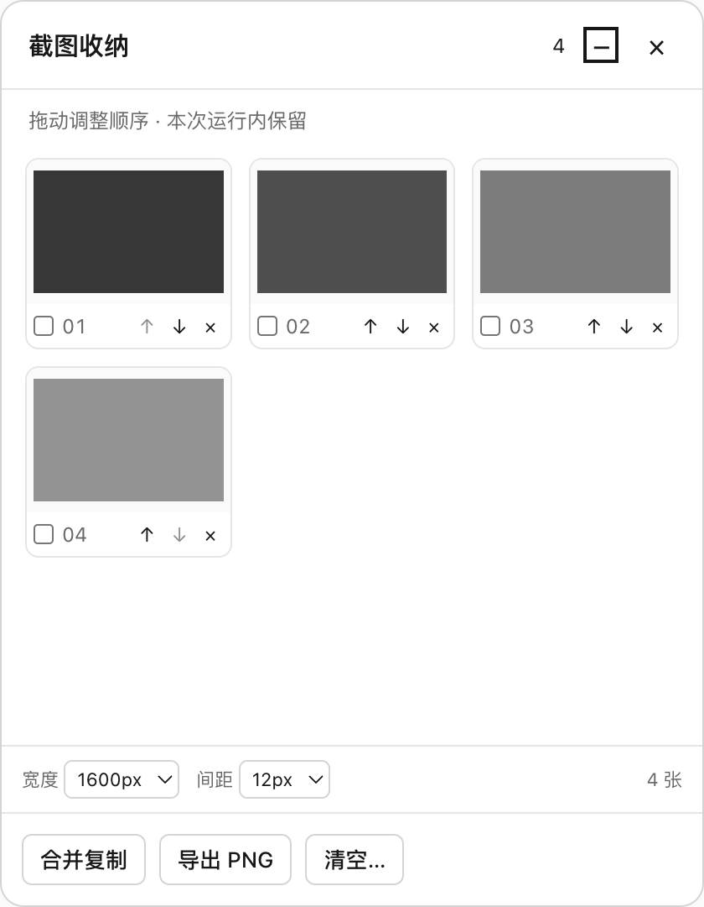
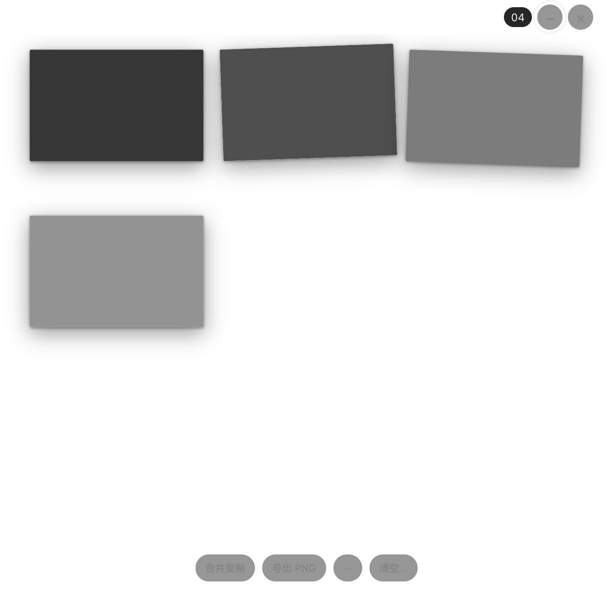

# Snipvia V2 Phase 2 Continuous Capture Report

日期：2026-10-23。工作目录：/Users/macbook/IdeaProjects/Snipvia-public-baseline。分支：refactor/snipvia-v2。源码验收提交：5352a01。

**结论：Quick、连续收集、收纳交互和批量输出已实际实现，功能回归通过；性能验收有保留，不建议据此直接发布“无尾延迟”正式版。** Collect 在本机 Electron fallback 合成测试中仍出现约 960ms 的 Overlay 尾延迟。完整保留了修改前、初次回归、窗口调用收敛实验和最终结果；未用最后一次较好样本替换全部历史结论。Windows 真机与跨应用多图粘贴没有标记为通过。

## 1. Git 提交与范围

开始时工作区干净，基线 ae7db9e；未切换分支、拉取 main、创建仓库或修改其他仓库。以下均为本地独立提交：

~~~text
77c553d docs: audit Phase 2 capture lifecycle and record baseline
a18f5e2 feat: complete quick capture directly through clipboard
2cbc905 feat: add ordered collection with protected screenshot ownership
c355990 feat: add reusable screenshot shelf with preview and ordering
d069c8a feat: animate collection feedback without blocking capture or focus
c4d2e11 feat: merge collection images and export ordered PNG files
8d2d83a feat: enable configurable collection shortcuts with conflict rollback
5352a01 fix: harden capture window lifecycle and verify continuous workflows
~~~

本报告及性能原始记录另有文档提交，可由 git log 查阅。源码快照保留在本机忽略目录 .dev-runtime/v2-phase2/phase1-ae7db9e.tar；没有 API Key、生产数据或用户截图。没有推送、打包、签名、公证、Release 或仓库可见性操作。

## 2. Quick Capture

src/main/index.ts 的 quick handler 直接从已裁剪 NativeImage 编码 PNG，等待 Main 剪贴板写入成功后标记 clipboard_committed，只结束仍然匹配的 Session。不会创建 ScreenshotItem、Collection 成员、历史、Conversation 或新窗口，不默认显示 Pin。帧、选区及临时编码数据随后释放；剪贴板抛错会返回 Overlay 的明确错误，允许重新框选或 Esc 取消。

独立测试验证三次连续成功、失败提示、零永久截图、零临时 Store 条目、零 Pin 可见和窗口 ID 复用；另验证 Quick 完成后已有十张收纳不变。原延迟剪贴板取消后启动 Edit 的竞争测试继续通过。Edit 的标注、复制、保存、取消保存、Pin 及 Pin 复制行为继续验证，不以删除测试适配产品变化。

Quick Selection → Clipboard 的最终 9 样本 P50 38.37ms / P95 74.45ms，使用合成桌面和剪贴板写入替身；实际系统 PNG 读回另由输出集成测试覆盖。这不是操作系统键盘派发或跨应用粘贴耗时。

## 3. Collection 数据模型、生命周期及预算

src/main/storage/ScreenshotCollection.ts 保存稳定 ID、有序 ID 列表、时间及 revision；图片大对象仅在 ScreenshotStore。append 为原位追加，快照只复制小型元数据。支持 append / remove / reorder / clear / getItems / getCount / getItem。

- Collection、Pin、异步 Export 分别持有 Store 引用；移除或清空仅释放自身引用，不调用图片永久删除。已保存图片继续由独立索引保留；保存期间有其他引用时同步更新元数据状态。
- 取消旧 Session 不撤销已经 append 的图片；截图再次启动、Shelf 收起、隐藏及关闭均不清空列表。三种模式独立路由。
- 排序提交必须提供当时 revision 和完整 ID 排列，拒绝重复、缺失、外来及过期 ID；并发新截图不会被旧排序覆盖。
- 清空使用原生确认框，默认和 Esc 均为取消；确认返回时再次检查 revision，收纳在等待期间变化则要求重新确认。
- 保留最多 32 张 / 256 MiB 编码字节 / 单张 64 MiB 限额。已被引用的图片不可静默淘汰；容量不足明确报错，旧图片保留，新选区仍可取消或重试。单测同时触达条目和字节预算。
- 本阶段选择有界内存而非磁盘 spool，没有隐藏的后台持久化队列或自动扩容。Collection 为本次应用运行内的数据，退出/崩溃不恢复，UI 明示“本次运行内保留”；关闭窗口与退出应用是不同操作。

## 4. Shelf Window 架构

src/main/windows/ShelfWindow.ts 延迟至首次 Collect 或主动打开时创建一个 BrowserWindow，随后复用。启动及仅 Quick 仍为原来的三个窗口；使用收纳后最多增加一个 Shelf，不按图片创建窗口，不增加动画专用 Renderer。

收起 184×58 DIP，展开最多 420×540 DIP，按截图显示器 workArea 的右上角定位，限制在工作区内。负坐标、显示器偏移、小工作区和 Retina 不重复乘缩放比例有单测；显示器变化时重新定位。实际双屏/混合 DPI 仍未完成真机验证。

沿用 sandbox / contextIsolation / nodeIntegration=false、导航与新窗口阻止规则、Main frame + WindowRole 校验。Shelf 无更新安装、旧数据、账号、文件任意路径或 Capture 启动权限；图片访问仅限收纳 ID。全部新增 IPC 有 Zod 参数校验。展开才允许聚焦；新增时 showInactive，收起和动画时不可聚焦。后台节流关闭以保证隐藏 Renderer 的渲染握手，不执行常驻 RAF 循环。

延迟创建节省未使用收纳时的一个 Renderer；代价是首次使用可能包含加载/解码延迟。并未仅凭启动时间差认定改进：Before 启动三窗 3328.56ms，最终 959.29ms，均为单次启动，受文件缓存等影响。

## 5. 飞入动画与实际表现

复用 Shelf Renderer，Main 提交 Collection 后立即结束截图；setImmediate 调度反馈，不等待缩略图、Renderer ACK 或动画结束。可见收纳时，窗口短暂扩展到截图显示器 bounds，设置鼠标穿透；缩略图从原选区 DIP 坐标向工作区右上角目标进行 transform / opacity 动画，220ms，随后约 40ms 收尾还原小窗。没有逐帧布局循环或动画依赖库。

显示前通过 presentation token、两次 RAF 和受控 ACK 握手，避免未清理旧 DOM 直接显示。新截图会使旧 epoch / presentation 失效，取消计时器、清理反馈缩略图并恢复鼠标策略。看门狗在 ACK 异常时收尾，未准备好的大窗口保持隐藏。支持 prefers-reduced-motion 变化，改为小型静态数量反馈。

集成测试实际触发 fly 状态、动画中开始新截图并取消、重新显示、Reduced Motion 下无 fly；拦截 Shelf.focus 验证自动追加为零次。测试不等于人工逐帧视觉品质或其他应用真实焦点恢复验收；这两项仍可改善。

## 6. 隐藏、展开及交互

用户可从收起或展开态隐藏 Shelf；数据和顺序保留。隐藏后继续 Collect，仅显示小型“+1 / 已收集 N 张”，550–800ms 自动消失，不做全屏飞入。正式收纳快捷键重新打开；Esc 收起。

展开复用 WorkspaceHeader、Button、现有黑白灰 Token，缩略图保持原色。点击进入既有中央 Pin 预览，可复制并关闭；本阶段没有新增图片编辑引擎。预览时删除 Collection 成员不会使预览失效。完整中央编辑器留给 Phase 3。

实际亮暗界面：

## 7. 删除、排序、清空验收

tests/integration/v2-continuous.spec.ts 已验证十张不同合成图与十个唯一缩略图、稳定顺序、一次取消不增量、Quick 不改变收纳、方向按钮排序、实际 HTML 拖拽及反向拖拽、过期 revision 拒绝、收起重开保序、预览共享引用、单删、取消清空及确认清空、单个 Shelf ID 复用和末态 Store 为零。

tests/unit/screenshot-collection.test.ts 覆盖非法排列、32 张及 256 MiB 满额不淘汰、共享引用最后释放、保存后清空不删文件与已提交收集不受旧 Session 取消影响。tests/unit/collection-exporter.test.ts 验证第二文件写入失败回滚，以及输出中清空后源数据由 export 引用保留到完成。

## 8. 批量输出与兼容性

src/renderer/src/collection/merge-images.ts 在已有 Shelf Renderer 中按顺序逐张解码、绘制并关闭 bitmap，使用有界 Canvas 纵向合并；最大宽度与间距可调，窄图不放大，居中白底。限制 32 Mpx / 高 32768px / PNG 64 MiB。Main 复核 revision、ID、PNG 头、尺寸和真实解码后才复制。失败不移除原图，Canvas finally 归零。

src/main/storage/CollectionExporter.ts 通过原生目录选择，创建新的私有输出目录，按收纳顺序输出 001-稳定ID.png。支持选择子集，无选择时全部；不覆盖目标现有文件。写入串行异步，持有独立引用；取消不写文件，失败清理本次新目录并保留源。Renderer 不提交任意文件路径。

合并 PNG 的真实系统剪贴板读回、不同尺寸合并高度/间距、选中文件命名和顺序、取消、失败安全及恶意 PNG/越权窗口请求均有测试。空、超长、超像素预算、非法尺寸和乱序子集有单测。

原生命名 NSPasteboard 实验成功写入两个独立 NSImage 对象，未读写用户通用剪贴板。**Finder、飞书、微信、Word、浏览器的多对象粘贴均未标记通过**；系统对象支持不能证明接收软件行为。产品提供单 PNG 合并兜底和文件导出，不模拟系统按键。详见[兼容性说明](PHASE2_CLIPBOARD_COMPATIBILITY.md)及[实验记录](PHASE2_PASTEBOARD.json)。

## 9. 快捷键、配置兼容与冲突

新安装默认值如下；已有用户以设置显示的实际值为准：

| 默认快捷键 | 行为 | 持久化字段 |
| --- | --- | --- |
| Control+1 | Quick → Clipboard | shortcut |
| Control+2 | Collect 一次框选 | collectShortcut |
| Control+Shift+2 | 打开 / 展开 / 收起 Shelf | collectionShortcut |
| Alt+2 | 确认后清空 | clearCollectionShortcut |
| Control+3 | Edit | editorShortcut |
| Control+Shift+1 | 仅预留外部目标 | 不注册 |

CapturePreferencesStore 原子写独立 capture-preferences.json，旧快捷键原值保留，新增默认与旧键冲突时选择未占用替代组合。旧两字段文件可读，不自动覆盖旧 settings.json；损坏或未知字段文件保持原位且禁止保存覆盖。主题、App ID、Bundle ID 和实际 userData 目录未改变。

五项绑定统一事务式注册：先验证 Ctrl / Control 等别名等价冲突，失败解除本次绑定、恢复旧绑定；保存失败也恢复旧绑定。若系统连旧绑定也拒绝，会明确提示恢复失败及菜单兜底。测试验证五键注册、旧配置、自定义设置、部分更新不重置新增键、注册失败磁盘不变，并实际调用已注册的收集、收纳切换、清空取消/确认回调；未注入系统按键，也不把回调测试声称为物理热键真机验证。

## 10. 性能 Before / After 与保留项

同一 Mac、同一 Node/Electron、相同合成帧与小/中/大三种选区各三轮。量纲均为 ms，P50 为中位数，P95 使用 nearest rank；9–10 个样本时 P95 接近最大值，不代表稳定的分位数估计。所有原始埋点保留。

| 指标 | N | P50 ms | P95 ms |
| --- | --- | --- | --- |
| Quick：Capture → Overlay（Before） | 9 | 113.44 | 141.45 |
| Quick：Capture → Overlay（After） | 9 | 106.36 | 128.42 |
| Quick：Selection → Clipboard | 9 | 38.37 | 74.45 |
| Collect：Capture → Overlay | 10 | 86.44 | 959.60 |
| Collect：Selection → Collection | 10 | 1.02 | 2.15 |
| Collect：Selection → Shelf 可见 | 10 | 46.90 | 104.66 |
| Shelf 展开 → 可交互 | 2 | 37.98 | 44.83 |
| Shelf 排序 → Main 更新 | 3 | 0.11 | 0.16 |
| 实际 ScreenCaptureKit：Capture → Overlay | 4 | 152.84 | 290.80 |

Before 的 Selection → Pin Visible 为 P50 88.37ms / P95 162.74ms；After Quick 的终点变为 Clipboard，两个终点不同，不能直接宣称同比提速。最终 Quick Overlay 样本较好，但初次完整回归 P95 为 1045.68ms，窗口调用收敛后的单独回归仍为 571.17ms；这些文件全部保留。

Collect 最终十次 Overlay 原值为 90.98, 81.90, 950.45, 71.30, 943.86, 64.69, 952.42, 69.94, 959.60, 67.61 ms。前五次中位数 90.98ms，后五次 69.94ms；没有从这十次断言已消除长期退化或尾延迟。慢样本主要出现于原生窗口隐藏调用及现有 readiness 附近，收纳提交本身很短。已减少 Main/Shelf 重复 hide，并避免收起 Shelf 聚焦；未为了降低数字修改截图引擎或跳过 readiness 安全屏障。

本阶段性能结论为**部分通过**：收纳提交与温态反馈可用，持续收纳仍有间歇性约一秒 Overlay 等待，首次 Shelf 创建也可能产生较长反馈等待。正式宣称“极速、无打断”前需要独立定位 AppKit/焦点/窗口服务等待，并重复轻量同环境验证。

原始证据：[Before](PHASE2_PERFORMANCE_BEFORE.json)、[首次 After](PHASE2_PERFORMANCE_AFTER_FIRST.json)、[窗口调用收敛实验](PHASE2_PERFORMANCE_AFTER_WINDOW_GUARD.json)、[最终 After](PHASE2_PERFORMANCE_AFTER.json)、[Collect 首次](PHASE2_COLLECTION_PERFORMANCE_FIRST.json)、[Collect 中间实验](PHASE2_COLLECTION_PERFORMANCE_WINDOW_GUARD.json)、[Collect 最终](PHASE2_COLLECTION_PERFORMANCE.json)、[汇总](PHASE2_METRICS_SUMMARY.json)。

## 11. 内存、窗口与资源

仅 Quick 的最终三窗口 ID 与启动相同，Store 为 0 项 / 0 字节；Collect 十次只增加单个 Shelf，后续预览复用原 Pin。十张小型合成 PNG 共 5997 字节；清空并关闭共享预览后为 0 项 / 0 字节。

本次样本全进程 working set：收纳前 721.2 MiB，十张后 837.4 MiB，排序/预览/清空后 893.3 MiB。编码缓存已释放，但 Chromium、GPU 与系统工作集没有立即降回初值；**不能据此断言没有内存泄漏**。也不能把 256 MiB Store 预算等同于整个应用 RSS 上限；解码图像与合并 Canvas 有额外开销。

缩略图仅在需要时读取；飞入临时数据随完成或中断清理，Canvas/bitmap 明确释放。不新增持久化队列、常驻动画窗口或按图新建窗口。PNG 编码、NativeImage 解码/缩放仍有同步 CPU 成本，本阶段没有重写成熟像素链路。

## 12. 验证结果与文件级变更

| 实际命令 | 最终结果 |
| --- | --- |
| pnpm typecheck | exit 0 |
| pnpm lint | exit 0 |
| pnpm test | exit 0；34 文件 / 227 单测 |
| pnpm build | exit 0；Main / Preload / Renderer / Notices |
| pnpm test:smoke | exit 0；21 通过、11 显式 opt-in 未执行 |
| SNIPVIA_REAL_SCREEN=1 pnpm exec playwright test tests/integration/v2-sck-light.spec.ts | exit 0；四次实际 SCK Quick/Collect + 一次取消 |

默认跳过的十个既有真机/安装包/高负载场景未删除或改成跳过；新增轻量 SCK 仅在显式开启时运行，已另行实际执行。没有 500 / 1000 次耐久或负载测试。Windows 此次为逻辑、尺寸、取消与 Renderer 仿真；macOS 为实际 Retina 单屏 SCK，加原生/fallback 替身及 Electron 窗口测试。

完整日志保留本机 .dev-runtime/v2-phase2/，摘要与哈希见[验收记录](PHASE2_VALIDATION.json)。最初全量回归发现设置重启立即退出的窗口预加载竞态，增加 quitting 守卫后通过；首次额外 SCK 测试把现有后端名字错误写作 sck，改为代码真实返回的 screen-capture-kit 后通过，未修改后端。

| 文件 / 目录 | 本阶段实际变更与证据 |
| --- | --- |
| src/main/index.ts | Quick 直写剪贴板、Collect 路由、引用保护、受限 IPC、五项注册、主窗口重复 hide 收敛、退出守卫、显示器变化与更新安装时 Shelf 清理 |
| src/main/capture/CaptureModeRouter.ts | 新增可选 Collect handler，保持旧 Session 取消与异步隔离 |
| src/main/storage/ScreenshotStore.ts | 引用所有者、元数据读取、受保护条目预算错误、保存元数据一致性 |
| src/main/storage/ScreenshotCollection.ts | ID 顺序、revision、增删/清空与引用生命周期 |
| src/main/storage/CollectionExporter.ts | 新目录有序 PNG、失败回滚、异步输出引用保护 |
| src/main/windows/ShelfWindow.ts | 单窗口、屏幕坐标、展开隐藏、动画 token、Reduced Motion、非聚焦与后台渲染策略 |
| src/shared/collection.ts / collection-output.ts | 小型状态、IPC 契约、布局上限、选中 ID 顺序 |
| src/shared/capture-preferences.ts / src/main/storage/CapturePreferencesStore.ts | 五键默认值、旧配置升级、别名与冲突保护 |
| src/shared/desktop-api.ts / src/preload/index.ts | 窄 Collection 桥及主题/性能同步，不暴露任意路径 |
| src/shared/performance.ts / src/main/performance/screenshot-performance.ts | 保留原埋点，增加六项关键阶段测量 |
| src/renderer/src/collection/ | Shelf、异步合并画布、稳定 ID UI、预览、选择、排序和输出 |
| src/renderer/src/components/WorkspaceHeader.tsx / main.tsx | 恢复共用工作区小标题组件，新增延迟加载 Shelf 路由 |
| src/renderer/src/settings/SettingsPanel.tsx / capture/CaptureOverlay.tsx | 新的设置入口/录制器与准确操作提示 |
| tests/unit/collection-*、screenshot-collection.test.ts、capture-preferences.test.ts、capture-mode-router.test.ts | 核心、预算、输出失败、兼容、坐标和路由 |
| tests/integration/v2-continuous.spec.ts / v2-sck-light.spec.ts | 新流程与实际轻量原生回归 |
| tests/integration/appearance、capture-early-selection、capture-local-first-latency、capture-window-visibility、performance、v2-settings、capture-performance-phase3/5 | 保留原验证目的，把 Quick→Pin 过渡假设改为 Quick 完成或显式 Edit→Pin |
| scripts/research-pasteboard.swift | 仅研究用的私有命名剪贴板，不进入截图 Helper |
| README.md / docs/UI_DESIGN_LANGUAGE.md / docs/v2/ / docs/ui/v2/ | 当前源码与已发布 V1 区分、设计语言、报告、原始指标及合成截图 |

CaptureEngine、readiness、ScreenCaptureKit backend、Electron backend、health、desktop-source-selection、thumbnail-size、types 及 Swift Helper 共九文件 SHA-256 与 Step 0 完全一致，见[哈希清单](PHASE2_CORE_PRESERVATION.json)。package.json、锁文件、Bundle ID 和 App ID 没有变化。

## 13. 未完成项、风险与回滚

1. **P1 性能：** Collect Overlay 约一秒的间歇尾延迟仍可复现；冷 Shelf、外部应用真实焦点恢复及逐帧动画品质未达最终体验验收。功能可试用，低延迟发布门槛保留。
2. **P1 平台：** Windows 真机、实际多屏/混合 DPI、Intel 真机及打包后 Helper 回归未执行；不可将此结果称为全平台发布验证。
3. **P1 容量/恢复：** 32 张及 256 MiB 为明确硬边界，没有磁盘暂存、跨重启 Collection 或崩溃恢复；退出前需导出。关闭/隐藏保留只涵盖本次运行。
4. **P2 输出：** 多对象跨应用粘贴未实现/未验收；真实大图跨应用粘贴还需目标版本人工验证。合并和文件导出为已验证 MVP。
5. **P2 资源：** 合并解码与 Chromium 缓存的总内存仍可能明显高于 Store；只做轻量采样，没有耐久泄漏结论。

回滚优先在新的本地修复提交中逐项撤销本阶段提交，从 5352a01 向前逆序评估到 77c553d；不得 reset --hard 或清理未知文件。本次未提交既有用户改动（开始即干净），原源码快照独立保留。若回滚到 Phase 1，应先备份新增 capture-preferences.json：它多了三项字段，旧 Phase 1 严格 schema 不识别；可以把独立 V2 配置备份后只恢复 shortcut / editorShortcut 两字段，原 settings.json 和用户笔记/历史不动。退出前导出本次 Collection，因为它不是持久化历史。依赖、旧数据格式、应用身份均未迁移，不涉及远程回滚。

## 14. Phase 3 输入与编辑器建议

可在当前分支继续编辑器开发；不要把本次功能通过等同于低延迟正式发布批准。

- 先用小型真机跟踪把 Shelf suspend、主窗口 hide、Overlay hide/show、readiness 与焦点恢复分段，解决现有约一秒尾延迟后再制定稳定 SLA。
- 点击成员沿用 Screenshot ID / Store 所有者与 revision，复用当前 ScreenshotEditor 的标注模型；保留原图，编辑结果显式替换或另存，避免修改其他共享预览。
- 完整中央编辑器使用同一工作区语言和现有主题，不新增 AI、账号、插件或双版本架构。
- 若真实使用需要超过 32 张或退出恢复，再增加受控异步私有 spool / 索引；先设计取消、引用、失败恢复、容量与清理测试，不自动扩大内存预算。
- 输出继续保留单图合并和 PNG 文件导出，跨应用多对象功能只有取得目标应用实际证据后才开放声明。

本阶段工作在本地报告与提交完成后停止，等待用户验收。
