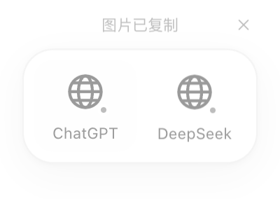
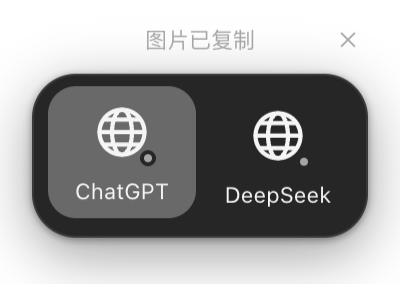

# 截图后快速切换：第一阶段实施与验收

日期：2026-10-28。基线：`refactor/snipvia-v2` / `2c93e3a`。工作目录仅为 Snipvia-public-baseline。本阶段实现「图标与名称」方案的 MVP，不代表第三方输入框自动化已完成；没有推送、签名、公证、打包或发布。

## 已实现

- 设置新增「截图后快速切换」，默认关闭；用户可从系统选择器添加本地应用，或添加 HTTP(S) 网页地址，最多 8 个，支持移除及排序。应用默认采用本机名称；网页名称可自定。
- 仅 Quick 模式在 PNG 真正写入系统剪贴板后异步显示顶部选择条，使用用户当前 Quick 快捷键，不写死 Command+1。菜单触发 Quick 同样遵循该设置。
- 使用本次截图屏幕的工作区顶部中央、黑白灰主题和本机应用图标；网页使用本地图标，不获取远程 favicon。Light/Dark/System、160ms 轻量动画和 Reduced Motion 继续有效。
- 默认 4 秒后隐藏，设置可选 2/4/6/10/15 秒。悬停或键盘操作暂停剩余倒计时，不在鼠标离开后无条件重置全部等待时间。
- 默认 showInactive，不抢原应用键盘焦点。菜单「选择截图目标」显式进入键盘选择，支持 Tab、左右、Home/End、Enter、Esc；点击或键盘聚焦选择条不会打开 Settings。
- macOS 按用户登记的应用真实路径及 Bundle ID 激活已运行应用，回查实际前台状态。默认不启动未运行应用；用户可单独允许启动。不通过窗口标题猜测应用，不接收 Renderer 传入的任意路径、脚本或进程参数。
- 网页目标明确标为「打开网页」，交由系统默认浏览器打开保存的地址。此阶段不承诺复用已有标签、选择浏览器 profile 或聚焦输入框，不自动粘贴、发送或切换聊天对象。
- 关闭功能或移除全部目标会销毁选择条窗口。配置缺失、损坏或未知版本不影响截图启动，损坏文件保留且拒绝覆盖。

## 生命周期、隐私与性能边界

Quick 输出仍走原 CaptureOutputQueue 和 PNG 编码路径；图片像素、框选、编辑、Collect、Shelf、Pin 和更新逻辑没有被重写。新增服务在复制成功后通过 setImmediate 接收通知，不把窗口准备、图标读取、目标发现或应用激活加入截图入口的 await 链。窗口未就绪时跳过本次选择条，原图片仍可粘贴。

选择条使用独立的最新截图 ID 和 presentation，不复用已经被 cleanupOverlay 终止的 CaptureSession.signal。A 的旧输出晚到、B 被取消、旧失败项重试、新截图、配置改变或退出均不能让失效的条重新出现。新截图入口只透明挂起该窗口、禁用鼠标和焦点，不在这一入口调用额外的原生 hide。

开启且已配置目标时，PNG 和随机会话标记通过同一个 ClipboardItem 原子提交；标记不含身份信息、URL 或业务数据。条显示期间每 750ms 及点击前只读取该标记，不解码或读取剪贴板图片、文本或其他用户内容。剪贴板改变后条失效，不擅自恢复截图。元数据不可读时选择条降级，成功复制不回滚、不重新入队。

所有新 IPC 按原有窗口角色、WebContents、主 frame 校验，并使用严格 schema；配置与业务身份由 Main 解析。选择条 Renderer 不接收截图字节、应用路径或 Bundle ID。AppKit helper 独立于 ScreenCaptureKit helper，不访问辅助功能、Apple Events、聊天内容或浏览器 Cookie。没有新增第三方依赖；App ID、Bundle ID 和 userData 路径保持原值。

当前没有完成 30 次真实框选的前后 p95 性能对比；不能将“没有新增 await”或合成连续输出测试等同于真实截图全链路零回归，也没有声称快于 PixPin。

## 本机能力探针

| 目标 | 已确认 | 未确认 |
| --- | --- | --- |
| WeChat.app | 原生 describe 验证路径、`com.tencent.xinWeChat`、4.1.15 | 此版本输入框识别、实际粘贴 |
| Lark.app | 本机实际元数据为 `com.electron.lark`、147.0.7727.149，显示名称 Feishu | 不据品牌名称推断其窗口/聊天结构，输入框未验 |
| DeepSeek Harness.app | `com.deepseek.dsh`、0.2.1-rc.2，元数据验证通过 | 输入框与多会话兼容未验 |
| Codex | 可以由用户从选择器添加实际安装位置 | 本次有限应用目录探针未确认位置，不猜 Bundle ID |
| Google Chrome / Safari | 本机脚本字典均存在 tab 定义 | 没有请求自动化权限、没有枚举真实标签；已有标签和网页输入框留到下一阶段 |
| 原生激活机制 | 临时合成 AppKit 应用实际激活并回查 isActive 通过；无运行目标、错误身份和非应用路径被拒绝 | 这不能替代每个第三方应用的完整真机验收 |

原生激活最后一个样本为 112ms，另一个排查样本为 293ms；都只是单次样本，不是 p95。测试曾发现合成 App 注册时机不稳定，已改为有截止时间的显式状态检查，未删除或跳过该测试。实际切换代码初始化 AppKit，已运行应用用 NSRunningApplication.activate，未运行且用户允许时才调用 NSWorkspace 打开。

## 文件级改动

| 文件/目录 | 内容 |
| --- | --- |
| `src/shared/quick-target.ts` | 配置/请求校验、公开视图和状态、几何、API 类型 |
| `src/main/storage/QuickTargetPreferencesStore.ts` | 独立原子配置，保留坏文件、拒绝重复/伪造排序/越界 |
| `src/main/quick-target/QuickTargetService.ts` | 复制后会话、取消、过期、悬停倒计时、失败隔离 |
| `src/main/quick-target/QuickTargetRegistry.ts` | Main 目标登记、图标缓存、公开视图脱敏 |
| `src/main/quick-target/QuickTargetPlatform.ts` | 限时 AppKit helper 调用与有界错误 |
| `src/main/quick-target/clipboard-marker.ts` | 不读取图片内容的会话标记检查 |
| `src/main/windows/QuickTargetWindow.ts` | 懒预热、无焦点呈现、ACK、透明挂起、预加载替换竞态与退出清理 |
| `src/main/index.ts` | Quick 成功通知、新截图挂起、窄角色 IPC、菜单、焦点保护、更新/退出时清理 |
| `src/preload/index.ts`、`src/shared/desktop-api.ts` | 明确的新桥；保留原接口 |
| `src/renderer/src/quick-target/` | 图标与名称条、主题、键盘、失败提示 |
| `src/renderer/src/settings/QuickTargetSettings.tsx`、`quick-target-settings.css` | 分组行设置、应用选择、网页表单和顺序管理 |
| `src/renderer/src/settings/SettingsPanel.tsx`、`src/renderer/src/main.tsx`、`src/renderer/src/components/Icon.tsx` | 设置接入、懒路由、本地图标复用 |
| `native/quick-target-helper/main.swift` | 独立 describe/status/activate 协议，不混入截帧 helper |
| `scripts/build-quick-target-helper.sh`、`scripts/build-native-helper.sh` | arm64/x86_64/universal helper 编译与既有构建接入 |
| `scripts/prepare-release-build.mjs`、`electron-builder.yml` | 新 helper 源码/产物指纹、仅 macOS 资源与二进制声明 |
| `scripts/verify-windows-build.mjs` | Windows 资源检查同时排除两个 macOS helper |
| `scripts/test-quick-target-helper.mjs` | 临时原生 App、明确注册检查、错误输入与前台回查 |
| `tests/unit/quick-target-*.test.ts` | 4 个文件、20 项新增单测 |
| `tests/integration/quick-target-headless.spec.ts`、`quick-target-focus.spec.ts` | 设置表单、实际 IPC、十次连续输出、旧结果/失败重试、剪贴板覆盖、鼠标/键盘真实焦点 |
| `docs/PRD.md`、`docs/PRIVACY.md`、`docs/UI_DESIGN_LANGUAGE.md` | 当前能力与未实现边界 |

## 验证记录

| 检查 | 结果与边界 |
| --- | --- |
| `pnpm lint` | 最终源码通过 |
| `pnpm typecheck` | 通过，最终 pnpm build 再次包含类型检查 |
| `pnpm test` | 最终 45 个文件、242 项通过；旧 222 项未删除或跳过，新增 20 项 |
| `pnpm build` | 最终通过；依赖声明仍为 122 个生产包版本，无新增依赖；仅有既有 Zod PURE 注释警告 |
| `playwright test quick-target-headless.spec.ts quick-target-focus.spec.ts` | 最终 2 项通过，共 11.6s。设置真实表单、十次连续 Quick 输出、失效结果、失败重试、跨窗口 IPC 拒绝及真实焦点覆盖 |
| 受影响既有 Electron 回归 | capture-output-headless、editor-pins-headless、shelf-column-headless 与当轮新 headless 共同 4 项通过，20.4s；capture-focus-return 另轮通过，7.0s。后续选择条键盘修复以新 focus 测试复验，没有重复运行这些无关流程 |
| `scripts/build-quick-target-helper.sh` | arm64、x86_64 与 universal 编译通过；实际运行验证在当前 arm64 macOS 完成，x64 真机未验 |
| `node scripts/test-quick-target-helper.mjs` | 最终原生前台激活、拒绝无效身份/非应用路径、默认不冷启动通过 |
| 真实 macOS 剪贴板探针 | 16×16 合成 PNG 与自定义会话标记同时原子写入、回读标记、原图尺寸校验通过；原剪贴板仅在内存保全，确认仍为测试内容后恢复，未输出用户数据 |
| Windows 安装包、真实第三方输入框、多屏/混合 DPI/全屏 Space、完整截图 p95 | 未执行，不写成通过 |

实际焦点测试发现并修复了“原生窗口聚焦后 Esc 未到达页面”的问题，最终分别验证鼠标关闭与菜单/IPC 进入键盘模式；没有将失败测试跳过。窗口单测覆盖关闭再开启期间旧预加载失败不能销毁新窗口。

以下两张图片来自临时数据和合成目标的离屏 Electron，透明背景在 PNG 查看器中可能显示黑色，不包含真实截图或聊天内容。

## 试用与回滚

开发环境首次运行新 helper：`pnpm native:build`，然后 `pnpm dev`。当前 helper 已在本机编译；现有开发版 Main/Renderer 随源文件变更重载。

打开「设置 → 截图后快速切换」，添加应用/网页后开启开关。按当前 Quick 快捷键（用户为 Command+1）框选，复制完成后点击目标，再手动点击输入框并粘贴。未运行应用默认给出提示；需要自动启动时再打开对应设置。网页会由默认浏览器打开，不用于本阶段验证“复用当前会话”。

若不需要该功能，关闭开关即可恢复原来的直接复制流程。旧 settings.json、capture-preferences.json、截图与旧记录都未迁移或删除；新文件只有 quick-target-preferences.json。代码可相对基线逐文件回退；本轮没有自动 commit 或推送。

## 下一阶段输入条件

由用户试用确认目标条尺寸、顺序、出现时机与实际截图手感后，再指定首批需要精确适配的软件及浏览器/profile。对这些实际版本建立有界 AX/浏览器适配，分别验收“切应用/切已有标签/唯一消息输入框/图片可粘贴”；拒绝授权或定位不唯一时仍维持本阶段降级。Mac 辅助功能/Apple Events 的授权用途与签名主体必须真实验证，Windows UIA 和可选浏览器扩展另做真机验收，不改变现有截图引擎。
