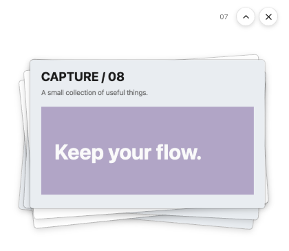

# 收纳区贴边位置、图片细边与复制后切换

日期：2026-10-28。工作区：Snipvia-public-baseline，分支 refactor/snipvia-v2，基于 HEAD 2c93e3a 及已有未提交修改。本轮没有提交、推送或发布。

## 实际修改

1. 贴边手柄始终根据折叠图堆计算位置。此前以当前窗口中心为锚点，展开成屏幕 3/4 高后手柄会下移。展开状态、折叠状态及自定义展开高度现在共用同一图堆锚点；保持原有屏幕工作区约束和悬停拉出逻辑。
2. 照片增加主题颜色的约 1 DIP 细边，保持透明面板、原色和比例。使用可保留小数精度的无模糊阴影环，并反向补偿卡片缩放，避免 Chromium 对 outline 取整后边缘变粗。长窄图片居中于原有最小操作区域，细边贴合图像，操作按钮仍保留可用的命中尺寸。居中预览也显示细边。
3. 收纳区单张复制（包括预览中的复制）、合并复制、全部复制接入现有 QuickTargetService。成功提交后异步通知选择条，复用已有目标、开关、倒计时、图标与权限设置，显示在来源收纳区所在屏幕顶部。不开启功能、没有目标、窗口未就绪或复制失败时不显示；不阻塞复制结果，不自动粘贴或发送。

全部复制仍是原始 PNG/JPEG 的独立文件引用，保持顺序、字节、缓存权限和延迟粘贴生命周期，不转为合并图。会话标记与文件列表在同一 ClipboardItem 中提交，不新增剪贴板项目；单图和合并图同样原子提交标记。开始新截图或新复制会使旧输出失效，避免迟到任务弹出选择条。导出文件不触发选择条。

## 文件记录

| 文件 | 修改 |
| --- | --- |
| src/main/windows/ShelfWindow.ts | 贴边手柄使用折叠图堆锚点 |
| src/renderer/src/collection/ScreenshotShelf.tsx、shelf.css | 图像尺寸、居中与细边，保留原命中区域 |
| src/main/index.ts | 三个收纳复制 IPC 共用复制后通知；选择来源屏幕 |
| src/main/quick-target/QuickTargetService.ts | 独立复制意图，复用原有过期和取消保护 |
| src/main/quick-target/clipboard-marker.ts | 图片及文件引用共用原子元数据构造 |
| src/main/storage/CollectionClipboard.ts | 可选元数据，不改变原有三参数调用和文件列表 |
| src/renderer/src/settings/QuickTargetSettings.tsx | 明确设置同时适用于收纳复制 |
| tests/unit/shelf-window.test.ts、quick-target-service.test.ts、quick-target-clipboard.test.ts、collection-clipboard.test.ts | 锚点、交叉过期、元数据、原图及缓存复用 |
| tests/integration/shelf-column-headless.spec.ts、quick-target-headless.spec.ts | 原生窗口位置、渲染细边、窄图及三条实际 IPC 链路 |
| docs/UI_DESIGN_LANGUAGE.md、PRIVACY.md | 同步当前行为和隐私边界 |

没有增加依赖、IPC 通道或设置文件，没有修改 App ID、用户数据目录、取帧、编码、快捷键或系统权限。

## 验证结果

- pnpm lint：通过。
- pnpm typecheck：通过；pnpm build：通过。
- pnpm test：50 个文件，281 项通过（新增 5 项）。
- quick-target-headless.spec.ts：通过，7.8 秒。真实 Main/Preload 的单图、合并图和独立文件复制均产生带标记的剪贴板事务并唤起同一选择条；核验文件列表包含全部 3 张合成图片、来源屏幕定位、失败不弹条及关闭开关不增加标记。
- shelf-column-headless.spec.ts：最终通过，14.1 秒。展开与折叠贴边后的原生坐标完全相同；细边实际缩放宽度约 1 DIP；长窄图按原图比例显示。保留单图复制、成功对号、排序、多选、全部原图字节校验、合并、导出、取消/失败、文件拖出、居中预览、透明窗口边界、悬停拉出不弹设置、设置重启恢复和确认清空等有效断言。
- 边框首次实现暴露 Chromium outline 取整问题，已修正绘制方式；新增窄图断言以原图比例验证，避免把经整数缩略图缩放后的比例当成原图；新增贴边循环等待实际展开动画结束后再检查普通应用激活。没有跳过或删除既有有效断言。

集成测试使用临时 userData、合成图片、模拟系统剪贴板/对话框及原生拖放接收端，不访问用户截图，不操作录屏、自动化或辅助功能授权。已验收的真实截图和浏览器跳转速度没有重复测试。本轮未新增 Windows、混合 DPI 或第三方输入框多文件粘贴的真机验收；原生文件格式的跨应用兼容性仍以目标应用支持为准。

上图为离屏 Electron 结果，背景 Alpha 为 0，查看器可能呈现黑色。

## 恢复记录

覆盖前的 16 个文件已保存在 Git 忽略目录 .dev-runtime/shelf-refinements/before-20261028-214958/，manifest.json 记录原始 SHA256。after-manifest.json 记录最终文件校验值及本轮新增文档、合成截图。

需要回退时先保全后续改动，再核对最终哈希，按清单恢复本轮覆盖的文件；新增文档和合成截图可按新增清单单独处理。不要使用 reset 或 clean，也不要覆盖此前快速切换、图标及权限修复的未提交修改。开发版沿用已有授权自动重载。
