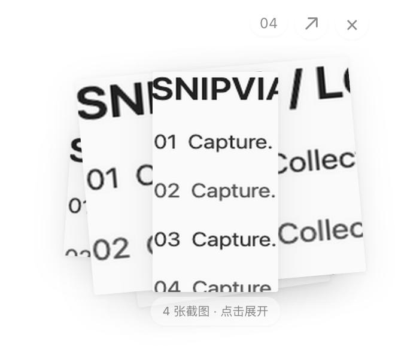
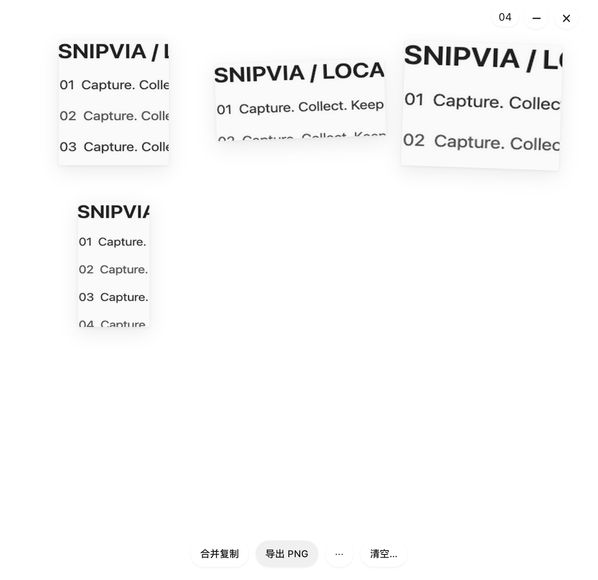

# 截图响应与透明图堆优化记录

> 后续审查更正：约 97ms 的 P95 来自模拟 Electron Collect，不代表实际 DEV + Command+1 + SCK + 真实剪贴板链路；当前仍有 Main 同步大图编码阻塞，见[完整截图链路审查](CAPTURE_CHAIN_AUDIT.md)。

日期：2026-10-24。工作目录为 Snipvia-public-baseline，分支 refactor/snipvia-v2，开始 HEAD 为 3cf4498。本次未提交、推送、打包、签名或发布；原有未提交清理和暂存区保持原状。

## 本次结果

- 截图入口移除重复 Dock 图标读取/写入；已隐藏 Overlay 不重复原生 hide；Shelf 预加载移出截图入口。收纳窗先零透明度、禁用焦点/鼠标，不阻塞首帧。
- 修复白闪根因：base.css 的 :root 背景优先级覆盖了原透明 html。Preload 和 bootstrap 在加载 Shelf 样式前标记专用 class，根节点、body 和 root 始终透明。收纳完成不先恢复旧面板。
- 飞入为 340ms 连续采样弧线与等比例缩放，cubic-bezier(.22,1,.36,1)；解码 → Main ACK → 播放 → 完成 ACK。旧动画取消、超时兜底和 Reduced Motion 保留。
- 收起显示最近 5 张错位图片；点击展开全部，再点单张平滑放大并读取原图，点图或 Esc 返回。无面板背景和外框，截图颜色/比例不变；按钮悬浮。
- 保留单张复制/贴图/删除、方向与拖拽排序、选择子集、合并、导出和确认清空。稳定 ID、revision、Pin 引用保护、32 张/256 MiB 边界保持。
- macOS Quick/Collect 完成后 app.hide 释放前台，再 showInactive 展示收纳反馈。Edit/Pin 保留原焦点流程；其他平台保留原生隐藏兜底。显式隐藏仍隐藏原生 Shelf。

## 实测与边界

数据与校验指纹见 [TRANSPARENT_SHELF_METRICS.json](TRANSPARENT_SHELF_METRICS.json)。M1 Pro / Electron 44.4.1 / 1728×1117 DIP / 2×；合成截图、临时用户目录、串行运行，前后各 10 次 Collect。P50 为中位数，P95 为 nearest-rank；10 次时 P95 即最大值。

| 指标 | 修改前 | 最终代码 |
| --- | ---: | ---: |
| Capture Start → Overlay Visible P50 | 89.26ms | 68.1ms |
| 同指标 P95 | 952.97ms | 96.54ms |
| Selection → Shelf Feedback P50 | 46.44ms | 35.48ms |
| 同指标 P95 | 116.16ms | 245.38ms |

最终首张反馈为 245.38ms，后 9 张最大 135.34ms。首次按需加载 Shelf 仍有成本；截图入口缩短不等于所有收纳延迟都已消失。原生焦点/窗口调用在中间方案出现过约 300–900ms 长尾，已保留本地诊断，不能把最优单次数据当作稳定 SLA。

透明背景在 500 次 RAF 采样中，根节点不透明计数为 0；实际 PNG 三个外部角点 Alpha 为 0。动画运行中收集 336 个 RAF 间隔，P50 8.3ms、P95 9.3ms、最大 13.1ms。这是隔离 Electron 样本，不代表所有设备帧率，也不是与 PixPin 的同机对照。

收起/展开原生视口一致，最多 680×660 DIP；收起图堆占右侧约 300×278 DIP。临时飞入窗口为截图显示器大小，完全鼠标穿透。稳定状态由 Main 每 32ms 检查有界卡片/控件区域，透明空白穿透。

## 验证

| 检查 | 结果及复用说明 |
| --- | --- |
| pnpm lint | 最终业务代码通过 |
| pnpm typecheck / pnpm build | 通过；build 前置执行 typecheck。Zod 两条既有 Rollup 注释警告；第三方声明 122 个版本、0 个缺失许可文件 |
| pnpm test | 本轮先前 30 个文件、169 项通过；最终原生窗口修改未改变单测输入，复用结果 |
| 受影响 Electron | 最终 11 项通过：提前框选 2、可见性 2、透明图堆 1、连续收纳 5、双应用系统焦点 1 |
| Dock 图标 | 最终独立 1 项通过；正常连续截图重复写图标次数为 0 |
| Electron 真机透明排除 | 通过；已有录屏权限，灰色合成背景上 3 次像素检查，无真实屏幕像素落盘 |
| ScreenCaptureKit 轻量真机 | 通过；Quick/Collect 各 2 次和取消，4 次实际 backend 均为 screen-capture-kit |
| 完整默认/高负载/安装包 | 未再次全量运行；不把跳过或未执行计为通过 |
| Windows / 实际多屏混合 DPI | 本轮未验收 |

合成测试覆盖透明帧、图片比例、展开不改变原生 bounds、原图预览、复制、角色越权、非成员 ID、非有限命中矩形、旧 presentation ACK、取消动画、隐藏/Reduced Motion、排序 revision、Pin 引用、合并 PNG、输出取消/失败及快捷键冲突。

双应用测试使用独立 Electron 和临时目录；只将自身测试 peer 切到前台，通过 macOS lsappinfo 读取前台 ASN，再核对退出后的系统前台和键盘焦点。生产客户端不调用该命令。真实截图检查禁用 trace/视频/截图持久化，不修改 TCC、系统权限或实际剪贴板。

## 文件级修改

| 文件 | 修改 |
| --- | --- |
| [src/main/index.ts](../../src/main/index.ts) | 收纳交接、按需预加载、Dock 缓存、退出前台、角色受限 IPC 和分段时序 |
| [ShelfWindow.ts](../../src/main/windows/ShelfWindow.ts) | 透明遮蔽、固定视口、反馈生命周期、命中区域、聚焦与穿透 |
| [capture-overlay-window.ts](../../src/main/windows/capture-overlay-window.ts) | 已隐藏窗口不重复 hide，仍保留真正退出和焦点路径 |
| [src/preload/index.ts](../../src/preload/index.ts) | Shelf 透明标记、窄化的复制/命中区域/完成 ACK 桥接 |
| [src/renderer/src/main.tsx](../../src/renderer/src/main.tsx)、[base.css](../../src/renderer/src/design/base.css) | 在样式加载前设置透明作用域，修复背景优先级 |
| [ScreenshotShelf.tsx](../../src/renderer/src/collection/ScreenshotShelf.tsx)、[shelf.css](../../src/renderer/src/collection/shelf.css) | 图堆、浮动操作、弧线飞入、稳定 ID 展开、原图与缩略图生命周期 |
| [src/shared/collection.ts](../../src/shared/collection.ts) | 区分反馈类型、状态/接口、视口与保比例卡片几何 |
| [collection-geometry.test.ts](../../tests/unit/collection-geometry.test.ts) | 正负屏幕边界、长/横/竖及极端比例 |
| [v2-continuous.spec.ts](../../tests/integration/v2-continuous.spec.ts) | 适配原位放大、显式贴图、状态提示与懒加载，保留原有效断言 |
| [transparent-shelf.spec.ts](../../tests/integration/transparent-shelf.spec.ts) | 新增透明、动画、IPC、穿透、原图、Dock/设置激活回归 |
| [capture-focus-return.spec.ts](../../tests/integration/capture-focus-return.spec.ts) | 新增双应用系统前台与焦点回归 |
| [capture-opacity-real.spec.ts](../../tests/integration/capture-opacity-real.spec.ts) | 新增无真实像素落盘的透明排除检查 |
| README、技术/设计文档、docs/ui/v2 | 当前行为、合成 UI 图片及本记录/指标 |

## 保留与安全

截图引擎 9 个文件、存储 5 个文件、更新 3 个文件、原生 Swift、编辑核心、旧数据服务、package.json 和锁文件均与任务前逐字节一致。当前暂存区与任务前 index.patch 一致。contextIsolation、sandbox、nodeIntegration=false、主 frame/角色校验、图片成员/revision/大小限制保留；无用户数据目录或身份变更，无数据迁移/删除、网络/账号/API Key 改动。

新增命中区域 IPC 只接受最多 100 个有界有限矩形，不提供任意鼠标/窗口/文件访问。缩略图缓存最多 32 项且随集合清理，原图 Blob URL 在退出预览或移除时释放。未新增常驻窗口：首次 Collect 后仍共四窗。

## 调试中淘汰的方案

仅把 Overlay 置透明而不真正退出的方案无法可靠恢复键盘焦点，未保留。仅延后原生 Shelf hide 的方案仍有窗口切换长尾，未保留。最终使用 macOS 原生 app.hide 释放前台；中间失败记录未删除，也未降低或跳过断言以获得通过。

## 回滚与后续验收

任务前恢复材料位于 .dev-runtime/transparent-shelf-before/：source.tar、sha256.json、index.patch、worktree.patch 和 status.txt。原始前/后性能记录、试验文件和合成 UI 证据也保留在该目录或 test-results。它们是本机恢复材料，不应提交为公开源码。

回滚先把 source.tar 解到新的临时目录，再按本表逐文件比对恢复；不要对现有工作区整体覆盖，更不要 git reset --hard 或 git clean。新增测试、文档与截图可独立撤回；任务前已有的大量清理和暂存文件必须保留。

下一步为人工试用手感、Windows 真机点击/透明穿透/快捷键、实际多屏与混合 DPI、横竖长图的飞入落点，以及同机 PixPin 对照。冷启动反馈和操作系统级偶发延迟仍属于性能边界；本轮没有将其描述为已彻底消除。
