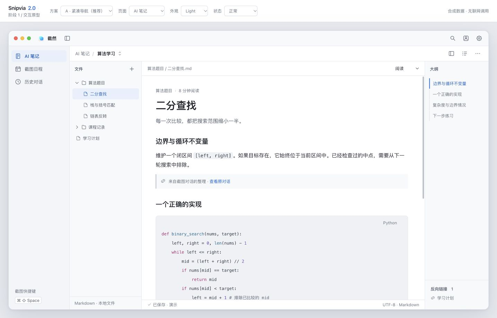
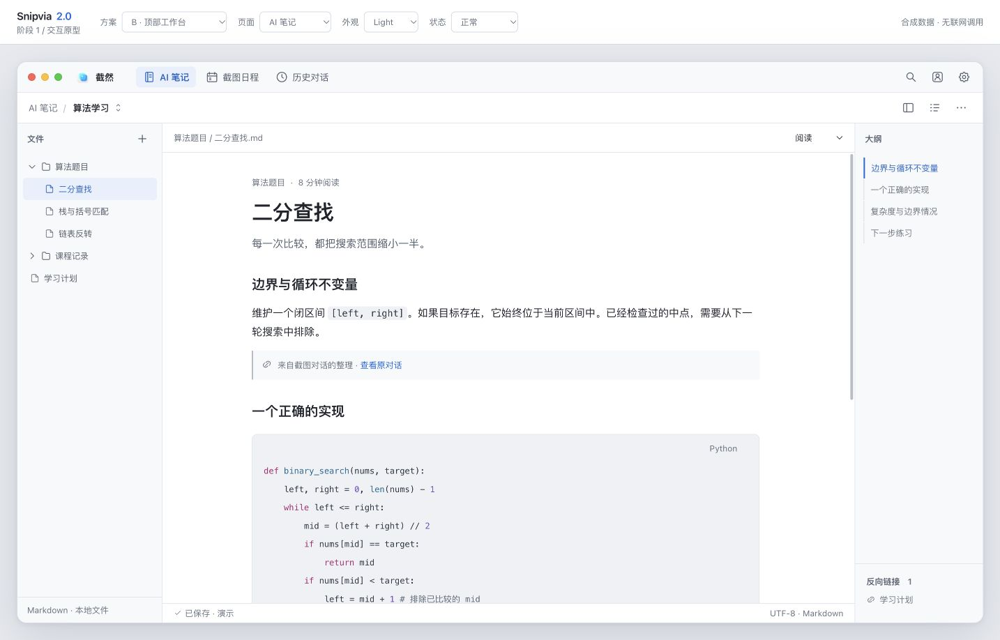
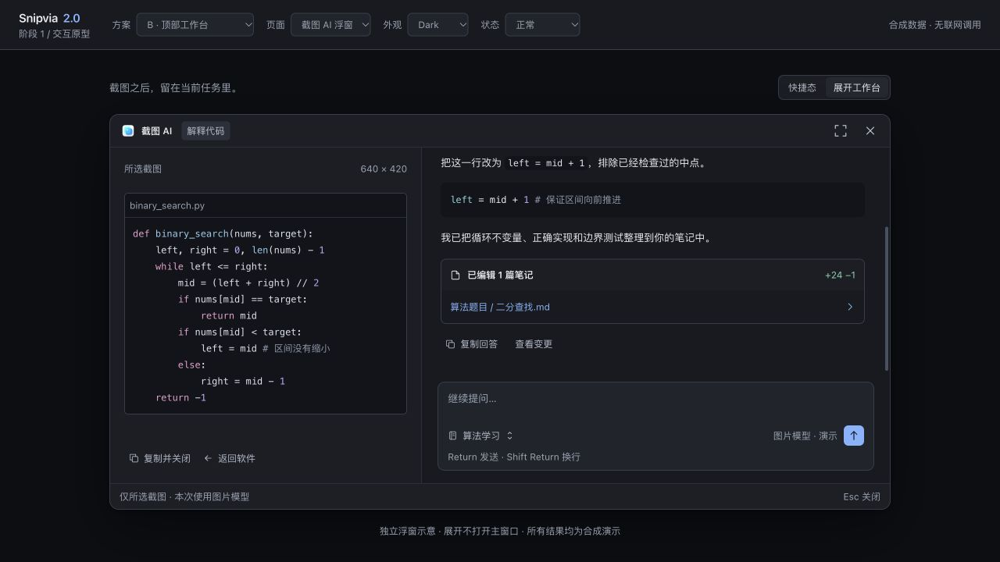

# UI 2.0 阶段 1 验证记录

日期：2026-10-09。验证对象是独立浏览器原型；**不是正式 Electron 2.0 已经完成或可发布的证明**。

## 结果

| 项目 | 结果 | 范围 |
| --- | --- | --- |
| 浏览器原型检查 | 33 项通过 | 10 项 A 布局五页亮暗呈现 + 23 项交互/状态检查 |
| 尺寸与外壳边界 | 40 组通过 | A/B × 五页 × 840×600、1120×780、1440×900、1920×1080 |
| 亮暗 Token | 各 43 个，键一致 | 两套独立颜色与阴影；System 解析为其中一套 |
| 文字对比度 | 48 组通过，最低 4.51:1 | 正文、次级、辅助、代码、选中、主要按钮、状态文字 |
| 页面控制台 | 无 warning/error | 浏览器此次合成数据演示范围 |
| 正式源文件完整性 | 197 个文件 hash 保持一致 | 客户端源文件、相关窗口、现有 UI 规范、官网源文件 |
| `pnpm lint` | 通过 | 项目与新增原型脚本 |
| `pnpm typecheck` | 通过 | 现有严格 TypeScript 配置 |
| `pnpm test` | 55 个测试文件、917 项通过 | 现有单元测试，没有真实 API Key 调用 |

证据：[浏览器检查与宽度轨迹](VALIDATION.json)、[文字对比](contrast.json)、[源文件完整性](production-integrity.json)。

命令使用 `pnpm_config_verify_deps_before_run=false` 运行。第一次受限环境运行单测时，16 项命令工具测试无法初始化项目自己的 macOS 沙箱；获得本机执行权限后完整重跑，917 项通过。没有因此改动业务代码或跳过失败测试。

未运行 Electron build/package/smoke：本轮没有修改正式 UI 或窗口；原型不能覆盖这些原生验收。

## 实际交互检查

- 主导航与文件列表收起采集到真实中间宽度，连续到 52px/约 0px。原型脚本在动画开始时以 requestAnimationFrame 记录尺寸，仅用于验证；不是依赖布局动画完成来推进业务。
- 笔记源码草稿在折叠与换主题后保留；正式 CodeMirror 的 undo 与点击测量仍需后续测试。
- 小窗口大纲默认隐藏，可主动浮出；展开浮窗在 840×600 预览范围内。
- 历史标题搜索生效，打开选中会话不离开列表。
- 初轮月历与草稿表单已验证；当前自动保存流程按最新反馈替代草稿确认，见下方复查。
- 设置的刷新按钮在模型选择左侧；API Key 字段 disabled，不收集凭据。
- 命令搜索可用键盘 Enter 打开历史。
- 空内容、加载、失败保留主导航；笔记空内容引导打开笔记本。
- 浮窗通过状态行显示正在编辑文件，状态结束后回复与已编辑文件入口出现。
- Return 不批准命令操作；无资格禁用 AI 输入。
- 关闭截图留在浮窗关闭示意，不自动打开主工作区；「返回软件」明确进入历史。
- System 与浏览器当前系统外观一致。本机系统为浅色，本轮没有更改 macOS 外观来验证热切换。

尺寸检查针对窗口框架与页面级溢出，不是每个任意长内容或所有弹层组合的证明。内部消息、日程和笔记可以滚动。

## 预览

顶端审查工具栏、灰色展示背景和 Web 红绿灯示意不属于最终客户端。

| 页面 | A Light | A Dark | B Light | B Dark |
| --- | --- | --- | --- | --- |
| AI 笔记 | [浅色](screenshots/a-notes-light.jpg) | [深色](screenshots/a-notes-dark.jpg) | [浅色](screenshots/b-notes-light.jpg) | [深色](screenshots/b-notes-dark.jpg) |
| 截图日程 | [浅色](screenshots/a-schedule-light.jpg) | [深色](screenshots/a-schedule-dark.jpg) | [浅色](screenshots/b-schedule-light.jpg) | [深色](screenshots/b-schedule-dark.jpg) |
| 历史对话 | [浅色](screenshots/a-history-light.jpg) | [深色](screenshots/a-history-dark.jpg) | [浅色](screenshots/b-history-light.jpg) | [深色](screenshots/b-history-dark.jpg) |
| 截图 AI 快捷态 | [浅色](screenshots/a-capture-light.jpg) | [深色](screenshots/a-capture-dark.jpg) | [浅色](screenshots/b-capture-light.jpg) | [深色](screenshots/b-capture-dark.jpg) |
| 设置 | [浅色](screenshots/a-settings-light.jpg) | [深色](screenshots/a-settings-dark.jpg) | [浅色](screenshots/b-settings-light.jpg) | [深色](screenshots/b-settings-dark.jpg) |

其他：[正在编辑文件](screenshots/a-capture-editing-light.jpg)、[浅色展开工作台](screenshots/a-capture-expanded-light.jpg)、[代码与表格浅色](screenshots/a-notes-code-light.jpg)、[代码与表格深色](screenshots/a-notes-code-dark.jpg)、[840px 大纲浮出](screenshots/a-notes-840-dark.jpg)、[840px 展开浮窗](screenshots/a-capture-840-dark.jpg)、[无资格状态](screenshots/a-capture-no-access-dark.jpg)。

## 标题栏调整复查（2026-10-09）

按设计反馈移除右上角「AI 截图」按钮，A/B 共用标题栏均已验证。两套布局的亮暗主题日程页仍保留「从截图创建」入口；更新了 16 张主窗口截图。JavaScript 语法检查和 `pnpm lint` 通过。本次仅修改独立原型与设计文档。

## 日程比例调整复查（2026-10-09）

本次历史复查时，月历与日期详情改为约 60% / 40%，日期格高度 48–64px，星期与日期保持居中对齐；「待核对」增加草稿确认说明。A/B、Light/Dark 在 840×600、1120×780、1920×1080 共 12 个尺寸组合检查通过，没有横向溢出。日期切换与草稿核对弹窗通过；更新 4 张日程截图。JavaScript 语法、`pnpm lint` 和 `pnpm typecheck` 通过，浏览器无错误日志。复查数据见 [日程检查记录](schedule-layout-validation.json)。本次未修改正式应用，未重复运行生产业务单元测试。

## 日程自动保存复查（2026-10-09，当前方案）

按用户反馈取消待核对列表、标签、视图切换和确认保存弹窗。A/B 的 Light/Dark 均已检查无残留入口；「从截图创建」经过合成识别后自动加入所选日期，计数与月历标记同步更新，不出现确认弹窗。重复创建不重复添加；已保存详情、截止事项、月份隔离与 840×600 无横向溢出检查通过。浏览器无错误日志，JavaScript 语法、`pnpm lint`、`pnpm typecheck` 通过。

复查数据见 [自动保存检查记录](schedule-auto-save-validation.json)，演示结果见 [自动加入日程截图](screenshots/a-schedule-auto-saved-light.jpg)。上方草稿确认检查保留为历史记录，当前方案已替代该流程。全部保存仅在原型内存中，正式客户端与真实日历尚未修改；本次未重复运行生产业务单元测试。

## 尚未验证

1. Electron 原生红绿灯、拖动区域、frameless 焦点、置顶、Spaces 与多屏。
2. 合并贴图与 QuickChat 后的 role、Agent owner 转移、resize 与关闭/取消时序。
3. macOS 与 Windows 的系统主题热切换、非活跃窗口选中与原生菜单。
4. 录屏/日历/钥匙串的真实权限交互，Windows 真机与混合 DPI。
5. CodeMirror 在正式 2.0 主题和动画下的点击测量、输入法、选区、undo、外部文件冲突。
6. 真正复制图片、文件拖拽/写入/撤销、API、验证码、会员资格与系统日历事务。
7. 超长文件树/历史、超长模型目录与长回答性能。
8. 减少动态效果 CSS 已审查；没有更改系统偏好做实机验证。

这些属于第二阶段的验收门槛，不能用上述浏览器检查宣称通过。
